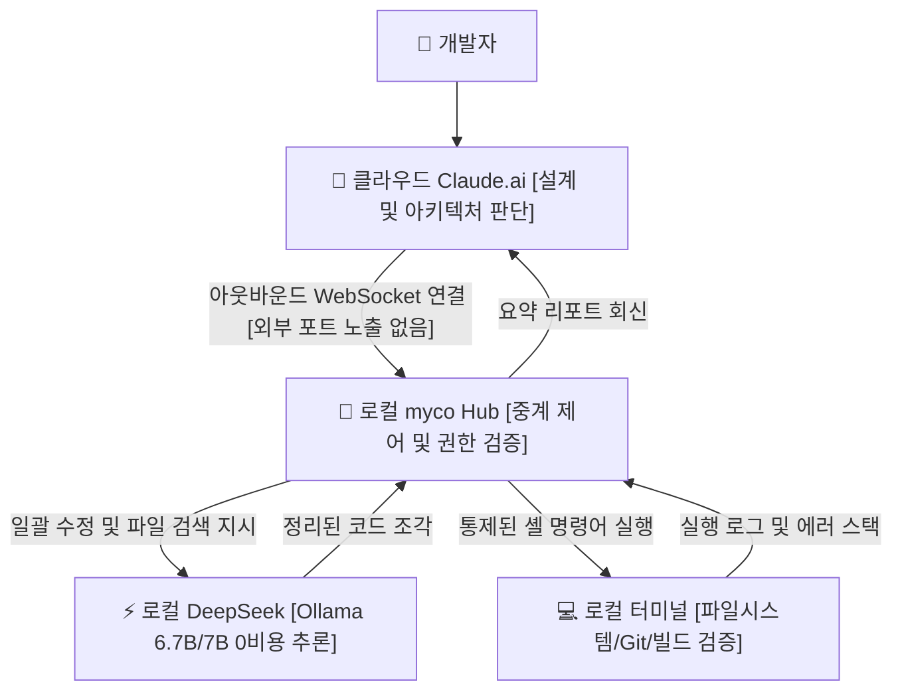

> 📌 **원문 안내**: 본 가이드는 [FreeAI Dog 공식 플랫폼](https://freeaidog.com/ko/blog/cloud-claude-local-deepseek-myco-hybrid-agent-guide/)에서 최초 발행되었습니다. 실시간 LLM 가용성 레이더 및 인터랙티브 테스트 도구는 공식 사이트를 방문하세요: [https://freeaidog.com/ko/](https://freeaidog.com/ko/).


# 클라우드 Claude가 기획하고 로컬 DeepSeek가 실행한다: myco 기반 포트 개방 없는 하이브리드 워크벤치 구축기

개발자의 토큰 한도를 가장 빠르게 바닥내는 주범은 깊이 있는 논리 추론이 아닙니다. 지극히 단순하고 기계적인 반복 작업입니다. `src` 폴더 깊숙한 곳에서 석 달 동안 방치된 컴포넌트 위치 찾기, Prisma 스키마 파일 안의 `user_id`를 `userId`로 일괄 치환하기, Vite 빌드 로그 300줄을 훑으며 순환 참조 추적하기 같은 일들입니다.

하루에도 스무 번씩 이런 작업을 클라우드에 던지며 파일 전체 코드를 복사해 붙여넣다 보면 피로감이 극에 달합니다.

매달 200달러를 내고 Claude Max를 쓰더라도, 대규모 코드 리팩터링 도중 5시간 45회 요청 제한 경고가 뜨는 순간 모든 작업이 멈춰 서게 됩니다.

그 시각 책상 아래에는 24GB VRAM을 갖춘 RTX 3090 워크스테이션이 조용히 대기하고 있습니다. Ollama로 `deepseek-coder:6.7b`나 `qwen2.5-coder:7b`를 상시 구동해도 메모리 점유율은 5.2GB 내외에 불과해 17GB 이상의 메모리가 그대로 방치됩니다.

일주일 중 닷새는 그래픽카드 쿨러 팬조차 돌지 않습니다. 전기세만 나가고 계산 능력은 놀고 있는 셈입니다.

클라우드의 Claude는 로컬 코드베이스에 닿지 못하고, 로컬 소형 모델은 복잡한 구조 설계를 소화하지 못합니다. 둘을 잇는 통로가 없으니 개발자가 직접 클립보드 배달부 역할을 해야 합니다. 파일 한두 개라면 참겠지만 십여 개가 넘어가면 하루 종일 복사 붙여넣기만 하다가 지쳐버립니다.

오픈소스 개발자 chenhg5가 GitHub에 공개한 `chenhg5/myco`는 바로 이 간극을 메워주는 실용적인 도구입니다.

핵심 원리는 명확합니다. 안전한 아웃바운드 장기 연결을 맺고 클라우드 Claude를 총괄 설계자로, 비용 없는 로컬 DeepSeek를 현장 작업자로 분업시키는 것입니다.



## 포트 포워딩이나 터널링을 피해야 하는 이유

역방향 터널을 뚫어 외부에 로컬 포트를 여는 방식은 저 역시 과거에 시도해 보았습니다.

작년에 ngrok으로 로컬 11434 포트를 이틀간 열어둔 적이 있었습니다. 사흘째 아침 로그를 열어보니 외부 IP에서 `/api/tags` 엔드포인트를 무단 스캔하고 의문의 모델 다운로드 요청을 던진 흔적이 남아 있었습니다. 침해 사고로 이어지진 않았지만 즉시 터널을 닫았습니다. 이후 시도한 frp와 IP 화이트리스트 구성도 세 시간 넘게 씨름해야 했고 보안 불안감은 가시지 않았습니다.

공용 인터넷에 포트가 노출된 이상 외부의 악의적인 포트 스캐닝을 완전히 피할 수 없습니다. AI 에이전트가 셸 스크립트를 직접 실행하는 환경에서는 작은 권한 허점 하나가 곧바로 개발 장비 탈취로 이어질 수 있습니다.

네트워크 대역폭 낭비도 심각합니다. 몇 줄의 코드 변경을 위해 수백 KB의 전체 소스코드가 인터넷을 오가야 합니다. 해외 통신 지연으로 타임아웃이 발생하고, 클라우드 콘텍스트 윈도가 무의미한 상용구 코드로 가득 차버립니다.

myco의 통신 구조는 정반대입니다. 로컬 클라이언트가 능동적으로 외부로 나가는 WebSocket 장기 연결을 수립합니다. 클라우드 서버는 로컬 공인 IP를 알 수 없으며, 공유기 포트포워딩 설정도 전혀 필요 없습니다. 기계적인 코드 수정은 사내망 내부에서 처리되고, Claude에게는 몇 줄의 실행 요약문만 전송됩니다.

## 4단계로 구성하는 하이브리드 파이프라인

복잡한 역방향 프록시나 외부 서버 대여 없이 다음 단계를 따라 몇 개의 명령어만 입력하면 곧바로 구동할 수 있습니다.

### 1단계: 로컬 Hub 데몬 구동

런타임 환경은 반드시 Node.js 20 LTS 버전을 선택해야 합니다. Node 18에서는 내장 WebSocket 처리 시 `undici` 호환성 경고가 발생하기 쉽고, 최신 Node 22에서는 `node-gyp` 컴파일 단계에서 `v8::Value` 폐기 심볼 에러가 발생하여 빌드가 멈춥니다.

소스 다운로드 및 빌드:

```bash
git clone https://github.com/chenhg5/myco.git
cd myco
npm install
npm run build
```

로컬 중계 허브 실행:

```bash
node dist/index.js start --port 8765 --workspace /Users/cool/projects
```

콘솔에 로컬 대기 주소인 `ws://127.0.0.1:8765`와 고유 인증 토큰이 출력됩니다.

### 2단계: 브라우저 Mixed Content 차단 우회

이 단계는 처음 세팅할 때 가장 흔하게 부딪히는 기술적 장벽입니다.

브라우저에서 접속하는 `https://claude.ai`는 보안이 엄격한 HTTPS 환경입니다. myco Hub가 기본값인 `ws://127.0.0.1:8765`로 일반 통신을 대기하면, Chrome이나 Edge 브라우저는 혼합 콘텐츠 [Mixed Content] 차단 정책을 적용해 연결을 강제로 끊어버리고 콘솔창에 온통 `SecurityError` 빨간 글씨를 띄웁니다.

해결 방법은 두 가지입니다.

첫 번째는 `mkcert` 도구를 사용해 `localhost` 전용 로컬 신뢰 인증서를 생성한 뒤 myco Hub를 `wss://127.0.0.1:8765` 보안 소켓으로 띄우는 것입니다.

두 번째는 제작자가 제공하는 전용 Chrome 확장 프로그램을 설치해 확장 프로그램의 백그라운드 Service Worker 권한을 거쳐 CORS 제약을 우회하는 것입니다.

저는 전자를 권장합니다. 로컬 인증서를 한 번 등록하면 2분 만에 끝나며 확장 프로그램의 잦은 업데이트를 신경 쓸 필요가 없습니다.

### 3단계: 권한 목록 및 로컬 모델 설정

터미널 권한을 AI에게 부여하는 만큼 경계선은 철저히 그어야 합니다.

설정 파일 `config.json`을 수정합니다:

```json
{
  "hub": {
    "port": 8765,
    "authToken": "myco_sec_token_9918"
  },
  "permissions": {
    "allowedDirectories": [
      "/Users/cool/projects/freeai-hub",
      "/Users/cool/projects/sandbox"
    ],
    "disallowedCommands": [
      "rm -rf /",
      "dd",
      "mkfs",
      "shutdown",
      "reboot"
    ],
    "autoConfirmReadOnly": true
  },
  "localWorker": {
    "engine": "ollama",
    "endpoint": "http://127.0.0.1:11434",
    "model": "deepseek-coder:6.7b"
  }
}
```

`allowedDirectories` 화이트리스트로 허용된 프로젝트 폴더 밖으로의 파일 조회를 차단하고, `disallowedCommands` 블랙리스트로 위험한 시스템 명령 실행을 사전 차단합니다.

로컬 모델은 Ollama를 통해 내려받습니다:

```bash
ollama pull deepseek-coder:6.7b
```

로컬 모델의 적정 크기는 어느 정도일까.

로컬 환경에 무리해서 33B나 70B 모델을 올리지 마십시오. 로컬 워커가 맡은 역할은 파일 탐색, 패턴 치환, 인터페이스 작성 같은 단순 반복 업무입니다. 핵심은 초당 45 토큰 이상의 빠른 응답 속도입니다. 70B 모델로 초당 몇 토큰 수준의 무거운 연산을 돌리면 클라우드 연결이 타임아웃으로 끊어져 하이브리드 구성의 이점이 사라집니다. 6.7B 모델은 RTX 3090에서 약 5.2GB 메모리만 점유하며 쾌적하게 동작합니다.

### 4단계: Claude 시스템 프롬프트 등록

웹 버전 Claude.ai의 Project 지침 또는 커스텀 인스트럭션에 다음 프롬프트를 입력합니다:

```markdown
당신은 총괄 소프트웨어 아키텍트입니다. 로컬 환경과 모델을 제어할 수 있는 myco_local 대리자를 보유하고 있습니다.
업무 분담 원칙:
1. 전체 시스템 설계, 인터페이스 정의, 심층 논리 추론은 당신이 직접 수행합니다;
2. 파일 탐색, 일괄 문법 치환, 단위 테스트 실행 시 대화창에 장문의 코드 전문을 출력하지 말고 로컬 실행용 명령을 생성하십시오;
3. 로컬 작업이 완료되면 반환된 테스트 로그와 요약문만 검토하여 최종 승인하십시오.
```

라우팅 모듈 리팩터링을 예시로 Claude에게 다음과 같이 요청합니다:

`"routes 폴더 내 모든 파일의 any 타입을 검사하여 엄격한 interface로 변경하고 로컬 타입 체크를 수행해 줘."`

Claude는 먼저 4개 열로 구성된 작업 목록을 정리합니다: 파일 경로, 수정 대상 인터페이스, 의존성 모듈, 검증 조건. 검토 후 로컬로 지시가 전달됩니다.

로컬 myco는 `grep`을 통해 수정 대상 14개 파일을 수초 만에 색인합니다. 로컬 DeepSeek가 파일을 차례대로 읽어 타입을 수정한 뒤 디스크에 저장합니다. 이후 터미널에서 자동으로 `npm run check`가 구동됩니다.

클라우드로 반환되는 텍스트는 단 세 줄입니다: 테스트 통과, 14개 파일 수정 완료, TypeScript 에러 0건. Claude는 요약문만 확인하고 완료 처리합니다. 창을 오가며 손으로 붙여넣던 방식에 비해 압도적으로 편리합니다.

## 실제 사용량 장부와 통계 기준 설명

일주일 동안 사용량을 점검한 결과, Claude의 일일 입력 토큰은 30만 개 이상에서 6만 개 안팎으로 대폭 줄었습니다. Anthropic 관리 콘솔이 세션 단위로 분할되어 수동 합산한 근사치이지만 토큰 절감 효과는 매우 체감됩니다.

무엇보다 작업을 가로막던 429 요청 한도 초과 오류가 일주일 내내 단 한 번도 발생하지 않았습니다.

물론 재작업 비용도 투명하게 밝힙니다. 로컬 모델이 함수 시그니처를 잘못 수정한 사례가 두 차례 있어 클라우드에서 다시 검토해야 했고, 이로 인해 절감 효과의 약 10% 정도가 상쇄되었습니다. 과장된 85% 절감보다 실질적인 75% 절감으로 이해하는 것이 솔직한 수치입니다.

| 평가 지표 | 클라우드 Claude 단독 사용 | myco 하이브리드 모드 | 차이 및 실무적 의미 |
| :--- | :--- | :--- | :--- |
| **일일 클라우드 토큰 소모** | 약 300,000+ 토큰 | 약 60,000 토큰 내외 | **수동 세션 합산 기준 약 75% 절감** |
| **429 요청 한도 초과 횟수** | 매일 수차례 발생 | 일주일 통틀어 0회 발생 | **단순 반복 작업을 사내망으로 이전** |
| **코드 보안 및 프라이버시** | 전체 코드가 외부망을 반복 왕복 | 로컬 디스크 내부에서 완결 처리 | **소스는 로컬 유지, 요약문만 회신** |
| **로컬 그래픽카드 활용도** | 24GB VRAM 온종일 방치 | 6.7B 모델이 5.2GB로 작업 분담 | **잠자던 GPU 연산 자원 극대화** |

## 실무 엔지니어링 주의점과 하드웨어 한계

현장에서 직접 겪은 두 가지 주의점을 공유합니다:

첫째, 노트북 덮개를 닫아 절전 모드로 진입하면 연결된 WebSocket은 `ECONNRESET` 에러와 함께 즉시 끊어집니다. 자동 복구에 의존하지 말고 시작 셸 스크립트에 5초 대기 재시도 루프를 감싼 뒤 pm2 같은 프로세스 관리자로 데몬을 유지하십시오.

둘째, 자동 수정이 완료된 후 커밋하기 전에 반드시 `git diff`를 육안으로 확인하십시오. 언더스코어 표기법을 카멜케이스로 일괄 치환할 때 외부 API가 반환하는 원본 JSON 필드명까지 잘못 바꾸는 경우가 생기며, 이는 타입 검사기로도 잡아내기 어렵습니다.

RTX 3090이나 16GB 이상 메모리를 가진 데스크톱 환경이 있다면 이 구성은 귀찮은 작업들을 확실하게 덜어줍니다. 반면 내장 그래픽을 탑재한 노트북에서 CPU 연산에 의존할 경우 응답 지연으로 인해 작업 효율이 오히려 떨어질 수 있습니다.

평소 개발 과정에서 가장 많은 토큰을 낭비하게 만드는 단순 반복 작업은 무엇인가요. 놀고 있는 그래픽카드 활용법에 대해 커뮤니티에서 다양한 의견을 나눠주시기 바랍니다.

---

> 💡 **원문 출처 및 실시간 모니터링**：
> - 원문 출처: [FreeAI Dog 공식 블로그](https://freeaidog.com/ko/blog/cloud-claude-local-deepseek-myco-hybrid-agent-guide/)
> - 무료 대형 언어 모델 실시간 가용성 및 지연 시간 측정은 [FreeAI Dog 가용성 레이더](https://freeaidog.com/ko/radar/)에서 확인하세요.

