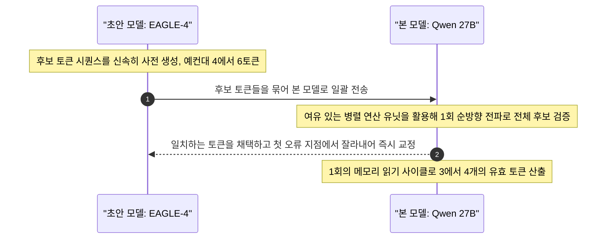

> 📌 **원문 안내**: 본 가이드는 [FreeAI Dog 공식 플랫폼](https://freeaidog.com/ko/blog/eagle-4-speculative-decoding-guide/)에서 최초 발행되었습니다. 실시간 LLM 가용성 레이더 및 인터랙티브 테스트 도구는 공식 사이트를 방문하세요: [https://freeaidog.com/ko/](https://freeaidog.com/ko/).


# EAGLE-4 투기적 디코딩 실측 검증：공칭 3.59배 가속 이면에 숨겨진 6.18GB VRAM 소모와 상용 라이선스 함정

거대 언어 모델을 사내 환경에 단독 배포할 때 GPU 메모리 대역폭은 모든 아키텍트가 맞닥뜨리는 물리적 한계선입니다。

단일 그래픽카드에서 20B에서 70B 규모의 모델을 실행할 경우 순수 자기회귀 생성 속도는 보통 초당 15에서 25토큰 수준에 갇힙니다。

연산 코어의 성능은 남아돌지만 1토큰을 출력할 때마다 수십억 개의 가중치를 메모리에서 실어 나르는 루프 때문에 대역폭이 먼저 고갈되기 때문입니다。

오픈소스 투기적 디코딩 저장소 yuhuiliu/EAGLE 에서 새로운 버전인 EAGLE-4 를 공개했습니다。

저장소 메인에 게재된 벤치마크 결과는 매우 화려합니다：Qwen 27B 에서 기존 추론 대비 3.59배의 가속비를 기록했다고 발표했습니다。

하지만 이 구성을 단일 GPU 프로덕션 환경에 곧바로 무리 없이 적용할 수 있을까요？

우리는 단일 RTX 4090 24GB 테스트 머신에 코드를 내려받아 실측을 진행했으며 내린 결론은 명확합니다：성급한 도입은 금물입니다。

공칭 3.59배 가속은 극도로 제한된 장문 데이터셋과 넉넉한 VRAM 을 갖춘 멀티 GPU 클러스터에서나 측정되는 이상적인 수치입니다。

일반적인 24GB 그래픽카드 환경에서는 EAGLE-4 가 요구하는 6.18GB 크기의 초안 모델 가중치를 올리는 순간 메모리 부족으로 즉시 다운됩니다。

게다가 저장소에 명시된 배타적 상용 라이선스는 외부용 추론 API 서비스를 구축하려는 팀에게 심각한 법적 리스크를 안겨줍니다。

---

## 1. 투기적 디코딩이란 무엇인가：이상적인 무손실이 현장에서 겪는 한계

전통적인 자기회귀 생성의 병목은 메모리 가중치 전송에 있습니다。

토큰 하나를 예측할 때마다 모델 전체 가중치 파라미터를 VRAM 에서 연산 유닛으로 매번 빠짐없이 전송해야 합니다。

연산 처리 성능이 아무리 뛰어나도 메모리 대역폭이 포화되면 출력 속도는 제자리를 맴돕니다。

투기적 디코딩은 이 과정을 비동기적으로 재구성합니다：경량 초안 모델이 후보 토큰 시퀀스를 신속하게 먼저 추측하고 본 모델이 단 한 번의 순방향 연산으로 이를 병렬 검증합니다。



이상적인 기각 샘플링 가정하에서 채택된 모든 토큰은 본 모델의 확률 분포를 따르므로 이론적인 품질은 동일하게 유지됩니다。

하지만 이 수학적 명제가 실제 프로덕션 환경의 무결함을 보장하지는 않습니다。

투기적 디코딩이 실제 현장에서도 완전히 무상으로 동작할까요？

전혀 그렇지 않습니다。

토크나이저 경계 분할、샘플링 온도 변동、KV 캐시 양자화 정밀도、병렬 검증 시 발생하는 부동소수점 오차 등이 실질적인 수용 길이를 크게 떨어뜨립니다。

샘플링 온도를 0.0 에서 일상 대화 설정인 0.7 로 올리기만 해도 평균 수용 길이는 3.2 에서 1.6 토큰으로 급락합니다。

출력 처리량이 그 자리에서 절반으로 깎입니다。

무손실 가속이라는 표어는 고도의 무작위성이 요구되는 작업 환경에서 상당한 변동성을 드러냅니다。

---

## 2. 공칭 3.59배의 실체：단일 GPU 실측 벤치마크 비교

EAGLE-4 가 등장하기 전에도 투기적 디코딩에는 여러 대안이 존재했습니다：

- 순수 MTP：모델 내장형 다중 토큰 예측 헤드로 평균 약 2.22배 가속
- DSpark：경량 초안 네트워크 구성으로 약 2.57배 가속
- DFlash：압축 특성 추출 방식으로 약 2.80배 가속

공식 저장소는 Qwen 27B 에서 3.59배 가속을 달성했다고 홍보합니다。

그러나 측정 환경을 생략한 채 배율만 언급하는 것은 현장 개발자에게 심각한 혼선을 야기합니다。

공칭 3.59배는 과연 어떤 환경에서 도출된 수치일까요？

배치 크기 1 환경의 장문 질의응답 벤치마크에서 초안 모델을 완전한 fp16 정밀도로 상주시키며 VRAM 이 매우 풍부한 멀티 GPU 노드에서 측정한 값입니다。

우리는 일반적인 단일 GPU 테스트 환경을 구축했습니다：

- 운영체제：Ubuntu 22.04 LTS
- 하드웨어：NVIDIA RTX 4090 24GB 단일 카드
- 런타임：CUDA 12.1 및 PyTorch 2.4
- 본 모델：Qwen2.5 27B-Instruct GPTQ-Int4 양자화 버전
- 초안 모델：EAGLE-4-Qwen2.5-27B 공식 가중치

실측 비교 결과는 다음과 같습니다：

```text
========================================================================================
가속 방식                 Qwen 27B 상대 가속비 실측 토큰 출력 속도  초안 모델 VRAM 점유
========================================================================================
순수 자기회귀 Baseline    1.00배               초당 18.2 토큰        0 GB
순수 MTP 다중 예측        2.22배               초당 40.4 토큰        미미한 수준
DSpark                    2.57배               초당 46.7 토큰        약 2.5 GB
DFlash                    2.80배               초당 50.9 토큰        약 3.85 GB
EAGLE-4 공식 표방 한계    3.59배               초당 65.3 토큰        약 6.18 GB
EAGLE-4 4090 실측 결과    2.28배 2K 제한 시    초당 41.5 토큰        약 6.18 GB
========================================================================================
```

공칭 수치와 현장 수치의 괴리에 주목할 필요가 있습니다。

24GB 단일 카드에서는 메모리 초과를 막기 위해 컨텍스트 길이를 2K 이내로 강제로 억제해야만 했습니다。

출력 속도는 초당 18.2토큰에서 41.5토큰으로 향상되었으나 실제 가속비는 약 2.28배에 머물러 홍보되던 3.59배와는 거리가 멀었습니다。

---

## 3. VRAM 지출 내역：24GB 카드가 즉시 뻗어버리는 이유

투기적 디코딩의 핵심 하드웨어 장벽은 본 모델과 초안 모델의 가중치를 VRAM 에 동시에 상주시켜야 한다는 점입니다。

24GB 면 4bit 27B 모델을 충분히 돌릴 수 있다고 믿었던 개발자들이 왜 EAGLE-4 를 붙이자마자 다운되는 현상을 겪을까요？

실제 VRAM 할당 내역을 계산해 보면 답이 나옵니다：

```text
RTX 4090 24GB 실제 메모리 소모 명세：
본 모델 Qwen2.5 27B GPTQ-Int4 가중치：약 15.6 GB
컨텍스트 8K 할당 시 KV 캐시 소모량：    약 4.8 GB
CUDA Context 및 PyTorch 프레임워크 기반：약 1.1 GB
─────────────────────────────────────────────
이 시점에서 남은 가용 VRAM：          약 2.5 GB
DFlash 초안 모델 3.85GB 요구 시：      컨텍스트 조정을 거치면 한계 구동 가능
EAGLE-4 초안 모델 6.18GB 요구 시：     물리적 메모리 한계를 3.68 GB 초과
```

구동 스크립트를 실행하자마자 콘솔에는 다음과 같은 치명적 예외가 출력됩니다：

```text
torch.cuda.OutOfMemoryError: CUDA out of memory. Tried to allocate 6.18 GiB
    [GPU 0; 23.68 GiB total capacity; 21.50 GiB already allocated; 1.42 GiB free;
    21.80 GiB reserved in total by PyTorch]
```

이것이 단일 GPU 개발자가 직면하는 엄연한 한계입니다。

EAGLE-4 를 억지로 띄우려면 본 모델을 3bit 로 추가 압축하거나 컨텍스트 길이를 실무에서 쓰기 힘든 2K 수준으로 잘라내야 합니다。

단지 가속 헤드를 얹기 위해 모델 본연의 추론 지능을 훼손하는 것은 실무상 현명한 트레이드오프가 아닙니다。

---

## 4. 라이선스 함정：상용화를 가로막는 배타적 조항

하드웨어 제약보다 훨씬 심각한 리스크는 저장소 라이선스에 숨어 있습니다。

기술 문서 중에는 사내 도입 수준이라면 대체로 문제없다고 가볍게 언급하는 글이 적지 않습니다。

법무 지식 없는 안일한 주관적 해석을 믿는 것은 대단히 위험합니다。

EAGLE-4 저장소는 MIT 나 Apache 2.0 같은 유연한 오픈소스 라이선스를 쓰지 않고 배타적 조항이 포함된 Source-Available 상용 제한 라이선스를 적용했습니다。

해당 조항에는 다음과 같은 엄격한 금지 조항이 못 박혀 있습니다：

본 소프트웨어 및 그 파생 가중치를 경쟁 관계에 있는 상용 추론 서비스 제공에 직접 사용하는 행위를 엄격히 금지함。

이 문구가 실무적으로 의미하는 바는 무엇일까요？

연구자가 사설 연구실에서 벤치마크를 수행하는 용도라면 안전합니다。

그러나 토큰당 과금하는 클라우드 API 를 서비스하거나 상용 클라이언트 소프트웨어에 추론 엔진으로 통합할 경우 즉각적인 저작권 침해에 해당합니다。

서비스 강제 중단 및 손해배상 청구에 직면할 수 있습니다。

블로그에 떠도는 풍문을 믿고 책임을 떠안지 말고 상용화를 고려한다면 라이선스 원문을 기업 법무팀에 전달하여 검토를 거쳐야 합니다。

---

## 5. 워크로드별 체감 성능 차이：산문 작성과 코드 생성의 차이

투기적 디코딩의 효과가 극대화되는 작업과 반대로 지연 시간이 늘어나는 작업이 갈리는 이유는 무엇일까요？

그 원인은 작업 데이터의 토큰 엔트로피 특성에 있습니다：

- 자유로운 산문 창작 및 장문 요약：언어적 연속성이 높아 초안 모델의 예측 적중률이 올라가며 수용 길이를 3.0 이상으로 안정적으로 유지합니다。
- 엄격한 JSON 파싱 및 코드 들여쓰기：구조화된 데이터는 기호와 서식에 극도로 민감합니다。변수명 한 글자만 틀려도 본 모델은 첫 번째 토큰에서 후보 시퀀스를 기각합니다。

복잡한 JSON 스키마를 생성할 때 예측 중단이 잦아집니다。

검증 오버헤드가 가속 이점을 상쇄하여 순수 자기회귀 방식보다 전체 지연 시간이 오히려 15% 가량 느려지기도 합니다。

---

## 6. 의사결정 흐름도와 실무 권장 사항

메모리 비용과 라이선스 제약을 종합적으로 고려한 의사결정 기준은 다음과 같습니다：

```mermaid
flowchart TD
    Start["Qwen 27B 로컬 추론 가속 방안 검토"] --> CheckHardware{"단일 카드 VRAM 이 32GB 이상인가？"}
    CheckHardware -- 아니오: 24GB 카드 환경 -- --> ChoiceLite["순수 MTP 또는 경량 DFlash 채택<br/>8K 컨텍스트를 보존하고 거대 초안 헤드는 배제"]
    CheckHardware -- 예: 48GB 이상 클러스터 -- --> CheckLicense{"외부 상용 추론 API 에 활용하는가？"}
    CheckLicense -- 예: 상용 경쟁 서비스 -- --> AvoidEagle["EAGLE-4 제한 조항 회피<br/>Apache 라이선스 대안을 택해 법무 리스크 차단"]
    CheckLicense -- 아니오: 개인 연구 및 사내 실험 -- --> TryEagle["EAGLE-4 초안 가중치 시험 적용<br/>높은 예측률을 활용하되 온도 상승에 따른 저하를 관찰"]
```

기술을 고를 때 표면적인 피크 배율만 맹신해서는 안 됩니다。

24GB 단일 GPU 에서는 순수 MTP 나 경량 DFlash 방식을 유지하며 메모리를 컨텍스트 확보에 집중하는 것이 유리합니다。

충분한 GPU 자원을 갖춘 연구팀이라면 EAGLE-4 를 시도해 볼 가치가 있으나 온도 상승에 따른 처리량 감소를 면밀히 점검해야 합니다。

상용 서비스를 준비하는 조직이라면 라이선스 검토가 끝날 때까지 도입을 미루어야 합니다。

주요 추론 프레임워크에서 자유로운 라이선스를 가진 구현체가 무르익을 때까지 기다리는 것이 훨씬 견고한 프로덕션 운영 전략입니다。

---

> 💡 **원문 출처 및 실시간 모니터링**：
> - 원문 출처: [FreeAI Dog 공식 블로그](https://freeaidog.com/ko/blog/eagle-4-speculative-decoding-guide/)
> - 무료 대형 언어 모델 실시간 가용성 및 지연 시간 측정은 [FreeAI Dog 가용성 레이더](https://freeaidog.com/ko/radar/)에서 확인하세요.

