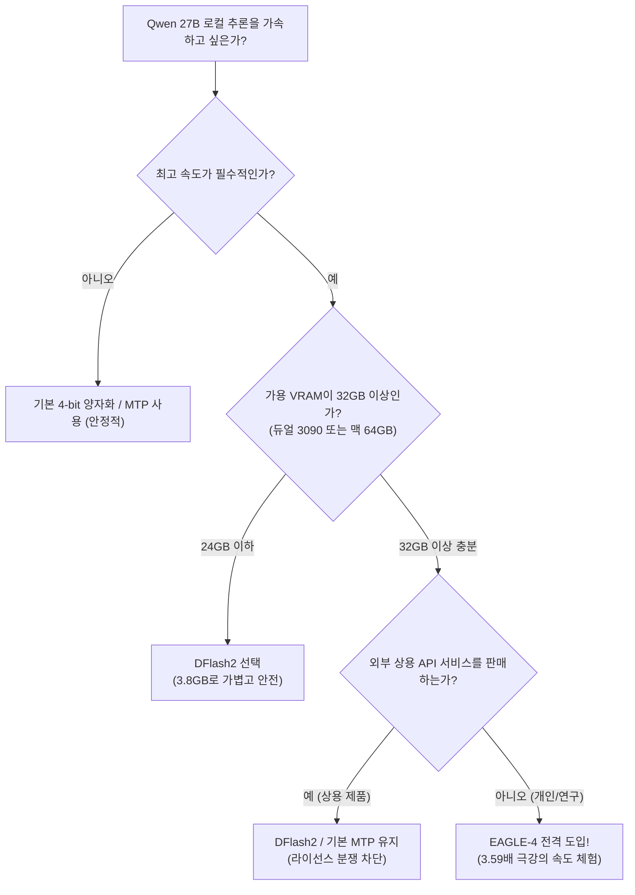

# 로컬 거대 모델 추론 3.59배 가속: EAGLE-4 투기적 샘플링 실측 및 VRAM/라이선스 함정 가이드

> **머리말**: 로컬 PC나 자체 서버에서 20B~70B 규모의 오픈소스 대형 언어 모델을 돌려보신 분이라면, 초당 15~20 토큰 수준으로 글자가 한 자씩 답답하게 출력되는 경험을 해보셨을 것입니다.
> 
> 이 추론 병목을 극복할 최신 기술로 **'EAGLE-4'가 공식 출시**되었습니다. 벤치마크 결과, 널리 쓰이는 Qwen 27B 모델에서 기본 대비 무려 **3.59배**의 가속비를 기록하며 기존 DFlash2와 DSpark를 가뿐히 제쳤습니다.
> 
> 하지만 세상에 공짜 점심은 없습니다. 커뮤니티 실측 결과, **6GB가 넘는 막대한 추가 VRAM 부담**과 **상용 추론 서비스를 명시적으로 금지하는 소스 가용(Source-Available) 라이선스**라는 두 가지 복병이 도사리고 있습니다. FreeAI Dog가 실측 데이터와 실전 판단 기준을 명쾌하게 정리해 드립니다.

---

## 1. 투기적 샘플링(Speculative Decoding)이란?

일반적인 자기회귀(Auto-regressive) 생성 방식에서는 토큰을 하나 생성할 때마다 수십억 개의 모델 가중치를 VRAM에서 연산 코어로 전부 읽어와야 합니다. 즉, 속도의 발목을 잡는 것은 연산력이 아니라 **메모리 대역폭(Memory-bound)**입니다.

**투기적 샘플링**은 '추측과 검증의 분업'으로 이를 해결합니다:
1. **가벼운 초안 모델(EAGLE-4)**이 여러 개의 후속 토큰(4~6개 단어)을 빠르게 선제 추측;
2. **주력 모델(Qwen 27B)**이 단 한 번의 병렬 연산으로 이 후보군들을 동시 검증;
3. 일치하는 단어들을 한꺼번에 채택하고 오류 지점에서 즉시 교정. 단 한 번의 메모리 왕복으로 3~4개 단어가 확정됩니다.

가장 놀라운 점은 **수학적으로 완벽한 무손실(Lossless)**이라는 사실입니다. 주력 모델의 확률 분포에 의해 엄격히 검증되므로, 기존 방식과 출력 품질이 100% 동일합니다.

---

## 2. EAGLE-4 벤치마크: 3.59배 가속의 파괴력

| 가속 방식 | Qwen 27B 상대 가속비 | 예상 생성 속도 (20 t/s 기준) | 초안 모델 추가 VRAM |
| :--- | :---: | :---: | :---: |
| 기존 순차 생성 (Baseline) | 1.00× | 20 t/s | 0 GB |
| 기본 MTP 헤드 | 2.22× | 44 t/s | 극소 (내장) |
| DSpark | 2.57× | 51 t/s | ~2.5 GB |
| DFlash2 | 2.80× | 56 t/s | **~3.85 GB** |
| 👑 **EAGLE-4 (신규 챔피언)** | **3.59×** | **71.8 t/s** | **~6.18 GB** ⚠️ |

초당 20토큰에서 **초당 70토큰 이상**으로의 도약은, 한 줄씩 기다리던 답답함이 문단 단위로 화면에 즉시 쏟아지는 시각적 혁신을 선사합니다.

---

## 3. 서둘러 도입하기 전 반드시 알아야 할 2대 함정

### 함정 1: 6.18GB VRAM 폭탄 (24GB 단일 그래픽카드 OOM 발생)

투기적 샘플링을 돌리려면 주력 모델과 초안 모델이 **VRAM에 동시에 상주**해야 합니다.

- DFlash2의 초안 모델은 약 **3.85 GB** 수준이었습니다;
- 반면 EAGLE-4는 높은 적중률을 달성하기 위해 초안 모델 용량이 **6.18 GB**까지 부풀었습니다.

```
【RTX 3090 / 4090 (24GB VRAM) 실제 배치 계산】：
주력 모델 Qwen 27B (4-bit 양자화): 약 15.5 GB
KV 캐시 (8k~16k 컨텍스트 확보): 약 4.5 GB
시스템 및 PyTorch 기본 점유:       약 1.0 GB
─────────────────────────────────────────────
남은 여유 VRAM: 약 3.0 GB
💥 DFlash2 (3.85GB) ➔ 컨텍스트 조율로 아슬아슬하게 수용 가능
❌ EAGLE-4 (6.18GB) ➔ 100% CUDA 메모리 부족(OOM) 튕김!
```

24GB 단일 카드 환경에서 EAGLE-4를 얹으려면 주력 모델을 3-bit 이하로 무리하게 깎거나 컨텍스트를 극도로 제한해야 합니다. 따라서 **단일 24GB 카드에서는 DFlash2가 여전히 가장 실용적인 대안**입니다.

---

### 함정 2: 라이선스 지뢰밭 (Source-Available, 상용 추론 서비스 금지)

EAGLE-4 깃허브 저장소는 자유 오픈소스(MIT/Apache)가 아닌 **독자적 소스 가용 라이선스**를 채택하고 있습니다.

> 🚫 **"본 소프트웨어 또는 그 파생물을 사용하여 경쟁적인 상용 추론 서비스를 제공하는 행위를 엄격히 금지함"**

- 개인 연구, 학습, 취미 로컬 구동: 문제없이 허용
- 유료 SaaS API 래퍼, 상용 클라우드 서비스 탑재: **심각한 저작권 침해 및 법적 리스크**

---

## 4. 기술 선택 가이드



로컬 장비 구축이나 VRAM 압박 없이 초고속 추론을 누리고 싶다면, [FreeAI Dog 홈](/)에서 안내하는 **Groq** (전용 LPU로 초당 500+ 토큰 폭주)나 **Cerebras / 실리콘플로우**의 무료 고속 API를 활용해 로컬 자원 소모 없이 0원으로 쾌적하게 활용해 보세요!

---

> 💡 **원문 출처 및 실시간 모니터링**：
> - 원문 출처: [FreeAI Dog 공식 블로그](https://freeaidog.com/ko/blog/eagle-4-speculative-decoding-guide/)
> - 무료 대형 언어 모델 실시간 가용성 및 지연 시간 측정은 [FreeAI Dog 가용성 레이더](https://freeaidog.com/ko/radar/)에서 확인하세요.
