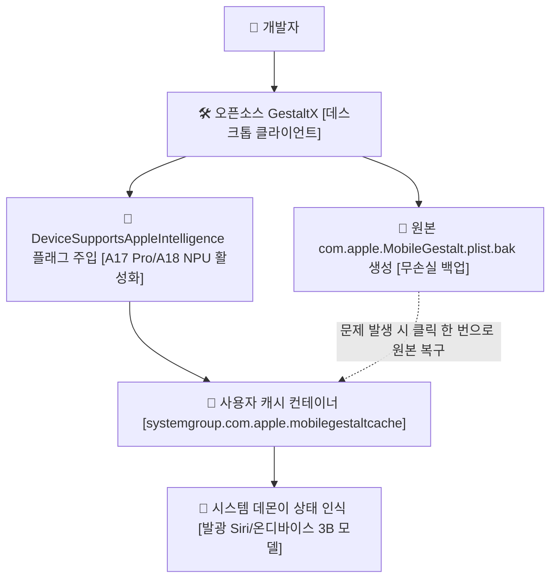

> 📌 **원문 안내**: 본 가이드는 [FreeAI Dog 공식 플랫폼](https://freeaidog.com/ko/blog/gestaltx-iphone-apple-intelligence-unlock-guide/)에서 최초 발행되었습니다. 실시간 LLM 가용성 레이더 및 인터랙티브 테스트 도구는 공식 사이트를 방문하세요: [https://freeaidog.com/ko/](https://freeaidog.com/ko/).

# 탈옥 없이 무손실 복구: 오픈소스 GestaltX로 특정 지역 아이폰의 온디바이스 Apple Intelligence 활성화하기

중국 본토판 iPhone 15 Pro나 iPhone 16 기기를 손에 쥐어보면 설정 창 어디에서도 Apple Intelligence나 발광하는 Siri 메뉴를 찾아볼 수 없습니다. A17 Pro와 A18 칩셋에 탑재된 16코어 Neural Engine은 35 TOPS의 연산 능력을 자랑하지만 일상적인 메신저 입력이나 웹서핑 중에는 완전히 방치되어 있습니다. 기기 제값을 다 주고도 잠재력을 쓰지 못하는 현실은 씁쓸할 수밖에 없습니다.

이는 하드웨어 자체의 결함이 아니라 `MobileGestalt` 파일 내부의 기능 지원 불리언 값이 false로 잠겨 있기 때문입니다. 온디바이스에서 구동되는 3B 파라미터 기반 모델 가중치 파일은 이미 시스템 이미지 내에 들어 있으며 단지 활성화 플래그가 비활성화되어 있을 뿐입니다.

내부 설정을 변경한다고 하면 흔히 탈옥을 떠올리기 쉽습니다. 하지만 탈옥을 진행하면 은행 금융 앱 실행이 막히고 기업 업무용 메신저가 차단되는 등 부작용이 커서 실사용 메인 폰에 적용하기 어렵습니다.

이 접근법은 본 글의 고유 창작이 아닙니다. iOS 트윅 커뮤니티에서는 오래전부터 MobileGestalt 캐시를 수정하는 방식이 존재해 왔으며 `worse_query` 역시 그중 하나입니다 [특정 펌웨어 환경을 요구하며 모든 버전을 지원하지는 않습니다].

GestaltX는 이 기법에 안전한 자동 백업 및 복원 기능을 얹은 데스크톱 도구로 GitHub의 `huamidev/GestaltX`에서 배포되고 있습니다. 적용 전에 릴리스 페이지와 이슈 목록을 확인하여 본인의 iOS 빌드가 지원 목록에 있는지 반드시 확인하십시오.

기본 원리는 명확합니다. 서명된 시스템 볼륨 SSV에는 일절 손대지 않고 사용자 영역 캐시 컨테이너 내부의 하드웨어 설정 태그만 부분 패치하여 언제든 순정 상태로 복귀할 수 있는 안전장치를 유지합니다.

## 왜 탈옥 없이 수정이 가능한가

iOS에는 암호화 서명으로 밀봉된 시스템 볼륨 SSV가 적용되어 있습니다. 루트 파티션은 해시 검증으로 봉인되어 있어 단 1바이트라도 변경되면 부팅 단계에서 무결성 검증 실패로 벽돌 현상이 발생합니다.

하지만 `com.apple.MobileGestalt.plist` 파일은 읽기 전용 루트 영역에 위치하지 않습니다. 그 실제 경로는 사용자 데이터 영역의 공유 컨테이너 내부에 있습니다.

저장 경로:

`/var/containers/Shared/SystemGroup/systemgroup.com.apple.mobilegestaltcache/Library/Caches/`

기기가 부팅되거나 SpringBoard가 재시작될 때 시스템 백그라운드 데몬은 이 캐시 파일에서 하드웨어 지원 플래그를 가장 먼저 읽어 들입니다.

AOD 지원 여부, 다이내믹 아일랜드 지원 여부, 그리고 온디바이스 Apple Intelligence 기능 사용 가능 여부가 여기에 해당합니다.

따라서 이 파일을 수정하는 것은 펌웨어를 변조하거나 부트로더를 건드리는 것이 아니라 단순한 설정 태그 하나를 변경하는 작업에 불과하므로 안전하게 원상 복구가 가능합니다.

## 작업 전 필수 수칙: 기기 모델 식별자는 절대 건드리지 말 것

MobileGestalt를 편집할 때 가장 위험한 실수는 모델 식별 번호를 통째로 바꾸는 행위입니다.

일부 잘못된 가이드에서는 중국판 식별자인 `A3104`를 미국판 `A2848`로 강제 변경하라고 권장하기도 합니다. 하지만 그렇게 변경하고 재부팅하면 Face ID 인증이 실패하고 셀룰러 통신이 서비스 없음 상태로 멈춰버립니다. 물리 듀얼 SIM 기기와 단일 eSIM 기기는 베이스밴드 캘리브레이션 테이블이 완전히 다르기 때문입니다. 모델 번호가 바뀌면 통신 펌웨어 로딩에 오류가 생겨 스마트폰이 무용지물이 됩니다.

올바른 방식은 모델 식별자를 절대 건드리지 않고 기능 플래그만 선택적으로 수정하는 것입니다.

GestaltX는 수정 값을 쓰기 전에 반드시 타임스탬프가 찍힌 `.plist.bak` 백업 파일을 자동으로 생성합니다. 만약 화면 이상이 발생하더라도 PC에 연결하여 복원 버튼 한 번만 누르면 수초 내에 순정 상태로 되돌릴 수 있습니다.

## 4단계 실전 세팅 가이드

정품 케이블을 준비하고 PC에 연결한 뒤 다음 절차대로 진행합니다.

### 1단계: 하드웨어 및 계정 조건 확인

하드웨어 제한: A17 Pro 또는 A18 칩셋을 탑재한 기기여야 합니다 [iPhone 15 Pro, iPhone 15 Pro Max, iPhone 16 전 라인업 또는 M 시리즈 iPad]. 일반 iPhone 15나 이전 구형 모델은 통합 메모리와 NPU 성능 부족으로 온디바이스 모델을 구동할 수 없어 설정 플래그를 바꿔도 작동하지 않습니다.

OS 요구사항: 기능이 내장된 해당 iOS 빌드로 업데이트가 완료되어 있어야 합니다.

언어 및 지역 설정: 시스템 언어를 English [United States]로, 지역을 United States로 지정하고 App Store에 해외 계정으로 로그인합니다. 이는 초기 활성화 시 서버 차단을 예방하기 위한 전제 조건입니다.

### 2단계: PC 연결 및 원본 백업 파일 추출

GestaltX 프로그램을 내려받아 Mac 또는 Windows PC에 설치하고 기기를 연결한 뒤 신뢰 버튼을 누릅니다.

GestaltX를 실행하고 `Backup MobileGestalt` 버튼을 클릭합니다.

컴퓨터 폴더 내에 수십 KB 크기의 백업 파일이 정상적으로 생성되었는지 반드시 확인하십시오. 백업 파일이 온전히 디스크에 저장된 것을 확인한 후에만 다음 단계로 넘어가야 합니다.

### 3단계: 기능 플래그 주입 및 통신 채널 확인

파일을 주입하는 이 단계는 가장 세심한 주의가 필요한 과정입니다. 표준 AFC 프로토콜은 개별 앱 샌드박스 내부만 접근할 수 있어 `systemgroup.com.apple.mobilegestaltcache` 컨테이너에 직접 도달하지 못합니다. GestaltX는 보조 통신 채널을 활용하여 접근합니다 [사용되는 내부 서비스는 iOS 메이저 버전에 따라 다를 수 있습니다].

테스트용 보조 기기 등에서 먼저 확인해 보고 터미널 로그에 `write ok` 응답이 출력되기 전까지는 케이블을 절대 분리하지 마십시오. 제 경우에도 첫 시도에서는 `handshake` 단계에서 멈추었으며 재연결 후 정상적으로 완료되었습니다. 항상 첫 시도에 성공하는 것은 아닙니다.

패널에서 `Apple Intelligence & Siri` 항목을 선택합니다. 프로그램은 내부적으로 난독화된 키인 `h9jDsbgj7xIVeIQ8S3` [시스템 내부 식별자 DeviceSupportsAppleIntelligence]를 찾아내어 값을 `true`로 설정합니다.

해외 음성 엔진을 함께 쓰려면 `Regional Features`도 함께 체크한 뒤 `Apply Changes`를 누릅니다.

### 4단계: 재부팅 및 온디바이스 모델 가중치 내려받기

케이블을 분리하고 기기 전원을 완전히 끈 뒤 다시 부팅합니다.

설정 앱으로 들어가 `Apple Intelligence & Siri` 메뉴를 열어보면 비활성화되어 있던 토글스위치가 활성화되어 있습니다.

대기 명단 등록을 누르면 일반적으로 수분 내에 승인됩니다. 이후 Wi-Fi에 연결하면 약 2.6GB 크기의 온디바이스 언어 모델 가중치가 백그라운드에서 자동으로 다운로드됩니다.

로컬 NPU로 동작하는지 확인하는 방법은 간단합니다.

비행기 탑승 모드를 켜고 SIM 카드를 제거한 뒤 Wi-Fi를 끕니다. 전원 버튼을 길게 눌러 Siri를 호출하고 메모 요약을 요청해 봅니다. 테두리 네온 애니메이션이 정상적으로 들어오며 밀리초 단위로 텍스트가 출력된다면 A17 Pro의 NPU가 완전한 오프라인 상태에서 작동하고 있다는 증거입니다.

## 실무 운영 시 주의사항과 한계선

반드시 알아두어야 할 세 가지 주의사항이 있습니다:

첫째, 온디바이스 모델은 오프라인으로 완벽히 구동되지만 프라이빗 클라우드 컴퓨트 PCC 기능은 네트워크 접속 경로를 확인합니다. 일반 요약이나 문장 다듬기는 기기 내부에서 처리되지만 복잡한 심층 추론을 위해 클라우드로 요청이 전송될 때 본토 IP가 감지되면 해당 요청은 차단됩니다.

둘째, OTA 소프트웨어 업데이트 시 캐시가 초기화됩니다. 마이너 패치나 판올림 업데이트를 거치면 `MobileGestalt` 파일이 새로 생성되어 수정했던 설정이 덮어씌워집니다. 토글이 사라지더라도 당황할 필요 없이 PC에 다시 연결하여 Apply를 한 번 더 실행해 주면 복구됩니다. 18.1 마이너 업데이트에서도 문제없이 재적용되었습니다.

셋째, 초기화 복원 절차입니다. 화면에 오류가 발생하거나 원래대로 돌아가고 싶다면 GestaltX의 `Restore from Backup` 메뉴에서 원본 `.plist.bak` 파일을 선택해 덮어씌운 뒤 재부팅하면 무상 보증이나 사후 서비스에 영향을 주지 않고 순정 상태로 즉시 복귀할 수 있습니다.

iPhone 15 Pro나 iPhone 16 기기를 사용 중이신 분들은 기기 내 Neural Engine을 평소 얼마나 활용하고 계신가요. 온디바이스 추론 속도와 사용 소감에 대해 커뮤니티에서 많은 의견을 들려주시기 바랍니다.

---

> 💡 **원문 출처 및 실시간 모니터링**：
> - 원문 출처: [FreeAI Dog 공식 블로그](https://freeaidog.com/ko/blog/gestaltx-iphone-apple-intelligence-unlock-guide/)
> - 무료 대형 언어 모델 실시간 가용성 및 지연 시간 측정은 [FreeAI Dog 가용성 레이더](https://freeaidog.com/ko/radar/)에서 확인하세요.

