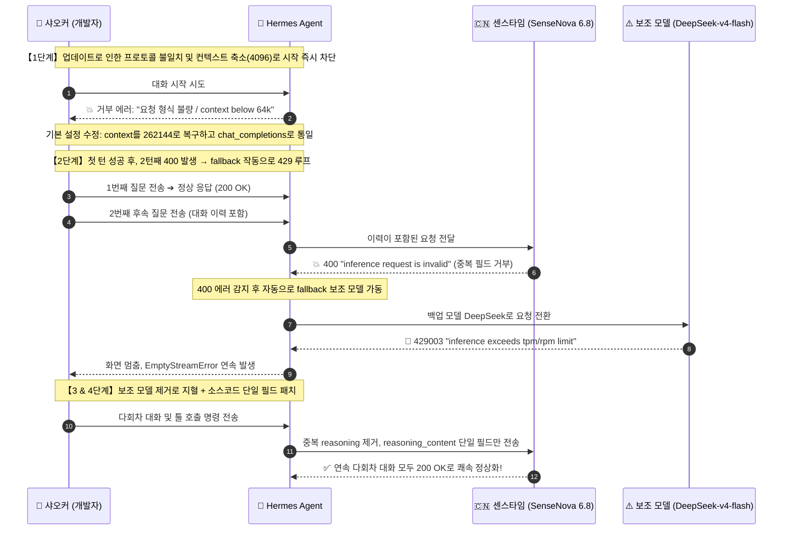
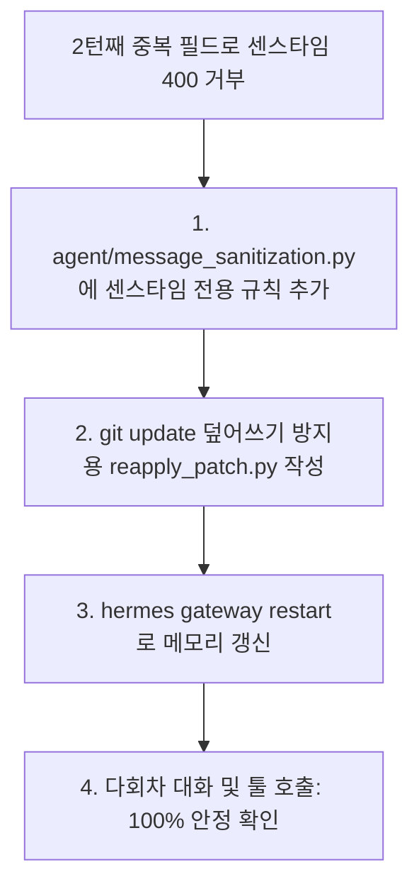

# Hermes Agent 업데이트 후 센스타임 모델 먹통? 400 에러·의문의 429 무한루프·reasoning 필드 충돌 해결기

평소 샤오커(小可)는 Nous Research의 자율 에이전트인 **Hermes Agent**를 주력으로 사용하고 있으며, 백엔드 모델로는 **센스타임(SenseNova 6.8 Flash Lite)**을 연동해 두고 있었습니다. 넉넉한 무료 토큰, 256K의 넉넉한 컨텍스트 창, 준수한 처리 속도 덕분에 일상 스크립트 작성이나 자동화 작업에 매우 유용했기 때문입니다.

그런데 오늘 무심코 `hermes update`를 실행한 직후, 기상천외한 연쇄 장애가 터졌습니다:
1. **업데이트 직후 즉시 뻗음**: 아무 메시지나 입력해도 즉각 `HTTP 400: inference request is invalid`를 뱉으며 첫 턴 대화조차 시작되지 않음;
2. **2턴째의 기괴한 배신**: 기본 설정을 손봐서 첫 턴은 겨우 살려냈지만, 두 번째 턴으로 넘어가자마자 Hermes가 제멋대로 보조 모델인 DeepSeek로 전환하더니, 플랫폼 동시 요청 제한에 걸려 `HTTP 429` 폭풍과 함께 터미널이 그대로 얼어붙음;
3. **이분법 격리로 찾아낸 진범**: 보조 모델을 꺼버리고 났더니 여전히 2턴째에 400이 뜸. 페이로드를 하나씩 뜯어보니 Hermes가 멀티턴 히스토리에 `reasoning`과 `reasoning_content` 두 필드를 동시에 밀어넣고 있었고, 엄격한 센스타임 게이트웨이가 이를 형식 불량으로 거부하고 있었음;
4. **소스코드 패치로 영구 해결**: Hermes 라우팅 로직에 센스타임 도메인 전용 단일 필드 필터링 규칙을 추가하고, 향후 업데이트 시에도 날아가지 않도록 자동 패치 스크립트를 작성한 뒤 게이트웨이를 재시작해 완전 복구.

반나절 동안 땀을 뻘뻘 흘리며 해결한 전 과정을 있는 그대로 정리해 공유합니다.

---

## 장애 전개 시퀀스

어떤 연쇄 작용으로 문제가 번져나갔는지 한눈에 볼 수 있도록 정리했습니다:



---

## 함정 1: 업데이트하자마자 첫 턴부터 먹통

### 에러 증상
`hermes update`를 마친 뒤 대화창에 명령어를 입력하자마자 붉은 글씨가 떴습니다:

```text
AI 服务拒绝了请求格式
custom 不接受此请求的构造方式。请切换服务商，或发送诊断信息以便我们排查。
HTTP 400: inference request is invalid
```

터미널 진단 로그를 살펴보니 결정적인 예외도 함께 찍혀 있었습니다:
```text
ValueError: Model sensenova-6.8-flash-lite has a context window of 4,096 tokens, which is below the minimum 64,000.
```

### 원인 파악 및 1차 조치
`~/.hermes/config.yaml`을 열어 확인해 보니, 업데이트 과정에서 설정 템플릿 일부가 초기화되어 있었습니다:
1. **컨텍스트 길이가 4096으로 강제 축소**: `model.context_length`가 `4096`으로 리셋되었습니다. 에이전트 프레임워크인 Hermes는 최소 64K의 컨텍스트를 요구하므로 4096 상태에서는 대화 시작 자체를 거부합니다. 그러나 센스타임 6.8의 실제 컨텍스트는 **262,144 (256K)**입니다;
2. **API 모드 충돌**: `providers.custom.api_mode`가 `anthropic_messages`로 적혀 있는 반면 최상위 설정은 `chat_completions`로 되어 있어 요청 헤더 규격이 깨져 있었습니다;
3. **만료된 보조 모델**: 기존 fallback으로 잡혀 있던 `deepseek-v4.1-flash`가 중계소에서 서비스 종료되어 403을 반환했습니다.

**조치 방법**:
- `model.context_length`를 `262144`로 원복;
- `api_mode`를 `chat_completions`로 통일;
- fallback 대상을 임시로 `deepseek-v4-flash`로 변경.

---

## 함정 2: 첫 턴은 성공했는데, 2턴째에 제멋대로 모델이 바뀌며 429 폭풍

설정을 고치고 새 세션을 열자, **첫 번째 질문은 아주 깔끔하게 답변이 돌아왔습니다.**

안도하며 두 번째 질문을 보낸 순간, 화면 속 모델명이 갑자기 DeepSeek로 바뀌더니 429 에러가 빗발쳤습니다:

```text
AI 服务繁忙
custom 正在限制请求数量。请稍等片刻后重试。
HTTP 429003: inference exceeds tpm/rpm limit
```

채팅창에서 `/model` 명령으로 센스타임 6.8을 다시 지정해 질문을 보내도, 다음 턴에서 즉시 DeepSeek로 튕기며 또다시 429로 뻗어버렸습니다.

### 타임스탬프 로그 분석
로그를 확인하자 그 이유가 명확히 드러났습니다:
```text
18:22:46  sensenova-6.8-flash-lite → HTTP 400 "inference request is invalid"
18:22:46  fallback_providers 발동 → deepseek-v4-flash로 자동 우회
18:23:53  재시도 요청 → 플랫폼의 엄격한 DeepSeek 동시 요청 제한(429003)에 직면
18:24~18:28  3연속 빈 스트림(EmptyStreamError) 발생, 터미널 프리징
```

**사건의 실체**:
두 번째 턴에서 센스타임이 400 에러를 뱉었고, Hermes가 이를 감지해 fallback 모델로 넘겼던 것입니다. 하지만 해당 중계 플랫폼의 DeepSeek 동시 호출 할당량이 너무 작아 순식간에 429에 걸려 뻗어버린 것이었습니다.

**우선 지혈 조치**:
샤오커는 우선 설정 파일에서 fallback 목록을 완전히 비웠습니다 (`fallback_providers: []`).  
이렇게 하니 429 폭풍은 멈췄지만, 핵심 질문은 그대로 남았습니다: **센스타임은 왜 2번째 턴에서 반드시 400을 뱉는가?**

---

## 함정 3: 진범 검거——센스타임은 왜 2턴째에 400을 뱉었을까?

터미널에서 `curl`을 이용해 센스타임 엔드포인트로 단발성 요청을 쏘면 언제나 200 OK가 떨어졌습니다. 즉 센스타임 서버 자체가 다운된 것은 아니었습니다.

그렇다면 문제는 Hermes가 조립하는 멀티턴 페이로드 내부에 있는 것이 분명했습니다. 샤오커는 2턴째 실패 시점의 실제 JSON 페이로드(17개 대화 이력 및 툴 정의 포함)를 추출하여 필드를 하나씩 제거하는 이분법 테스트를 진행했습니다:

```bash
# 테스트 1: 대화 이력이 포함된 원본 페이로드 전송 ➔ 💥 HTTP 400
# 테스트 2: 직전 assistant 메시지에서 reasoning 필드 제거 후 전송 ➔ ✅ 즉시 HTTP 200 OK!
```

이어서 사고 과정 필드 조합 테스트를 수행했습니다:
- `reasoning` 필드만 단독 포함 ➔ **200 OK**
- `reasoning_content` 필드만 단독 포함 ➔ **200 OK**
- **두 필드가 assistant 메시지에 동시에 포함 ➔ 💥 100% 확률로 HTTP 400 "inference request is invalid" 발생!**

### Hermes는 왜 두 필드를 모두 보냈을까?
DeepSeek R1 이후 사고 과정 필드명이 벤더마다 제각각(`reasoning` 또는 `reasoning_content`)으로 갈렸습니다.  
Hermes는 범용 호환성을 위해 `provider: custom` 환경에서 이전 턴의 사고 내용을 두 가지 키에 복제하여 이력에 보관하고 있었습니다.

반면 센스타임 API 게이트웨이는 스키마 검증이 매우 엄격합니다. 둘 중 하나만 보내는 것은 허용하지만, 동의어 필드가 중복으로 들어오면 비정상 요청으로 판단해 400을 반환합니다. 센스타임의 에러 메시지가 구체적인 필드명을 알려주지 않아 Hermes 내부의 동적 정화 로직도 작동하지 못했던 것입니다.

---

## 영구 해결: 소스코드 라우팅 패치 및 유지 스크립트

원인이 중복 필드 충돌로 밝혀졌으니 해결책은 간단합니다: **센스타임 도메인으로 향하는 요청은 단일 필드만 통과시키면 됩니다.**



### 1. 메시지 정화 로직 수정
Hermes의 `agent/message_sanitization.py` 파일을 열고, 범용 custom 규칙 앞쪽에 센스타임 도메인 전용 필터링을 추가합니다:

```python
# OpenRouter / Vercel 등의 규칙...
(_ALL_CARRIERS, frozenset({"openrouter", "kilocode", "ai-gateway", "nous"}),
 ("openrouter.ai", "kilo.ai", "ai-gateway.vercel.sh", "nousresearch.com")),

# 【추가】센스타임 도메인은 reasoning_content 단일 필드만 허용
(frozenset({RC}), frozenset(), ("token.sensenova.cn", "sensenova.cn")),
```
*(참고: `RC`는 Hermes 내부 상수인 `reasoning_content`입니다. 이 규칙은 `sensenova.cn` 도메인에만 적용되며 다른 공급자에는 영향을 주지 않습니다.)*

### 2. 업데이트 시 덮어쓰기 방지 스크립트
추후 `hermes update`를 실행할 때 git pull로 인해 소스코드가 덮어씌워지는 것을 방지하기 위해, `~/.hermes/scripts/reapply_sensenova_reasoning_patch.py`에 자동 패치 스크립트를 작성해 두었습니다:

```python
import sys
from pathlib import Path

target_file = Path("agent/message_sanitization.py")
if not target_file.exists():
    sys.exit(0)

content = target_file.read_text(encoding="utf-8")
sensenova_rule = '(frozenset({RC}), frozenset(), ("token.sensenova.cn", "sensenova.cn")),'

if "sensenova.cn" not in content:
    insert_marker = '(_ALL_CARRIERS, frozenset({"openrouter"'
    if insert_marker in content:
        new_content = content.replace(insert_marker, sensenova_rule + "\n    " + insert_marker)
        target_file.write_text(new_content, encoding="utf-8")
        print("✅ 센스타임 단일 필드 패치 재적용 완료!")
```

### 3. 게이트웨이 데몬 재시작
Hermes는 백그라운드에 게이트웨이 데몬 프로세스를 상주시키고 있습니다. 파일만 수정한다고 해서 메모리 프로세스가 갱신되지 않으므로 외부 터미널에서 재시작해 주어야 합니다:
```bash
python3 ~/.hermes/scripts/reapply_sensenova_reasoning_patch.py && hermes gateway restart
```

---

## 검증 및 결과

게이트웨이 재시작 후 다양한 상황에서 테스트를 거쳤습니다:
1. **장기 다회차 대화**: 이전 사고 과정이 누적된 상태에서 연속으로 기술적 질문을 주고받았으나, **모든 턴에서 200 OK가 즉각 반환**되었으며 모델 무단 전환이나 400 에러는 완전히 사라졌습니다;
2. **도구 호출 부하 테스트**: 복잡한 터미널 명령과 파일 조작을 연속으로 요청해도 SenseNova 6.8이 매우 빠르고 안정적으로 처리해 주었습니다.

---

## 요약 및 교훈

1. **에이전트 프레임워크 업데이트 후엔 반드시 게이트웨이를 재시작할 것**: 상주 데몬이 있는 경우, 소스코드만 갱신되면 메모리의 구버전 로직과 설정이 꼬여 원인 모를 버그가 생깁니다;
2. **필드가 많다고 무조건 좋은 것은 아니다**: 엔터프라이즈 API는 스키마를 엄격히 검사합니다. 호환성을 위해 추가된 중복 필드가 치명적인 400 에러를 유발할 수 있습니다;
3. **보조 모델(Fallback)의 동시성 한도를 점검할 것**: 메인 모델 장애 시 전환될 백업 모델의 동시 호출 한도가 너무 낮으면, 단순 일시 오류가 순식간에 시스템 전체 프리징(429)으로 번집니다.

---

> 💡 **원문 출처 및 실시간 모니터링**：
> - 원문 출처: [FreeAI Dog 공식 블로그](https://freeaidog.com/ko/blog/hermes-agent-sensenova-400-reasoning-fix/)
> - 무료 대형 언어 모델 실시간 가용성 및 지연 시간 측정은 [FreeAI Dog 가용성 레이더](https://freeaidog.com/ko/radar/)에서 확인하세요.
