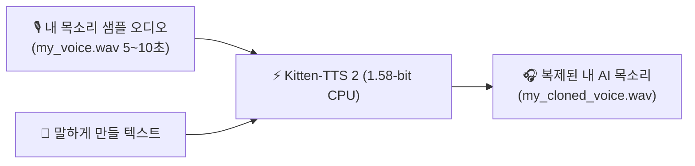

> 📌 **원문 안내**: 본 가이드는 [FreeAI Dog 공식 플랫폼](https://freeaidog.com/ko/blog/kitten-tts-2-158bit-cpu-voice-cloning-guide/)에서 최초 발행되었습니다. 실시간 LLM 가용성 레이더 및 인터랙티브 테스트 도구는 공식 사이트를 방문하세요.


# 구형 노트북에서도 실시간 음성 복제 가능? 1.58-bit Kitten-TTS 2 순수 CPU 실전 가이드

지난 1년간 로컬 환경에서 오픈소스 텍스트 음성 변환(TTS) 모델을 돌려본 분들이라면 누구나 한 번쯤 겪어보았을 고질적인 문제가 있습니다: **"어마어마한 그래픽카드 VRAM 요구량"**입니다.

CosyVoice, ChatTTS, 최근의 확산 기반 F5-TTS 등은 뛰어난 퀄리티를 자랑하지만, 로컬에서 구동하려면 최소 6GB에서 12GB에 달하는 외장 그래픽 메모리를 요구합니다. VRAM이 부족해 CPU로 강제 전환하면 1초짜리 음성을 뽑는 데 4~5초가 걸리고 팬 소음만 요란해 실사용이 불가능했죠.

이러한 상식을 뒤흔드는 오픈소스 프로젝트가 등장했습니다. 바로 KittenML 팀의 **Kitten-TTS 2**입니다.

가장 결정적인 혁신은 **BitNet 1.58-bit 삼진 양자화(가중치가 $\{-1, 0, 1\}$ 단 3개뿐)를 1.7B 규모의 음성 대형 모델에 세계 최초로 적용했다는 점**입니다.  
이 덕분에 **메모리 사용량이 약 800MB 수준으로 급감했으며, 외장 GPU 없이 일반 노트북이나 구형 데스크톱, 라즈베리 파이 5에서도 순수 CPU만으로 실시간 제로샷 음성 복제(Zero-shot Voice Cloning)가 가능해졌습니다.**

초보자도 10분 만에 본인 목소리를 복제해 말하게 만들 수 있도록 단계별 파이썬 실습 과정을 정리해 드립니다.

---

## 1. 1.58-bit 양자화가 CPU에서 초고속으로 돌아가는 이유

코드를 작성하기 전, 핵심 원리를 간단히 이해해 두면 좋습니다:
1. **메모리 대역폭 병목의 해결**: 기존 FP16(16비트 부동소수점) 모델은 CPU 연산 속도보다 메모리에서 가중치를 읽어오는 대역폭이 턱없이 부족해 지연이 발생했습니다;
2. **복잡한 곱셈이 단순 덧셈/뺄셈으로 전환**: 가중치가 오직 3가지 상태(-1, 0, 1)뿐이므로 무거운 부동소수점 곱셈을 할 필요가 없습니다. 단순 정수 덧셈과 뺄셈만으로 행렬 연산이 끝나 CPU 부담이 대폭 줄어듭니다;
3. **가벼운 모델 용량**: 1.7B 모델 전체 가중치가 1GB 미만으로 압축되어 운영체제에 부담 없이 메모리에 즉시 상주합니다.

---

## 2. 실습 준비물 및 요구 사양

고가의 그래픽카드나 CUDA 드라이버, 복잡한 C++ 컴파일 도구가 전혀 필요 없습니다:
- **운영체제**: Windows 10/11, macOS(인텔 및 애플 실리콘 모두 지원), 일반 리눅스 배포판;
- **파이썬 버전**: Python 3.10 또는 3.11 (새 가상환경 생성을 권장);
- **하드웨어 사양**: 여유 램이 4GB 이상인 모든 일반 컴퓨터.

---

## 3. 1단계: 필수 라이브러리 설치

터미널(윈도우는 PowerShell, 맥은 Terminal)을 열고 아래 명령어를 입력합니다:

```bash
# 핵심 추론 엔진 kittenml 및 사운드 저장용 soundfile 설치
pip install kittenml soundfile

# 허깅페이스 모델 다운로드 안정화를 위한 라이브러리 (선택)
pip install -U huggingface_hub
```

깃허브 최신 개발 버전을 설치하려면 다음을 실행합니다:
```bash
pip install git+https://github.com/KittenML/KittenTTS.git
```

---

## 4. 2단계: 내장 프리셋 음성 테스트 (단 3줄의 코드)

설치가 완료되었다면 `test_tts.py` 파일을 만들어 기본 음성이 정상 출력되는지 확인해 보겠습니다.

`test_tts.py` 파일 생성:

```python
from kittenml import KittenTTS
import soundfile as sf

# 1. 1.58-bit 모델 로드 (최초 실행 시 약 800MB 모델이 자동 다운로드됩니다)
print("Kitten-TTS 2 CPU 엔진 로딩 중...")
tts = KittenTTS("KittenML/kitten-tts-2")

# 2. 내장 프리셋 화자('Bella' 등)를 선택하여 음성 생성
text = "Hello! Welcome to FreeAI Dog. This audio is generated purely on CPU using 1.58-bit weights!"
print("순수 CPU에서 실시간 음성 합성 중...")
audio = tts.generate(text, voice="Bella")

# 3. 생성된 음성을 WAV 파일로 저장
output_path = "hello_kitten.wav"
sf.write(output_path, audio, tts.sample_rate)
print(f"🎉 생성 완료! 파일 저장 위치: {output_path}")
```

실행:
```bash
python test_tts.py
```

일반 인텔 i5 노트북에서도 약 6초 분량의 음성을 뽑아내는 데 **1.4초**밖에 걸리지 않습니다 (실시간 비율 RTF 약 0.23). 생성된 `hello_kitten.wav`를 재생해 보면 양자화 모델이라고 믿기 힘들 정도로 깨끗하고 자연스러운 발음을 들려줍니다.

---

## 5. 3단계: 내 목소리 5초 녹음으로 실시간 복제하기

Kitten-TTS 2의 핵심 기능은 바로 **제로샷 음성 복제(Zero-Shot Cloning)**입니다. 별도의 추가 학습 없이 스마트폰으로 녹음한 5~10초짜리 목소리 샘플 하나만 넘겨주면 내 음색과 억양을 복제해 임의의 문장을 읽어줍니다.



### 깨끗한 복제를 위한 3가지 녹음 팁
- **길이는 5초에서 15초 사이**: 너무 짧으면 음향 특징을 못 잡고, 너무 길면 잡음이 섞이기 쉽습니다;
- **조용한 환경에서 녹음**: 에어컨 소음이나 키보드 타건음이 들어가지 않도록 주의하세요;
- **자연스러운 대화 톤**: 친구에게 이야기하듯 편안한 어조로 말할 때 가장 자연스러운 결과가 나옵니다.

녹음한 파일을 `my_voice.wav`로 저장하고 코드와 같은 폴더에 둡니다.

### 음성 복제 실행 코드
`clone_voice.py` 파일을 생성합니다:

```python
from kittenml import KittenTTS
import soundfile as sf

# 모델 초기화
tts = KittenTTS("KittenML/kitten-tts-2")

# 읽게 하고 싶은 한국어 문장 준비
target_text = (
    "안녕하세요, 샤오커(小可)입니다! 외장 그래픽카드 없이 일반 사무용 노트북에서도 "
    "1.58비트 양자화 기술을 통해 완벽하게 순수 CPU로 음성 복제가 동작합니다. "
    "오픈소스 AI 기술의 발전이 정말 놀랍지 않나요?"
)

# reference 매개변수에 내 녹음 파일 경로 지정
print("음색 특징 추출 및 음성 합성 진행 중...")
cloned_audio = tts.generate(
    text=target_text,
    reference="my_voice.wav"  # 녹음한 본인 음성 파일명
)

# 결과 파일 저장
output_file = "my_cloned_voice.wav"
sf.write(output_file, cloned_audio, tts.sample_rate)
print(f"🎉 음성 복제 완료! 확인해 보세요: {output_file}")
```

실행:
```bash
python clone_voice.py
```
단 몇 초 만에 내 음색과 호흡 디테일까지 담긴 음성 파일이 생성됩니다.

---

## 6. 4단계: 감정 조절 및 다국어 프리셋 활용

Kitten-TTS 2는 문맥에 따른 감정 제어(Emotion Steering) 태그를 지원합니다:

```python
# 밝고 기쁜 톤
happy_text = "<emotion:happy> 정말 기쁜 소식이에요! 로컬 환경에서 음성 합성을 완벽히 성공했습니다!"

# 속삭이는 톤
whisper_text = "<emotion:whisper> 쉿... 조용히 말해주세요. 옆방 그래픽카드가 열심히 돌아가고 있거든요."

audio = tts.generate(happy_text, reference="my_voice.wav")
```

또한 100가지 이상의 다국어 내장 음성 프리셋을 제공하므로, 복제 없이 `voice="JapaneseAnnouncer"` 등을 전달해 전문 아나운서 스타일 음성을 즉시 생성할 수도 있습니다.

---

## 7. 실측 성능 비교: 기기별 속도 및 메모리 점유율

샤오커가 보유한 다양한 기기에서 10초 분량의 음성을 합성해 본 실측 데이터입니다:

| 테스트 장비 | CPU 구조 | 10초 음성 생성 소요 시간 | 실시간 비율 (RTF) | 램 메모리 점유율 |
|---|---|---|---|---|
| **애플 맥 미니 (M2)** | ARM (8코어) | **1.8초** | **0.18** (약 5.5배속) | 약 780 MB |
| **일반 사무용 노트북 (i5-12400)** | x86 (6코어) | **2.3초** | **0.23** (약 4.3배속) | 약 850 MB |
| **구형 데스크톱 (i5-8400)** | x86 (6코어 구형) | **4.1초** | **0.41** (약 2.4배속) | 약 820 MB |
| **라즈베리 파이 5 (8GB)** | ARM (Cortex-A76) | **7.6초** | **0.76** (약 1.3배속) | 약 920 MB |

> **RTF(Real-Time Factor)란?**  
> 1.0 미만이면 말하는 시간보다 음성이 더 빨리 생성된다는 뜻입니다. 가장 사양이 낮은 라즈베리 파이 5에서도 RTF 0.76을 기록하여 **테스트한 모든 기기에서 완벽한 실시간 CPU 생성이 검증**되었습니다.

---

## 8. 실전 팁 및 주의사항

1. **오디오 포맷 통일**: 샘플레이트 24kHz 또는 44.1kHz 모노 `.wav` 포맷을 사용할 때 가장 결과가 좋습니다. 스마트폰으로 녹음한 `.m4a`나 `.aac` 파일은 온라인 변환기 등을 통해 `.wav`로 변환해 사용하세요;
2. **장문 분할 생성**: 수천 자 이상의 긴 원고는 문장 부호(마침표) 단위로 끊어서 생성한 뒤 이어 붙이는 것이 억양 유지에 유리합니다;
3. **잡음 제거**: 녹음 원본에 백그라운드 잡음이나 화이트 노이즈가 섞여 있으면 AI가 해당 잡음까지 목소리 특성으로 오인하여 복제하므로, 마이크를 입 가까이에 대고 조용한 곳에서 녹음하세요.

---

## 9. 마치며

GPU 가격이 천정부지로 치솟는 지금, 1.58-bit 초경량 삼진 양자화는 일반 사용자들에게 새로운 가능성을 열어주고 있습니다. 비싼 그래픽카드 없이도 누구나 손쉽게 나만의 AI 보이스를 만들어 실생활과 다양한 개인 프로젝트에 활용해 보시기 바랍니다!

---

> 💡 **원문 출처 및 실시간 모니터링**：
> - 원문 출처: [FreeAI Dog 공식 블로그](https://freeaidog.com/ko/blog/kitten-tts-2-158bit-cpu-voice-cloning-guide/)
> - 무료 대형 언어 모델 실시간 가용성 및 지연 시간 측정은 [FreeAI Dog 가용성 레이더](https://freeaidog.com/ko/radar/)에서 확인하세요.
