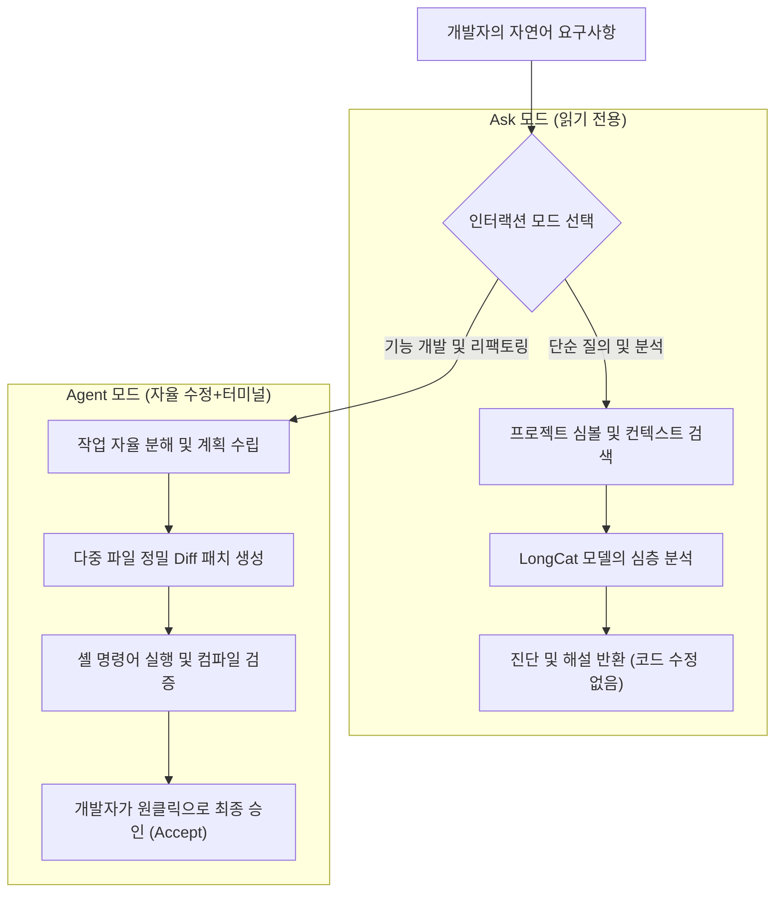

> 📌 **원문 안내**: 본 가이드는 [FreeAI Dog 공식 플랫폼](https://freeaidog.com/ko/blog/meituan-catpaw-longcat-ai-ide-complete-guide/)에서 최초 발행되었습니다. 실시간 LLM 가용성 레이더 및 인터랙티브 테스트 도구는 공식 사이트를 방문하세요: [https://freeaidog.com/ko/](https://freeaidog.com/ko/).


# 차세대 다크호스의 등장! 메이투안 캣포(Meituan CatPaw) AI IDE 완벽 가이드: 에이전트 듀얼 모드, 실시간 프리뷰 및 롱캣(LongCat) 매일 대량 무료 토큰 활용법

오늘날 생성형 AI 프로그래밍 영역에서 **Cursor, Claude Code, Windsurf**와 같은 도구는 글로벌 개발자들에게 필수적인 생산성 도구로 자리 잡았습니다. 하지만 인디 개발자, 학생 및 소규모 팀에게 매달 지불해야 하는 **20달러(한화 약 2만 8천 원)**의 구독료와 해외 결제 장벽은 여전히 적지 않은 부담입니다.

시중의 많은 AI 확장 프로그램들은 여전히 단순한 '한 줄 자동완성'이나 '사이드바 일회성 채팅' 수준에 머물러 있어, 프로젝트 전반의 다중 파일을 자율적으로 수정하고 터미널에서 빌드 및 테스트까지 완결 짓는 '진정한 에이전트' 능력을 제공하지 못했습니다.

이러한 상황에서 중국의 대표적인 테크 플랫폼 기업 메이투안(Meituan)이 사내 수만 명의 개발자들에 의해 엄격하게 검증된 핵심 AI 개발 도구인 **'CatPaw(캣포)' AI IDE**를 일반 대중에게 무료 공개 베타로 전격 오픈했습니다!

> [!NOTE]
> CatPaw는 단순한 VS Code 플러그인이 아닙니다. 메이투안의 자체 장문 맥락/추론 모델인 **'롱캣(LongCat)'**을 탑재하고, **인간과 AI 에이전트의 긴밀한 협업을 핵심으로 설계된 독립형 AI IDE**입니다. 메이투안 사내 데이터에 따르면 코드 자동 생성 및 채택률에서 업계 최상위권의 검증된 성능을 자랑합니다.

더욱 매력적인 점은 **현재 CatPaw는 대기열이나 초대장 없이 누구나 즉시 무료 다운로드**가 가능하며, 자체 롱캣 모델 역시 **매일 자정마다 리셋되는 대량의 무료 토큰(OpenAI 호환 API 지원)**을 제공한다는 것입니다!

본 가이드에서는 CatPaw의 핵심 4대 기능과 외부 도구에서도 손쉽게 연동할 수 있는 무료 API 활용법을 친절하게 안내해 드립니다.

---

## 1. 주목해야 할 4가지 혁신 기능

### 1. 역할이 명확한 듀얼 인터랙션: Ask(조회/진단) 모드 vs Agent(자율 실행) 모드
* **Ask 모드 (읽기 전용 코드 분석)**:
  레거시 코드베이스 해석, 복잡한 종속성 파악 또는 런타임 오류 추적에 이상적입니다. 프로젝트 심볼을 인덱싱하여 즉시 명쾌한 진단을 제공하며, **사용자의 소스 코드를 무단으로 수정하지 않습니다**.
* **Agent 모드 (다중 파일 자율 수정 + 터미널 실행)**:
  "Tailwind CSS와 Lucide 아이콘을 사용하여 반응형 네비게이션 바를 구현하고 다크 모드를 지원해 줘"라고 명령하면, 에이전트가 작업을 스스로 분해하여 여러 연관 파일을 동시에 패치하고 터미널에서 코드 검사를 자율 수행합니다.



### 2. NextEdit: 개발자의 의도를 읽는 스마트 예측 완성
단순히 커서 바로 뒤의 텍스트만 추측하는 기존 자동완성과 달리, CatPaw의 **NextEdit** 엔진은 개발자의 편집 맥락을 이해합니다.
* `UserEntity.ts`에 새 필드를 추가한 뒤 `UserDTO.ts`로 탭을 전환하면, DTO 매핑 코드의 수정 위치를 즉시 예측하여 하이라이트로 제안합니다.
* 여러 위치의 연동 수정을 `Tab` 키 하나로 연속 승인할 수 있어 반복적인 수작업을 획기적으로 줄여줍니다.

### 3. 프론트엔드/풀스택 맞춤형: 인-IDE 실시간 웹 프리뷰 & 시각적 영역 선택 수정
* Vite, Next.js 등 로컬 개발 서버가 시작되면 IDE 내에 **실시간 웹 프리뷰 샌드박스가 즉시 활성화**됩니다.
* **Visual Select & Edit**: 화면에서 어색한 버튼이나 컴포넌트를 마우스 드래그로 사각형 영역을 지정한 뒤 "이 버튼 모서리를 둥글게 하고 그림자를 추가해 줘"라고 요청하면 AI가 해당 JSX/CSS 소스를 자동 역추적하여 수정합니다.
* **Console 오류 연동**: 프리뷰 콘솔에 찍힌 런타임 오류를 원클릭으로 에이전트에 전송하여 즉각적인 픽스를 유도할 수 있습니다.

### 4. MCP(Model Context Protocol) 및 커스텀 규칙 지원
* **`.catpawrules` 지원**: "엄격한 TypeScript 사용", "모든 API 요청은 공통 인터셉터를 경유할 것" 등의 팀 코딩 컨벤션을 설정하면 에이전트가 이를 최우선 가이드라인으로 준수합니다.
* **MCP 프로토콜 연동**: 로컬 SQLite, Git 커밋 이력 검색, Figma 디자인 연동 등 다양한 외부 도구를 에이전트에 자유롭게 확장할 수 있습니다.

---

## 2. 핵심 엔진: 롱캣(LongCat) 모델과 매일 제공되는 대량 무료 토큰

메이투안의 자체 대형 모델 플랫폼([longcat.chat/platform](https://longcat.chat/platform/))에서는 외부 도구 연동을 위한 대규모 **일일 무료 토큰**을 지원합니다:

| 모델명 | 아키텍처 및 특징 | 일일 무료 제공량 (매일 리셋) | 추천 용도 |
|---|---|---|---|
| **LongCat-Flash-Lite** | 초저지연 경량화 모델 | **매일 수천만 토큰 규모 제공** | 실시간 인라인 완성, 빠른 문법 검사 |
| **LongCat-Flash-Chat** | 범용 코드 이해 및 대화형 모델 | **매일 수백만 토큰 공유 제공** | 일반 개발 질의응답, 단위 테스트 작성 |
| **LongCat-Flash-Thinking** | 심층 추론 및 롱체인 사고 모델 | **전용 일일 무료 할당량** | 복잡한 아키텍처 설계, 버그 원인 분석 |

> [!TIP]
> **무료 혜택 이용 팁**:
> 1. 무료 토큰은 **매일 한국 시간 기준 새벽 1시(베이징 자정)에 자동 리셋**됩니다.
> 2. 신용카드 등록 없이 휴대전화 인증만으로 즉시 발급받아 사용할 수 있습니다.

---

## 3. 실전 가이드: LongCat API를 외부 도구에 연결하기

OpenAI 표준 규격을 준수하므로 Cursor, Cline, OpenCode 및 Python 스크립트에 손쉽게 설정할 수 있습니다:

* **Base URL**:
  ```
  https://api.longcat.chat/openai
  ```
* **API Key**: 플랫폼에서 발급받은 `sk-...`
* **호환 모델명**: `longcat-flash-lite`, `longcat-flash-chat`, `longcat-flash-thinking`

### Python SDK 호출 예제
```python
from openai import OpenAI

client = OpenAI(
    api_key="sk-your-longcat-api-key-here",
    base_url="https://api.longcat.chat/openai/v1"
)

response = client.chat.completions.create(
    model="longcat-flash-chat",
    messages=[
        {"role": "system", "content": "당신은 고성능 분산 시스템을 전문으로 하는 시니어 아키텍트입니다."},
        {"role": "user", "content": "Go 언어로 Redis 분산 락을 활용한 안전한 선착순 결제 제한기를 작성해 주세요."}
    ],
    temperature=0.3
)

print(response.choices[0].message.content)
```

---

## 4. 주요 AI IDE 비교 매트릭스

| 비교 항목 | 메이투안 CatPaw | Cursor (Pro) | 바이트댄스 Trae | 알리바바 링마(Lingma) |
|---|---|---|---|---|
| **구독 비용** | **완전 무료 오픈 베타** | 월 \$20 (약 2.8만원) | 무료 베타 | 무료 티어 / 유료 기업형 |
| **네트워크 접근성** | 안정적인 글로벌/아시아 CDN | 해외 프록시 환경 권장 | 다이렉트 직결 | 다이렉트 직결 |
| **기반 파운데이션 모델** | 자체 롱캣(LongCat) 시리즈 | Claude 3.5 Sonnet / GPT-4o | Claude 3.5 Sonnet / GPT-4o | 통이치엔원(Qwen) |
| **자율 에이전트 성능** | 강력 (다중 파일 자율 수정) | 업계 최고 수준 | 강력 (파일 횡단 수정) | 보통 (단일 파일 위주) |
| **NextEdit 의도 예측** | ✅ 정밀 다중 포인트 예측 | ✅ Copilot++ 예측 지원 | 🟡 기본 인라인 예측 | ❌ 단순 완성 수준 |
| **인-IDE 실시간 프리뷰** | ✅ 화면 드래그 선택 수정 지원 | ❌ 외부 플러그인 필요 | ❌ 외부 브라우저 전환 | ❌ 프리뷰 미지원 |
| **MCP 프로토콜** | ✅ 기본 공식 지원 | ✅ 기본 공식 지원 | 🟡 일부 지원 | ❌ 미지원 |
| **독립형 무료 API** | ✅ 매일 갱신 무료 토큰 | ❌ API 개별 판매 없음 | ❌ API 개별 판매 없음 | ✅ Model Studio에서 제공 |

---

## 5. 결론

메이투안 CatPaw는 단순히 또 하나의 빅테크 복제 도구가 아닙니다. **실제 수만 명의 개발자가 쓰는 엔터프라이즈 환경에서 검증된 자율 에이전트, 생산성을 극대화하는 인-IDE 웹 프리뷰, 매일 갱신되는 넉넉한 자체 모델 무료 토큰을 비용 부담 없이 제공**하는 훌륭한 선택지입니다.

해외 결제나 네트워크 문제 없이 쾌적한 AI 개발 환경을 찾고 계셨다면 지금 즉시 체험해 보세요!

* 🎯 **CatPaw 공식 다운로드**: [catpaw.meituan.com](https://catpaw.meituan.com/)
* 🔑 **LongCat 오픈 플랫폼**: [longcat.chat/platform](https://longcat.chat/platform/)

---

> 💡 **원문 출처 및 실시간 모니터링**：
> - 원문 출처: [FreeAI Dog 공식 블로그](https://freeaidog.com/ko/blog/meituan-catpaw-longcat-ai-ide-complete-guide/)
> - 무료 대형 언어 모델 실시간 가용성 및 지연 시간 측정은 [FreeAI Dog 가용성 레이더](https://freeaidog.com/ko/radar/)에서 확인하세요.

