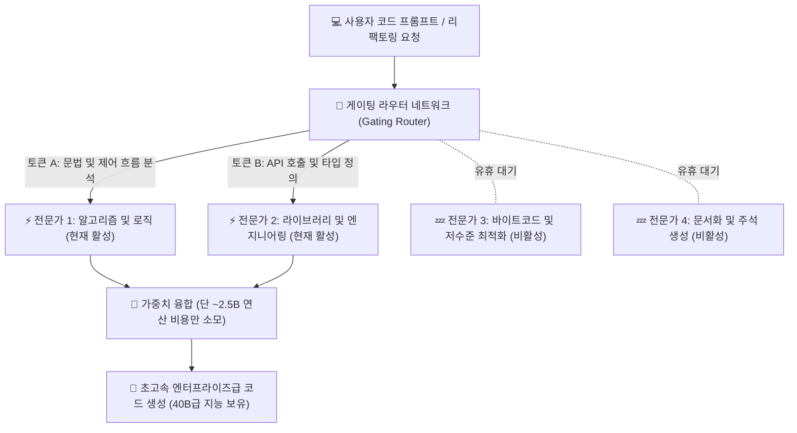
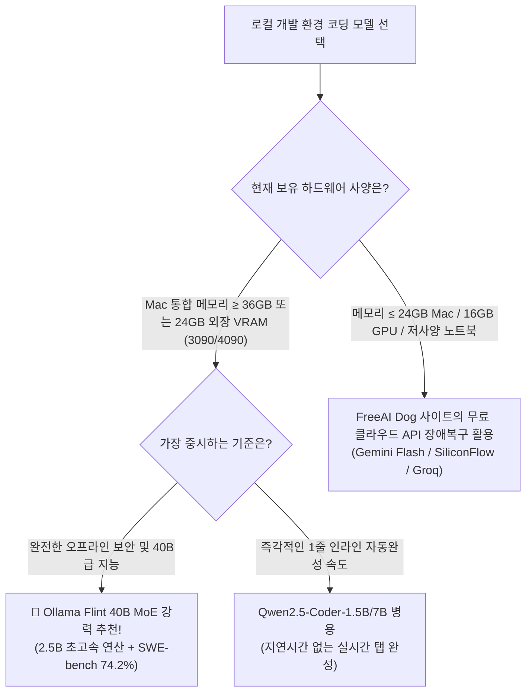

> 📌 **원문 안내**: 본 가이드는 [FreeAI Dog 공식 플랫폼](https://freeaidog.com/ko/blog/ollama-flint-40b-moe-coding-guide/)에서 최초 발행되었습니다. 실시간 LLM 가용성 레이더 및 인터랙티브 테스트 도구는 공식 사이트를 방문하세요: [https://freeaidog.com/ko/](https://freeaidog.com/ko/).


# Ollama v0.40.8 정식 지원! 40B MoE 코딩 모델 Flint 원클릭 로컬 구동: 2.5B 활성화, SWE-bench 74.2% 벤치마크 분석

> **핵심 요약**: 로컬 장비에서 코딩 전문 거대언어모델(LLM)을 구동할 때, 개발자들은 항상 '트릴레마(세 가지 딜레마)'를 겪어왔습니다:  
> - **7B~8B 소형 모델**: 속도는 빠르지만 복잡한 다중 파일 참조나 심층 타입 추론에서 할루시네이션(문법 오류)이 빈번함;  
> - **32B~70B 대형 모델**: 지능은 뛰어나나 개인용 PC나 MacBook 환경에서 초당 10~15 토큰으로 극도로 느리며 VRAM을 초과함;  
> - **상용 클라우드 API**: 편리하지만 사내 보안 코드 유출 위험이 크고, 망분리된 폐쇄망 환경에서는 사용 불가.
> 
> 오늘 Recursive 팀이 오픈소스로 공개하고 **Ollama v0.40.8**이 즉각 지원을 시작한 **Flint**가 이 난제를 완벽하게 해결했습니다. 총 파라미터는 **40B**에 달하지만 각 토큰 추론 시 **단 2.5B만 활성화**되는 Mixture-of-Experts(MoE) 구조를 채택했습니다. 여기에 **262K 초장문 컨텍스트**, 상업적 이용이 자유로운 **Apache 2.0 라이선스**, 그리고 SWE-bench Verified **74.2%**의 압도적인 벤치마크를 기록했습니다.
> 
> 이제 터미널에서 `ollama run flint` 명령어 한 줄이면 개인 PC가 오프라인 초지능 코딩 어시스턴트로 변모합니다.

---

## 1. MoE 구조란? 왜 40B 총 파라미터 + 2.5B 활성화가 로컬 개발자의 정답인가?

기존의 Dense(밀집형) 네트워크는 간단한 반복문을 생성할 때도 모델 전체의 수백억 개 뉴런을 모두 연산하므로 연산량과 메모리 대역폭 소모가 극심했습니다.

반면 **Flint의 MoE(Mixture of Experts) 아키텍처**는 모델을 전문 도메인별 '전문가(Expert)' 서브 네트워크로 분할하여 필요한 전문가만 동적으로 호출합니다.



### 로컬 환경에서의 핵심 장점:
1. **압도적인 생성 속도**: 토큰당 2.5B 연산만 수행하므로 Apple Silicon이나 RTX 그래픽카드에서 초당 45~60 토큰의 초고속 출력을 달성;
2. **40B 급의 방대한 지식**: 소형 모델이 취약한 비인기 언어나 서드파티 라이브러리 지식을 완벽히 포괄;
3. **262K 컨텍스트 윈도우**: 프로젝트 전체 코드를 통째로 입력받아 다중 파일 간의 버그를 자동 추적하고 교차 리팩토링 가능.

---

## 2. 벤치마크 비교: Flint vs 주요 코딩 LLM 실전 성능

실제 개발 현장에서의 성능을 검증하는 글로벌 표준 벤치마크인 SWE-bench Verified(실제 GitHub 이슈 자동 해결율) 및 Terminal-Bench 2.1(터미널 자동화 제어) 비교 표입니다:

| 모델명 | 아키텍처 | 총 파라미터 / 활성화 | SWE-bench Verified | Terminal-Bench 2.1 | 최대 컨텍스트 | 라이선스 |
| :--- | :---: | :---: | :---: | :---: | :---: | :---: |
| **👑 Recursive Flint** | **MoE** | **40B / 2.5B** | **74.2%** | **54.9%** | **262K** | **Apache 2.0 (완전 상용 허용)** |
| Qwen3.6-35B-A3B | MoE | 35B / 3.0B | 68.5% | 49.2% | 128K | Apache 2.0 |
| DeepSeek-Coder 33B | Dense | 33B / 33B | 62.1% | 46.8% | 128K | DeepSeek License |
| Llama-3.1-8B-Instruct | Dense | 8B / 8B | 41.3% | 34.7% | 128K | Llama 3.1 Community |
| Claude 3.5 Sonnet (클라우드 기준) | 독점 폐쇄형 | 미공개 | 77.2% | 58.6% | 200K | 상용 유료 API |

불과 **2.5B 연산량**으로 **SWE-bench Verified 74.2%**를 달성하여 최고 티어 클라우드 모델인 Claude 3.5 Sonnet에 필적하는 완성도를 보여줍니다.

---

## 3. 3분 완성: Ollama로 Flint 로컬 구동하기

**Ollama v0.40.8**부터 Flint가 기본 레지스트리에 등록되어 복잡한 컴파일 없이 바로 실행할 수 있습니다.

### 1단계: Ollama 버전 업데이트 (≥ v0.40.8)
```bash
# macOS / Linux 업데이트
curl -fsSL https://ollama.com/install.sh | sh

# 설치 버전 확인
ollama --version
# ollama version is 0.40.8 이상 확인
```

### 2단계: Flint 실행 명령어
```bash
ollama run flint
```
처음 실행 시 양자화 가중치가 자동 다운로드됩니다.

> [!WARNING]
> ### ⚠️ 하드웨어 메모리 팩트체크: 통합 메모리 공유의 함정, 왜 24GB Mac mini도 역부족인가?
> PC 독립 VRAM과 Mac 통합 메모리(Unified Memory)의 근본적인 물리적 차이를 명확히 이해해야 합니다:
> 1. **PC 외장 그래픽카드 (RTX 3090 / 4090)**: 독립된 **24GB 전용 VRAM**을 탑재하고 있습니다. Windows OS와 일반 앱은 메인보드 RAM(DDR5)에서 구동되므로, 22GB~23GB 크기의 모델이 GPU VRAM에 100% 온전히 올라갑니다;
> 2. **Mac 통합 메모리 (치명적 병목)**: Mac은 **CPU와 GPU가 시스템 메모리를 완전히 공유**합니다!
>    - macOS 운영체제와 백그라운드 앱이 부팅 즉시 4GB~6GB를 차지합니다;
>    - macOS의 Metal 프레임워크는 GPU 할당 상한선(통상 전체 물리 메모리의 70%~75%)을 둡니다;
>    - **결론: 24GB 통합 메모리의 Mac mini나 MacBook이라 해도, GPU가 안전하게 쓸 수 있는 물리 메모리는 약 16GB ~ 18GB에 불과합니다!**
>    - 22GB~24GB의 Q4 모델을 억지로 로드하면 5GB~7GB가 강제로 SSD 가상 메모리(Swap)로 밀려나 속도가 0.5 t/s로 폭락합니다;
> 
> **🎯 실제 하드웨어 권장 기준**:
> - **PC 외장 그래픽카드 사용자**: **RTX 3090 / 4090 (24GB VRAM)** 단일 카드로 Q4_K_M을 완벽하게 구동;
> - **Mac 사용자**: 스왑 지연 없이 쾌적하게 돌리려면 **32GB / 36GB / 48GB / 64GB** 통합 메모리(M3/M4 Pro 36GB 또는 Max 칩셋)가 필수입니다;
> - **16GB / 24GB Mac 사용자**: 무리해서 24GB 크기의 Q4 버전을 받지 마시고, 향후 출시될 **Q3_K_M (~17GB)** 경량 양자화 버전을 기다리거나 `qwen2.5-coder:7b` 및 FreeAI Dog의 무료 클라우드 API를 활용하세요.

---

## 4. 실전 활용: VS Code와 연동하여 0원 오프라인 Copilot 구축하기

터미널 실행을 넘어 일상 개발 환경에 직접 결합하는 방법입니다.

### Continue 확장 프로그램 설정
1. VS Code 마켓플레이스에서 `Continue` 확장을 설치합니다.
2. `Cmd + Shift + P` (Windows는 `Ctrl + Shift + P`)를 누른 뒤 `Continue: Open config.json`을 열어 아래 내용을 추가합니다:

```json
{
  "models": [
    {
      "title": "Local Flint 40B (Ollama)",
      "provider": "ollama",
      "model": "flint",
      "apiBase": "http://localhost:11434",
      "contextLength": 131072
    }
  ],
  "tabAutocompleteModel": {
    "title": "Local Flint Tab",
    "provider": "ollama",
    "model": "flint",
    "apiBase": "http://localhost:11434"
  }
}
```
저장 후 에디터에서 코드를 드래그하고 `Cmd + I`를 누르면, 인터넷 연결이 차단된 상태에서도 실시간 인라인 리팩토링과 단위 테스트 작성을 수행할 수 있습니다.

---

## 5. Linux / Windows CUDA 환경: vLLM을 통한 선행 배포

Ollama v0.40.8의 Metal 최적화 선공개 외에, Linux 서버나 Windows CUDA 환경 사용자는 **vLLM**을 통해 즉시 OpenAI 호환 고성능 서버를 구축할 수 있습니다:

```bash
# vLLM 최신 버전 설치
pip install --upgrade vllm

# Flint 서빙 시작
python3 -m vllm.entrypoints.openai.api_server \
    --model RecursiveSI/flint \
    --tensor-parallel-size 1 \
    --trust-remote-code \
    --gpu-memory-utilization 0.92 \
    --max-model-len 32768 \
    --port 8000
```
이후 `http://localhost:8000/v1` 주소로 Cherry Studio, Cursor, Dify 등 다양한 클라이언트와 연동할 수 있습니다.

---

## 6. 결론 및 모델 선택 가이드



Flint는 무작정 모델 크기만 키우던 시대가 지나고, **희소 MoE 아키텍처가 개인 개발자 하드웨어의 미래 표준**임을 입증했습니다. 지금 터미널에서 `ollama run flint`를 실행하고 새로운 차원의 로컬 코딩 성능을 직접 체감해보세요!

---

> 💡 **원문 출처 및 실시간 모니터링**：
> - 원문 출처: [FreeAI Dog 공식 블로그](https://freeaidog.com/ko/blog/ollama-flint-40b-moe-coding-guide/)
> - 무료 대형 언어 모델 실시간 가용성 및 지연 시간 측정은 [FreeAI Dog 가용성 레이더](https://freeaidog.com/ko/radar/)에서 확인하세요.

