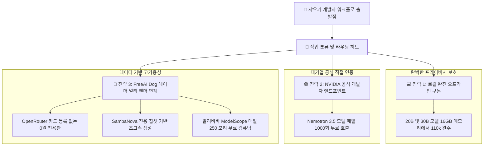

> 📌 **원문 안내**: 본 가이드는 [FreeAI Dog 공식 플랫폼](https://freeaidog.com/ko/blog/ollama-free-cloud-models-end-migration-alternatives-guide/)에서 최초 발행되었습니다. 실시간 LLM 가용성 레이더 및 인터랙티브 테스트 도구는 공식 사이트를 방문하세요: [https://freeaidog.com/ko/](https://freeaidog.com/ko/).


# Ollama 무료 클라우드 모델 서비스 종료：대상 6개 모델 목록과 3가지 0원 대체 전략

로컬 터미널이나 코드 편집기에서 클라우드 거대 모델을 손쉽게 무료로 활용해온 개발자들에게 중대한 정책 변경 소식이 전해졌습니다.

Ollama 공식 팀은 커뮤니티 공지를 통해 2026년 11월 9일부터 기존 Free 플랜의 클라우드 모델 무료 할당량을 공식 종료하고 사용량 기반의 종량제 과금 체계로 전환한다고 발표했습니다. 그동안 명령어 한 줄로 편리하게 불러 쓰던 수백억에서 천억 매개변수 규모의 고성능 클라우드 모델들이 9일 뒤부터 전면 유료화되는 것입니다.

일상적인 코딩 보조 도구나 대용량 문서 요약 파이프라인을 Ollama 클라우드 엔드포인트에 연결해 두었던 개발팀은 갑작스러운 서비스 중단 위험에 직면하게 되었습니다.

샤오커는 공식 발표 내용과 해외 커뮤니티의 실시간 대응책을 점검하고 FreeAI Dog가 상시 탐지 중인 멀티 벤더 무료 컴퓨팅 자원을 결합하여 긴급 이전 가이드를 완성했습니다. 본 글에서 소개하는 3가지 무비용 대체 경로를 적용하면 비용을 전혀 들이지 않고도 플래그십 인공지능 모델을 끊김 없이 안정적으로 계속 사용할 수 있습니다.

---

## 一、 유료화 일정과 대상 모델 목록

### 1. 주요 정책 일정
- **무료 제공 종료일**: 2026년 11월 9일
- **과금 방식의 전환**: 대상 클라우드 모델을 계속 호출하려면 계정에 크레딧을 사전 충전해야 하며 사용한 토큰 수에 따라 실시간 차감됩니다.
- **기존 구독자의 권리**: 과거 월간 유료 구독을 체결했던 기존 사용자는 기존 요금 체계가 유지되지만 신규 사용자에게는 과거 할인 플랜이 더 이상 판매되지 않습니다.

### 2. 무료 제공이 중단되는 6개 클라우드 모델

| 유료화 대상 클라우드 모델 | 매개변수 규모 | 주력 활용 분야 | 영향도 분석 |
| :--- | :--- | :--- | :--- |
| **gpt-oss:120b** | 1200억 초대형 매개변수 | 복잡한 다단계 논리 추론 및 대규모 리팩터링 | 매우 높음, 일반 개인용 PC에서 전량 구동 불가 |
| **nemotron-3-super** | 플래그십 멀티모달 사고 모델 | 소프트웨어 엔지니어링 및 코드 아키텍처 설계 | 매우 높음, 코딩 어시스턴트의 핵심 클라우드 모델 |
| **nemotron-3-ultra** | 최고 사양 올라운드 플래그십 | 학술 논문 심층 요약 및 전방위 질의응답 | 매우 높음, 무료로 쓸 수 있었던 최고 스펙 자원 |
| **gemma4:31b** | 310억 중대형 가중치 | 다국어 알고리즘 구현 및 정형 데이터 추출 | 보통, 고사양 워크스테이션에서 로컬 실행 가능 |
| **nemotron-3-nano:30b** | 300억 초고속 기본 모델 | 저지연 함수 단위 코드 완성 및 문법 검사 | 보통, 일반 16GB 그래픽카드로 로컬 대체 가능 |
| **gpt-oss:20b** | 200억 경량 추론 모델 | 일상적인 터미널 질의응답 및 명령어 보조 | 낮음, 로컬 오프라인 모델로 100퍼센트 대체 가능 |

### 3. 가장 핵심적인 불변의 약속
이번 공지에서 개발진은 매우 중요한 핵심 원칙을 재확인했습니다: **자신의 컴퓨터에서 직접 실행하는 로컬 모델은 앞으로도 영구히 100퍼센트 무료라는 점**입니다.

이번 조치는 클라우드 인프라 유지비용 급증에 대응하기 위한 불가피한 조정일 뿐이며 로컬 오픈소스 런타임 엔진으로서의 Ollama의 가치는 변함없이 굳건합니다.

---

## 二、 3가지 0원 무비용 대체 아키텍처

11월 9일 이후에도 업무 흐름을 차질 없이 이어가기 위해 샤오커는 다음과 같은 계층적 이전 토폴로지를 설계했습니다:



작업의 복잡도와 필요한 메모리 규모에 따라 최적의 대체 수단을 즉시 연결할 수 있도록 구성했습니다.

---

## 三、 단계별 마이그레이션 실무 가이드

### 전략 1: 20B에서 30B급 모델을 로컬 완전 오프라인으로 전환
목록에 포함된 gpt-oss:20b, nemotron-3-nano:30b, gemma4:31b 모델은 16GB VRAM을 갖춘 PC나 32GB 이상의 통합 메모리를 장착한 시스템이라면 클라우드 결제 없이 로컬에서 원활하게 구동할 수 있습니다.

샤오커가 앞서 검증한 내장 그래픽 화면 분리와 q5 KV 캐시 압축 기술을 적용하면 Qwen 27B나 Gemma 31B 경량 모델을 아주 쾌적하게 다룰 수 있습니다:

```bash
# 오픈소스 커뮤니티의 검증된 고성능 로컬 모델 즉시 다운로드
ollama run qwen3.8:27b

# 클라우드로의 불필요한 호출을 차단하고 완전 오프라인 모드로 고정
export OLLAMA_HOST="127.0.0.1:11434"
```

데이터가 로컬 기기 밖으로 한 걸음도 나가지 않으므로 네트워크 장애나 원격 요금 인상으로부터 완벽히 자유로워집니다.

### 전략 2: NVIDIA 공식 엔드포인트로 직결하여 Nemotron 무료 혜택 유지
Ollama 측의 클라우드 지원이 끝나더라도 NVIDIA 공식 개발자 플랫폼을 통하면 Nemotron 3.5 모델을 계속 무료로 이용할 수 있습니다.

샤오커가 정리한 연동 절차:
1. NVIDIA Build 개발자 포털에 접속하여 해외 신용카드 등록 없이 일반 계정으로 가입합니다.
2. 대시보드에서 개인 전용 API Key를 생성합니다. 기본 1000회의 무료 추론 크레딧이 지급되며 정기적으로 재충전됩니다.
3. 코드 편집기나 에이전트의 접속 주소를 NVIDIA 공식 표준 엔드포인트로 설정합니다.

호출 예시:

```bash
# NVIDIA 공식 엔드포인트를 통해 Nemotron 3.5 플래그십 모델을 호출하는 예시
curl -X POST https://integrate.api.nvidia.com/v1/chat/completions \
  -H "Authorization: Bearer 본인의_NVIDIA_API_KEY" \
  -H "Content-Type: application/json" \
  -d '{
    "model": "nvidia/nemotron-3.5-super",
    "messages": [
      {"role": "user", "content": "마이크로서비스 아키텍처의 트래픽 제어 정책을 검토해주세요"}
    ],
    "temperature": 0.6,
    "top_p": 0.95
  }'
```

실무 고려사항:
NVIDIA 공식 서비스 약관에는 모델 성능 개선을 위해 익명화된 데이터가 학습에 활용될 수 있다는 조항이 포함되어 있습니다. 기업 비밀 코드는 로컬에서 처리하고 일반적인 알고리즘 설계나 기술 리서치 위주로 활용하는 것을 권장합니다.

### 전략 3: FreeAI Dog 레이더를 활용한 멀티 벤더 무료 혜택 집약
120B급과 같은 초대형 모델은 일반 개인용 PC로 감당하기 어렵습니다. 이 영역은 당사 레이더에서 상시 검증 중인 여러 대기업의 무료 전용관으로 요청을 우회하는 것이 가장 안전합니다:

1. **OpenRouter 신용카드 불필요 0원 전용관**:
   - free 접미사가 붙은 수많은 오픈 모델을 매일 리셋되는 무료 한도로 이용할 수 있습니다.
   - 기본 주소: `https://openrouter.ai/api/v1`
2. **SambaNova Cloud 초고속 가속 전용관**:
   - 자체 제작 하드웨어 칩셋을 통해 초당 수백 토큰의 놀라운 속도를 매일 무료로 제공합니다.
   - 기본 주소: `https://api.sambanova.ai/v1`
3. **알리바바 ModelScope 오픈소스 커뮤니티**:
   - 초저지연 직통 연결을 지원하며 매일 250 모리의 무료 오픈소스 컴퓨팅 자원을 제공합니다.
   - 기본 주소: `https://api-inference.modelscope.cn/v1`

사용 중인 클라이언트 설정에서 기존 Ollama 주소를 위 주소 중 하나로 교체하고 발급받은 무료 키를 입력하면 작업 환경이 즉시 정상화됩니다.

---

## 四、 이전 방안별 종합 비교 평가

| 대체 전략 | 지원 모델 규모 | 응답 지연 시간 | 추가 비용 | 데이터 보안 및 프라이버시 |
| :--- | :--- | :--- | :--- | :--- |
| **전략 1: 로컬 완전 오프라인** | 20B에서 30B급 모델 | 밀리초 단위 즉각 응답 | 완전 무료 | 최고 수준, 데이터 유출 가능성 제로 |
| **전략 2: NVIDIA 공식 연동** | Nemotron 플래그십 시리즈 | 200ms에서 300ms 수준 | 완전 무료, 공식 크레딧 제공 | 일반 개발용 적합, 학습 활용 약관 존재 |
| **전략 3: 레이더 멀티 벤더 활용** | 70B에서 120B급 초대형 모델 | 150ms에서 400ms 수준 | 완전 무료, 매일 자동 충전 | 엔터프라이즈급 API 보안 격리 보장 |

---

## 五、 개발자를 위한 실천 권고사항

클라우드 호스팅 서비스의 유료화는 인공지능 산업 성숙에 따른 필연적인 흐름입니다. 외부 플랫폼의 정책 변화에 흔들리지 않으려면 언제든 전환 가능한 유연하고 탈중앙화된 개발 환경을 구축해 두어야 합니다.

11월 9일 마감 시점까지 앞으로 9일이 남았습니다. 샤오커는 이번 주 안으로 다음 3가지 조치를 완료할 것을 강력히 권장합니다:
1. **자동화 파이프라인 전수 조사**: 사내 코드베이스나 에이전트 설정 파일에 6개 대상 모델이 하드코딩되어 있는지 점검합니다.
2. **예비 무료 키 사전 확보**: NVIDIA Build와 OpenRouter에 접속하여 5분 만에 예비 무료 API 키를 미리 발급받아 둡니다.
3. **FreeAI Dog 데일리 레이더 활용**: 대형 플랫폼의 정책 변동에 발맞추어 당사 플랫폼에서는 240개 이상의 엔드포인트를 24시간 감시하며 새로운 무료 대안을 가장 빠르게 업데이트하고 있습니다.

---

> 💡 **원문 출처 및 실시간 모니터링**：
> - 원문 출처: [FreeAI Dog 공식 블로그](https://freeaidog.com/ko/blog/ollama-free-cloud-models-end-migration-alternatives-guide/)
> - 무료 대형 언어 모델 실시간 가용성 및 지연 시간 측정은 [FreeAI Dog 가용성 레이더](https://freeaidog.com/ko/radar/)에서 확인하세요.

