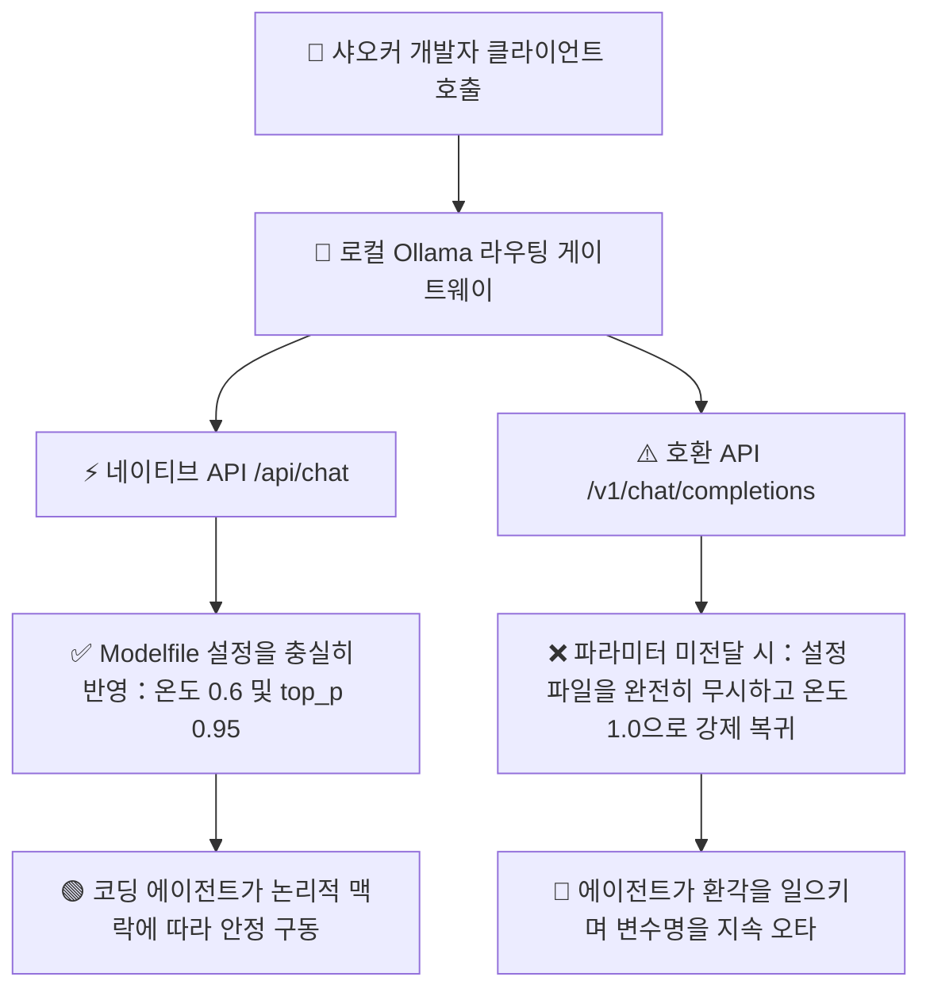

> 📌 **원문 안내**: 본 가이드는 [FreeAI Dog 공식 플랫폼](https://freeaidog.com/ko/blog/ollama-v1-temperature-bug-greedy-coding-pitfalls-guide/)에서 최초 발행되었습니다. 실시간 LLM 가용성 레이더 및 인터랙티브 테스트 도구는 공식 사이트를 방문하세요: [https://freeaidog.com/ko/](https://freeaidog.com/ko/).


# 엔진이 제멋대로 1.0으로 폭주하지 않게 하라: 디코딩 설정 함정과 Ollama의 온도 무시 버그 실측

로컬 환경에서 코딩 어시스턴트나 자율형 개발 에이전트를 구동할 때 많은 엔지니어가 직관적인 착각에 빠지곤 합니다. 온도 매개변수를 0이나 0.1로 낮추면 모델이 컴파일러처럼 엄격하고 확정적으로 코드를 생성해줄 것이라 믿는 것입니다. 그러나 실제 실무 현장에서는 온도를 극단적으로 낮출수록 복수 파일 리팩터링이나 알고리즘 설계 과정에서 모델이 무의미한 코드 반복 루프에 갇히거나 기본적인 함수명을 오타 내는 기현상이 자주 관찰됩니다.

심층적인 네트워크 추적과 샘플링 통계를 분석한 결과 샤오커는 매우 치명적인 두 가지 기술적 원인을 밝혀냈습니다:
첫째, 사고 능력을 갖춘 최신 추론 모델의 문제 해결력은 토큰 확률 샘플링의 적절한 엔트로피에 크게 의존하며 탐욕 디코딩은 이러한 비검색형 추론 지능을 저해합니다.
둘째, 가장 위험한 규격 결함으로서 Ollama의 표준 호환 엔드포인트는 호출 측에서 파라미터를 명시하지 않을 경우 Modelfile에 적힌 설정을 완전히 무시하고 시스템 기본값 1.0의 최대 무작위성으로 동작해버립니다.

정성껏 튜닝해둔 설정 파일이 통째로 씹히고 있었다는 뜻입니다. 본 글에서는 이 문제를 입증하는 검증 스크립트와 안전한 실무 대책을 안내합니다.

---

## 一、 탐욕 디코딩의 병목과 오해

### 1. 극저온 설정이 코딩 모델을 멍청하게 만드는 이유
온도를 0으로 설정하면 수학적 탐욕 디코딩 방식으로 동작합니다. 매 단계에서 확률이 가장 높은 단일 토큰만 선택하는 구조입니다. 단순 사실 검색에는 적합하지만 프로그래밍 환경에서는 치명적인 결함을 유발합니다:
- **우수한 대안 경로의 배제**: 뛰어난 알고리즘 코드는 확률 순위에서 두 번째나 세 번째에 위치한 참신한 토큰에서 출발하는 경우가 많습니다. 좁은 외길에 갇히면 모델이 잘못된 가설을 스스로 수정하지 못합니다.
- **파괴적인 무한 루프와 퇴행**: 시퀀스가 한 번 국소 최적점에 빠지면 그 뒤에 가장 확률이 높아지는 것은 직전 패턴의 반복이 되며 결국 동일한 코드 블록을 끊임없이 복사하는 루프가 발생합니다.
- **공식 문서의 경고**: Qwen 공식 모델 카드에서도 사고 모드가 켜진 상태에서 탐욕 디코딩을 적용하면 극심한 지능 저하와 반복 출력이 발생하므로 온도 0 사용을 피하라고 명시하고 있습니다.

### 2. 투기적 디코딩 벤치마크의 숫자 착시
추론 가속 벤치마크에서 초당 수백 토큰을 넘나드는 놀라운 수치가 발표되곤 합니다. 샤오커는 이 측정 조건의 이면을 주의 깊게 살펴봐야 한다고 강조합니다:
상당수 벤치마크는 의도적으로 온도 0의 탐욕 모드에서 진행됩니다. 확정적인 상태에서는 초안 모델의 토큰 채택률이 95퍼센트를 손쉽게 넘기며 화려한 수치가 나오기 때문입니다. 하지만 실제 비영도 환경에서는 채택률이 눈에 띄게 떨어집니다. 홍보용 벤치마크 수치를 맹신하여 실무 설정을 결정해서는 안 됩니다.

---

## 二、 내부 원인 분석과 데이터 검증

### 1. Ollama 표준 엔드포인트의 파라미터 누락 버그
엔지니어는 보통 Modelfile에 권장 설정을 작성해 둡니다:

```dockerfile
FROM qwen3.8:27b
PARAMETER temperature 0.6
PARAMETER top_p 0.95
PARAMETER top_k 20
```

그러나 Ollama 내부 라우팅 구조에는 치명적인 두 갈래 경로가 존재합니다:



Cursor나 Aider 같은 도구가 표준 호환 엔드포인트를 통해 통신할 때 요청 본문에 온도가 명시되어 있지 않으면 서버는 설정 파일의 값을 읽지 않고 하드코딩된 기본값 1.0을 적용합니다. 0.6으로 안전하게 돌리고 있다고 믿었지만 실제로는 1.0의 최대 무작위성 속에서 동작하고 있던 셈입니다.

### 2. 30회 과일 이름 출력 검증 실험
이 현상을 증명하기 위해 샤오커는 간단한 통계적 실험을 설계했습니다: 모델에게 흔한 과일 이름을 하나만 출력하도록 요청하고 30회 연속 실행하여 결과의 분산도를 측정합니다.

온도 0.6에서는 사과 등 서너 가지 결과로 집중되지만 온도 1.0에서는 답변이 광범위하게 흩어집니다.

터미널에서 다음 테스트 스크립트를 실행했습니다:

```bash
#!/bin/bash
# 네이티브 API와 호환 API 간의 샘플링 분산도 검증

echo "=== 테스트 1: 네이티브 /api/chat 엔드포인트 ==="
for i in {1..30}; do
  curl -s http://localhost:11434/api/chat -d '{
    "model": "qwen3.8:27b",
    "messages": [{"role": "user", "content": "문장 부호 없이 가장 흔한 과일 이름 하나만 출력해줘"}],
    "stream": false
  }' | jq -r '.message.content'
done | sort | uniq -c

echo "=== 테스트 2: 호환 /v1/chat/completions 엔드포인트 파라미터 미지정 ==="
for i in {1..30}; do
  curl -s http://localhost:11434/v1/chat/completions -H "Content-Type: application/json" -d '{
    "model": "qwen3.8:27b",
    "messages": [{"role": "user", "content": "문장 부호 없이 가장 흔한 과일 이름 하나만 출력해줘"}]
  }' | jq -r '.choices[0].message.content'
done | sort | uniq -c
```

실험 결과 비교 매트릭스:

| 연결 경로 | 목표 설정 | 고유 답변 가짓수 | 최다 빈출 토큰 횟수 | 실질 체감 동작 온도 |
| :--- | :--- | :--- | :--- | :--- |
| **네이티브 API 경로** | 설정 파일에 0.6 지정 | 단 3종류 | 사과가 24회 | 0.6 설정에 정확히 수렴 |
| **호환 API 미지정** | 설정 파일에 0.6 지정 | 8종류로 급증 | 답변이 크게 분산 | 1.0 상당의 최대 무작위 |
| **호환 API 명시 지정** | 요청 본문에 0.6 주입 | 3종류로 복귀 | 사과가 25회 | 의도했던 설정으로 정상화 |

명시적으로 파라미터를 넘겨주지 않는 한 호환 API는 설정 파일을 완전히 무시하고 있음을 실측으로 입증했습니다.

---

## 三、 실무 프로덕션 환경의 대응 방안

해결책은 간단하며 두 가지 엔지니어링 습관을 정착시키면 됩니다.

### 1단계: 클라이언트 호출 시 샘플링 파라미터를 명시적으로 전송
서버 측의 묵시적 상속을 믿지 말고 모든 외부 클라이언트 요청 설정에 파라미터를 직접 명시합니다:

Aider 설정 파일에서 명시하는 경우:

```yaml
# aider 설정에서 샘플링 파라미터를 강제 주입
temperature: 0.6
```

표준 API 호출 시:

```bash
# 파라미터를 명시적으로 포함한 표준 API 호출 예시
curl -X POST http://localhost:11434/v1/chat/completions \
  -H "Content-Type: application/json" \
  -d '{
    "model": "qwen3.8:27b",
    "messages": [
      {"role": "system", "content": "당신은 숙련된 풀스택 엔지니어입니다"},
      {"role": "user", "content": "인증 모듈 코드를 리팩터링해주세요"}
    ],
    "temperature": 0.6,
    "top_p": 0.95
  }'
```

### 2단계: 주요 모델 계열별 권장 파라미터 매트릭스
모델 아키텍처에 따라 최적의 설정값은 상이합니다:

| 모델 계열 | 권장 온도 범위 | 권장 top_p | 권장 top_k | 핵심 주의사항 |
| :--- | :--- | :--- | :--- | :--- |
| **Qwen 3.8 사고형 시리즈** | 0.6에서 0.7 | 0.95 | 20에서 40 | 루프 방지를 위해 온도 0 사용 금지 |
| **DeepSeek R1 및 V3 시리즈** | 0.6 | 0.95 | 무제한 | 공식 가이드가 권장하는 기본 균형점 |
| **Gemma 4 시리즈** | 0.1에서 0.2 | 0.90 | 40 | 낮은 온도에서 코딩 성향이 개선되는 예외 모델 |
| **범용 7B 및 8B 기본 모델** | 0.7 | 0.90 | 40 | 0.5 미만 적용 시 문장이 지나치게 경직됨 |

---

## 四、 엔지니어링 결론

코딩 에이전트의 예기치 못한 오작동은 모델 자체의 성능 부족보다는 통신 게이트웨이 계층의 암묵적인 기본값 오작동에서 비롯되는 경우가 많습니다.

샤오커의 실무 권장 수칙:
1. **결정론의 함정 탈피**: 다단계 추론에서는 탐욕 디코딩을 지양하고 적절한 무작위성을 확보해야 오류 복구 능력이 유지됩니다.
2. **핵심 파라미터의 명시적 전달**: 호환 인터페이스를 연동할 때는 서버가 설정을 알아서 반영해줄 것이라 넘겨짚지 말고 직접 파라미터를 전달해야 합니다.
3. **간이 벤치마크 검증**: 에이전트 동작이 이상해질 때는 30회 과일 테스트 같은 가벼운 스크립트로 게이트웨이의 이상 여부를 빠르게 가려낼 수 있습니다.

---

> 💡 **원문 출처 및 실시간 모니터링**：
> - 원문 출처: [FreeAI Dog 공식 블로그](https://freeaidog.com/ko/blog/ollama-v1-temperature-bug-greedy-coding-pitfalls-guide/)
> - 무료 대형 언어 모델 실시간 가용성 및 지연 시간 측정은 [FreeAI Dog 가용성 레이더](https://freeaidog.com/ko/radar/)에서 확인하세요.

