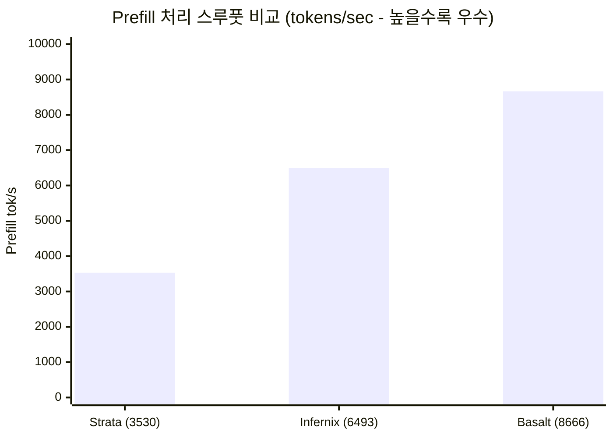

> 📌 **원문 안내**: 본 가이드는 [FreeAI Dog 공식 플랫폼](https://freeaidog.com/ko/blog/qwen-3-8-flash-next-engine-benchmark-basalt-strata-guide/)에서 최초 발행되었습니다. 실시간 LLM 가용성 레이더 및 인터랙티브 테스트 도구는 공식 사이트를 방문하세요.


# Qwen 3.8 Flash Next 엔진 벤치마크: Basalt 187 t/s 폭주 vs llama.cpp 39 t/s 꼴찌! 7대 엔진 실측 및 '전문가 건너뛰기' 함정 가이드

로컬 환경에서 오픈소스 LLM을 직접 구동하는 유저라면 대부분 `llama.cpp`나 `Ollama`를 먼저 떠올릴 것입니다. GGUF 양자화 생태계가 워낙 폭넓고 안정적이기 때문입니다.

하지만 최근 알리바바가 오픈소스로 공개한 최신 **Qwen 3.8 Flash Next**(초고속 추론과 지능을 겸비한 MoE 혼합 전문가 모델)가 등장하면서 이러한 구도에 큰 균열이 생겼습니다. Reddit의 r/LocalLLaMA 커뮤니티에서 진행된 최신 벤치마크에서, 한 엔지니어가 동일한 **단일 RTX 5090 @ 400W + 128GB RAM** 환경을 구성하고 현재 가장 주목받는 7개 추론 엔진을 맞비교했습니다.

결과는 그야말로 충격적이었습니다:
- **전통의 강자 llama.cpp는 디코드(Decode) 속도 32 ~ 39 tokens/s로 최하위 기록**;
- 반면 신예 **Basalt 엔진은 무려 187 tokens/s**를 기록하며 거의 **5배** 빠른 수치를 보여주었습니다! 사전 프롬프트 처리(Prefill) 속도 역시 3,500에서 **8,666 tokens/s**로 2배 이상 폭증했습니다.

동일한 그래픽카드, BIOS 개조나 오버클럭 없이 **추론 엔진 하나 바꿨을 뿐인데 5배의 성능을 공짜로 얻어낸 것**입니다.

하지만 여기에 함정은 없을까요? 일부 엔진이 벤치마크 점수를 올리기 위해 몰래 계산을 건너뛰어 모델의 추론 지능을 떨어뜨린 것은 아닐까요? 저(샤오커)가 원문의 상세 기술 데이터, 벤치마크 로그, 코드 내부 구조와 주의사항을 전수 분석하여 군더더기 없는 실전 가이드를 준비했습니다.

---

## 1. 7대 추론 엔진 실측 벤치마크 종합 비교

GPU 온도 상승에 따른 쓰로틀링과 메모리 잔류 데이터의 간섭을 배제하기 위해 테스트는 매우 엄격한 조건에서 진행되었습니다:
- **하드웨어 사양**: 단일 RTX 5090 (전력 제한 400W 설정) + 128 GB DDR5 메모리;
- **테스트 모델**: Qwen 3.8 Flash Next (NVIDIA 공식 배포 **NVFP4 풀웨이트**);
- **테스트 프로토콜**: 7회 Greedy 샘플링 요청, 매 요청마다 콜드 스타트 수행, 25K / 50K / 100K / 200K 초장문 컨텍스트 4단계 측정.

### 1) 디코드 속도 (Decode Speed · tokens/sec)
실제 대화나 코드 자동완성 시 체감되는 생성 출력 속도입니다:

| 추론 엔진 | 25K 컨텍스트 | 50K 컨텍스트 | 100K 컨텍스트 | 200K 컨텍스트 | llama.cpp 대비 향상폭 |
| :--- | :---: | :---: | :---: | :---: | :---: |
| **Basalt** *(적극 추천)* | **187 t/s** | **184 t/s** | **180 t/s** | **160 t/s** | **+380% (4.8배)** 🚀 |
| **Infernix** | 174 t/s | 176 t/s | 163 t/s | 158 t/s | +350% (4.5배) |
| **capy-flash** | 143 t/s | 152 t/s | 152 t/s | 135 t/s | +270% (3.7배) |
| **Strata** | 123 t/s | 121 t/s | 123 t/s | 114 t/s | +220% (3.2배) |
| **ninfer-ext** | 86 t/s | 79 t/s | 95 t/s | 66 t/s | +120% (2.2배) |
| **ninfer** | 46 t/s | 47 t/s | 53 t/s | 44 t/s | +20% (1.2배) |
| **llama.cpp** *(기존 표준)* | 36 t/s | 35 t/s | 39 t/s | 32 t/s | *기준선 (1.0배)* 🐢 |

### 2) 프리필 처리량 (Prefill Throughput · tokens/sec)
수만 자의 긴 문서나 대형 코드베이스를 모델에 입력할 때 읽어 들이는 처리 속도입니다:



- **Basalt**: 짧은 문맥 6,492 tok/s에서 초장문 **8,666 tok/s**까지 가파르게 상승;
- **Infernix**: 약 6,500 tok/s 선에서 안정적 유지;
- **Strata**: 3,530 ~ 4,245 tok/s 수준으로, Basalt의 문서 파싱 속도가 Strata보다 **2배 이상** 빠릅니다.

---

## 2. 심층 검증: 고속 주행 뒤에 '꼼수'는 없는가?

MoE 모델 구조를 아는 개발자라면 바로 의문을 가질 것입니다. "Qwen 3.8 Flash Next는 MoE 모델인데, 이렇게까지 빠르다면 뒤에서 전문가 연산을 몰래 건너뛴 것(Expert Tail Skip) 아니야?"

이번 커뮤니티 토론에서 가장 가치 있었던 지점이 바로 이 '추론 품질의 진실성'에 대한 공방이었습니다.

### 1) 점수 부풀리기의 함정: 전문가 건너뛰기(Tail Skip)란?
MoE 모델은 각 토큰을 처리할 때 게이트 라우터가 가중치 상위 전문가들을 선별합니다. 그런데 일부 엔진은 극한의 속도를 내기 위해 **가중치가 낮은 하위 전문가들의 연산을 강제로 생략**하는 과격한 기법을 씁니다.
- **Strata의 방식**: 환경 변수 `STRATA_ROUTE_TAIL_SKIP=7`이 기본 활성화되어 있습니다! 즉, 하위 7개 전문가 연산을 강제로 잘라내어 프레임을 올리는 방식입니다.
- **어떤 대가를 치르는가?** 이러한 생략은 무손실이 아닙니다. 복잡한 다단계 추론, 도구 호출(Function Calling), 구조화된 코드 작성 시 지능 저하와 함수 호출 무한 루프 오류를 유발합니다.

### 2) Basalt가 인정받는 기술적 근거
Basalt 개발팀은 오픈소스 코드와 실험 데이터를 통해 다음 두 가지를 증명했습니다:
1. **Basalt는 전문가 건너뛰기를 전혀 사용하지 않음**: 활성화되어야 할 모든 전문가를 전액 계산합니다. 개발자가 건너뛰기 테스트를 진행했을 때, KL 발산(KLD) 수치가 양자화 1등급 수준으로 급격히 악화된 반면 속도 이득은 미미했기 때문에 **100% 완전 연산 방식**을 고수했습니다.
2. **함수 호출 실패율 0% 기록**: 공식 NVFP4 가중치와 엄격한 문법 제약(Grammar Enforcement) 환경에서 수백 회의 실전 함수 호출 및 JSON 출력 테스트를 거친 결과, **단 한 번의 다운, 인자 누락, 무한 루프도 발생하지 않았습니다**.
3. **KLD 일치성**: Unsloth Q8 기준선과의 비교에서 Basalt 출력 분포와 llama.cpp 간의 상대 엔트로피(KLD)는 사실상 0으로 수렴했습니다.

> **샤오커의 실측 결론**: **Basalt의 187 t/s는 계산을 누락시켜 만든 허수가 아니라, 아키텍처 최적화로 일궈낸 '진짜 속도'입니다.**

---

## 3. 실전 구축 가이드: Basalt로 초고속 Qwen 3.8 구동하기

Basalt는 현재 GitHub에 전체 코드가 오픈소스로 공개되어 있습니다 (저장소: `github.com/jesdga95/basalt`). llama.cpp의 거대한 레거시 코드를 걷어내고, 최신 NVIDIA GPU(Ada Lovelace 40 시리즈 및 Blackwell 50 시리즈)에 특화되어 설계되었습니다.

Linux / WSL2 환경에서 빌드하고 실행하는 전체 단계는 다음과 같습니다.

### 1단계: 빌드 환경 구성
NVIDIA 공식 드라이버, CUDA 12.6 이상, C++ 컴파일 도구를 설치합니다:

```bash
# 필수 컴파일 도구 및 CMake, Ninja 설치
sudo apt-get update && sudo apt-get install -y \
    build-essential cmake ninja-build git git-lfs

# CUDA 컴파일러 버전 점검 (>= 12.6 권장)
nvcc --version
```

### 2단계: 소스코드 복제
```bash
git clone --recursive https://github.com/jesdga95/basalt.git
cd basalt
```

### 3단계: 고성능 릴리즈 빌드
Basalt는 모던 CMake 기반으로 작성되어 있어 하드웨어 최적화 플래그를 자동으로 구성합니다:

```bash
mkdir -p build && cd build

# 릴리즈 모드 빌드 설정
cmake .. -G Ninja -DCMAKE_BUILD_TYPE=Release

# 멀티스레드 병렬 컴파일
ninja -j$(nproc)
```
빌드가 완료되면 `build/bin/` 디렉터리에 `basalt-cli`와 `basalt-server` 실행 파일이 생성됩니다.

### 4단계: 공식 NVFP4 가중치 다운로드 및 서버 실행
변형된 비공식 양자화 대신 HuggingFace 공식 저장소에서 검증된 NVFP4 가중치를 내려받습니다:

```bash
# Basalt 로컬 고성능 서버 실행
./bin/basalt-server \
    --model-path /path/to/Qwen3.8-Flash-Next-NVFP4 \
    --port 8000 \
    --ctx-size 131072 \
    --gpu-layers 999
```
서버가 시작되면 로컬 `8000` 포트에서 완벽한 OpenAI 호환 API(`/v1/chat/completions`)가 열립니다. Cursor, Chatbox, Immersive Translate는 물론 FreeAI Dog 웹의 API 디버깅 창에 즉시 연동하여 사용할 수 있습니다.

---

## 4. 환경별 엔진 선택 가이드

| 보유 하드웨어 및 환경 | 추천 엔진 | 핵심 선정 이유 |
| :--- | :--- | :--- |
| **NVIDIA RTX 4090 / 5090 / 5080** | **Basalt** 🏆 | 네이티브 NVFP4 가속으로 손실 없이 4~5배 속도 향상 |
| **AMD 라데온 (RX 9070 XT / 7900 XTX 등)** | **Strata** 🥈 | ROCm 네이티브 지원으로 RDNA4 환경에서 70~90 t/s 달성 |
| **Apple Silicon (Mac M 시리즈) 또는 CPU 전용** | **llama.cpp / Ollama** | 범용 아키텍처 호환성과 포터블 지원 면에서 여전히 최고 선택지 |
| **초저예산 시스템 (X99 + MI50 중고 구성 등)** | **Strata (Atomic Q4)** | 200달러 안팎의 저비용으로 30~50 t/s 로컬 환경 구축 가능 |

---

## 마치며

로컬 AI 모델을 운용할 때 흔히 "속도를 높이려면 더 비싼 그래픽카드를 사야만 한다"고 생각하기 쉽습니다. 그러나 이번 7대 엔진 벤치마크가 입증하듯, **소프트웨어 커널 최적화와 최신 아키텍처가 가져다주는 보너스는 하드웨어 세대교체에 결코 뒤지지 않습니다.**

llama.cpp의 39 t/s에서 Basalt의 187 t/s까지, 단 1원의 하드웨어 추가 지출 없이 달성한 도약입니다.

FP4 / FP8을 지원하는 그래픽카드를 보유하고 계시다면 지금 바로 Basalt를 빌드해 보세요! 빌드 과정에서 발생하는 에러나 궁금한 점은 댓글로 남겨주시면 샤오커가 빠르게 답변해 드리겠습니다.

---

> 💡 **원문 출처 및 실시간 모니터링**：
> - 원문 출처: [FreeAI Dog 공식 블로그](https://freeaidog.com/ko/blog/qwen-3-8-flash-next-engine-benchmark-basalt-strata-guide/)
> - 무료 대형 언어 모델 실시간 가용성 및 지연 시간 측정은 [FreeAI Dog 가용성 레이더](https://freeaidog.com/ko/radar/)에서 확인하세요.
