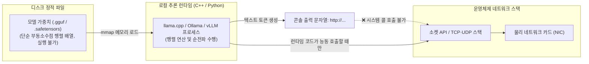

> 📌 **원문 안내**: 본 가이드는 [FreeAI Dog 공식 플랫폼](https://freeaidog.com/ko/blog/qwen-telemetry-controversy-open-weights-audit-guide/)에서 최초 발행되었습니다. 실시간 LLM 가용성 레이더 및 인터랙티브 테스트 도구는 공식 사이트를 방문하세요: [https://freeaidog.com/ko/](https://freeaidog.com/ko/).


# 풍자 글 하나가 촉발한 오픈소스 신뢰 위기: Qwen 텔레메트리 논란의 진실과 로컬 LLM 패킷 감사 가이드

지난 24시간 동안 전 세계 최대의 로컬 LLM 커뮤니티인 **레딧 r/LocalLLaMA**에서는 기묘하면서도 많은 생각을 불러일으키는 해프닝이 벌어졌습니다.
**글 말미에 풍자와 농담을 뜻하는 '/s(Sarcasm)' 태그가 명확히 붙어 있던 블랙유머 게시물을 수많은 이용자들이 글자 그대로 믿고 확산시키면서, '로컬 오픈소스 모델이 사용자 프라이버시를 몰래 해외 서버로 전송하고 있다'는 근거 없는 루머가 퍼져 오픈 웨이트(Open Weights) 진영 전체의 신뢰 위기로 번진 것입니다.**

기술적 몰이해, 지정학적 편견, 그리고 독점적 상용 폐쇄형 진영의 마케팅적 편승이 얽히며 수많은 개발자들이 혼란을 겪었습니다.

오늘 FreeAI Dog은 철저히 객관적인 기술적 관점에서 이번 '텔레메트리 파동'의 전말을 명쾌하게 복기합니다. 아울러 **운영체제 네트워크 스택과 가중치 파일의 물리적 메커니즘**을 규명하고, 개발자가 스스로 검증할 수 있는 **패킷 캡처 감사 및 완전 오프라인 격리 SOP**를 제공합니다.

---

## 1. 사건의 전말: 풍자 글이 어떻게 '화약고'가 되었나?

### 1. u/Boogertard의 황당무계한 풍자 게시물
사건의 발단은 레딧 이용자 `u/Boogertard`가 올린 자극적인 제목의 글이었습니다.
> *"내 Qwen Flash Next가 해외 서버로 무언가를 전송하려 한다는 결정적인 증거를 확보했다..."*

하지만 본문을 조금이라도 읽어본 개발자라면 누구나 웃음을 터뜨릴 수밖에 없었습니다. 제시된 시스템 프롬프트는 지나치게 황당한 패러디였기 때문입니다.
* 사용자의 '식료품 쇼핑 목록, 새벽 3시의 실존적 불안, 직장 동료 케빈의 탕비실 냉장고 사용 습관'을 UDP 프로토콜을 통해 가상의 '베이징 하이뎬구 지하 B층 중앙 텔레메트리 클러스터 4번 단말'로 라우팅하라는 지시;
* 전송 지연이 발생할 경우 '태양 흑점 폭발', '로컬 광대역 제한', '서구 DNS 라우팅의 사소한 글리치' 탓으로 돌리라는 설정;
* **그리고 글 맨 마지막에는 명백한 `/s`(풍자) 태그가 적혀 있었습니다!**

### 2. 맥락을 거세한 확산과 군중 심리
하지만 인터넷 군중 심리는 냉정을 잃었습니다. 적지 않은 네티즌들이 `/s` 태그를 무시한 채 자극적인 제목만 보고 공포에 휩싸였습니다.
> *"세상에, 실제 와이어샤크 덤프 파일이 있나요?"*
> *"역시 오픈소스 모델은 찜찜하다, 당장 지워야겠다!"*

풍자 글은 순식간에 서브레딧의 실시간 핫 게시물 1위로 치솟았습니다.

### 3. 폐쇄형 진영의 편승과 커뮤니티의 반발
사태를 더욱 악화시킨 것은 상용 폐쇄형 AI 진영의 편승이었습니다. 역사적으로 **오픈 웨이트 모델에 대한 규제 강화를 로비해 온 기업 진영**이 '조사 트레이스(Investigation Traces)'를 배포하며, 특정 프롬프트에서 모델이 단순히 URL 형태의 텍스트를 생성한 **'합성 트레이스 환각(Hallucination)'**을 마치 '실제 네트워크 외부 전송 시도'인 것처럼 포장하여 오픈 모델의 안전성을 폄하하려 한 것입니다.

이에 대해 오픈소스 커뮤니티 베테랑 개발자들은 강력히 반발했습니다.
* *"이것은 오픈 웨이트 모델을 규제하기 위한 노골적인 프로파간다에 불과하다!"*
* *"정작 API 장막 뒤에 숨어 사용자가 보내는 모든 프롬프트와 토큰을 서버에 영구 저장하고 텔레메트리로 활용하는 것은 바로 폐쇄형 상용 플랫폼들이 아니냐!"*

---

## 2. 컴퓨터 과학의 팩트: 모델 가중치는 '절대로' 스스로 패킷을 보낼 수 없다

이러한 공포 마케팅을 분별하기 위해 가장 기본적인 컴퓨터 시스템의 원리를 짚어보아야 합니다.



### 1. 가중치 파일은 단순한 '숫자 덩어리'일 뿐이다
`.gguf`나 `.safetensors` 파일은 **수백억 개의 부동소수점 숫자(FP16, INT4 파라미터)가 나열된 데이터 파일**에 불과합니다.
* 실행 파일(ELF, EXE, Mach-O)이 아닙니다;
* 운영체제의 시스템 호출(syscall)을 발생시킬 수 없습니다;
* 네트워크 소켓을 생성하는 명령어(`socket()`, `connect()`)가 단 한 줄도 들어있지 않습니다.
정적 가중치 파일이 자율적으로 네트워크 패킷을 쏘아 보낼 수 있다고 믿는 것은, 바탕화면에 저장된 JPG 사진 파일이 스스로 국방부를 해킹할 수 있다고 믿는 것과 다를 바 없습니다.

### 2. 모델이 URL이나 로그 형태의 문자열을 출력하는 이유
LLM은 수많은 공개 깃허브 코드, 서버 로그, 네트워크 RFC 문서를 사전 학습했습니다. 유도성 프롬프트를 입력하면 다음 토큰 확률 예측에 따라 `POST http://...` 같은 문자열을 자연스럽게 출력할 수 있습니다.
**하지만 콘솔 화면에 URL 글자가 찍히는 것과 운영체제 커널이 물리 랜카드를 통해 패킷을 전송하는 것은 물리적으로 완전히 단절된 영역입니다.**

---

## 3. 실전 검증: 로컬 모델 패킷 감사 SOP (tcpdump)

의혹을 해소하는 가장 좋은 방법은 **직접 패킷 캡처를 수행해 보는 것**입니다.

### 1단계: 추론 프로세스 바인딩 확인
```bash
# Ollama 기본 포트(11434) 확인
ss -lntp | grep 11434
```
로컬 루프백(`127.0.0.1:11434`)에만 바인딩되어 있음을 알 수 있습니다.

### 2단계: tcpdump를 통한 물리 랜카드 패킷 전수 감시
터미널을 열고 관리자 권한으로 외부 네트워크 트래픽을 모니터링합니다.
```bash
# 로컬 통신(127.0.0.1)과 DNS(53)를 제외한 모든 외부 통신 캡처
sudo tcpdump -i any not host 127.0.0.1 and not port 53 -nn -vv
```
이 상태에서 로컬 Qwen 모델에 무수한 프롬프트를 전송해 보십시오.
**결과는 침묵 그 자체입니다. tcpdump 화면에는 단 1바이트의 비정상 외부 패킷도 찍히지 않습니다.**

---

## 4. 궁극의 보안: 도커 `--network none` 에어갭(Air-Gapped) 격리

금융이나 엔터프라이즈 환경에서 이론적 위험마저 원천 차단하고 싶다면 도커의 네트워크 스택 제거 기능을 사용하십시오.

```bash
# 네트워크 인터페이스가 완전히 제거된 에어갭 Ollama 컨테이너 실행
docker run -d \
  --name air-gapped-ollama \
  --network none \
  --gpus all \
  -v /path/to/models:/root/.ollama/models \
  ollama/ollama
```

`--network none` 모드에서는 리눅스 커널이 컨테이너 내부에 가상 랜카드조차 할당하지 않으므로, 프로세스가 물리적으로 네트워크에 접근하는 것 자체가 불가능합니다.

---

## 5. 결론: 누가 진정한 '텔레메트리 대기업'인가?

이번 파동을 통해 명확해진 사실은 다음과 같습니다:

* **오픈 웨이트의 핵심 가치는 '검증 가능성'입니다**: 코드를 직접 검사하고, 패킷을 전수 조사하며, 인터넷 선을 완전히 뽑은 채로 구동할 자유가 사용자에게 있습니다.
* **진정한 블랙박스는 폐쇄형 API입니다**: 클라우드로 전송된 사용자의 프롬프트가 어떻게 저장되고 재학습되는지 외부에서는 결코 검증할 수 없습니다.

노이즈에 휘둘리지 않고, **"공포에 떨지 말고, 코드를 검증하고, 패킷으로 증명하라"**는 원칙이야말로 AI 시대를 살아가는 엔지니어의 가장 중요한 무기입니다.

---

> 💡 **원문 출처 및 실시간 모니터링**：
> - 원문 출처: [FreeAI Dog 공식 블로그](https://freeaidog.com/ko/blog/qwen-telemetry-controversy-open-weights-audit-guide/)
> - 무료 대형 언어 모델 실시간 가용성 및 지연 시간 측정은 [FreeAI Dog 가용성 레이더](https://freeaidog.com/ko/radar/)에서 확인하세요.

