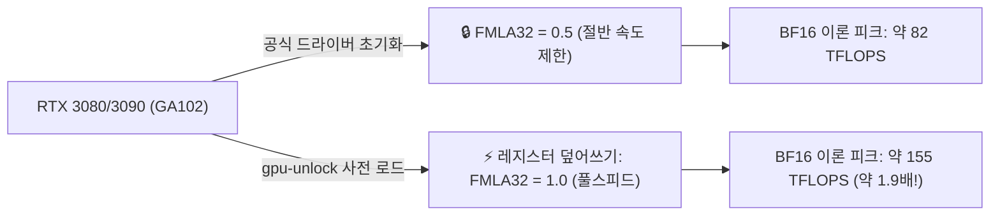

> 📌 **원문 안내**: 본 가이드는 [FreeAI Dog 공식 플랫폼](https://freeaidog.com/ko/blog/rtx-3090-gpu-unlock-bf16-kernel-module-guide/)에서 최초 발행되었습니다. 실시간 LLM 가용성 레이더 및 인터랙티브 테스트 도구는 공식 사이트를 방문하세요.


# RTX 3090 연산 성능 1.9배 무료 해금? Zagitta GPU Unlock 커널 모듈 실측 및 LLM 실제 체감 성능

로컬에서 대형 언어 모델(LLM)을 구동하는 홈랩 유저들에게 24GB VRAM을 갖춘 **RTX 3090**은 여전히 최고의 가성비 카드입니다. 샤오커(小可)의 작업실에서도 3090 두 장이 Qwen과 Llama 등 로컬 모델 추론 및 파인튜닝용으로 매일 활발하게 돌아가고 있습니다.

하지만 하드웨어 매니아들 사이에는 널리 알려진 공공연한 비밀이 있었습니다. **엔비디아(NVIDIA)가 일반 소비자용 GA102 칩(RTX 3080 / 3090 / 3090 Ti)에서 FP32 누적 Tensor Core 연산 속도(드라이버 내부의 `FMLA32` 명령어)를 절반(Half Speed)으로 고의 제한해 두었다는 사실**입니다. 수백만 원을 호가하는 기업용 카드(RTX A6000 등)로의 구매를 유도하기 위해서였죠.

이전에는 이를 풀려면 벽돌 위험을 무릅쓰고 개조 vBIOS를 씌워야만 했습니다. 그런데 오늘 r/LocalLLaMA에서 개발자 Zagitta가 공개한 **`gpu-unlock` Linux 커널 모듈**이 커뮤니티를 뒤흔들었습니다: **vBIOS를 건드릴 필요도, 비공식 드라이버를 깔 필요도 없이, 엔비디아 드라이버가 로드되기 직전 레지스터를 가로채 텐서 코어를 본래의 풀스피드로 복구**하는 매우 깔끔한 방식입니다.

샤오커가 곧바로 실기에 적용해 실측해 보았습니다. 빌드 및 설치 방법, 벤치마크 수치, 그리고 가장 중요한 **"실제 로컬 LLM 추론 속도가 얼마나 빨라지는지"**를 객관적으로 정리해 드립니다.

---

## 1. 엔비디아는 무엇을 잠갔고, 커널 모듈은 이를 어떻게 푸는가?

### FMLA32 절반 속도 제한이란?
BF16이나 TF32 기반의 행렬 곱셈(GEMM)을 수행할 때, 텐서 코어는 연산의 정밀도와 수치적 안정성을 확보하기 위해 곱셈 결과를 **FP32 정밀도로 누적 합산**합니다 (Fused Multiply-Add with FP32 Accumulation, 줄여서 `FMLA32`).

기업용 카드(RTX A6000)에서는 이 유닛이 최대 속도로 작동하지만, 소비자용 GA102 칩에서는 엔비디아 공식 드라이버의 초기화 루틴이 `FMLA32` 레지스터를 0.5(절반 속도)로 강제 설정합니다.



### Zagitta의 해결 방식: 드라이버 로드 전 선점
펌웨어를 영구 변조하는 위험한 방식 대신, 리눅스의 부팅 시퀀스를 활용했습니다:
- 가벼운 **Linux DKMS 커널 모듈** 형태로 동작;
- 운영체제 부팅 시 엔비디아 독점 드라이버(`nvidia.ko`)가 그래픽카드를 초기화하기 **직전**에 개입하여, GA102 제어 레지스터의 `FMLA32` 플래그를 Full Speed로 수정;
- 이후 엔비디아 공식 드라이버가 정상 로드되면서 하드웨어가 제한 없이 구동됨.

**정밀도 및 안정성 검증**:
- **연산 결과에 오차가 생기지 않는가?** 개발자의 엄격한 검증에 따르면, 동일한 캐시 조건에서 1,996개 teacher-forced 위치의 log-prob 출력을 바이트 단위로 대조한 결과 **순정 드라이버 출력과 100% 동일**했습니다. 연산 속도만 빨라질 뿐 답변 퀄리티에는 아무런 영향이 없습니다;
- **재부팅이나 절전 모드 시 풀리는가?** 실제 재부팅 및 절전 모드 복귀 후에도 설정이 완벽히 유지됨을 확인했습니다.

---

## 2. 벤치마크 vs LLM 실제 성능: 1.9배에 현혹되지 마세요

커뮤니티 제목의 "1.9배 가속"이라는 문구만 보고 LLM 생성 속도가 두 배로 뛸 것이라 기대하기 쉽습니다. **하지만 이론적 마이크로 벤치마크와 실제 엔드투엔드 LLM 추론은 완전히 다릅니다.**

### 1. 순수 수학 연산 마이크로 벤치마크 (4× RTX 3090)
텐서 코어 자체의 순수 행렬 연산 처리량은 수치상 엄청난 차이를 보입니다:

| 측정 항목 | 순정 드라이버 | gpu-unlock 적용 후 | 향상률 |
|---|---|---|---|
| **BF16 Tensor Pipe 이론 피크** | 82 TFLOPS | **155 TFLOPS** | **+89% (≈ 1.89배)** |
| **cuBLAS BF16 GEMM (8192)** | 64 TFLOPS | **99 TFLOPS** | **+54.7% (≈ 1.55배)** |
| **TF32 연산 피크** | 41 TFLOPS | **79 TFLOPS** | **+92.7% (≈ 1.92배)** |

순수 GEMM 행렬 연산 구간에서는 사실상 두 배에 가까운 성능 향상이 측정됩니다.

### 2. 실제 LLM 추론: Qwen3.8 Flash-Next 듀얼 카드 실측
실제 추론 스택(Strata 런타임 + Qwen3.8 Flash-Next 2장 분산)에서 프롬프트를 처리하는 Prefill 속도를 측정한 결과는 다음과 같습니다:

- **4K 컨텍스트 Prefill**: 약 **+12% 속도 향상**;
- **10K 컨텍스트 Prefill**: 약 **+12% 속도 향상**;
- **90K 장문 컨텍스트**: 3,205 t/s에서 **3,536 t/s (+10.3%)**로 향상.

### 3. 이론치는 2배인데 왜 LLM에서는 10~12%인가?
실제 모델 추론 구조를 들여다보면 이유를 쉽게 이해할 수 있습니다:
1. **GEMM이 전체의 전부가 아님**: 실제 Prefill 연산에서 순수 GEMM 행렬 곱셈이 차지하는 시간 비중은 약 35%~40%에 불과합니다;
2. **진짜 병목은 메모리 대역폭(VRAM Bandwidth)**: 모델 가중치 로드와 KV 캐시 이동은 3090의 물리적 메모리 버스(384-bit) 대역폭에 강하게 묶여 있습니다. 텐서 코어를 푼다고 메모리 대역폭이 넓어지지는 않습니다;
3. **GEMM 외 연산 커널은 미적용**: Attention 연산자, LayerNorm, 활성화 함수, 양자화/역양자화 연산은 일반 CUDA 코어에서 동작하므로 이 레지스터의 영향을 받지 않습니다.

> **샤오커의 결론**:
> "3090이 4090으로 변신하는 기적"은 아닙니다. 하지만 **비용 지출 0원, 하드웨어 벽돌 위험 0%**인 상태에서 커널 모듈 하나 올려두는 것만으로 **10%~12%의 무료 가속을 영구적으로 얻을 수 있다**는 점은 로컬 LLM 유저에게 매우 훌륭한 혜택입니다.
> *(※ 8× 3090 Ti 환경에서 증류 학습을 진행하는 등 순수 GEMM 비중이 극단적으로 높은 Logits 단계에서는 최대 +70%까지 속도가 치솟았으나, 소비 전력 또한 320W에서 450W로 급증했습니다)*.

---

## 3. 지원 하드웨어 및 주의사항

시도하기 전 본인의 그래픽카드 칩셋이 지원 대상인지 확인하세요:

### 지원 목록 (Ampere GA102 전용)
- ✅ **RTX 3090** (24GB)
- ✅ **RTX 3090 Ti** (24GB)
- ✅ **RTX 3080** (10GB / 12GB)
- ✅ **RTX 3080 Ti** (12GB)
- ✅ **GA102 코어를 탑재한 워크스테이션 및 파생 카드**

### 미지원 목록
- ❌ **RTX 40 시리즈 (Ada Lovelace)**: 4090, 4080 등. 레지스터 구조가 완전히 달라 동작하지 않습니다 (커뮤니티에서 포크 시도 중이나 아직 미완성);
- ❌ **RTX 3070 이하**: GA104 이하 칩셋에는 해당 레지스터가 없습니다;
- ❌ **Windows**: 리눅스 커널 부팅 시퀀스를 활용하므로 현재는 Linux 전용입니다.

---

## 4. 설치 및 적용 가이드 (Linux)

Ubuntu 22.04 / Debian 12 등 일반적인 리눅스 배포판에서 안전하게 진행할 수 있습니다.

### 1. 필수 빌드 패키지 설치
```bash
sudo apt update
sudo apt install -y build-essential dkms git linux-headers-$(uname -r)
```

### 2. 소스코드 복제 및 빌드
```bash
git clone https://github.com/Zagitta/gpu-unlock.git
cd gpu-unlock
make
```

### 3. DKMS 모듈 등록 (커널 업데이트 시 자동 유지)
```bash
sudo make install-dkms
```

### 4. 로드 우선순위 지정 (엔비디아 드라이버보다 먼저 로드)
```bash
echo "gpu_unlock" | sudo tee /etc/modules-load.d/gpu-unlock.conf
sudo update-initramfs -u
```

### 5. 재부팅 및 확인
시스템을 재부팅한 후 `dmesg` 로그를 확인합니다:
```bash
sudo dmesg | grep -i "gpu_unlock"
```
다음과 같은 로그가 출력된다면 정상적으로 레지스터가 해금된 것입니다:
```text
[    1.428512] gpu_unlock: Found GA102 device [10de:2204]
[    1.428519] gpu_unlock: Patching FMLA32 register to FULL speed... OK!
```

---

## 5. 요약 및 마무리

1. **무료 혜택은 챙겨두자**: 리눅스에서 3080이나 3090으로 모델을 돌리고 있다면 설치해 두지 않을 이유가 없습니다. 단 5분 투자로 일상적인 추론 시간을 유의미하게 아낄 수 있습니다;
2. **벤치마크 숫자를 맹신하지 말 것**: 1.9배라는 이론치와 실제 LLM 추론 속도의 차이를 올바르게 이해하고 사용하는 것이 중요합니다;
3. **위험한 vBIOS 대신 안전한 오픈소스 커널 모듈로**: 하드웨어 리스크 없이 안전하고 투명하게 제약을 우회한 훌륭한 하드웨어 해킹 사례입니다.

---

> 💡 **원문 출처 및 실시간 모니터링**：
> - 원문 출처: [FreeAI Dog 공식 블로그](https://freeaidog.com/ko/blog/rtx-3090-gpu-unlock-bf16-kernel-module-guide/)
> - 무료 대형 언어 모델 실시간 가용성 및 지연 시간 측정은 [FreeAI Dog 가용성 레이더](https://freeaidog.com/ko/radar/)에서 확인하세요.
