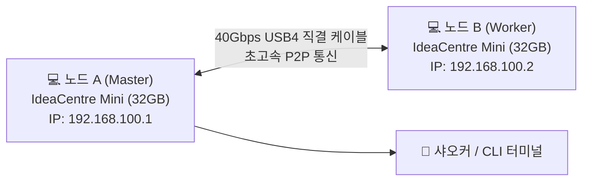

# 미니 PC 두 대로 95GB 대형 모델을? 레노버 스냅드래곤 미니 PC 노외장그래픽 실전 가이드

지금까지 40B 이상의 오픈소스 대형 언어 모델(LLM)을 로컬에서 구동하려면 진입 장벽이 너무 높았습니다. RTX 3090이나 4090을 2장 이상 꽂은 거대한 워크스테이션을 조립하거나, 수백만 원을 들여 64GB/128GB 통합 메모리를 갖춘 Mac Studio를 장만해야 했죠.

그런데 최근 r/LocalLLaMA 커뮤니티에서 홈랩 하드웨어 매니아들의 시선을 강탈한 기막힌 조합이 등장했습니다: **외장 그래픽카드(GPU)를 일절 쓰지 않고, 대당 약 299파운드(한화 약 53만 원)짜리 레노버 IdeaCentre Mini 스냅드래곤 미니 PC 2대를 USB4 케이블 하나로 직결해 무려 95GB 용량의 Qwen3.8 Flash-Next 모델을 실사용 속도로 구동하는 방식**입니다.


뜬구름 잡는 개념 설명 대신, **하드웨어 구매 체크리스트부터 핵심 원리, 윈도우 온 ARM 환경 구축, 모델 다운로드, USB4 P2P 직결 네트워크, 분산 실행 명령어**까지 초보자도 그대로 따라 할 수 있는 튜토리얼로 정리했습니다.

---

## 1. 외장 GPU 없이 어떻게 95GB 모델이 돌아갈까?

장비를 구하기 전, 기존 상식을 깨는 핵심 구동 메커니즘을 먼저 짚고 넘어가겠습니다:

### 1. MoE(전문가 혼합) 모델의 "필요할 때만 호출" 방식
기존의 Dense 모델(예: Llama-70B)은 글자 하나를 생성할 때마다 700억 개의 파라미터 전체를 메모리에서 훑어야 합니다. 반면 **MoE 모델(Qwen3.6-35B-A3B 또는 Qwen3.8 Flash-Next)**은 구조가 완전히 다릅니다:
- 전체 파라미터는 35B~40B(디스크 크기 20GB~95GB)에 달하지만, **토큰 하나를 생성할 때 실제로 활성화되는 전문가는 약 2.5B~3B에 불과**합니다;
- 대다수 전문가는 대부분의 시간 동안 비활성 상태로 대기합니다.

### 2. 고속 NVMe 스트리밍 + ARM NEON 연산의 결합
이번에 사용된 순수 C 기반 고성능 추론 엔진 **Janas**는 매우 영리한 방식을 취합니다:
- 항상 참조되는 기본 Attention 레이어는 32GB 물리 램에 상주;
- 나머지 95GB에 달하는 전문가 가중치는 고속 NVMe SSD에 배치;
- 토큰 생성 시 필요한 전문가만 비동기로 디스크에서 읽어 들이며, 퀄컴 Oryon CPU의 **ARM NEON SIMD 및 `i8mm` 정수 행렬 연산 명령어**로 즉각 계산합니다.

### 3. 왜 "USB4를 통한 2대 연결"을 권장하는가?
- **1대 단독(32GB RAM)**: 19.4GB 크기의 Qwen 35B A3B는 단독으로도 43 tokens/s로 쾌적합니다. 하지만 95GB짜리 Flash-Next를 1대에서 억지로 돌리면 램 부족으로 인한 페이징 때문에 첫 글자 응답(TTFT)까지 54초~80초가 걸려 실사용이 어렵습니다;
- **2대 직결(총 64GB RAM)**: USB4 케이블로 두 대를 묶어 64GB 메모리 풀을 구성하면, Flash-Next의 첫 글자 응답 시간이 **12.5초**로 단축되고 생성 속도도 **20 tokens/s**에 도달하여 실제 코딩 및 질의응답용으로 손색없는 수준이 됩니다.

---

## 2. 하드웨어 준비 및 구매 체크리스트

| 부품/장비 | 추천 사양 및 모델 | 예상 가격 | 용도 및 주의사항 |
|---|---|---|---|
| **미니 PC × 2대** | **레노버 IdeaCentre Mini x (스냅드래곤 버전)**<br>(Snapdragon X X1-26-100 / 8코어 Oryon + Hexagon NPU / 32GB LPDDR5 / 512GB NVMe) | 대당 약 299파운드<br>(할인 시 약 53만 원) | **반드시 32GB 메모리 옵션**을 선택해야 합니다. 온보드 메모리라 증설 불가하며 16GB는 부족합니다. |
| **초고속 직결 케이블 × 1개** | **40Gbps 지원 USB4 / 썬더볼트 4 Type-C 케이블 (1m 내외)** | 약 1만 원 ~ 2만 원 | 반드시 **40Gbps 데이터 전송 규격**이어야 합니다 (단순 충전 전용 케이블 불가). |
| **모니터 및 입력기기** | 일반 모니터와 키보드/마우스 | 기존 보유 기기 활용 | 초기 윈도우 설정용 (이후 원격 데스크톱으로 조작 가능). |

> **총 예산**: 1대만 구매 시 약 53만 원으로 35B 모델을 즐길 수 있으며, 2대 풀세트를 맞춰도 **약 110만 원 안팎**입니다. RTX 4090 단품 가격의 절반에도 못 미치는 가격에 64GB 분산 클러스터가 구축됩니다.

---

## 3. 1단계: Windows 11 on ARM 추론 환경 세팅

두 기기에는 출고 시 기본으로 **Windows 11 on ARM**이 설치되어 있습니다. 별도의 리눅스 듀얼부팅 없이 윈도우 환경에서 즉시 구동됩니다.

### 1. 개발자 모드 켜기
윈도우 검색창에 `개발자 설정`을 입력하고 **개발자 모드(Developer Mode)**를 활성화합니다.

### 2. ARM 최적화 Janas 엔진 빌드
PowerShell(또는 Windows Terminal)을 실행합니다:

```powershell
# 1. 패키지 관리자로 Git과 Clang 설치 (이미 설치되어 있다면 생략)
winget install Git.Git
winget install LLVM.LLVM

# 2. Janas 리포지토리 복제
git clone https://github.com/prabanta-dev/janas.git
cd janas

# 3. 스냅드래곤 Oryon 코어에 맞춘 ARM NEON / i8mm 가속 활성화 빌드
clang -O3 -march=armv8.6-a+neon+i8mm -fopenmp src/*.c -o janas-arm.exe
```
*(※ 직접 빌드가 번거로우신 분은 제작자의 GitHub Releases 페이지에서 미리 빌드된 `janas-win-arm64.zip`을 다운받아 압축 해제 후 바로 사용하셔도 됩니다)*

---

## 4. 2단계: 모델 다운로드 및 SSD 배치

모델 파일은 고속 NVMe SSD 경로(예: `C:\models\`)에 저장해 둡니다.

### 1. 가볍게 맛보기: Qwen 35B A3B 코딩 모델 (1대로도 쾌속)
- **Hugging Face 저장소**: `bartowski/Qwen_Qwen3.6-35B-A3B-Q4_0.gguf`
- **파일 크기**: 약 **19.4 GB**
- **특징**: 32GB 1대만으로도 1.8초 만에 첫 토큰이 나오고 생성 속도가 43 t/s에 달해 실시간 코딩용으로 훌륭합니다.

### 2. 본 게임: Qwen3.8 Flash-Next (95GB 대형 MoE)
- **Hugging Face 저장소**: `ggml-org/Qwen3.8-Flash-Next-IQ4_NL`
- **파일 크기**: 약 **95 GB**
- **특징**: 2대 직결(64GB 램 풀)로 구동하는 초강력 프론티어 모델입니다.

PowerShell을 통한 다운로드 예시(35B):
```powershell
mkdir C:\models -Force
cd C:\models
curl -L -O "https://huggingface.co/bartowski/Qwen_Qwen3.6-35B-A3B-Q4_0-GGUF/resolve/main/Qwen_Qwen3.6-35B-A3B-Q4_0.gguf"
```

---

## 5. 3단계: 단일 기기 실행 테스트

두 대를 연결하기 전, 먼저 1대에서 정상 동작하는지 테스트합니다:

```powershell
.\janas-arm.exe `
  --model C:\models\Qwen_Qwen3.6-35B-A3B-Q4_0.gguf `
  --threads 8 `
  --temp 0.6 `
  --prompt "로컬 네트워크 내 모든 활성 IP를 스캔하는 파이썬 스크립트를 작성해줘"
```

**1대 단독 실측 결과**:
- **Prefill 속도**: 초당 약 **315 토큰**;
- **생성 속도**: 초당 **43 토큰** (글자가 물 흐르듯 쾌적하게 찍힙니다);
- **램 점유율**: 약 22GB 수준으로 32GB 사양에서 매우 안정적입니다.

---

## 6. 4단계: 2대 결합! USB4 직결 네트워크 및 분산 실행 (핵심 단계)

95GB 모델을 돌리기 위해 두 기기를 연결합니다. **고가의 10기가 스위치 없이 USB4 케이블 하나로 해결됩니다.**



### 1. 케이블 연결
노드 A 뒷면의 USB4 포트와 노드 B의 USB4 포트를 케이블로 직접 연결합니다. 윈도우가 이를 감지하여 **Thunderbolt / USB4 네트워크 어댑터**를 자동 생성합니다.

### 2. 고정 IP 설정 (2분 소요)
초저지연 통신을 위해 사설 IP 대역을 부여합니다:

- **노드 A 설정**:
  - `설정` ➔ `네트워크 및 인터넷` ➔ `고급 네트워크 설정`에서 USB4 어댑터 선택;
  - `IPv4` 속성 수동 입력:
    - IP 주소: `192.168.100.1`
    - 서브넷 마스크: `255.255.255.0`
    - 기본 게이트웨이: 비워둠
- **노드 B 설정**:
  - 마찬가지로 USB4 어댑터의 `IPv4` 수동 입력:
    - IP 주소: `192.168.100.2`
    - 서브넷 마스크: `255.255.255.0`
    - 기본 게이트웨이: 비워둠

노드 A에서 `ping 192.168.100.2`를 날려 `<1ms` 응답이 나오면 40Gbps 대역폭의 직결 통로가 열린 것입니다.

### 3. 95GB 모델 분산 실행 명령어

**1단계: Worker(노드 B)에서 수신 대기 시작**
```powershell
.\janas-arm.exe --worker --listen 192.168.100.2:9999 --threads 8
```

**2단계: Master(노드 A)에서 모델 분산 구동**
```powershell
.\janas-arm.exe `
  --model C:\models\Qwen3.8-Flash-Next-IQ4_NL.gguf `
  --nodes 192.168.100.1,192.168.100.2:9999 `
  --threads 8 `
  --temp 0.7 `
  --interactive
```

양쪽 노드의 64GB 메모리에 모델 레이어가 균등하게 분산 탑재되면서 95GB 모델이 부드럽게 대기 상태로 진입합니다.

---

## 7. 실제 속도 및 실측 후기 (솔직한 장단점)

| 테스트 항목 | 1대 단독 (32GB) | 2대 USB4 직결 (64GB) | 샤오커의 평가 |
|---|---|---|---|
| **Qwen 35B A3B (19.4GB)** | TTFT 1.8초 / 생성 43 t/s | TTFT 1.8초 / 생성 43 t/s | 1대로도 이미 충분함 |
| **Qwen3.8 Flash Next (95GB)** | TTFT 54~80초 / 생성 8 t/s | **TTFT 12.5초 / 생성 20 t/s** | **완전 불가능에서 실사용 가능으로 격변** |
| **전력 소모량** | 유휴 8W / 풀로드 35W | 2대 합산 풀로드 **약 70W** | 듀얼 3090(700W) 대비 10분의 1 수준 |
| **소음 및 발열** | 거의 무소음 | 매우 조용하며 미지근한 온기 수준 | 침대 머리맡에 켜두어도 수면에 지장 없음 |

### 체감 팁과 유의점
1. **장문 입력 시의 첫 토큰 대기 시간**:
   - Prefill 속도가 약 46 t/s이므로, 8,000자 분량의 문서를 통째로 넣으면 첫 글자가 나오기까지 약 25~30초 정도 기다려야 합니다;
   - **하지만 에이전트(Agent) 환경에서는 Prompt Caching이 적용되므로**: 1회차 대화 이후로는 시스템 프롬프트와 이전 문맥이 램에 캐싱되어 이후 응답 지연을 거의 느끼기 어렵습니다;
2. **NPU의 가속 한계**:
   - 스냅드래곤에 내장된 Hexagon NPU는 Gemma-4B나 Qwen-8B 같은 **Dense 모델에서는 3~4배의 폭발적인 가속**을 보여줍니다;
   - 반면 MoE 모델처럼 산발적으로 램과 SSD를 오가는 구조에서는 데이터 이동이 주된 병목이라 NPU 가속 효과는 약 1.2배 수준으로 완만합니다.

---

## 8. 결론: 누구에게 가장 추천하는가?

- **예산은 적지만 64GB 메모리가 꼭 필요한 학생/개발자**: 100만 원 남짓한 금액으로 64GB 램을 확보하여 대형 오픈 모델을 돌릴 수 있는 최고의 실용적 대안입니다;
- **24시간 상시 가동 AI 에이전트 서버**: 두 대 합쳐서 70W도 안 되는 초저전력과 정숙성 덕분에 전기세나 소음 걱정 없이 상시 구동할 수 있습니다;
- **엣지 컴퓨팅을 좋아하는 하드웨어 매니아**: 손바닥만 한 미니 PC 두 대를 USB4로 엮어 95GB 프론티어 모델을 돌리는 손맛은 클라우드 API 호출로는 절대 느낄 수 없는 즐거움입니다.

---

> 💡 **원문 출처 및 실시간 모니터링**：
> - 원문 출처: [FreeAI Dog 공식 블로그](https://freeaidog.com/ko/blog/snapdragon-mini-pc-zero-gpu-qwen-40b-moe-guide/)
> - 무료 대형 언어 모델 실시간 가용성 및 지연 시간 측정은 [FreeAI Dog 가용성 레이더](https://freeaidog.com/ko/radar/)에서 확인하세요.
