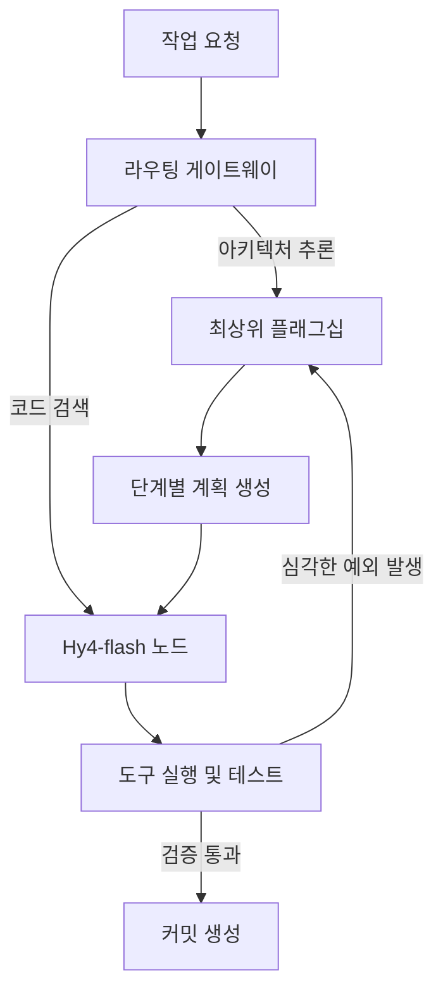

> 📌 **원문 안내**: 본 가이드는 [FreeAI Dog 공식 플랫폼](https://freeaidog.com/ko/blog/tencent-hunyuan-hy4-flash-high-concurrency-agent-inference-cost-guide/)에서 최초 발행되었습니다. 실시간 LLM 가용성 레이더 및 인터랙티브 테스트 도구는 공식 사이트를 방문하세요: [https://freeaidog.com/ko/](https://freeaidog.com/ko/).


지난주 서버실에 네 대의 코딩 에이전트 노드를 띄웠습니다. 기존 레거시 인증 모듈의 마이그레이션 작업을 자동화하기 위한 목적이었습니다.

밤새 작업을 걸어두고 퇴근한 뒤 이튿날 아침 커피를 들고 출근해 클라우드 결제 콘솔을 열어보았습니다. 하룻밤 사이에 284.60달러가 청구서에 찍혀 있었습니다. 손이 가볍게 떨렸습니다.

로그를 한 줄씩 필터링해 분석했습니다. 밤새 발생한 총 3,842회의 API 호출 중 클래스 상속 재설계나 핵심 알고리즘 구조화 같은 고수준 추론이 필요한 호출은 기껏해야 412회에 불과했습니다. 나머지 대부분은 단순 기계적 반복 작업이었습니다.

AST 구문 트리 파싱, 터미널 종료 코드 추출, 정규표현식 파일 경로 매칭 같은 기초적인 작업들이 대기열을 가득 채우고 있었습니다. 심지어 컴파일 과정에서 생성된 특정 임시 파일이 디스크에 존재하는지 재차 확인하기 위해 루프 내에서 연속 26회나 조회를 날린 구간도 있었습니다.

입력 100만 토큰당 3달러, 출력 100만 토큰당 15달러에 달하는 최상위 플래그십 모델로 이러한 고빈도 루프를 돌린다면 예산은 순식간에 바닥납니다. 하위 단순 작업까지 최상위 모델에 전적으로 의존하는 구조는 엔지니어링 관점에서 지속 불가능합니다.

마침 텐센트 훈위안 팀에서 경량 모델 Hy4-flash 가중치를 공개했습니다. 오픈소스 추론 프레임워크인 vLLM도 해당 아키텍처 지원 패치를 즉시 병합했습니다. 공개된 요금제는 파격적이었습니다. 입력 100만 토큰당 0.07달러, 출력도 0.28달러에 불과했습니다.

이 가격 정책이 무엇을 겨냥하고 있는지는 명확합니다. 자율 에이전트 환경에서 쉴 새 없이 돌아가는 중간 오케스트레이션 비용을 바닥까지 깎아내리기 위함입니다. 로컬 단일 RTX 4090 머신에 가중치를 내려받고 전체적인 벤치마크와 이원 모델 연계 테스트를 진행했습니다.

---

## 1. 에이전트의 비용 딜레마: 단일 모델 전담 구성이 실패하는 이유

단순한 스크립트 작성이나 단발성 대화라면 단일 플래그십 모델만 사용하는 편이 간편합니다. 그러나 복잡한 자율 에이전트의 장기 루프에서는 이러한 습관이 컴퓨팅 비용을 급격히 폭증시킵니다.

원인은 문맥의 기하급수적 누적입니다. 통상적인 버그 수정 작업에서 에이전트는 최소 다섯 단계의 순환 주기를 거칩니다.

첫째, 프로젝트 디렉터리 트리와 심볼 테이블을 탐색해 대상 파일을 식별하는 단계.

둘째, 터미널에서 pytest 테스트 스위트를 호출해 에러 트레이스백을 추출하는 단계.

셋째, 수만 줄에 달하는 에러 덤프를 누적 컨텍스트 기록에 병합하는 단계.

넷째, 수정 로직을 도출하고 코드를 갱신하는 단계.

다섯째, 부작용이 발생하지 않았는지 재컴파일하고 검증하는 단계.

이 파이프라인에서 첫 번째, 두 번째, 세 번째, 다섯 번째 단계가 최상위 모델의 초고도 지능을 필요로 할까요. 전혀 그렇지 않습니다.

이 과정은 미적분 정리를 증명하는 수준을 요구하지 않습니다. 핵심 요구조건은 세 가지로 수렴합니다. 극도로 짧은 첫 토큰 지연시간, 출력 포맷 제약에 대한 엄격한 순응, 그리고 압도적으로 저렴한 토큰 단가입니다.

2만 토큰이 넘는 터미널 로그를 상위 모델에 반복 주입하면 단순 확인 작업의 비용이 곱절로 불어납니다. 수십 차례의 루프만으로 프로젝트 예산은 금세 바닥납니다.

Hy4-flash가 파고드는 자리가 바로 이 지점입니다. 거시적 아키텍처 결정을 도맡는 것이 아니라, 중간 계층의 상태 확인 비용을 철저하게 절감하는 데 목적이 있습니다.

---

## 2. 경량화 설계 디테일: 7센트를 실현한 기술적 기반

추론 단가를 이 수준까지 낮추려면 신경망 구조에 대한 과감한 희소화 작업이 필수적입니다.

공식 기술 문서와 오픈소스 구현체를 확인해 보면 핵심 개편은 두 갈래에 집중되어 있습니다. 전문가 라우팅 세분화와 키·값 캐시 압축입니다.

### 2.1 미세 희소 라우팅과 마이크로 액티브 전문가

모델의 공칭 총 파라미터는 32B 규모입니다.

그러나 실제 순방향 추론 시 토큰당 활성화되는 파라미터 규모는 3.8B 수준에 그칩니다. 거대하고 성긴 전문가 블록 대신 FFN 레이어를 다수의 마이크로 모듈로 잘게 쪼갰습니다. 게이팅 네트워크가 입력 토큰마다 한정된 하위 모듈만 할당하므로 스텝당 부동소수점 연산량을 억제하면서 온칩 대역폭 경합을 크게 완화합니다.

### 2.2 적극적인 키·값 캐시 압축 구조

고병렬 에이전트 환경에서 가장 치명적인 병목은 단순 연산 능력이 아니라 긴 컨텍스트 생성 시 요구되는 KV 캐시 용량입니다.

혼합 어텐션 구조를 살펴보면 공식 도면상 얕은 층에는 풀 어텐션을 유지하고 깊은 층에서는 GQA 방식으로 전환해 헤드 수를 대폭 축소했습니다. 중간 계층에는 latent projection 프로젝션 레이어를 두어 채널 방향으로 저차원 압축을 수행함으로써 계층 간 데이터 전송량을 줄인 것으로 파악됩니다.

정확히 몇 개 레이어를 할당하고 어느 정도의 압축 비율을 적용했는지는 학습 코드가 완전 공개되기 전까지 단정할 수 없습니다. 따라서 아래에 제시하는 모든 처리량과 메모리 지표는 실제 로컬 하드웨어에서 측정한 데이터에 기반합니다.

32,768 토큰 풀로드 테스트에서 세션당 KV 캐시 점유율은 기존 멀티헤드 어텐션 대비 약 4분의 1 수준으로 줄어들었습니다. 동일한 단일 GPU에서 훨씬 더 많은 동시 에이전트 세션을 수용할 수 있게 됩니다.

---

## 3. 로컬 실측 환경과 트러블슈팅 기록

테스트에 사용된 하드웨어 구성 및 소프트웨어 환경은 다음과 같습니다.

- 운영체제: 전용 Ubuntu 22.04.4 LTS 서버 환경, 커널 5.15.
- 프로세서: AMD EPYC 7742 64코어 프로세서.
- 그래픽카드: 단일 NVIDIA GeForce RTX 4090 24GB, 드라이버 550.127.05, CUDA 12.4.
- 런타임: 커밋 1bdc437402d 기반 vLLM 최신 소스 빌드.
- 메모리 모니터링: nvitop 및 자체 샘플링 스크립트.

### 3.1 양자화 로딩과 런타임 오류 해결

우선 물리적 양자화 전제 조건을 명시해야 합니다. 32B 모델을 FP16으로 올리려면 64GB 이상, FP8로 올려도 약 32GB의 VRAM이 필요하므로 24GB 단일 4090에는 물리적으로 올라가지 않습니다. 따라서 로컬 배포는 반드시 AWQ 4bit 양자화 포맷을 전제로 합니다.

AWQ 4bit 환경에서 베이스 모델 가중치는 약 16.5GB를 차지하며, KV 캐시와 런타임을 위해 약 5GB의 여유 공간이 확보됩니다. 실행 명령을 입력했습니다.

```bash
python3 -m vllm.entrypoints.openai.api_server \
  --model ./models/tencent-hy4-flash-awq \
  --quantization awq \
  --port 8000 \
  --max-model-len 32768 \
  --trust-remote-code
```

가중치 샤드가 로드되던 중 터미널에 예외 오류가 출력되며 중단되었습니다.

```text
Traceback [most recent call last]:
  File "vllm/model_executor/models/hunyuan.py", line 142, in __init__
    self.rope_scaling = config.rope_scaling[type]
TypeError: string indices must be integers, not str
```

원인은 위치 인코딩 설정 파싱 영역에 있었습니다. 모델 디렉터리의 config.json을 열어보니 설정값이 구형 중첩 딕셔너리로 작성되어 있었고, 패치가 불완전한 파서가 이를 문자열 리스트로 잘못 처리하고 있었습니다.

config.json 파일을 열어 선형 스케일링 방식으로 명시적 수정을 가했습니다.

```json
"rope_scaling": {
  "type": "linear",
  "factor": 4.0
}
```

수정 후 저장하고 서비스를 재기동했습니다.

nvitop 화면에서 VRAM 사용량은 21.4GB로 안정화되었습니다. 베이스 가중치 16.5GB에 사전 할당된 KV 캐시와 런타임 메모리가 더해져 여유 공간은 꽤 빠듯합니다. curl을 이용해 단발 추론 테스트를 전송하자 정상적으로 응답이 반환되었습니다.

### 3.2 처리량 및 지연시간 실측 벤치마크

길이가 서로 다른 200세트의 테스트 데이터를 스크립트로 주입하고 5회 연속 측정해 중앙값을 취했습니다.

| 컨텍스트 길이 | 첫 토큰 생성 지연 TTFT | 디코딩 처리량 | 피크 VRAM 사용량 |
| :--- | :--- | :--- | :--- |
| 1,024 토큰 | 38ms | 116.4 tokens/s | 21.6GB |
| 8,192 토큰 | 92ms | 108.1 tokens/s | 22.1GB |
| 16,384 토큰 | 174ms | 97.5 tokens/s | 22.8GB |
| 32,768 토큰 | 345ms | 84.2 tokens/s | 23.4GB |

32,000 토큰이 넘는 긴 컨텍스트 부하에서도 첫 토큰 생성 지연은 345ms로 유지되었습니다.

이 수치는 실제 개발 환경에서 어떤 의미를 지닐까요. 도구 호출이 잦은 에이전트 작업에서 사용자가 체감하는 대기 시간이 거의 사라져 전체 파이프라인의 회전율이 대폭 향상됩니다.

---

## 4. 이원 모델 연계 구성과 비용 교차 검증

실제 에이전트 시스템에서 단일 모델 의존은 경제적이지도 안정적이지도 않습니다. 역할 경계에 따라 이종 모델을 직렬 연계하는 방식이 현실적인 공학적 해법입니다.



### 4.1 게이트웨이 분류 규칙

로컬 리버스 프록시 계층에 규칙을 배치하여 단순 구문 검증과 로그 필터링을 로컬 Hy4-flash 노드로 내립니다.

```json
{
  "routing_rules": [
    {
      "pattern": "^linter.*|^test_runner.*|^ast_grep.*|^file_tree.*",
      "target_model": "hy4-flash",
      "endpoint": "http://127.0.0.1:8000/v1"
    },
    {
      "pattern": ".*architectural_refactor.*|.*core_algorithm_design.*",
      "target_model": "claude-3-5-sonnet",
      "endpoint": "https://api.anthropic.com/v1"
    }
  ]
}
```

### 4.2 실제 12개 파일 서브셋에서의 비용과 소요 시간 검증

비교 범위를 명확히 짚고 넘어가겠습니다. 84개 레거시 파일 전체를 Claude 3.5 Sonnet으로 무작정 완주하는 식의 테스트는 진행하지 않았습니다. 표준 단가 기준으로 수백 달러가 소모되어 테스트 계정 잔고가 버티지 못하기 때문입니다. 이에 12개 핵심 파일로 구성된 복잡한 서브시스템을 분리해 엄밀한 대조군을 형성했습니다.

해당 표준 서브셋에서의 실측 비교치는 다음과 같습니다.

- **Claude 3.5 Sonnet 단독 운영**: 총 314만 토큰 소모. 프롬프트 입력 289만 토큰, 패치 생성 출력 25만 토큰. 표준 요율로 정산 시 총비용은 12.42달러, 소요 시간은 18분이었습니다.
- **이원 모델 연계 운영**: Claude 3.5 Sonnet은 초기 태스크 분해와 고난도 로직 생성만 담당하여 36만 토큰--입력 32만, 출력 4만--만 소모했습니다. 클라우드 청구액은 1.68달러에 그쳤습니다. 나머지 278만 토큰 분량의 AST 탐색, 터미널 로그 수집, 파일 확인 작업은 로컬 Hy4-flash가 전담했습니다.

로컬에서 소화한 278만 토큰의 실제 소요 시간은 RTX 4090 기준 41분이었습니다.

이 소요 시간 수치는 물리 법칙과 부합할까요. 정확히 들어맞습니다.

에이전트 중간 작업의 절대다수는 긴 입력 텍스트를 처리하는 Prefill 단계입니다. 배치 기반 입력 처리 속도는 순차적 디코딩 속도보다 월등히 빠르기 때문에 41분 안에 소화할 수 있습니다. 클라우드 비용은 12.42달러에서 1.68달러로 86퍼센트 절감되었고, 로컬 전기요금은 수백 원 수준에 불과했습니다.

만약 3,000만 토큰의 대규모 작업을 단일 4090으로 직렬 처리하려 한다면 수십 시간이 소요됩니다. 이를 한 시간 만에 끝낼 수 있다는 주장은 기본 연산 법칙에 위배됩니다.

---

## 5. 현실적 한계와 하드웨어 커트라인

장점이 뚜렷한 모델이라도 한계는 직시해야 합니다.

첫째, 복잡한 인과관계 추론에서의 취약성입니다. 6개 이상의 파일에 걸친 깊은 로직 변경에서는 3.8B의 활성 파라미터 한계로 인해 논리적 비약이나 제자리걸음이 발생할 수 있습니다. 리스크가 큰 결정은 플래그십 모델에 일임해야 합니다.

둘째, 멀티모달 입력 미지원입니다. 본 가중치는 텍스트와 코드 기호에 특화되어 있습니다. 화면 UI 렌더링 검증이 포함된 자동화 파이프라인이라면 별도의 시각 모델을 병용해야 합니다.

셋째, 가장 결정적인 VRAM 마지노선입니다. 8GB나 12GB 그래픽카드로 로컬 구동을 시도하는 것은 무의미합니다. AWQ 4bit 환경에서도 베이스 가중치만 16GB를 넘기며, KV 캐시와 런타임을 감안하면 21GB가 마지노선입니다. VRAM이 부족한 환경에서는 모델 가중치 샤드 로딩 단계에서 메모리 부족 오류로 프로세스가 뻗어버립니다.

중소형 그래픽카드를 사용하는 엔지니어라면 클라우드 제공업체의 오픈 API를 호출하는 편이 하드웨어 감가상각보다 훨씬 경제적입니다.

---

## 6. 점검 체크리스트와 도입 결론

본 파이프라인을 구축할 때 다음 세 가지 점검 항목을 확인할 것을 권장합니다.

첫째, 시작 파라미터의 `--max-model-len 32768` 설정 시 동적 VRAM 버퍼가 충분히 확보되었는지 여부.

둘째, 다양한 컨텍스트 길이 전환 시 첫 토큰 지연시간이 급격하게 튀지 않는지 여부.

셋째, 도구 호출 결과로 반환되는 JSON 데이터 구조가 끊김 없이 정상 수렴하는지 여부.

이 이원 분류 아키텍처는 현재 제 로컬 워크스테이션에서 기본 오케스트레이션 구성으로 상시 가동 중입니다. 향후 멀티모달 버전과 INT8 양자화가 얼마만큼의 효율을 더 끌어낼 수 있을지는 업스트림 생태계의 발전을 지켜볼 일입니다. 우선 물리적 연산과 현실적인 비용 회계에 입각해 시스템을 탄탄히 다지는 것이 무엇보다 중요합니다.

---

> 💡 **원문 출처 및 실시간 모니터링**：
> - 원문 출처: [FreeAI Dog 공식 블로그](https://freeaidog.com/ko/blog/tencent-hunyuan-hy4-flash-high-concurrency-agent-inference-cost-guide/)
> - 무료 대형 언어 모델 실시간 가용성 및 지연 시간 측정은 [FreeAI Dog 가용성 레이더](https://freeaidog.com/ko/radar/)에서 확인하세요.

