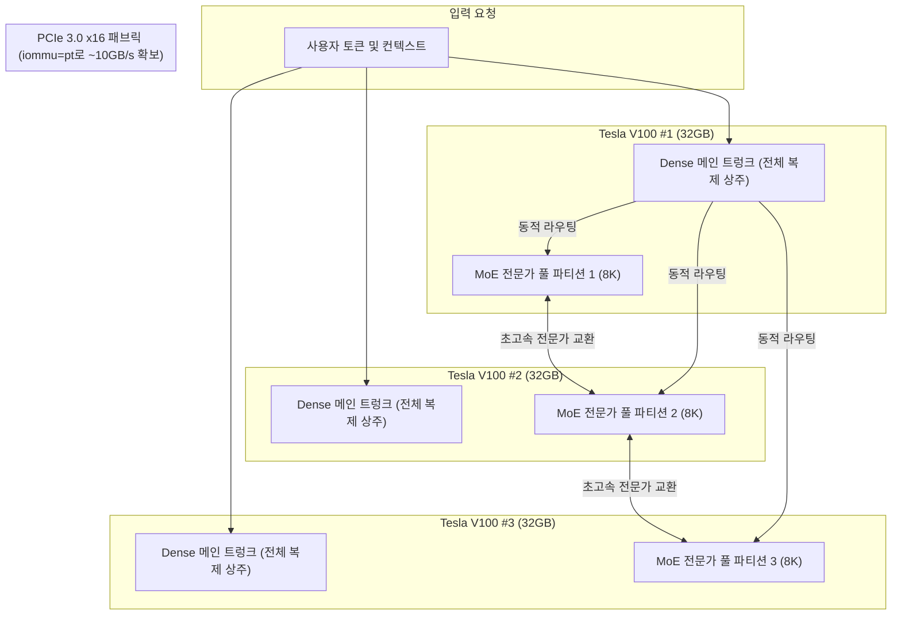

> 📌 **원문 안내**: 본 가이드는 [FreeAI Dog 공식 플랫폼](https://freeaidog.com/ko/blog/v100-dell-r740-400tps-qwen-volta-engine-guide/)에서 최초 발행되었습니다. 실시간 LLM 가용성 레이더 및 인터랙티브 테스트 도구는 공식 사이트를 방문하세요: [https://freeaidog.com/ko/](https://freeaidog.com/ko/).


# 2500달러로 400 t/s 달성! 볼타(Volta) 전용 커널 리빌드로 3장의 테슬라 V100 부활: 중고 Dell R740 서버 & iommu=pt 커널 돌파구 완전 가이드

로컬 환경에서 100B 이상의 초대형 MoE(Mixture-of-Experts) 모델을 배포할 때 맞닥뜨리는 두 가지 거대한 장벽은 **막대한 VRAM 비용**과 **멀티 GPU 간 PCIe 통신 지연**입니다.

80GB~96GB 규모의 VRAM 풀을 확보하려면 고가의 RTX 3090/4090 4장을 묶거나 수천만 원에 달하는 최신 엔터프라이즈 카드를 도입해야 했습니다. 또한 NVLink가 없는 듀얼 CPU 서버 환경에서는 카드 간 데이터 전송 병목으로 인해 추론 속도가 급격히 저하되곤 했습니다.

하지만 최근 레딧 **r/LocalLLaMA** 커뮤니티의 **u/jfinkpottery**라는 개발자가 이러한 편견을 깨뜨리는 놀라운 실측 프로젝트를 공개했습니다.
**총 2,530달러(한화 약 350만 원)의 비용으로 중고 Dell PowerEdge R740 서버와 3장의 테슬라 V100(32GB)을 결합하고, 볼타(Volta) 아키텍처 전용 추론 엔진을 직접 빌드하여 피크 디코드 400 t/s, 긴 문맥 Prefill 3,400 t/s라는 기록적인 성능을 뽑아낸 것입니다!**

본 가이드에서는 이 놀라운 프로젝트의 하드웨어 구성(BOM), 전송 속도를 50배 끌어올린 커널 튜닝 비법, 그리고 실제 멀티 GPU 설정 시 주의할 점을 상세히 정리해 드립니다.

---

## 1. 왜 2026년에 테슬라 V100인가? 2500달러 가성비 분석

2017년에 발표된 볼타 아키텍처의 V100은 최신 FP8/FP4 저정밀도 연산을 하드웨어 차원에서 지원하지 않습니다. 그럼에도 불구하고 왜 지금 시점에 강력한 경쟁력을 가질까요?

핵심은 **초고속 HBM2 메모리 대역폭**과 **중고 시장의 압도적인 가격 경쟁력**에 있습니다.

* **장당 32GB HBM2 탑재**: 3장을 연결하면 **총 96GB의 거대한 VRAM**이 완성되며, 장당 **900 GB/s**의 메모리 대역폭을 제공합니다.
* **데이터센터 방출 물량**: 클라우드 인프라 업그레이드로 인해 PCIe 버전의 32GB V100 카드가 장당 약 600달러 선에서 활발히 거래되고 있습니다.
* **안정적인 2U 엔터프라이즈 섀시**: 듀얼 제온 소켓, 강력한 쿨링 솔루션 및 여유로운 PCIe 슬롯을 갖춘 Dell PowerEdge R740 베어본 본체는 500달러 안팎에 구매 가능합니다.

### 전체 부품 명세서 (Total BOM: ~$2,530)

| 부품명 | 세부 규격 | 수량 | 예상 단가 | 합계 금액 |
|---|---|---|---|---|
| **GPU 가속기** | NVIDIA Tesla V100 32GB PCIe 버전 | 3장 | \$600 | **\$1,800** |
| **서버 본체** | Dell PowerEdge R740 (듀얼 Xeon + BOSS M.2 PCIe 카드) | 1대 | \$500 | **\$500** |
| **시스템 메모리** | DDR4 16GB 2666MHz ECC Registered | 2개 (총 32GB) | \$65 | **\$130** |
| **부팅 드라이브** | M.2 SATA SSD 512GB (BOSS 카드 장착) | 1개 | \$100 | **\$100** |
| **총 하드웨어 비용** | **96GB HBM2 엔터프라이즈 시스템** | — | — | **\$2,530** (약 350만 원) |

---

## 2. 병목 해결의 열쇠: 0.2 GB/s에서 10 GB/s로 도약시킨 `iommu=pt`

처음 시스템을 조립했을 때 작성자는 듀얼 제온 환경에서 흔히 발생하는 **심각한 카드 간 전송 속도 저하** 문제에 직면했습니다.

한때 소켓 간 비-NVLink 통신은 물리적으로 0.2 GB/s가 한계라는 오해가 있었으나, 커널 디버깅 결과 진짜 원인은 **리눅스 IOMMU(입출력 메모리 관리 장치)의 가상화 주소 변환 락 경쟁**이었습니다.

### 해결책: IOMMU 패스스루 모드(`iommu=pt`) 활성화

GRUB 부팅 설정에 `iommu=pt` 플래그를 추가하는 것만으로 상황이 완전히 바뀌었습니다.

```bash
# 1. GRUB 설정 파일 열기
sudo nano /etc/default/grub

# 2. GRUB_CMDLINE_LINUX에 iommu=pt 추가
GRUB_CMDLINE_LINUX="... intel_iommu=on iommu=pt pci=realloc"

# 3. 부트로더 갱신 후 재부팅
sudo update-grub
sudo reboot
```

**결과는 극적이었습니다:**
* 카드 간 양방향 대역폭이 **0.2 GB/s에서 ~10 GB/s로 무려 50배 폭증**했습니다!
* `pt` 모드는 게스트 가상머신용 기능은 유지하면서, 호스트 커널의 물리 드라이버가 불필요한 IOMMU 주소 변환 없이 물리 주소에 직접 접근하도록 허용합니다.

> [!TIP]
> **홈랩 엔지니어를 위한 황금률**:
> 듀얼 소켓 엔터프라이즈 서버(Dell R730/R740, HP DL380 등)에서 다중 GPU를 구성할 때는 **반드시 `iommu=pt`를 첫 번째 튜닝 작업으로 적용**하십시오.

---

## 3. 소프트웨어 혁신: 볼타 아키텍처 맞춤형 MoE 엔진 리빌드

최신 오픈소스 **Strata**는 Ampere나 Ada 등 최신 아키텍처를 전제로 하므로 볼타 환경에서는 구동되지 않거나 극도로 느려집니다. 작성자는 Strata 코드를 포크하여 볼타 연산 구조에 최적화된 커스텀 엔진을 구현했습니다.



### 1. 전문가 병렬화 + Dense 트렁크 중복 복제
* **전문가 분할**: 대규모 MoE 모델의 수많은 전문가 레이어를 3장의 V100에 균등 분산.
* **Dense 트렁크 중복 상주**: 모델의 어텐션 및 Dense 뼈대 네트워크를 각 카드에 그대로 복제 상주시켜 **메인 레이어 통과 시의 GPU 간 통신 지연을 완전히 제거**.
* 일상적인 단일 사용자(Batch Size = 1) 디코드 성능을 극대화.

### 2. 실측 벤치마크 결과 (Q4_XL 양자화)

| 벤치마크 지표 | 실측 성능 | 환경 및 설명 |
|---|---|---|
| **Decode 피크 처리량** | **400 t/s** | 특정 반복 구조 및 높은 캐시 적중 시의 이론적 최대치 |
| **Decode 실제 문장 생성** | **~140 t/s** | **실제 복잡한 코딩 및 추론 시의 안정적인 속도** |
| **Prefill 속도 (3 GPU)** | **~3,400 t/s** | 긴 문맥 프롬프트의 초고속 평가 속도 |
| **Prefill 속도 (2 GPU)** | **~2,800 t/s** | 2장 구성 시의 기본 성능 |

---

## 4. 하드웨어 세팅 시 필수 주의사항

1. **패시브 쿨링 풍량 확보**: V100은 자체 팬이 없습니다. Dell 정품 에어 플로우 덮개를 장착하고 iDRAC 콘솔에서 시스템 최저 팬 속도를 **45%~60%**로 고정하십시오.
2. **PCIe 토폴로지 검증**: 터미널에서 `nvidia-smi topo -m`을 실행하여 카드가 두 CPU 소켓의 라이저 카드에 이상적으로 분산 장착되었는지 확인하십시오.
3. **용량 혼용 불가**: 현재 엔진은 동일한 32GB 용량의 카드 구성만 지원하며, 16GB와 32GB의 혼용은 불가능합니다.

---

## 5. 결론

u/jfinkpottery의 프로젝트는 고성능 LLM 추론이 반드시 수천만 원의 최신 플래그십 카드만을 필요로 하지 않는다는 점을 증명합니다. **리눅스 커널 수준의 IOMMU 최적화(`iommu=pt`)와 MoE 특성에 맞춘 엔진 설계**가 뒷받침된다면 8년 전의 명기 테슬라 V100도 최신 워크로드를 눈부시게 소화해낼 수 있습니다.

---

> 💡 **원문 출처 및 실시간 모니터링**：
> - 원문 출처: [FreeAI Dog 공식 블로그](https://freeaidog.com/ko/blog/v100-dell-r740-400tps-qwen-volta-engine-guide/)
> - 무료 대형 언어 모델 실시간 가용성 및 지연 시간 측정은 [FreeAI Dog 가용성 레이더](https://freeaidog.com/ko/radar/)에서 확인하세요.

