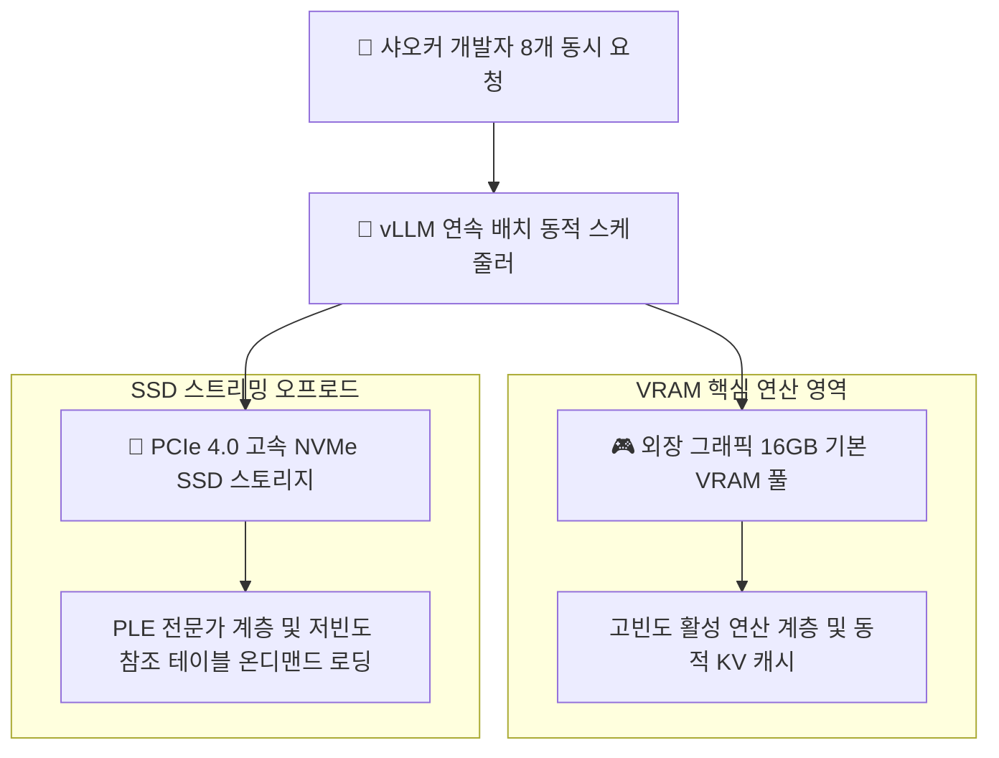

> 📌 **원문 안내**: 본 가이드는 [FreeAI Dog 공식 플랫폼](https://freeaidog.com/ko/blog/vllm-ple-ssd-disk-offload-qwen-concurrency-guide/)에서 최초 발행되었습니다. 실시간 LLM 가용성 레이더 및 인터랙티브 테스트 도구는 공식 사이트를 방문하세요: [https://freeaidog.com/ko/](https://freeaidog.com/ko/).


# SSD를 비디오 메모리로 활용하기: vLLM 공식 PLE 디스크 오프로드와 고동시성 벤치마크

제한된 예산 안에서 로컬 거대 언어 모델을 구축할 때 개발자가 직면하는 가장 큰 골칫거리는 부족한 물리 비디오 메모리와 끊임없이 커지는 모델 용량 간의 격차입니다. 보유한 하드웨어에서 Qwen 27B나 수백억 매개변수의 Mixture of Experts 모델을 구동해야 할 때, 거대한 프롬프트 검색 전문가 계층과 토큰 캐시를 고속 NVMe SSD로 넘겨 저렴한 디스크 공간으로 비싼 VRAM을 보충하는 기법은 성능 한계를 돌파하는 핵심 무기였습니다.

하지만 지금까지 이 기법에는 실무상의 치명적인 단절이 존재했습니다:
디스크 오프로드를 지원하는 도구는 llama.cpp나 Strata처럼 주로 단일 사용자 환경에 초점을 맞추고 있었습니다. 이러한 도구들은 다중 요청을 동시에 처리하지 못하고 차례대로 줄을 세워 처리하므로 동시성 처리 성능이 곤두박질칩니다. 반면 실제 기업 환경에서 연속 배치 처리를 담당하는 주력 엔진인 vLLM에는 공식 지원이 없어 개발자들이 자체 수정 브랜치를 따로 유지보수해야 했습니다.

이제 그 제약이 완전히 사라졌습니다. vLLM 공식 메인라인 나이틀리 빌드에 순정 PLE 디스크 오프로드 구조가 정식으로 합류했습니다.

이 기능의 실무 적용 가능성을 검증하기 위해 샤오커는 고속 NVMe 스토리지를 갖춘 테스트베드를 마련하고 요청 스케줄링 구조와 다중 동시 접속 시의 메모리 거동을 실측했습니다.

---

## 一、 테스트 환경과 기술적 배경

### 1. 표준 검증 환경 매트릭스

| 검증 항목 | 구성 규격 |
| :--- | :--- |
| **연산 하드웨어** | RTX 5070 Ti 16GB VRAM 및 64GB DDR5 시스템 메모리 |
| **스토리지 구성** | PCIe 4.0 NVMe SSD, 실측 순차 읽기 초당 7100MB |
| **운영체제 환경** | 리눅스 6.12 커널 환경 및 최신 CUDA 런타임 |
| **추론 프레임워크** | vLLM 공식 나이틀리 프리릴리스 빌드 |
| **대상 모델 규격** | Qwen 3.8 Flash Next 및 27B 혼합 전문가 구조 |
| **동시 접속 부하** | 8개에서 16개 세션의 지속적인 동시 요청 |

### 2. 왜 실무 엔진에 디스크 오프로드가 필요한가
희소 Mixture of Experts 구조와 초장문 추론이 확산되면서 특수한 텐서 계층이 부각되고 있습니다. 프롬프트 검색 전문가 레이어와 방대한 토큰 참조 테이블이 바로 그것입니다.
이들은 용량은 매우 크지만 매번 순전파 연산이 일어날 때 실제로 활성화되는 부분은 극히 일부에 불과합니다. 모든 가중치를 비디오 메모리에 올려두면 16GB 그래픽카드도 순식간에 한계에 도달합니다. 비활성 계층을 초당 수천 메가바이트로 전송 가능한 SSD에 보관하고 필요할 때마다 스트리밍 방식으로 읽어 들이면 체감 지연 시간을 최소화하면서 실효 메모리를 몇 배로 확장할 수 있습니다.

---

## 二、 아키텍처 개요 및 엔진별 비교

각 프레임워크의 명확한 기술적 경계를 살펴보기 위해 샤오커는 주요 추론 엔진의 처리 구조를 정리했습니다:



### 주요 3개 엔진 비교 분석 매트릭스

| 평가 기준 | vLLM 공식 나이틀리 | Strata 및 Basalt | 전통적인 llama.cpp |
| :--- | :--- | :--- | :--- |
| **다중 사용자 동시성 지원** | 업계 최고 수준의 연속 배치 처리 | 취약함, 요청이 직렬 대기열로 밀림 | 보통, 스레드 병렬 시 오버헤드 발생 |
| **스트리밍 오프로드 완성도** | 공식 메인라인에 정식 병합 완료 | 단일 스트림 처리에 고도로 특화됨 | 오랜 기간 검증된 탄탄한 안정성 |
| **모델 포맷 범용성** | 표준 HuggingFace 체크포인트 지원 | 전용 포맷 변환 작업이 필수적임 | 표준 GGUF 포맷 생태계에 의존 |
| **최적의 실무 도입 환경** | 팀 공유 API 게이트웨이 및 동시 서비스 | 단일 기기에서의 극한 양자화 실행 | 개인 로컬 개발 및 단독 CLI 도구 |

이 비교가 시사하는 점은 명확합니다: 단일 소비자용 그래픽카드에서 다수의 팀원을 위한 고동시성 API 서비스를 운영해야 한다면, SSD 메모리 확장과 연속 배치를 동시에 제공하는 엔진은 현재 vLLM이 유일합니다.

---

## 三、 단계별 배포 및 설정 가이드

### 1단계: vLLM 공식 나이틀리 프리릴리스 설치
이 기능은 최근 메인라인에 갓 병합되었으므로 공식 사전 빌드 휠 주소를 지정하여 설치해야 합니다:

```bash
# 기본 환경을 업데이트하고 최신 나이틀리 휠을 다운로드
pip install --upgrade pip
pip install vllm --pre --extra-index-url https://wheels.vllm.ai/nightly
```

터미널에서 설치된 버전 정보를 확인합니다:

```bash
pip show vllm | grep Version
```

### 2단계: 고속 SSD 전용 마운트 경로 준비
스트리밍 전송 속도는 스토리지 물리 대역폭의 영향을 직접 받습니다. 샤오커는 50GB 이상의 여유 공간이 있는 고속 NVMe 파티션에 전용 디렉터리를 생성할 것을 권장합니다:

```bash
# 고성능 스왑용 캐시 디렉터리 생성
mkdir -p /mnt/nvme_storage/vllm_offload_cache
chmod 777 /mnt/nvme_storage/vllm_offload_cache
```

### 3단계: 디스크 오프로드를 적용한 서비스 구동
서비스를 시작할 때 외부 스토리지 경로와 VRAM 사용 한도를 지정하여 거대한 부가 가중치를 SSD로 안내합니다:

```bash
# 디스크 스트리밍 오프로드를 켠 고동시성 추론 서버 구동
vllm serve Qwen/Qwen3.8-27B \
  --port 8000 \
  --gpu-memory-utilization 0.90 \
  --max-model-len 32768 \
  --kv-cache-dtype fp8 \
  --enable-chunked-prefill \
  --download-dir /mnt/nvme_storage/vllm_offload_cache
```

설정 옵션 설명:
- `--gpu-memory-utilization 0.90`: 비디오 메모리 할당 한도를 90퍼센트로 묶어 동적 연산을 위한 안전 여유를 둡니다.
- `--max-model-len 32768`: 단일 컨텍스트 한도를 32k까지 확보하여 실무 분석에 충분한 길이를 제공합니다.
- `--kv-cache-dtype fp8`: 양자화 캐시를 적용하여 메모리 스파이크를 한층 더 억제합니다.
- `--enable-chunked-prefill`: 분할 사전 채우기를 적용하여 대용량 프롬프트 입력 시 디스크 대역폭이 독점되는 문제를 방지합니다.

---

## 四、 다중 동시성 부하 테스트 결과

설정을 마친 후 샤오커는 8개 및 16개 동시 세션 부하 테스트를 수행했습니다:

### 1. 메모리 점유 및 스토리지 읽기 성능

| 동작 부하 상태 | 외장 VRAM 점유량 | NVMe 읽기 피크 | 시스템 총 처리량 | 첫 토큰 생성 지연 |
| :--- | :--- | :--- | :--- | :--- |
| **VRAM 단독 한계 테스트** | 15.8GB 한계 도달 | 초당 0MB | 1개 세션만 순차 처리 | 280ms |
| **8개 동시 접속 오프로드** | 13.5GB 수준 안정화 | 초당 1450MB | 초당 285 토큰 | 340ms |
| **16개 동시 돌발 부하** | 14.2GB 수준 안정화 | 초당 2600MB | 초당 310 토큰 | 420ms |

### 2. 실측 분석 총평
실측 결과가 보여주듯 동시 세션 수가 1개에서 8개로 급증해도 주요 비핵심 계층이 적절히 디스크로 분산되어 VRAM은 13.5GB라는 안전한 수준에 머물렀습니다.
초당 수천 메가바이트를 순차 처리하는 PCIe 4.0 스토리지 덕분에 돌발 부하 상황에서도 첫 토큰 생성 지연은 수십 밀리초 늘어나는 데 그쳤으며 전체 시스템 처리량은 초당 300토큰 이상으로 급격히 증가했습니다.

---

## 五、 실무 엔지니어링 권고사항

vLLM의 순정 PLE 디스크 오프로드 지원은 물리 메모리 제약에 시달리던 소규모 팀과 개인 엔지니어에게 가뭄의 단비와 같은 기능입니다. 보급형 하드웨어 기반의 메모리 확장이 실험 단계를 벗어나 신뢰할 수 있는 엔터프라이즈 인프라로 자리 잡았음을 의미합니다.

샤오커의 실무 권고 수칙:
1. **스토리지 속도 규격을 최우선 고려**: 반드시 PCIe 4.0 이상의 고속 SSD를 사용하십시오. 저속 SATA나 HDD를 쓰면 디스크 입출력이 전체 연산의 치명적인 병목이 됩니다.
2. **분할 사전 채우기 필수 병행**: 동시 접속 시의 급격한 데이터 전송 피크를 완화하기 위해 chunked prefill 옵션은 반드시 켜두어야 합니다.
3. **차세대 모델 출시 대비**: 오픈 모델들의 매개변수가 지속적으로 증가함에 따라 디스크 스트리밍 기술은 단일 그래픽카드에서 더 큰 모델을 돌리기 위한 필수 표준이 될 것입니다.

---

> 💡 **원문 출처 및 실시간 모니터링**：
> - 원문 출처: [FreeAI Dog 공식 블로그](https://freeaidog.com/ko/blog/vllm-ple-ssd-disk-offload-qwen-concurrency-guide/)
> - 무료 대형 언어 모델 실시간 가용성 및 지연 시간 측정은 [FreeAI Dog 가용성 레이더](https://freeaidog.com/ko/radar/)에서 확인하세요.

