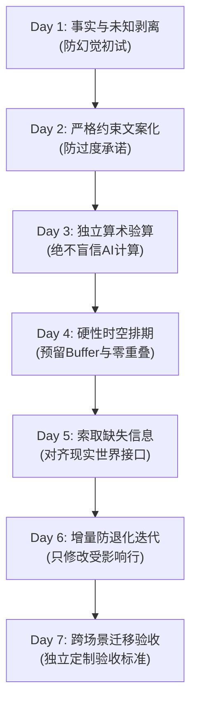

# 别再把 AI 当聊天玩具：新手 7 天“单一微项目”AI 实战闭环训练法

> **导读**：你是否也有过这样的经历——收藏了上百条“封神提示词”，天天在对话框里向大模型询问各种宏大问题，但一旦面对真实的现实任务（一份会议通知、一张物料预算比对表、一个有硬性时间限制的日程排期），AI 要么一本正经地胡说八道，要么给出一堆华而不实的套话？
> 
> 真正的 AI 实战能力，**绝不是靠背诵模板获得的，而是在对现实约束的精细把控中磨炼出来的**。本文将带你用一个极简的单一微项目，每天仅需 15~20 分钟，通过 7 天环环相扣的闭环训练，彻底建立起属于你自己的“人机协同防御与交付力”。

---

## 一、为什么随机提问练不出真正的 AI 生产力？

很多人学习 AI 的方式是“东一榔头西一棒槌”：今天让它写首诗，明天问它世界未解之谜，后天让它编一段 Python 代码。这种碎片化的交互就像在游乐场里试玩各种玩具，无法让你建立起处理复杂业务的肌肉记忆。

在真实的交付场景中，AI 协作有四大致命暗礁：

1. **幻觉陷阱（Hallucination）**：当输入的信息存在空缺时，AI 往往会以极其自信的语调脑补虚假事实（例如把“尚未确认是否有无障碍洗手间”擅自写成“设施一应俱全”）；
2. **约束失效（Constraint Drift）**：你明明规定了“不要超过 140 字”、“不要承诺免费茶歇”，AI 稍不留神就会突破字数限制或随口承诺福利；
3. **数字算术幻视（Arithmetic Blindness）**：大模型本质是基于概率的下一个 Token 预测器，而不是严谨的计算器。在涉及多笔报价、运费、税率与预算结余时，AI 给出的总和常常漏洞百出；
4. **增量退化（Regression on Revision）**：当现实条件发生突发变更、你要求 AI 局部微调时，它往往会在重新生成时悄悄弄丢之前确认过的关键信息（如地址、自带物料清单等）。

克服这些问题的核心，在于建立一套**“人机闭环核验机制”（Human-in-the-Loop Verification）**。这与 Google 官方倡导的提示词工程准则高度契合：**以事实为唯一依据，以明确检验为终点**。

---

## 二、实训基石：唯一的“事实真理来源”（Single Source of Truth）

在开始 7 天训练前，请将以下这份**模拟微项目事实清单（Brief）**保存在一个独立记事本中。

在整个训练过程中，这份清单是整个宇宙中**唯一的客观真理来源**。AI 不得联网随意搜索，更不得私自添加任何未经清单证实的信息。

> 📋 **【模拟微项目：12人社区旧物修补工作坊 (Repair Café)】**
> 
> - **活动主题**：衣物织物小修补（学习简单缝纫打补丁）
> - **活动日期**：2026年10月17日
> - **场地预约时段**：14:00 – 16:00（**包含主办方前置布置与后置清场**）
> - **招募参与人数**：12 人
> - **物料总预算上限**：90 美元
> - **参与者自带要求**：每人自带一件干净、需要轻微修补的织物或衣物
> - **现场提供工具**：剪刀、缝衣针由主办方统一提供
> - **无障碍通行状况**：**无台阶平地入口已确认；独立无障碍洗手间尚未确认**
> - **报名登记方式**：在 2026年10月10日前通过邮件回复主办方
> - **详细地址**：雪松路 8 号社区中心 Cedar Room（虚拟地址）
> - **茶歇餐饮安排**：**尚未决定**

*提示：你可以直接打开 [FreeAI Dog 首页](/)，使用免费的 Google Gemini 2.5 Flash、DeepSeek-V3 或 Groq Llama 3.3 等任意模型，无需付费即可零成本实操。*

---

## 三、7 天递进实战全景演练



---

### Day 1：剥离假设——事实归事实，疑问归疑问

很多新手一上来就对 AI 说：“帮我策划一个工作坊方案”。AI 瞬间为你生成一个宏大的方案，包含了免费咖啡、乐队表演和全套无障碍设施——但这些全是脑补的幻觉。

#### 🎯 训练目标
要求 AI 仅基于给定事实清单，将**已确认安排**与**未决问题**严格分开，不填充任何未经验证的猜测。

#### 📝 提示词模板 (Prompt)
```text
请严格仅依据以下给出的工作坊事实清单，将内容梳理为两个独立板块：
1. 【已确认的安排】（保留精确日期、数字、时段与地址）
2. 【尚未确认的待决疑问】

严禁根据常识或建议自行脑补任何未提及的细节。如果清单中没说，就不能当作已确认。

【工作坊事实清单】：
[在此粘贴上述清单]
```

#### 🔍 人肉质检清单 (Checklist)
- [ ] **洗手间核验**：AI 是否把“无障碍洗手间”列入了待决疑问？如果它写成“设施齐全已确认”，立刻扣分打回！
- [ ] **餐饮核验**：AI 是否把“茶歇安排”明确列为未定？
- [ ] **时段核验**：“14:00–16:00”是否标注了包含布场与保洁，而不是纯教学时间？

> 💡 **核心心法**：AI 自信满满的语气（“没问题，为您安排了完备的无障碍体验”）不等于事实。学会给 AI 的回答挑刺，是掌握大模型的第一步。

---

### Day 2：戴着镣铐跳舞——字数死线与防过度承诺

现在我们要将清单转化为面向参与者的邀请文案。在传播中，多说一句未经确认的话，就可能引发信任危机。

#### 🎯 训练目标
在严苛的字数限制与事实约束下，生成一份友善的邀请函，杜绝虚假承诺。

#### 📝 提示词模板 (Prompt)
```text
请基于工作坊事实清单，撰写一封面向社区居民的友好邀请函。
严格满足以下限制：
1. 正文字数严禁超过 140 字；
2. 必须准确包含：日期、场地预约时段、地址、自带物品要求、报名方式及 10月10日截止日期；
3. 必须明确说明：独立无障碍洗手间目前仍在向物业确认中；
4. 严禁声称“免费入场”或“提供免费茶点”（因为清单中预算仅用于物料，且餐饮未决）。
```

#### 🔍 人肉质检清单 (Checklist)
- [ ] **字数校验**：复制 AI 生成的正文，用字数统计工具检查是否真的 $\le 140$ 字；
- [ ] **虚假免费审查**：AI 是否擅自加了“完全免费活动”这类字眼？（物料预算 90 美元不代表免收门票）；
- [ ] **精准修正练习**：如果 AI 遗漏了洗手间说明，**不要让它重新生成整篇**，而是指出：“请仅补上‘无障碍洗手间尚在确认中’这一句话，并确保总字数依然不超过 140 字”。

---

### Day 3：打破数学迷信——采购报价比对与独立验算

很多人误以为大模型懂数学，结果在预算、财报、库存统计上吃了大亏。今天我们要给 AI 两份物料报价，并在现实中独立核算。

#### 🎯 训练目标
让 AI 梳理报价并与 90 美元总预算对比，同时**用真实计算器对 AI 的算术结果进行独立复核**。

#### 📝 提示词模板 (Prompt)
```text
我们在为 12 位参与者采购修补工具包，目前获得两家供应商报价（含税）：
- 方案 A：每套 5 美元，另加 18 美元总运费。
- 方案 B：每套 6 美元，另加 8 美元总运费。
已知总预算上限为 90 美元。

请分别计算两套方案的总开销与预算结余：
1. 分步骤列出：基础物料费用（12套 × 单价）、运费、最终总支出；
2. 计算各自剩余多少可用预算；
3. 指出哪套方案总花费更低。不要随意主观揣测哪套质量更好。
```

#### 🔍 人肉质检清单 (Checklist)
自己拿起手机计算器独立验算：
$$\text{方案 A} = 12 \times 5 + 18 = 60 + 18 = 78\text{ 美元} \quad (\text{结余 } 90 - 78 = 12\text{ 美元})$$
$$\text{方案 B} = 12 \times 6 + 8 = 72 + 8 = 80\text{ 美元} \quad (\text{结余 } 90 - 80 = 10\text{ 美元})$$
- [ ] 检查 AI 的每一步运算结果是否与上述参考答案完全一致；
- [ ] 方案 A 虽单价更低，但运费更高，最终总开支仍然省 2 美元；
- [ ] 检查 AI 是否画蛇添足地说“方案 B 质量更优”或“建议选方案 B 送货更快”——未经给出的条件，一律视为违规臆断。

---

### Day 4：硬性时空对齐——零重叠与预留缓冲时段

活动统筹中最怕“赶场”。场地只租了两个小时，如果课程安排到最后一分钟，清场就会超时罚款。

#### 🎯 训练目标
在 14:00–16:00 的 120 分钟硬约束下，设计两套活动排期，必须预留布置与清场缓冲。

#### 📝 提示词模板 (Prompt)
```text
请为 14:00–16:00（共 120 分钟）的工作坊制定两套时间排期方案：
硬性约束：
1. 14:00–14:15 必须为场地布置与签到（15分钟）；
2. 15:45–16:00 必须为工具归还与场地清扫（15分钟）；
3. 中间可供教学互动的净时间为 90 分钟。

请输出两套方案：
- 方案一【重视示范】：安排较长的主讲人实操示范时间；
- 方案二【重视动手】：主讲人简短示范，留出更长的时间让居民自己动手缝补。

要求：每个环节必须标明清晰的起止时间（如 14:15–14:35），环节之间严禁出现时间空隙或重叠冲突。
```

#### 🔍 人肉质检清单 (Checklist)
- [ ] **时间链闭环**：上一环节的结束时间，是否精确等于下一环节的起始时间？
- [ ] **清场时间守卫**：教学环节是否在 15:45 准时结束？如果有环节排到 16:00，说明它把清场时间吃掉了，判定不合格。
- [ ] **人类决策练习**：在两套方案中选择一套，并写下一句你的选择理由（例如：“选方案二，因为学习修补最好的方式是亲自上手，遇到问题即时答疑”）。记住：**选项由 AI 生成，但决策权必须留在人类手中**。

---

### Day 5：对齐真实世界接口——索取缺失数据而不臆造

既然无障碍洗手间和茶歇还没定，我们能不能让 AI “直接给个结论”？不能！因为现实中的开关不在模型参数里，而在场地负责人的钥匙串上。

#### 🎯 训练目标
让 AI 起草一封面向现实世界负责人的沟通邮件，只询问事实，不臆想答案。

#### 📝 提示词模板 (Prompt)
```text
请帮我起草一封简短的问询邮件，发送给雪松路 8 号社区中心场地管理部门：
目的：核实 10 月 17 日 14:00–16:00 在 Cedar Room 预约期间，同楼层的独立无障碍洗手间是否处于开放可用状态。
要求：
1. 语言礼貌职业，点明预约日期、时段与房间；
2. 这是一封真实的【询问邮件】，严禁把洗手间可用当作既成事实去宣布；
3. 不编造任何居民的个人健康隐私人格信息。
```

#### 🔍 人肉质检清单 (Checklist)
- [ ] 这封邮件是在**提问**，而不是在**告知**；
- [ ] 邮件信息足够具体，物业收信人一眼就能查到系统排期并给出肯定或否定的答复；
- [ ] **认知复盘**：明白哪些事情是必须由人类通过真实世界接口完成的，绝不要妄图用“向 AI 追问一次”来替代现实核验。

---

### Day 6：防退化增量更新——只动手术刀，不换全盘骨架

现实项目总是在变化。现在，管理方回复了邮件，时间也发生了顺延。

#### 🎯 训练目标
输入两个新变更，要求 AI 在保留 Day 2 已确认文案结构的前提下，**仅做精准的增量手术**，杜绝“改好了一处，搞坏了三处”。

#### 📝 提示词模板 (Prompt)
```text
项目产生了两项最新事实更新：
1. 场地管理方已正式确认：活动期间同楼层的无障碍洗手间正常开放使用；
2. 因物料备货提前完成，报名截止日期由原先的 10 月 10 日顺延至 10 月 12 日。

请调出我们此前在 Day 2 确定的 140 字邀请函文案，仅对涉及上述两个变动的语句进行精准修订。
要求：
- 其他所有已确认的事实（活动主题、日期、时段、地址、自带物品、工具提供）必须 100% 保持原样；
- 依然保持在 140 字以内；
- 在输出修改后文案的下方，用两行清单明确标出你修改了哪两处。
```

#### 🔍 人肉质检清单 (Checklist)
- [ ] **做一次“文本 Diff”对比**：拿 Day 2 的旧版本和新版本逐句比对；
- [ ] **检查是否产生暗度陈仓的退化**：地址还在不在？“自带一件需微修的织物”有没有被偷偷删改或缩写得词不达意？
- [ ] 确认仅有两处实质变动：洗手间可用状态变更 + 截止日期由 10 日变为 12 日。

---

### Day 7：跨场景迁移实战——检验属于你的“人机协同直觉”

经过前 6 天的刻意练习，你已经掌握了事实真理源、约束控制、独立验算、时空闭环与增量迭代。现在，我们脱离原本的工作坊场景，用一个全新的任务检验你的掌握度。

#### 🎯 训练目标
在**全新的空白对话**中，对全新业务需求自行编写提示词、设立核验红线并完成质检。

#### 📝 全新测试 Brief (自测题)
> - **活动**：团队研读分享会
> - **时间**：2026年11月6日 上午 10:00–11:00
> - **人数**：6 人
> - **阅读任务**：会前务必通读随附报告的第 1 至第 8 页
> - **线上会议链接**：尚未分配（将于会前一天发送）
> - **参会性质**：自愿报名参与，非强制要求

#### 🚀 你的行动：
1. 自己写一段提示词，让 AI 生成内部邀请通知；
2. 自定义质检红线：检查 AI 有没有脑补虚拟会议链接？有没有写错阅读页码范围（1~8页）？有没有误写成强制全体参会？
3. 如果 AI 出错，用单点修正指令让它在原地打补丁，直到产出一份 100% 严丝合缝的合格通知。

---

## 四、高手不传之秘：从“Prompt 魔法”到“工程思维”的五大定律

| 传统“聊天式”盲目用法 | 工业级“人机协同”把控思维 |
| :--- | :--- |
| 看到 AI 答得长、语气肯定，就直接复制粘贴 | **Confidence $\ne$ Fact**：AI 越是言之凿凿，越要在第一轮排查它的幻觉脑补 |
| 让 AI 做大额运算并盲信它的最终统计数据 | **算术独立原则**：大模型负责逻辑与列式，计算器或 Python 负责求和验算 |
| 每次提修改意见都让它“重新润色一下” | **增量修改原则（Diff Thinking）**：只允许精准修改变动字段，警惕暗度陈仓式退化 |
| 遇到缺少的信息，催促 AI“帮我编一个推荐” | **现实接口原则**：分清信息边界，未知项应形成向人类提问的清单，而非让模型脑补 |
| 每次换模型都要重新摸索一遍“咒语” | **结构化约束**：只要明确了输入事实、负面约束与检查清单，任意大模型都能稳定交付 |

---

## 五、结语：把掌控权握在自己手中

AI 的时代，最稀缺的从来不是模型能生成多少华丽的词藻，而是**你能否在汹涌的信息洪流中，精准甄别什么是事实，什么是幻觉，并确保交付物在严酷的现实约束下依然稳健可靠**。

这套 7 天训练法，不依赖任何特定软件，你可以在 [FreeAI Dog](/zh/tools) 上的各个免费 AI 工具间随时展开实践。从今天起，挑选一个哪怕只有几百字的真实小项目，开启你的 Day 1 吧！当你学会了如何对大模型进行“工程级质检”，AI 才真正成为你手中最锋利的武器。

---

> 💡 **原文首发与实时探活**：
> - 本文首发于 [FreeAI Dog 官网博客](https://freeaidog.com/blog/ai-practice-plan-for-beginners/)
> - 更多免费 API 端点实时探活与端到端延迟测速，欢迎访问 [FreeAI Dog 可用性雷达](https://freeaidog.com/radar/)
