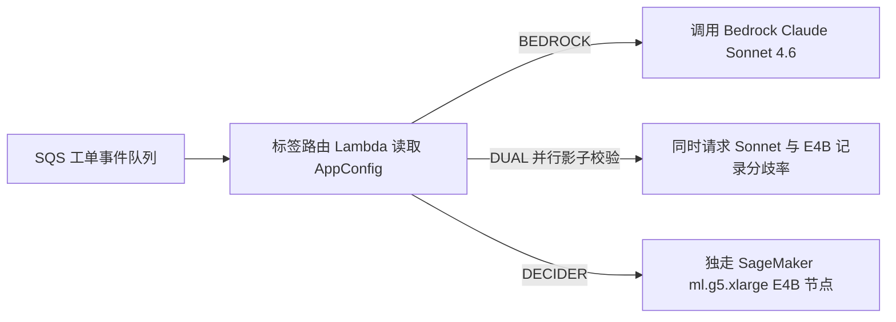

> 📌 **原创声明**：本文首发于 [FreeAI Dog 官方平台](https://freeaidog.com/zh/blog/amazon-strands-decider-4b-replace-sonnet-46-routing-cost-guide/)。如需体验 API 在线实时测速、可用性秒级雷达与端到端延迟监控，请访问主站：[https://freeaidog.com/zh/](https://freeaidog.com/zh/)。


拿每秒吐几十个字的通用推理模型干 20 选 1 路由，本质是在烧钱买延迟。

Amazon 内部工程师刚算过一笔实账。原本系统靠 Bedrock 上的 `Claude Sonnet 4.6` 给工单打标。客诉、权限申请与告警全往里塞；一共 20 个固定类别加兜底项。平均每单吃进 6554 个输入 token。模型还得吐出 170 个输出 token 的理由与 JSON。单次平均耗时 4215 毫秒。按挂牌价折算，每单花 0.0222 美元；每百万工单就是 22200 美元。

换成开源 `Strands Decider E4B` 之后呢？耗时掉到 897 毫秒；每百万工单压到约 500 美元。账面降幅 98%。先别急着抄。这笔省钱账卡着个硬前提：年工单量不够千万甚至近亿级别，包月租卡的闲置费能把利润赔光。更离谱的是，连输入 JSON 的键名顺序都会篡改它的打分。

以下数值全核自官方工程博客、GitHub 源码与 Hacker News 讨论。手头没租 SageMaker 跑并发。本文只核账本与排障细节，不伪造压测曲线。

## 指针头只吐 1 个 token：别当普通微调小模型

第一眼瞄到 `strands-labs/strands-decider`，我也差点把它归进普通微调小模型。翻了源码才发现不是。

常规大模型靠自回归逐字输出；哪怕只要一个分类名，也得跑完解码循环。这个仓库在 `Gemma 4` 或 `Qwen3.5` 上接了指针输出头。给一段文本状态，再选定模式：`choice` 多选、`noul` 是非判定或 `score` 打分；一次前向传播就输出带校准置信度的概率。输出永远只吐 1 个 token。

对照仓库公开的 Gemma 4 全系指标，差异很直白：

| 模型版本 | JevBench 得分 | Brier 校准误差 | 权重显存占用 BF16 | 单张 H100 中位延迟 | 典型适用场景 |
| --- | --- | --- | --- | --- | --- |
| `strands-decider-E2B-gemma4-v1-2610` | 180 | 0.313 | 约 9 GB | 102 ms | 极度抠显存或纯 CPU 部署 |
| `strands-decider-E4B-gemma4-v1-2610` | 187 | 0.243 | 约 15 GB | 139 ms | 单张 24G 卡与别的服务混跑 |
| `strands-decider-12B-gemma4-v1-2610` | 200 | 0.173 | 约 23 GB | 136 ms | 独享单卡追求更高准确率 |
| `strands-decider-26B-A4B-gemma4-v1-2610` | 207 | 0.162 | 约 51 GB | 245 ms | 重度精度敏感型决策节点 |

表里有组反直觉数字：12B 在 H100 上中位延迟是 136 毫秒，比 E4B 还快 3 毫秒。既准又快，生产环境为什么偏挑 E4B？原因出在卡上。SageMaker `ml.g5.xlarge` 只给了单张 24 GB A10G。E4B 实占约 19 GiB 显存；刚好留出余量。12B 光权重就占 23 GB，跑上线随时撑爆显存。

本地试跑时先避坑。PyPI 上发布的旧包还没合入 Gemma 4 支持。直接装会报错。请从 GitHub 主干拉取：

```bash
pip install "strands-decider @ git+https://github.com/strands-labs/strands-decider"
strands-decider ask StrandsAgents/strands-decider-E4B-gemma4-v1-2610 \
  --state "Help! My payouts have been failing for 3 days! " \
  --choice "Which team should handle this?=billing,sales,retail"
```

Mac 用户注意两点。跑 `--device mlx` 能比 MPS 快上 1.4 到 1.6 倍。但要走源码安装 `pip install -e ".[mlx]"` 才能打开。另外别传错模态：Gemma 4 目前纯读文本。只有早先的 `Qwen3.5-2B-Base` 支持 `--vision` 看图；别拿截图往 E4B 里硬塞。

## 算清每小时 1.408 美元的显卡账：低频队列反而更贵

官方博客放出了上线前后对照账单：

| 核心对比指标 | Claude Sonnet 4.6 Bedrock | Strands Decider E4B SageMaker | 变化幅度与口径 |
| --- | --- | --- | --- |
| 单次调用平均耗时 | 4215 ms | 897 ms | 提速 78%；实例内部耗时约 640 ms |
| 平均输入 token | 6554 | 2009 | 缩减 69%，依赖提示词硬压缩 |
| 平均输出 token | 170 | 1 | 直接输出选项，免除 JSON 生成 |
| us-east-1 公开单价 | 输入 3 美元、输出 15 美元每百万 | `ml.g5.xlarge` 每小时 1.408 美元 | 按需挂牌价计算，未含 Lambda 费用 |
| 单百万工单估算成本 | 约 22200 美元 | 约 500 美元 | 省约 98%；全负荷理论值 250 美元 |

单百万工单省 21700 美元，账面数字极其唬人。可算完年账就清醒了。要兑现“年省数百万美元”，全年得处理 9000 万张以上工单。小厂哪来这种量？

中小团队照搬多半亏钱。`ml.g5.xlarge` 按开机小时计费；单机挂满一个月，底租就是 1014 美元。算上多可用区容灾与预发节点，每月两三千美元跑不掉。假如平台每月只有 5 万张单，继续调 Sonnet 4.6 月费也才 1110 美元。干嘛自讨苦吃？改用 Haiku 级小模型，月费直接压进两百美元内。镜像维护也一并省了。

自建节点只认两条硬门槛。要么队列 24 小时吃饱算力，把每小时 1.408 美元的租金彻底摊薄；要么合规铁律规定数据绝不出私有 VPC，必须借断网容器走完整个流程。那问题来了：既然差价这么狠，Bedrock 为什么不上按 token 计费的托管版？HN 原帖里就有好几个人追问这句；到现在没人接。

## 上线排障实录：JSON 键序漂移 0.19 与 4096 窗口裁切

翻到案例后半段的上线故障单时，我反而多停了一会儿。他们一点没藏。

最邪门的一件事发生在序列化层：JSON 字段顺序能直接改写决策概率。同一张工单里内容一字未改，工程师仅仅调换了字典键名的先后次序，模型概率竟漂了 0.19。对于靠置信度阈值决定是否转人工的系统，0.19 足够把边缘单全判歪。研发最后强行规定请求前按字母序重排键名。后续谁自己包接口，记得先锁死序列化排序。

刚把键序按字母锁死，紧接着又顶到了 4096 token 的上下文死线。原本喂给 Sonnet 的 20 条分类细则，单规则就撑破了 4096 上限。塞不下怎么办？删太狠怕误判，硬塞直接报错。团队只好把每条规则压成一两句短判据，再配一个 `"none"` 兜底。碰到回复盖了几十楼的长单，干脆裁掉最早的旧回复保住近况；整轮瘦身砍完，平均输入才缩回 2009 token。

切线上流量的那天团队倒是稳；谁也不敢一把全切。他们在 AWS `AppConfig` 背后挂了个三态开关：



切换初期先走 `DUAL` 影子模式。线上依然用 Sonnet 的结论交差，后台悄悄攒下 E4B 的分歧单，调稳置信度阈值才切进 `DECIDER`。真撞上半夜误判飙高，改个配置 45 秒热回滚。一行代码也不用重发。

看到这儿，HN 讨论串里还有句刺耳但实在的追问：类目既然长期锁死在 20 个，直接用 `scikit-learn` 或 `ModernBERT` 训个小分类器不行吗？延迟能干进 10 毫秒内；硬件开销比 GPU 低几个量级。这话站得住脚；前提是你库里早攒了数万条精标工单。Strands Decider 真正赌的场景是零样本冷启加自带概率校准，专治刚加新类目、手里又零样本的急活。

---

文中全部单价、延迟与漂移数值均核自下列公开一手源：

| 核验项目 | 一手出处链接 |
| --- | --- |
| Amazon 工单系统替换 Sonnet 4.6 案例原文 | https://strandsagents.com/blog/amazon-saves-millions-replacing-sonnet-with-strands-decider/ |
| Strands Decider 官方仓库与安装命令 | https://github.com/strands-labs/strands-decider |
| StrandsAgents Gemma 4 E4B 模型页 | https://huggingface.co/StrandsAgents/strands-decider-E4B-gemma4-v1-2610 |
| Marc Brooker 对比解码器与编码器技术分析 | https://brooker.co.za/blog/2026/10/04/encoders.html |
| Hacker News 原帖计费与经典 ML 争论 | https://news.ycombinator.com/item?id=50436640 |

换作我接这套改造，这周先不碰卡。直接在主链路挂个异步双跑日志跑七天，回来只盯两个死数：月均请求量到底过不过百万、删掉旧回复后准确率跌几个点？这两个数摆上桌，前面那个降本 98% 就没那么晃眼了。

---

> 💡 **原文首发与实时探活**：
> - 本文首发于 [FreeAI Dog 官网博客](https://freeaidog.com/zh/blog/amazon-strands-decider-4b-replace-sonnet-46-routing-cost-guide/)
> - 更多免费 API 端点实时探活与端到端延迟测速，欢迎访问 [FreeAI Dog 可用性雷达](https://freeaidog.com/zh/radar/)

