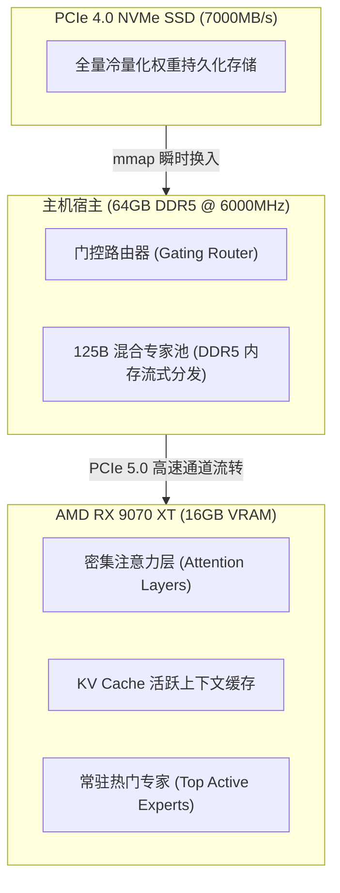

# 1600€ 拿下前沿 Flash Next！AMD RX 9070 XT + Strata 跑出 90 t/s：量化避坑与万元装机实测

很多打算在本地折腾大模型的朋友，查了一圈配置单直接被劝退：
“想跑顶尖 125B 的 MoE 混合专家模型？至少双卡 RTX 3090 / 4090，或者砸两万买一张 32G 的 RTX 5090。”

但在开源硬件社区，永远不缺死磕性价比的极客。

就在这两天，Reddit 的 r/LocalLLaMA 板块爆出一个引发上百条跟帖讨论的神贴：一位欧洲老哥用 **Intel i7-14700KF + 64GB DDR5 + AMD 新一代 Radeon RX 9070 XT 16GB（RDNA4 架构）**，搭建了一台总价只要 **1600 欧元（折合人民币约 1.24 万元）** 的整机。

在这台万元平民主机上，他用专门针对 MoE 动态分流优化的开源引擎 **Strata**，把阿里顶尖的多模态代码大模型 **Qwen 3.8 Flash Next** 跑到了 **70 ~ 90 tokens/s** 的惊人解码速度！

这个速度已经远超日常阅读极限，打字机弹射出字的速度甚至比很多付费云端 API 还快。

不过，先别急着掏钱包。很多小白看了帖子直接冲，结果掉进了“Q2 量化弱智”、“ROCm 驱动报错”的大坑里。小可今天带大家扒透这套配置的真实实操细节、软硬件门道，以及如何把钱花在刀刃上。

---

## 一、 1600 欧元装机单拆解：钱都花在哪了？

这套配置之所以能在万元出头的预算下拿下 125B 参数量级的 MoE 模型，核心逻辑在于**“显存保核心注意力，高带宽高频内存扛专家层流转”**。

老哥的原版配置清单如下（小可同时折算了当前国内行货行情）：

| 配件类型 | 社区实测型号 | 核心选型考量 | 国内参考价 |
| :--- | :--- | :--- | :--- |
| **显卡 (GPU)** | **AMD Radeon RX 9070 XT 16GB** | RDNA4 架构，Navi 48 核心，原生 FP8/FP4 矩阵加速，性价比远超同显存 N 卡 | ~¥4,699 |
| **处理器 (CPU)** | **Intel Core i7-14700KF** | 20 核 28 线程，单核睿频高，负责专家调度路由计算不拖后腿 | ~¥2,499 |
| **内存 (RAM)** | **64GB (32G×2) DDR5 6000MHz CL30** | **重点！** 带宽 ~96 GB/s，时序紧，MoE 专家从内存到显存的传输生命线 | ~¥1,499 |
| **主板 (MB)** | **B760 / Z790 优质供电大板** | 需具备 PCIe 5.0 显卡插槽和至少 2 个 PCIe 4.0×4 M.2 盘位 | ~¥1,299 |
| **固态硬盘 (SSD)**| **2TB PCIe 4.0 NVMe (7000+ MB/s)** | 存放模型权重与冷专家预备区，读取延迟必须极低 | ~¥899 |
| **电源 (PSU)** | **850W ATX 3.0 金牌全模组** | 应对 9070 XT 与 14700KF 的瞬间峰值功耗 | ~¥699 |
| **散热与机箱** | **360 水冷 + 宽体风道机箱** | 压制 14700KF 高负载，保证长时间推演不降频 | ~¥799 |
| **整机总计** | **~1600 €** | **整机约 1.24 万元，仅相当于一张半 5090 裸卡的价格** | **~¥12,393** |



这套架构的精髓在于：RX 9070 XT 的 16GB 显存刚好能完整容纳 Qwen 3.8 Flash Next 的注意力层（Attention）、KV Cache 以及当前 Token 最频繁触发的核心专家；而 64GB DDR5 内存作为二级缓冲池，利用 Strata 的流式调度实时换入，彻底盘活了整机。

---

## 二、 关键争论：90 t/s 的 Q2 量化真的能用吗？

原贴发出后，社区老哥们最大的争议点不是速度，而是**量化精度带来的智商滑坡**。

测试者跑出 70~90 t/s 所使用的模型版本是：`Qwen3.8-Flash-Next-GSQ-RCO-Q2_0`。

如果你是一个对输出质量有要求的开发者，这里必须打起十二分精神：

### 1. 三档量化真实体验对比

| 量化档位 | 实测解码速度 | 显存+内存总占用 | 真实可用性与小可实测评价 |
| :--- | :---: | :---: | :--- |
| **GSQ-RCO-Q2_0** | **90 ~ 70 t/s** | 约 38 GB | ⚠️ **能跑，但会“掉智”**。日常聊天打诨很顺滑，但在复杂长逻辑、多分支代码生成和严格 JSON 工具调用时，漏字段、前后逻辑矛盾的概率明显增加。 |
| **GSQ-RCO-IQ3_S** *(黄金推荐)* | **60 ~ 50 t/s** | 约 48 GB | 🏆 **绝对值得用速度换质量的“甜点档”**！重要性矩阵量化保留了核心注意力精度，代码生成严密，函数调用无故障，50+ t/s 的阅读体验依然如丝般顺滑。 |
| **Atomic Q4 / GSQ-RCO-Q4** | **50 ~ 30 t/s** | 约 62 GB | 💎 **高保真生产级**。几乎 1:1 复刻 FP16 原生推理水平，完全没有幻觉加剧问题，适合本地主力代码辅助与长文分析。 |

> **小可实测建议**：不要为了单纯追求贴吧跑分数字死守 Q2_0。**IQ3_S 是目前性价比与质量兼备的唯一真神档位**，50~60 t/s 的速度对于屏幕前的你来说，阅读压力已经很大了，多保留的那部分逻辑推理能力在关键时刻能救你的项目。

---

## 三、 实操教程：在 RX 9070 XT 上把 Strata 跑起来

如果你拿到了 AMD 显卡，千万别用 Windows 自带的旧版驱动去折腾。目前开源社区的最新算子优化都是首发在 Linux ROCm 环境下。

推荐系统环境：**Ubuntu 24.04 LTS，内核 Linux 6.10 或更高**。

### 第 1 步：安装 AMD 原生 ROCm 6.3 运行环境
```bash
# 1. 导入 AMD 官方 ROCm 源
sudo apt-get update
sudo apt-get install -y wget gnupg2
wget https://repo.radeon.com/rocm/rocm.gpg.key -O - | \
    gpg --dearmor | sudo tee /etc/apt/trusted.gpg.d/rocm.gpg > /dev/null

echo "deb [arch=amd64] https://repo.radeon.com/rocm/apt/6.3/ noble main" | \
    sudo tee /etc/apt/sources.list.d/rocm.list

# 2. 安装 ROCm 运行时与开发工具链
sudo apt-get update && sudo apt-get install -y \
    rocm-hip-sdk rocm-opencl-runtime rocm-smi-lib rocminfo

# 3. 将当前用户加入 render 与 video 组
sudo usermod -a -G render,video $USER
```

> **避坑关键提示**：RX 9070 XT 采用的是最新的 RDNA4 架构（设备目标 gfx1201）。如果在初始化时出现找不到 GPU target 的提示，需在终端或环境变量中加入强制覆盖：
> ```bash
> export HSA_OVERRIDE_GFX_VERSION=12.0.0
> export ROCM_PATH=/opt/rocm
> ```

### 第 2 步：获取并编译 Strata 推理引擎
Strata 是由开发者 Niko1221 专为异构分流打造的高性能推理引擎（官网：`stratallm.dev`，GitHub：`github.com/Niko1221/Strata`）：

```bash
# 克隆仓库
git clone https://github.com/Niko1221/Strata.git
cd Strata

# 使用 ROCm HIP 编译后端
mkdir build && cd build
cmake .. -DHIP_ROOT_DIR=/opt/rocm -DSTRATA_ENABLE_ROCM=ON -DCMAKE_BUILD_TYPE=Release
make -j$(nproc)
```

### 第 3 步：下载 Qwen 3.8 Flash Next 量化权重
你可以直接使用 HuggingFace CLI 下载社区适配的 GSQ/IQ3 权重包：

```bash
# 推荐下载甜点位 IQ3_S 模型
huggingface-cli download \
    LoneStriker/Qwen3.8-Flash-Next-GSQ-RCO-IQ3_S-GGUF \
    --local-dir /models/Qwen3.8-Flash-Next-IQ3_S
```

### 第 4 步：启动异构分流服务
```bash
./bin/strata-server \
    --model /models/Qwen3.8-Flash-Next-IQ3_S \
    --vram-budget 14500 \
    --ram-budget 52000 \
    --port 8000 \
    --ctx-size 65536
```
参数解析：
- `--vram-budget 14500`：分配 14.5GB 显存给 9070 XT，保留约 1.5GB 留给系统桌面防花屏；
- `--ram-budget 52000`：分配 52GB 物理内存用于专家层高速中转，剩下的 12GB 维持宿主系统顺畅运行。

启动后，访问 `http://localhost:8000/v1` 就能直接对接各类前端客户端！

---

## 四、 极客彩蛋：200 美元（约 1500 元）洋垃圾终极方案

在原帖的评论区里，还有一群更硬核的“垃圾佬”分享了另一套让人拍案叫绝的极客低配方案：

如果你手头连 1 万元预算都没有，甚至只有一两千块压岁钱，能不能玩转前沿 MoE？

答案是：**能，去二手市场捡旧服务器洋垃圾！**

- **CPU**：Intel Xeon E5-2673 v4（20 核 40 线程，Broadwell 架构，二手准系统 CPU 仅需约 **60~70 元**）；
- **内存**：4 根 16GB DDR4 2133 RDIMM ECC 服务器内存（单条约 60 元，四通道 64GB 只要 **~240 元**）；
- **主板**：二手 X99 四通道大板（约 **250~350 元**）；
- **显卡**：**AMD Radeon Instinct MI50 16GB**（Vega 20 架构，原生 ROCm 支持，带完整 FP16/INT8 矩阵单元，二手价格只要 **~700 元**）；
- **电源与杂件**：二手 750W 航嘉/长城 + 裸机架约 **200 元**。

**总成本不到 1600 元人民币（约 200 美元）！**
虽然由于 DDR4 四通道带宽与旧架构限制，跑 Atomic Q4 的解码速度在 **30 ~ 45 tokens/s** 左右，但要知道这可是用两顿火锅的钱，在自家卧室硬生生跑起来了一个 125B 级别的混合专家大模型！

---

## 结语

从欧洲极客的 1600 欧元 RX 9070 XT 飞驰体验，到二手市场的 200 美元洋垃圾奇迹，开源大模型生态最迷人的地方正是这种“打破算力垄断”的韧性。

NVIDIA 依靠 CUDA 护城河与高昂的定价统治着高端市场，但以 **AMD RDNA4 + Strata 异构流式分流** 为代表的新一代软硬件栈，正在给广大平民玩家开辟出另一条通往顶级大模型的捷径。

如果你手头刚好打算换机，或者想给工作室装一台高性价比的模型推理主机，这套方案绝对值得你列入备选清单。装机或驱动遇到坑？来评论区和小可一起聊聊！

---

> 💡 **原文首发与实时探活**：
> - 本文首发于 [FreeAI Dog 官网博客](https://freeaidog.com/blog/amd-rx-9070-xt-strata-qwen-flash-next-budget-setup/)
> - 更多免费 API 端点实时探活与端到端延迟测速，欢迎访问 [FreeAI Dog 可用性雷达](https://freeaidog.com/radar/)
