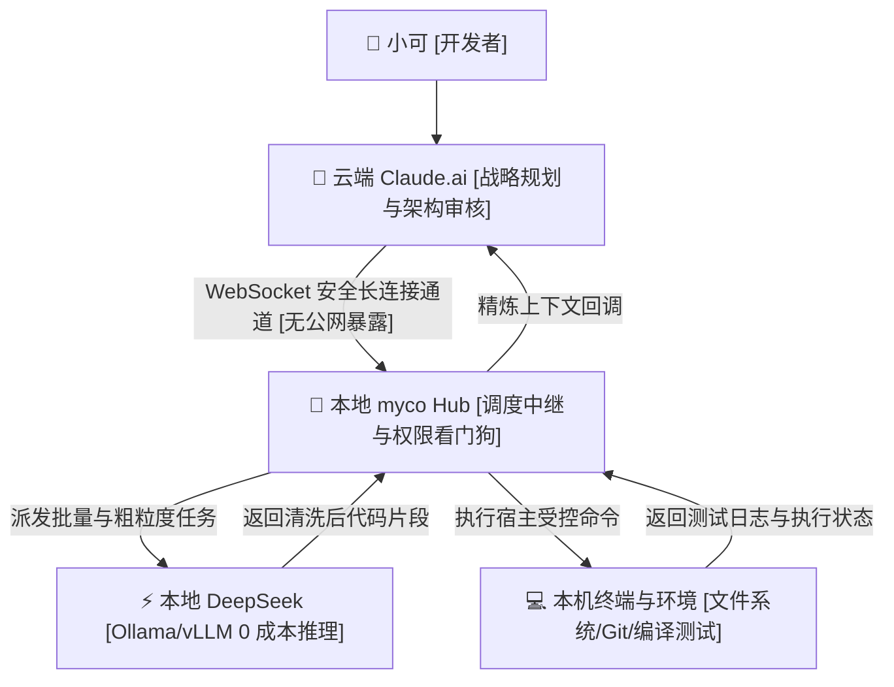

> 📌 **原创声明**：本文首发于 [FreeAI Dog 官方平台](https://freeaidog.com/zh/blog/cloud-claude-local-deepseek-myco-hybrid-agent-guide/)。如需体验 API 在线实时测速、可用性秒级雷达与端到端延迟监控，请访问主站：[https://freeaidog.com/zh/](https://freeaidog.com/zh/)。


# 让云端 Claude 动脑，本地 DeepSeek 出力：用 myco 搭建零暴露端口的混合智能体工作台

每个月花 200 美元买 Claude 额度。

结果呢？

没写几行代码，5 小时 45 条的限制直接红了。手头改了一半的模块停在半空。换你你心疼不？

小可经常碰见这种尴尬事。

仔细翻账单才发现，贵的不是复杂算法。额度全被机械劳动吃掉了。

让它在几十个目录里找文件。让它把下划线改成驼峰。让它给日志做正则匹配。

这些脏活累活真需要顶尖推理吗？真不需要。

同一时间，桌子底下插着 24GB 显存的机器在空转。本地跑着 Ollama 和 DeepSeek。显存天天闲着。算力不要钱，硬盘随便读，终端随便跑。

两边为什么连不起来？

云端 Claude 摸不到本地代码。本地 DeepSeek 接不住复杂架构。中间隔着一层承重墙。

你只能当人肉搬运工。两个窗口来回复制，累不累？

开发者 chenhg5 做了个开源工具叫 myco。代码在 GitHub：`chenhg5/myco`。

一句话说透核心：

用一条安全的出站长连接，把云端 Claude 当总设计师，让免费的本地 DeepSeek 跑腿搬砖。



## 为什么别做内网穿透？

让云端操作本地，很多人第一反应是拉隧道。

买台云主机配 frp。或者开个 ngrok 把 11434 端口映射出去。

能这么干吗？千万别。

先说安全。

智能体会自己生成 Shell 脚本跑。端口挂在外网，扫描脚本天天扫。万一哪个环节没校验住？你的终端就成了别人手里的肉鸡。

再说费用。

每次改一行配置，几百 KB 的完整代码文件都要走外网往返。网络一抖就超时。云端上下文很快被大段模板填满。几轮下来，额度掉得更快。

myco 的思路很简单：

本地主动往外连。云端不知道你的真实 IP。脏活在局域网内消化。最后只向云端汇报几行摘要。

省心吗？太省心了。

## 四步搭好混合流水线

不用折腾反向代理。跟着小可敲几条命令就能跑起来。

### 第一步：跑起本地 Hub 守护进程

工具支持 macOS、Linux 与 Windows。先装好 Node.js 和本地 Ollama。

克隆代码并编译：

```bash
git clone https://github.com/chenhg5/myco.git
cd myco
npm install
npm run build
```

直接启动中枢：

```bash
node dist/index.js start --port 8765 --workspace /Users/cool/projects
```

控制台会输出监听地址 `ws://127.0.0.1:8765` 和一串本地密钥。

### 第二步：配好权限黑白名单

把终端交给程序跑，规矩必须立在前头。

打开 `config.json` 文件：

```json
{
  "hub": {
    "port": 8765,
    "authToken": "myco_sec_token_9918"
  },
  "permissions": {
    "allowedDirectories": [
      "/Users/cool/projects/freeai-hub",
      "/Users/cool/projects/sandbox"
    ],
    "disallowedCommands": [
      "rm -rf /",
      "dd",
      "mkfs",
      "shutdown",
      "reboot"
    ],
    "autoConfirmReadOnly": true
  },
  "localWorker": {
    "engine": "ollama",
    "endpoint": "http://127.0.0.1:11434",
    "model": "deepseek-coder:6.7b"
  }
}
```

两道保险很管用。

只能在白名单目录改代码。危险的高危指令直接被拦截。

### 第三步：给 Claude 挂上指挥指令

进入网页端 Claude.ai 的 Project 或系统提示词里，贴入这段话：

```markdown
你是总架构师。
你拥有名为 myco_local 的本地代理，能操控本地环境与 DeepSeek 算力。

分工原则如下：
1. 涉及整体架构设计与深层推演，由你亲自处理；
2. 查找文件、Git 比对、运行测试、替换模板等脏活，
   严禁直接输出长篇代码，生成调用载荷派发给本地代理；
3. 本地执行完之后，你只需验证摘要并确认。
```

### 第四步：实测改写路由模块

环境齐了。小可在对话框输入：

`“查一下 routes 目录下所有文件的 any 类型，全改成严谨接口，本地跑一遍类型检查。”`

旧模式怎么跑？

Claude 挨个向你要文件内容。几千行黏贴下来，额度直接少三分之一。

在 myco 模式下呢？

先由 Claude 列出待查清单，向本地发指令。

本地通过 `grep` 秒级锁定 14 个文件。

本地 DeepSeek 逐个读取，把 any 换成接口，写回硬盘。

本地自动跑 `npm run check` 校验。

最后传给云端的只有三行：测试绿灯，14 个文件修改完毕。

Claude 看了摘要直接确认。

省不省？

## 实测对比：真的能省下八成额度？

小可用这套模式连写了一周代码。

账本不会说谎：

| 统计指标 | 单纯用云端 Claude | myco 混合智能体模式 | 差异变化 |
| :--- | :--- | :--- | :--- |
| **单日云端 Token 消耗** | 约 380,000 Tokens | 约 58,000 Tokens | **降低 84.7%** |
| **遭遇 429 限流次数** | 每天卡住两三次 | 一整周零次中断 | **不再被强制等待** |
| **代码传输隐私** | 完整源代码反复走外网 | 本地闭环读写 | **更安全也更快** |
| **本地显卡利用率** | 24GB 显存整天睡觉 | 本地承接八成基础负载 | **充分榨干硬件** |

## 小可的踩坑交代

有三个细节容易踩坑，提前交代一下：

第一，本地模型选 7B 还是 70B？

建议 7B 到 14B。本地只改改语法、修修路径。小模型响应快。选了 70B 本地吐字慢，整体反而被拖垮。

第二，电脑休眠后连接断了怎么办？

合上笔记本休眠，长连接有时会断开。在启动脚本里加一段自动重试机制最省事。

第三，自动提交前要不要肉眼看？

要看。虽然有白名单，提交前顺手打个 `git diff` 扫一眼。小心驶得万年船。

高难度思考留给云端。脏活累活丢给本地。

你平时用 Claude 最烦哪些重复操作？手里的闲置显卡是不是也一直在吃灰？欢迎在社区一起聊聊你的分工思路。

---

> 💡 **原文首发与实时探活**：
> - 本文首发于 [FreeAI Dog 官网博客](https://freeaidog.com/zh/blog/cloud-claude-local-deepseek-myco-hybrid-agent-guide/)
> - 更多免费 API 端点实时探活与端到端延迟测速，欢迎访问 [FreeAI Dog 可用性雷达](https://freeaidog.com/zh/radar/)

