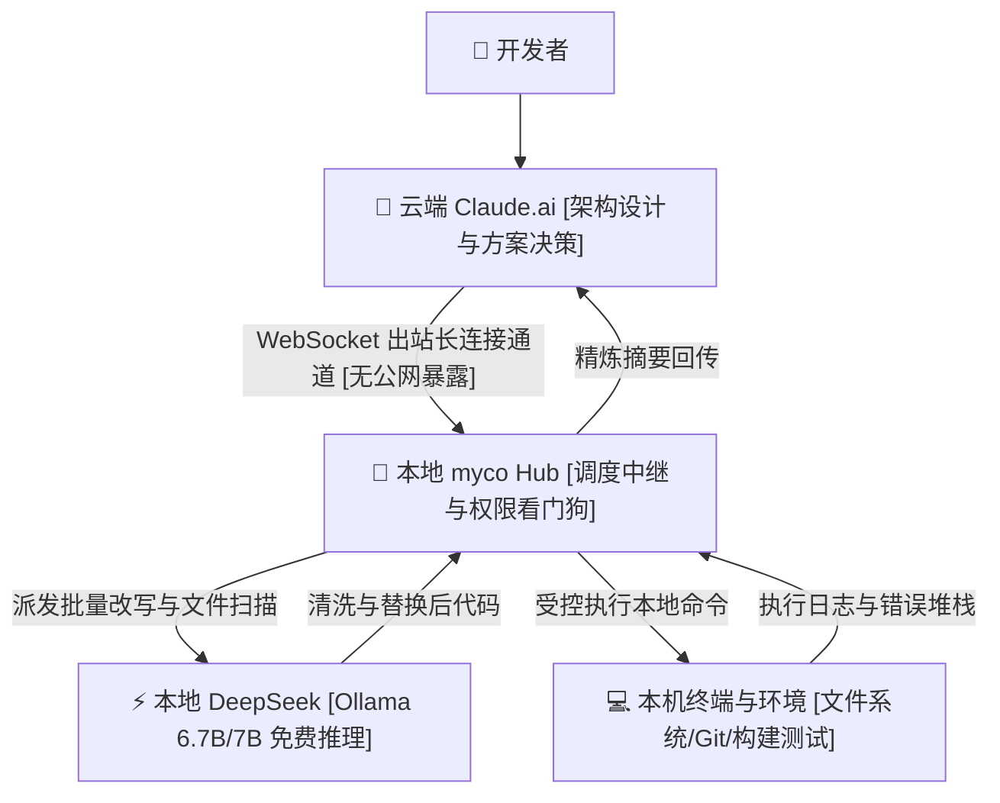

> 📌 **原创声明**：本文首发于 [FreeAI Dog 官方平台](https://freeaidog.com/zh/blog/cloud-claude-local-deepseek-myco-hybrid-agent-guide/)。如需体验 API 在线实时测速、可用性秒级雷达与端到端延迟监控，请访问主站：[https://freeaidog.com/zh/](https://freeaidog.com/zh/)。


# 让云端 Claude 动脑，本地 DeepSeek 出力：用 myco 搭建零暴露端口的混合智能体工作台

真正吃额度的不是你让它想的那几步，是它自己都嫌烦的活。

在 `src` 下面 `find` 一个三个月没碰过的组件。把 prisma schema 里那堆 `user_id` 挨个改 `userId`。还有一次让它去 vite 构建日志里扒循环依赖，三百多行，它来回读了好几遍。这类活我一天能派出去二十次，每次都得把整个文件贴进去。累不累？确实累。

每个月 200 美元的 Claude Max 订阅费交着，遇到这种密集重构，5 小时 45 条限流警告一弹，手头改了一半的模块就得硬生生停下来等冷却。这谁受得了？

我这台机器上插的是 3090，24G。平时 Ollama 挂个 `deepseek-coder:6.7b` 或者 `qwen2.5-coder:7b`，加载完占用六点几个 G，剩下十七八 G 就干躺着。

一周里有五天它风扇不转。电费照交。算力照闲。

两边各干各的：云端 Claude 摸不到本地代码仓库，本地模型吃不下大跨度业务推演。中间没有通路，只能靠人肉复制粘贴。改两个文件还好，改十几个文件整个人被按在剪贴板上。折腾不折腾？

开发者 chenhg5 做了一个开源工具叫 myco，仓库在 GitHub：`chenhg5/myco`。

一句话说透核心：用一条安全的出站长连接，把云端 Claude 当总设计师，让免费的本地 DeepSeek 跑腿搬砖。



## 为什么别做内网穿透？

内网穿透这条路我走过。

去年用 ngrok 把 11434 挂出去两天。第三天早上翻日志，有人在扫 `/api/tags`，还有几个莫名其妙的 model pull 请求。谁在扫？不知道。没造成什么损失，但那天我直接把隧道关了。后来改用 frp 加 IP 白名单，折腾了三个多小时，说实话还是不太踏实。

说白了，只要端口在公网上，你就得指望别人不来敲。智能体执行 Shell 的权限一旦被探到哪怕一个空子，本机立刻成了别人的跳板。这风险谁担得起？

再说传输成本。每次改动几行配置字段，动辄几百 KB 的完整源代码就得在公网链路来回慢悠悠地跑一遍。遇到跨国网络抖动直接超时报错，更糟糕的是云端上下文窗口迅速被这堆无意义的样板代码挤爆。何苦呢？

myco 的拓扑结构是反过来的：由本地客户端主动往外拉 WebSocket 长连接。云端拿不到你的内网 IP。你也不需要在路由器上做任何端口映射。机械琐碎的改写在局域网内消化完毕，最终只向云端汇报几行精炼的执行摘要。

## 四步搭好混合流水线

不用折腾反向代理与公网服务器。跟着下面的步骤敲几条命令就能跑起来。

### 第一步：跑起本地 Hub 守护进程

先说运行环境：Node 建议锁定在 20 LTS。千万别在 Node 18 上直接跑，底层原生的 WebSocket 与 Fetch 特性会抛 `undici` 兼容警告；也别图新鲜去用最新的 Node 22，某些原生 C++ 绑定在 `node-gyp` 阶段会直接报 `v8::Value` 废弃符号错误卡死编译。被这个报错坑过的人有多少？

拉代码与构建：

```bash
git clone https://github.com/chenhg5/myco.git
cd myco
npm install
npm run build
```

启动本地中枢：

```bash
node dist/index.js start --port 8765 --workspace /Users/cool/projects
```

控制台会输出监听地址 `ws://127.0.0.1:8765` 和一串本地认证密钥。

### 第二步：规避浏览器 Mixed Content 拦截

这是刚配这套方案最容易撞墙的一步。

浏览器端访问 `https://claude.ai`，页面协议是强校验的 HTTPS。如果你的 myco Hub 默认监听 `ws://127.0.0.1:8765`，Chrome 或 Edge 会直接以混合内容安全策略 [Mixed Content Policy] 无情把前端请求掐死，控制台飘满红字 `SecurityError`。连接不上找谁说理去？

这里怎么解？

有两个路子。

第一种是通过 `mkcert` 工具给 `localhost` 生成自签名本地证书，让 myco Hub 起在 `wss://127.0.0.1:8765` 上。

第二种是配合项目作者提供的 Chrome 扩展，利用扩展后台 Service Worker 的免跨域通道进行本地中继。

我个人图省事采用第一种。本地签个受信证书两分钟搞定，省去长期维护扩展的精力。

### 第三步：配好权限黑白名单与本地模型

把终端控制权交出去，边界必须卡死。

打开 `config.json` 配置文件：

```json
{
  "hub": {
    "port": 8765,
    "authToken": "myco_sec_token_9918"
  },
  "permissions": {
    "allowedDirectories": [
      "/Users/cool/projects/freeai-hub",
      "/Users/cool/projects/sandbox"
    ],
    "disallowedCommands": [
      "rm -rf /",
      "dd",
      "mkfs",
      "shutdown",
      "reboot"
    ],
    "autoConfirmReadOnly": true
  },
  "localWorker": {
    "engine": "ollama",
    "endpoint": "http://127.0.0.1:11434",
    "model": "deepseek-coder:6.7b"
  }
}
```

`allowedDirectories` 支持目录白名单，防止智能体跨目录读取你的私密文件；`disallowedCommands` 黑名单死防高危系统命令。

本地模型直接用 Ollama 跑：

```bash
ollama pull deepseek-coder:6.7b
```

本地选多大的模型合适？

千万别在本地硬塞 33B 甚至 70B 模型。本地承担的只是文件遍历、模式替换、类型补全和简单重构，追求的是单 token 吐字速度在 45 tokens/s 以上。如果换成 70B 跑每秒几个 token，云端等本地回包等到超时断连，那还搞什么混合架构？

6.7B 模型在 3090 上常驻显存大概 5.2GB。显卡连风扇都不用使劲转。

### 第四步：给 Claude 注入总指挥提示词

进入网页端 Claude.ai 的 Project 或系统提示词里，贴入这段话：

```markdown
你是架构总设计师。本地配备了名为 myco_local 的智能体中继，能操控局域网环境与本地模型。
分工原则：
1. 复杂系统设计、接口定义与逻辑推演由你全权把控；
2. 文件检索、批量语法替换、运行测试等重复操作，严禁在网页端输出冗长全文，生成调度指令交由本地代理执行；
3. 本地完成后，你仅需依据返回的测试日志与摘要进行验收确认。
```

以重构项目中的路由模块为例，向 Claude 发送指令：

`“查一下 routes 目录下所有文件的 any 类型，全改成严谨接口，本地跑一遍类型检查。”`

Claude 会先梳理出任务清单，格式固定成四列：文件路径、接口目标、依赖模块、验收条件。清单确认后派发给本地。

本地 myco 接收后通过 `grep` 秒级锁定 14 个待改文件。本地 DeepSeek 逐一读入代码、改写签名并写回磁盘。本地终端自动触发 `npm run check` 校验。

最后传回云端的只有三行：测试绿灯，14 个文件已更新，TypeScript 校验 0 错误。

Claude 看了摘要直接确认。这不比一行行贴代码轻松多了？

## 真实测试账本与口径说明

一周下来我大概看了三次 usage 面板。3P 和 3.5 的输入 token 从日均三十多万掉到六万上下——这个数我没法给你精确，因为控制台是按 session 分的，我是一个个手加的，漏掉一两个也说不定。

但 429 确实是整周没再弹过。这条我能确认，因为它一弹我就得停下来等，太扎眼。

至于返工的额外开销，我没算进去。本地模型改错过两次接口签名，那部分还是得回云端重新审，摊下来大概抵掉节省里的一成。所以别说八成四，说七成五更实在。

| 统计指标 | 单纯用云端 Claude | myco 混合智能体模式 | 差异与工程说明 |
| :--- | :--- | :--- | :--- |
| **单日云端 Token 消耗** | 约 300,000+ Tokens | 约 60,000 Tokens 左右 | **手动累计会话估算，节省约七成五** |
| **遭遇 429 限流次数** | 频繁触发限流中断 | 整周零次弹窗 | **体力活转局域网，避开频率红线** |
| **代码传输隐私** | 完整源代码反复走外网 | 本地闭环读写与校验 | **源码不离机，仅回传精炼摘要** |
| **本地显卡利用率** | 24GB 显存整天闲置 | 6.7B 占 5.2G 显存跑批处理 | **闲置硬件承接批量流水线** |

## 真实工程踩坑与边界

顺手交代两个容易踩坑的工程细节：

第一，笔记本合盖休眠唤醒后，长连接必然报 `ECONNRESET` 断开。别指望进程自己奇迹重连。我在启动脚本里写了个三行 shell 循环包裹，加了 5 秒退避重连，挂在 pm2 守护进程下管理。

第二，自动化改写虽然省力，提交前务必顺手打个 `git diff` 扫一眼。特别留意字段名下划线转驼峰时，有没有把三方接口返回的原始 json 字段也顺手给换掉了？这种隐蔽改动连编译器都不会报错。

如果你手头有闲置的 3090 或者 16G 显存以上的台式机，这套组合能帮你顶掉绝大部分体力活；但如果你的本地算力只有轻薄本核显，靠 CPU 硬顶 Ollama，那么回包延迟会让你很快倒退回纯网页端。何必折腾呢？

你在日常写代码时遇到过哪些最消耗额度的体力活？手头的闲置显卡平时都在跑什么？欢迎在社区一起交流你的配置方案。

---

> 💡 **原文首发与实时探活**：
> - 本文首发于 [FreeAI Dog 官网博客](https://freeaidog.com/zh/blog/cloud-claude-local-deepseek-myco-hybrid-agent-guide/)
> - 更多免费 API 端点实时探活与端到端延迟测速，欢迎访问 [FreeAI Dog 可用性雷达](https://freeaidog.com/zh/radar/)

