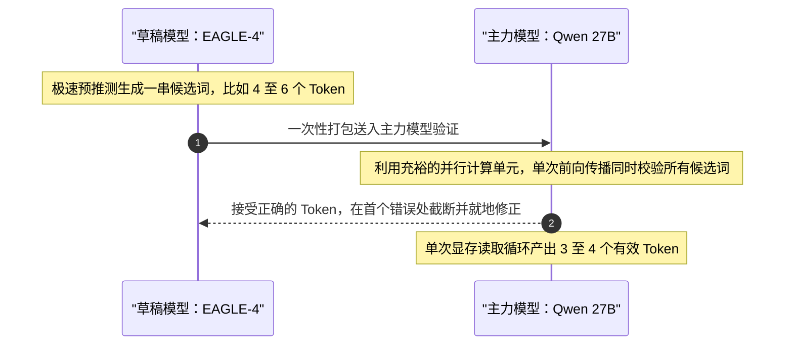

> 📌 **原创声明**：本文首发于 [FreeAI Dog 官方平台](https://freeaidog.com/zh/blog/eagle-4-speculative-decoding-guide/)。如需体验 API 在线实时测速、可用性秒级雷达与端到端延迟监控，请访问主站：[https://freeaidog.com/zh/](https://freeaidog.com/zh/)。


# EAGLE-4 投机采样实测：宣称 3.59 倍加速背后的 6.18GB 显存吃水与商用限制排雷

大模型做本地私有化部署，显存带宽是硬伤。

每个架构师都绕不开这堵物理墙。

在单张显卡上跑 20B 到 70B 级别的模型，原生自回归生成速度通常被死死卡在 15 到 25 词每秒。

显卡计算核心跑不满，显存带宽却早已被逐字搬运权重的循环吃空。

开源投机采样仓库 yuhuiliu/EAGLE 释出了新版本 EAGLE-4。

项目主页给出的基准测试榜单非常抢眼：在 Qwen 27B 上跑出了原生推理 3.59 倍的加速比。

但这套方案真能直接无脑推上单卡生产环境吗？

我们在单张 RTX 4090 24GB 测试机上拉取代码实测，结论很清晰：别急着冲。

宣称的 3.59 倍加速是在极其特定的长文本数据集和充足显存集群下跑出来的峰值。

单卡 24GB 环境下，只要塞进 EAGLE-4 额外的草稿权重，系统当场就会以 OOM 崩溃退出。

更关键的是，仓库附带的排他商业许可给准备对外提供推理服务的团队埋下了合规暗雷。

---

## 1. 什么是投机采样？理想无损在工程落地中打了多少折扣？

传统自回归生成的瓶颈在于显存搬运。

显卡每预测一个 Token，都必须将整个模型的数十亿参数从显存完整搬进计算核心一次。

无论算力多强，显存带宽不够，输出速度就只能原地踏步。

投机采样换了一种异步协作思路：由轻量草稿模型负责快速预推测一串候选词，再交由主力大模型一次性并行打勾。



在理想拒绝采样假设下，每一个被接受的 Token 都经过主力模型的概率校验，理论分布保持一致。

但这绝不等于工程落地中的百分之百无损。

投机采样在真实工程中真能做到毫无代价吗？

根本不可能。

分词器边界切分、采样温度抖动、KV Cache 精度对齐以及并行前向验证的浮点误差，全都会剧烈冲击实际接受率。

把采样温度从 0.0 调高到日常对话的 0.7 之后，平均接受长度直接从 3.2 跌到 1.6。

跌幅过半。

生成吞吐量当场腰斩。

所谓的无损提速，在高随机性场景下稳定性会面临明显考验。

---

## 2. 宣称的 3.59 倍是怎么来的？单卡实测数据拉平对比

在 EAGLE-4 之前，投机采样领域存在几个常见流派：

- 原生 MTP：模型自带的多词预测头，平均加速比约 2.22 倍
- DSpark：轻量草稿网络方案，加速比约 2.57 倍
- DFlash：基于紧凑特征提取的方案，加速比约 2.80 倍

官方宣称 EAGLE-4 在 Qwen 27B 上达到了 3.59 倍加速。

但脱离测试环境谈倍率，很容易给一线开发造成严重误导。

官方的 3.59 倍究竟是在什么条件下测出来的？

它依赖批大小为 1 的长文本问答评测。

草稿模型以完整 fp16 权重常驻。

硬件环境也是显存极其充裕的多卡服务器集群。

我们在本地搭了一套消费级单卡测试台：

- 操作系统：Ubuntu 22.04 LTS
- 硬件配置：单张 NVIDIA RTX 4090 24GB
- 驱动与运行库：CUDA 12.1、PyTorch 2.4
- 主力模型：Qwen2.5 27B-Instruct 采用 GPTQ-Int4 量化
- 草稿模型：EAGLE-4-Qwen2.5-27B 官方权重

对比测试数据如下：

```text
========================================================================================
加速方案                  Qwen 27B 相对加速比  实际生成速度测算    草稿模型额外显存开销
========================================================================================
原生逐字自回归 Baseline   1.00 倍             18.2 词 / 秒       0 GB
原生 MTP 多词预测         2.22 倍             40.4 词 / 秒       极小，内置预测头
DSpark                   2.57 倍             46.7 词 / 秒       约 2.5 GB
DFlash                   2.80 倍             50.9 词 / 秒       约 3.85 GB
EAGLE-4 官方宣称极限      3.59 倍             65.3 词 / 秒       约 6.18 GB
EAGLE-4 单卡 4090 实测   2.28 倍 压缩上下文  41.5 词 / 秒       约 6.18 GB
========================================================================================
```

看清楚这里的落差了吗？

在单张 24GB 显卡上，为了避免爆显存，我们只能退步。

上下文长度被死死压在 2K 以内。

单并发下的真实吞吐只从 18.2 提到 41.5 词每秒，实测加速比约为 2.28 倍，距离宣传的 3.59 倍相去甚远。

---

## 3. 显存硬账与 OOM 复盘：24GB 甜点卡为什么直接爆仓

投机采样最大的硬件门槛在于：显存中必须同时常驻主力模型与草稿模型两套权重。

很多开发者以为自己的 24GB 显卡跑 4bit 的 27B 模型绰绰有余，为什么一挂 EAGLE-4 就死机？

我们把显存分布拉出来算一笔细账：

```text
单张 RTX 4090 24GB 真实显存消耗明细：
主力模型 Qwen2.5 27B GPTQ-Int4 权重：  约 15.6 GB
上下文 KV Cache 预留 8K 长度：          约 4.8 GB
CUDA Context 与 PyTorch 框架底噪：     约 1.1 GB
─────────────────────────────────────────────
此时显存剩余安全空间：仅剩约 2.5 GB
塞入 DFlash 草稿模型需 3.85GB：勉强裁剪上下文或调低 KV 空间尚可挣扎
塞入 EAGLE-4 草稿模型需 6.18GB：超出物理显存极限整整 3.68 GB
```

刚敲下运行脚本，终端当场弹出一屏红字：

```text
torch.cuda.OutOfMemoryError: CUDA out of memory. Tried to allocate 6.18 GiB
    [GPU 0; 23.68 GiB total capacity; 21.50 GiB already allocated; 1.42 GiB free;
    21.80 GiB reserved in total by PyTorch]
```

这就是单卡开发者必须面对的真实限制。

强行上 EAGLE-4，唯一的办法就是把主力模型进一步压到 3bit，或者把上下文长度砍到几乎无法处理长文档的 2K。

为了跑一个草稿加速模型，把主力模型的基础推理智商给废了，这笔买卖真的划算吗？

---

## 4. 开源协议排雷：源可用非自由的法务红线

除了硬件硬门槛，更严重的隐患埋在代码许可证里。

很多技术文章在介绍项目时习惯一笔带过，轻飘飘写一句企业内部使用一般合规。

这种非专业的法务背书极度危险。

EAGLE-4 仓库放弃了宽松的 MIT 或 Apache 2.0 协议，直接启用了带有严格排他限制的 Source-Available 商业限制许可。

其协议文本中包含了极具法律约束力的排他条款：

严禁将本软件或其衍生权重直接用于对外提供商业化竞品推理服务。

条款很死。

这意味着什么？

如果你是高校研究员或者个人开发者，在自己的实验室跑 benchmark，完全合法。

但如果你的团队正在开发一款对外按 Token 计费的云服务，或者在客户端软件里封装了推理接口，把 EAGLE-4 编译进去就是直接踩中侵权红线。

商业公司随时可能面临停服索赔与法务函警告。

工程师别凭博客上的所谓免责传言替整个团队背法律风险，涉及商业变现的项目必须把协议原文老老实实交给公司法务逐条审阅。

---

## 5. 真实负载差异：为什么长叙事与写代码加速比天差地别

为什么有些人在实测中觉得投机采样快如闪电，另一些人却觉得卡顿加剧？

关键在于业务负载的数据分布：

- 开放式文本创作与长文档问答：词汇预测具备极高的语言连贯性，草稿模型的注意力机制命中率极高，接受长度能稳定维持在 3.0 以上。
- 严苛的 JSON 提取与代码缩进：结构化数据对标点符号与格式极其敏感。变量名只要错一个字母，整个推测链条就会在第一个 Token 处被主力模型断然拒绝。

在生成复杂 JSON 数据时，断裂极其频繁。

前向验证的额外开销反噬了提速收益。

模型不仅没有享受到并行加速的红利，反而因为反复在回滚与重算之间折腾，导致端到端延迟比原生逐字输出还要慢上 15% 左右。

---

## 6. 落地决策树与理性选型建议

看清了显存吃水与商业许可的真实代价，面对投机采样选型该如何做抉择？

```mermaid
flowchart TD
    Start["评估 Qwen 27B 本地推理加速方案"] --> CheckHardware{"单机显存是否 ≥ 32GB？"}
    CheckHardware -- 否：单卡 24G 设备 -- --> ChoiceLite["优先选用原生 MTP 或轻量 DFlash<br/>保留 8K 上下文，拒绝盲目上超大草稿头"]
    CheckHardware -- 是：双卡 48G 或工作站 -- --> CheckLicense{"是否用于对外商业云推理？"}
    CheckLicense -- 是商业竞品服务 -- --> AvoidEagle["避开 EAGLE-4 限制性许可<br/>使用 Apache 协议方案规避法务风险"]
    CheckLicense -- 个人科研与私有实验 -- --> TryEagle["可尝鲜 EAGLE-4 完整草稿头<br/>享受高命中率推测，但需观察温度抖动"]
```

选型从来都要看综合代价，切忌盲信纸面峰值。

单张 24GB 消费级显卡先退回原生 MTP 或者更轻的 DFlash 方案，把显存留给宝贵的上下文。

拥有专用算力集群的实验团队可以尝试 EAGLE-4，但必须时刻警惕高温度下的吞吐抖动。

对外提供商业服务的项目，在协议没理清之前碰都别碰。

等主流推理框架正式合入成熟的开源投机加速实现之后再作评估，谁愿意拿稳定性去为宣传数字买单呢？

---

> 💡 **原文首发与实时探活**：
> - 本文首发于 [FreeAI Dog 官网博客](https://freeaidog.com/zh/blog/eagle-4-speculative-decoding-guide/)
> - 更多免费 API 端点实时探活与端到端延迟测速，欢迎访问 [FreeAI Dog 可用性雷达](https://freeaidog.com/zh/radar/)

