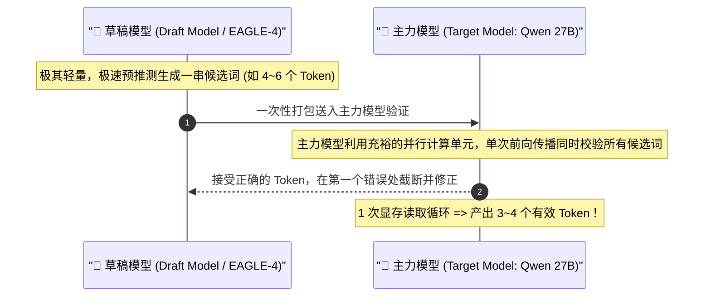
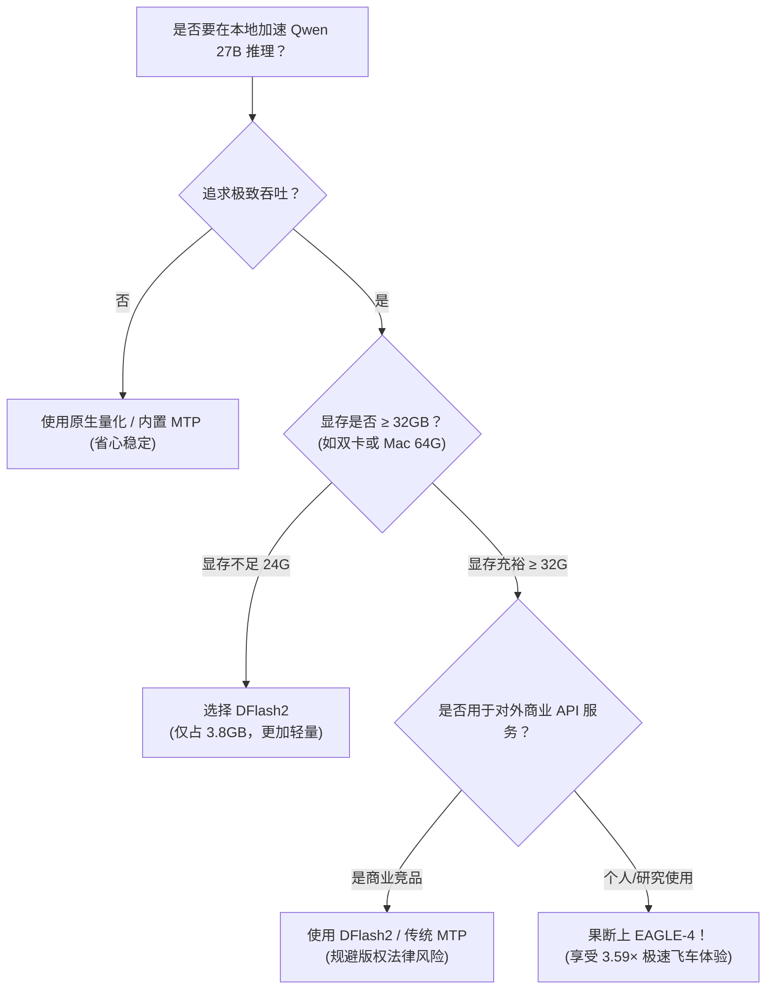

> 📌 **原创声明**：本文首发于 [FreeAI Dog 官方平台](https://freeaidog.com/blog/eagle-4-speculative-decoding-guide/)。如需体验 API 在线实时测速、可用性秒级雷达与端到端延迟监控，请访问主站。


# 本地大模型狂飙 3.59×：EAGLE-4 投机采样实测与显存/开源许可避坑指南

> **导读**：只要在本地或私有服务器上跑过 20B~70B 大模型的人，都经历过那种“一个字一个字往外蹦”的便秘感。显卡风扇呼呼狂转，Token 输出速度却只有慢吞吞的 15~25 t/s。
> 
> 近日，开源投机采样社区迎来重磅核弹——**EAGLE-4 正式发布**！基准测试显示，在热门的 Qwen 27B 模型上，它的生成速度直接飙升到了原生推理的 **3.59 倍**，一举超越此前的 DFlash2 与 DSpark。
> 
> 但是，天下没有免费的午餐。在狂欢背后，社区实测暴露出**两个足以劝退普通玩家的致命暗坑**：一个是高达 6GB+ 的显存吃水，另一个则是充满法律雷区的“源可用非自由（Source-Available）”排他商业许可。今天 FreeAI Dog 为大家做一次深度拆解与避坑指南。

---

## 一、什么是投机采样？为什么它能“无损提速”？

在传统自回归大模型（Auto-regressive）的生成过程中，显卡每向前预测一个 Token，都必须将整个模型的数十亿参数从显存完整搬进计算单元一次（Memory-bound 显存带宽受限）。这意味着：**无论你的 GPU 算力多强，只要显存带宽不够，速度就被死死卡住**。

而**投机采样（Speculative Decoding）**巧妙地换了种思路：**“轻量小模型狂猜，主力大模型批量打勾”**。



最诱人的是：**投机采样在数学上是严格无损的（Lossless）**！因为每一个被采纳的词都经过了主力大模型的严格概率分布验证，生成质量与原生逐字吐词 100% 一致。

---

## 二、EAGLE-4 战报：3.59 倍加速究竟有多猛？

在 EAGLE-4 出现前，投机采样领域有三大主流方案：
- **MTP (Multi-Token Prediction)**：模型原生自带的多词预测头，平均加速比约 **2.22×**；
- **DSpark**：较轻量的投机方案，加速比约 **2.57×**；
- **DFlash2**：前阵子备受推崇的黑马，加速比约 **2.80×**。

而此次发布的 **EAGLE-4** 直接将加速比拉到了 **3.59×**！

| 加速方案 | Qwen 27B 相对原生加速比 | 预估生成速度 (以原生 20 t/s 测算) | 草稿模型额外显存占用 |
| :--- | :---: | :---: | :---: |
| 原生逐字生成 (Baseline) | 1.00× | 20 t/s | 0 GB |
| 原生 MTP 多词预测 | 2.22× | 44 t/s | 极小（内置头） |
| DSpark | 2.57× | 51 t/s | ~2.5 GB |
| DFlash2 | 2.80× | 56 t/s | **~3.85 GB** |
| 👑 **EAGLE-4 (新王登顶)** | **3.59×** | **71.8 t/s** | **~6.18 GB** ⚠️ |

从 20 t/s 直接飞升到 **70+ t/s**，阅读体验从“耐着性子等”变成了“成段直接刷屏”，体验提升堪称质变。

---

## 三、别急着冲！普通玩家必须小心的两大暗坑

看到 3.59 倍的恐怖数据，很多只有单张 24GB 显卡（如 RTX 3090 / 4090）的小伙伴已经跃跃欲试，但请务必先看清下面两个大坑：

### 坑 1：显存开销暴涨 1.6 倍，24G 甜点卡直接爆显存（OOM）

投机采样最大的代价就是：**必须在显存中同时常驻主力模型 + 草稿模型**。

- DFlash2 的草稿模型大约只有 **3.85 GB**；
- 但 EAGLE-4 为了追求超高的预测命中率，草稿模型体积膨胀到了 **6.18 GB**！

```
【RTX 3090/4090 24GB 显存分布算笔账】：
主力模型 Qwen 27B (4-bit 量化):   ~15.5 GB
上下文 KV Cache (留出 8k~16k 上下文): ~4.5 GB
系统与 PyTorch 预留显存:              ~1.0 GB
─────────────────────────────────────────────
此时显存剩余：约 3.0 GB
💥 塞入 DFlash2 (3.85GB) ➔ 勉强边缘试探或微调上下文可塞下
❌ 塞入 EAGLE-4 (6.18GB) ➔ 100% 内存溢出 (CUDA Out of Memory)！
```

> ⚠️ **避坑建议**：如果你的显卡是单卡 24GB，强上 EAGLE-4 必须将主力模型进一步压到 3-bit / 2.5-bit 量化，或者严重牺牲上下文长度；否则你更适合继续使用显存更友好的 **DFlash2** 或等待更小参数量的轻量版。

---

### 坑 2：开源协议陷阱！“源可用非自由”，商业公司严禁用于推理服务

这是开源社区最大的争议点。EAGLE-4 的代码仓库并没有采用宽松的 MIT 或 Apache 2.0 协议，而是采用了严苛的 **Source-Available（源可用，非开源自由）** 许可证。

其许可条款中包含了极其明确的**排他性竞争限制**：
> 🚫 **“严禁将本软件或其衍生版本用于提供商业化竞品推理服务（Competitive Inference Services）。”**

这意味着：
1. **个人本地折腾、学术研究、自娱自乐**：完全合法，放心玩；
2. **企业内部提效、不对外卖 API**：灰色地带但一般合规；
3. **独立开发者接单做 API 转售、或创业团队包装成对外云服务**：**存在严重的法律侵权风险**，分分钟收到律师函！

---

## 四、真实负载差异：短结构化（JSON/代码）反而更推荐 DFlash2？

在 Reddit `r/LocalLLaMA` 社区的最新实测中，极客们发现了一个反常识的现象：

- **长文本、小说、问答叙事**：EAGLE-4 凭借深层注意力特征，猜词准确度极高，稳稳跑满 **3.5×+**；
- **短 Token 交互、高密度的 JSON 返回与精确代码缩进**：EAGLE-4 在极小 Token 上下文切换时，投机猜测容易频繁打断重来，加速比骤降到 2.0× 甚至不如原生流畅；反而是 **DFlash2** 在结构化语法约束下的容错表现更稳。

因此，**不要盲目追逐基准测试的平均峰值**。如果是写爬虫结构化数据抽取、代码自动补全等任务，DFlash2 或 MTP 的综合表现可能更加平稳。

---

## 五、普通人如何享受极速推理？

看到这里，如果你没有 48GB 显存的双卡工作站，也不想在本地被复杂的环境编译折磨，但又想体验“大模型飞一般的感觉”，有两条极其省心的路线：

1. **等待主流推理后端的主线移植**：
   目前社区正在积极推进将 EAGLE-4 理念移植到 `vLLM`、`llama.cpp` 和 `SGLang`。届时配合 GGUF 量化和显存精简，单卡 24G 跑起来会轻松很多；
2. **直接白嫖云端算力（无需消耗本地任何显存）**：
   如果你日常需要极速写代码、查资料，可以直接使用 [FreeAI Dog 首页](/) 推荐的 **Groq**（自研 LPU 芯片，实测 500+ token/s 真正秒级出字）或 **Cerebras / 硅基流动** 的免费高速 API，无需配置任何本地草稿模型，直接零成本跑满带宽！

---

## 六、总结：技术选型决策树



EAGLE-4 的出现代表着投机采样技术在算法结构上的又一次突破。了解它的加速红利，同时看清它的显存与协议代价，才能让你在 AI 浪潮的工具选型中永远做出最清醒的决策！

---

> 💡 **原文首发与实时探活**：
> - 本文首发于 [FreeAI Dog 官网博客](https://freeaidog.com/blog/eagle-4-speculative-decoding-guide/)
> - 更多免费 API 端点实时探活与端到端延迟测速，欢迎访问 [FreeAI Dog 可用性雷达](https://freeaidog.com/radar/)
