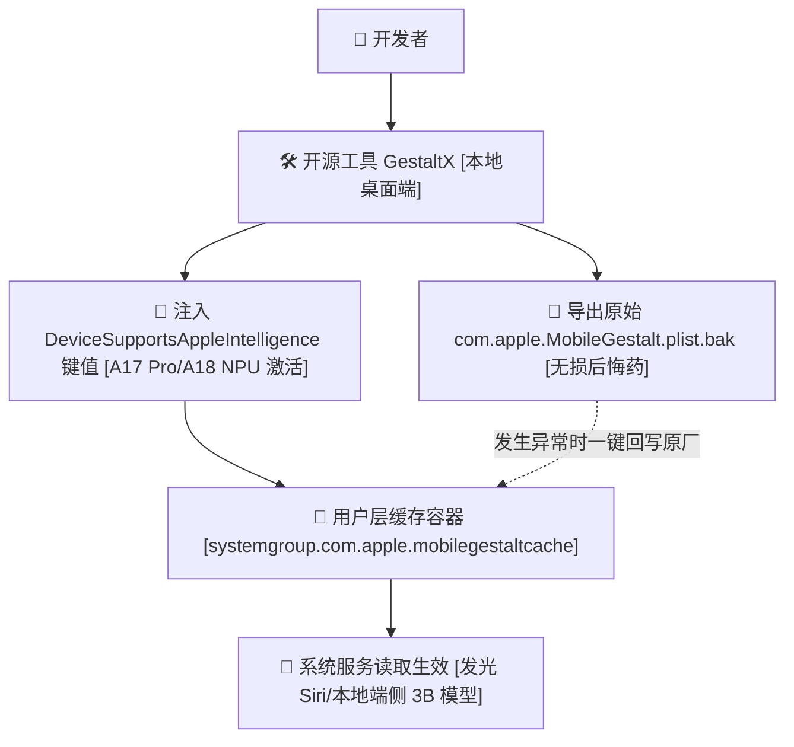

> 📌 **原创声明**：本文首发于 [FreeAI Dog 官方平台](https://freeaidog.com/zh/blog/gestaltx-iphone-apple-intelligence-unlock-guide/)。如需体验 API 在线实时测速、可用性秒级雷达与端到端延迟监控，请访问主站：[https://freeaidog.com/zh/](https://freeaidog.com/zh/)。

# 不越狱无损恢复：手把手用开源工具 GestaltX 激活国行设备的端侧 Apple Intelligence

国行 iPhone 15 Pro 和 16 系列的设置里，找不到 Apple Intelligence 的入口。A17 Pro 那颗 16 核 Neural Engine 标称 35 TOPS，日常基本闲着。硬件钱一分没少掏，算力全在闲置——这谁看着不别扭？

不是硬件不支持，是 `MobileGestalt` 里的能力标志位被置成了 false。端侧那个 3B 模型权重就躺在系统镜像里；只是加载条件不满足。

很多人一听说改底层，第一反应是越狱。越狱划算吗？显然不划算。越狱之后招商银行和企业微信大概率报异常风控，日常主力机不适合这么折腾。

这套思路不是这篇原创的。越狱社区早就有改 MobileGestalt 缓存的玩法，`worse_query` 是其中一条路子 [需要特定系统环境，不是所有机器都能跑通]。

GestaltX 在此基础上加了桌面壳，仓库在 `huamidev/GestaltX`。先看 release 页与 issue。确认支持你的固件版本。别直接下主干编译。

逻辑就一条：不碰只读分区。只在用户缓存容器打补丁。随时能无损还原。

## 为什么能免越狱改写？

iOS 引入了密封系统卷宗 SSV。系统根目录被加密校验锁死。一旦篡改哪怕一个字节，开机直接白苹果死机。谁愿意冒这个险？没人愿意。

但 `com.apple.MobileGestalt.plist` 不在只读根目录里。它的物理位置在用户数据卷的共享容器内。

路径很长：

`/var/containers/Shared/SystemGroup/systemgroup.com.apple.mobilegestaltcache/Library/Caches/`

位置就在这里。

系统启动时，守护进程会先读这个用户层缓存。读取机器的硬件便签。

比如全天候显示支持与否。灵动岛支持与否。以及端侧 Apple Intelligence 支持与否。

修改这个文件没刷固件。没动 bootloader。只改了一个 plist 便签。改坏了能退回去；就守着这一条底线。

## 动工前的死命令：绝不碰整机代号

改 MobileGestalt 最忌讳无脑替换整机代号。

有人图省事直接把国行代号 `A3104` 强改成美版 `A2848`，结果开机发现 Face ID 硬件校验不通过，蜂窝移动网络直接显示无服务。为什么？因为国行实体双卡与美版单卡 eSIM 的基带校准参数完全不同。整机代号一换，基带固件加载报错，整台机器立刻变成砖头样机。

正确的做法是只修改能力特征键值，绝不碰整机代号。

GestaltX 会在写入新键值之前，强制将当前文件打包另存为带时间戳的 `.plist.bak`。万一进系统黑屏或者界面异常，连上电脑直接一键 Restore 原装快照，秒级恢复出厂。

## 四步落地实操流程

找一根原装数据线，连上电脑，跟着下面的步骤操作即可。

### 第一步：准备环境与账号要求

设备门槛必须卡死：必须是配备 A17 Pro 或 A18 系列芯片的设备。包含 iPhone 15 Pro、iPhone 15 Pro Max、iPhone 16 全系；或者配备 M 系列芯片的 iPad。标准版 iPhone 15 或旧款机型因为物理内存与算力不足无法运行端侧模型。改了有用吗？改了也没用。

系统版本要求：升级到支持该功能的对应 iOS 系统版本。

账号与语言设置：系统语言设置为 English [United States]；地区设置为 United States；App Store 登录一个非国区 Apple ID。这一步是为了防止苹果云端服务在初次下发配置时直接掐断通道。能省略吗？不能省略。

### 第二步：连接电脑并导出原始快照

下载 GestaltX 开源安装包。通过数据线连接 Mac 或 Windows 电脑。

手机端点击信任电脑。打开 GestaltX，点击界面的 `Backup MobileGestalt` 按钮。

务必检查电脑本地文件夹里是否切实生成了大小约几十 KB 的备份文件。确认备份稳稳躺在硬盘里——确认好之后，才能往下点。万一没备份直接改坏了怎么办？哭都没地方哭。

### 第三步：勾选精准特征注入与通道排查

写入这一步是整个流程里最容易翻车的地方。AFC 本身只能摸到应用沙盒，够不着 `systemgroup.com.apple.mobilegestaltcache` 这个共享容器。GestaltX 能写进去，靠的是它挂载的额外通道 [具体走哪个 service，看仓库 README，不同 iOS 大版本之间会变]。

先在测试机上跑一遍。看工具日志里有没有 `write ok` 之类的回执；没有回执就别拔线。我这边第一次跑的时候，日志停在 `handshake`，重新拔插连了一次才顺利通过。不是每次都能一次成。

在功能面板中找到 `Apple Intelligence & Siri` 选项。工具会在后台定位到混淆键值 `h9jDsbgj7xIVeIQ8S3`。这个键对应系统底层的 `DeviceSupportsAppleIntelligence` 特征。工具将其布尔值修改为 `true`。

如果需要体验外版完整的 Siri 语音引擎，勾选开启 `Regional Features`；随后点击 `Apply Changes`。

### 第四步：重启生效与本地端侧模型加载

拔掉数据线。长按电源键滑动关机；随后开机重启。

进入系统设置，打开 `Apple Intelligence & Siri` 页面。原本隐藏的开关已经完全点亮。

点击加入等待列表。通常数分钟内即可获批。此时连接 Wi-Fi，系统会自动拉取约 2.6GB 大小的本地端侧语言模型权重文件。

怎么验证是在本地 NPU 跑还是在云端跑？

开飞行模式；拔掉 SIM 卡；关掉 Wi-Fi。长按电源键唤醒 Siri，让它总结长短信或者处理本地备忘录。Siri 屏幕边缘彩色流光正常泛起，文字秒级回显。这证明 A17 Pro 的 NPU 正在完全离线跑本地权重。离线跑得顺不顺？非常顺畅，心里才真正踏实。

## 真实工程踩坑与边界交代

有三个实战细节必须提前交代：

第一，端侧离线跑，但私有云计算 PCC 依然认网络出口。本地 3B 模型总结邮件、写摘要、润色文本；全部走离线通道。但如果遇到复杂的深层推演，系统试图将请求上抛给云端集群时，如果网络检测到直连大陆 IP，这部分云端请求会被拦截。这是一个必须知晓的技术边界。

第二，OTA 升级之后开关会消失，这个正常。系统更新会重新生成一遍 `MobileGestalt` 缓存，把你之前写进去的键冲掉。不用恢复备份，也不用抹机，重新连电脑点一次 Apply 就行。我这边 18.1 小版本升过一次，重写之后没再掉。

第三，一键还原 SOP。如果遇到设置界面异常或者不想折腾了，插上电脑打开 GestaltX，点击 `Restore from Backup`。选择之前备份的原始 `.plist.bak` 回写并重启。整台机器立刻变回官方纯正原厂状态，保修与售后丝毫不受影响。

手头有国行 A17 Pro 或 A18 设备的朋友，你的端侧 NPU 平时利用率如何？端侧本地模型的响应速度符合你的日常预期吗？欢迎在社区一起交流你的实操体验与配置细节。

---

> 💡 **原文首发与实时探活**：
> - 本文首发于 [FreeAI Dog 官网博客](https://freeaidog.com/zh/blog/gestaltx-iphone-apple-intelligence-unlock-guide/)
> - 更多免费 API 端点实时探活与端到端延迟测速，欢迎访问 [FreeAI Dog 可用性雷达](https://freeaidog.com/zh/radar/)

