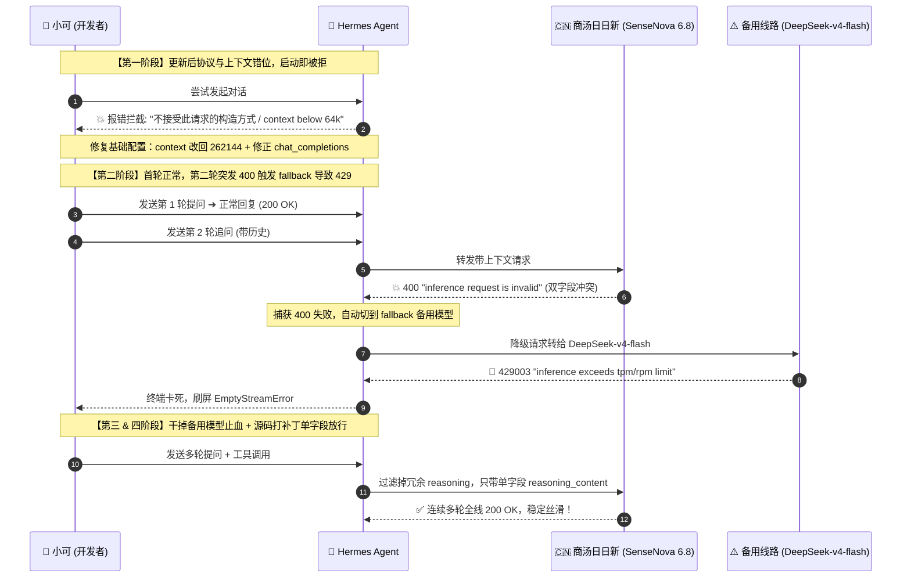
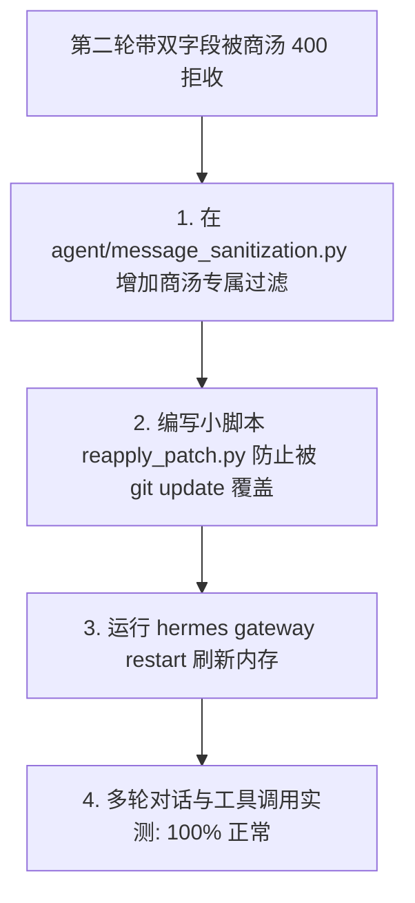

> 📌 **原创声明**：本文首发于 [FreeAI Dog 官方平台](https://freeaidog.com/zh/blog/hermes-agent-sensenova-400-reasoning-fix/)。如需体验 API 在线实时测速、可用性秒级雷达与端到端延迟监控，请访问主站：[https://freeaidog.com/zh/](https://freeaidog.com/zh/)。


# Hermes 升级后商汤模型用不了？记一次从 400 报错、429 自动切到双 reasoning 字段的排坑实录

平时小可一直用 Nous Research 的 **Hermes Agent** 当主力智能体，底座接的是**商汤日日新（SenseNova 6.8 Flash Lite）**——毕竟官方白送的 token 量大管饱，还有 256K 超大上下文，日常写脚本、跑自动化都特别顺手。

然而今天随手执行了一次 `hermes update` 之后，直接给小可上了一堂生动的排障课：
1. **刚更新完就罢工**：敲任何消息都直接报 `HTTP 400: inference request is invalid`，连第一轮都发不出；
2. **第二轮诡异背刺**：修好了配置，第一轮终于能回了，但一到第二轮，Hermes 竟然偷偷把模型切到了备用模型 DeepSeek，随后被平台的限流机制按在地上摩擦，狂喷 `HTTP 429` 彻底卡死；
3. **二分排查揪出真凶**：狠心关掉备用模型后，第二轮依然报 400。抓包一层层扒开才发现，竟然是 Hermes 在历史消息里同时塞了两个同义字段：`reasoning` 和 `reasoning_content`，而商汤对入参格式非常严苛，双字段直接拒收；
4. **源码补丁彻底搞定**：给 Hermes 路由逻辑补上一行域名过滤，顺手写个小脚本防止下次更新被冲掉，最后重启网关，整个世界终于清静了。

折腾了大半天，小可把这套排坑逻辑和解决办法原汁原味记下来，供遇到同类问题的朋友们参考。

---

## 排障全景还原

先上一张完整的交互时序图，直观看看这连环坑是怎么踩进去的：



---

## 坑一：更新后直接罢工，连第一轮都发不出

### 现场报错
今天执行完升级后，在窗口敲了句日常指令，结果立刻弹红字：

```text
AI 服务拒绝了请求格式
custom 不接受此请求的构造方式。请切换服务商，或发送诊断信息以便我们排查。
HTTP 400: inference request is invalid
```

翻看一下终端诊断日志，还附带了一条致命异常：
```text
ValueError: Model sensenova-6.8-flash-lite has a context window of 4,096 tokens, which is below the minimum 64,000.
```

### 诊断与解决
打开 `~/.hermes/config.yaml` 逐行排查，发现升级时默认模板重置了部分项：
1. **上下文被砍成 4096**：`model.context_length` 变成了 `4096`。Hermes 作为一个强依赖长上下文的 Agent，要求底座模型至少得有 64K 上下文，看到 4096 就不干了。但商汤原生给的其实是 **262,144 (256K)**；
2. **API 模式打架**：`providers.custom.api_mode` 写成了 `anthropic_messages`，可顶层又是 `chat_completions`，格式对不上导致请求体组装完就是破的；
3. **旧备用模型下线**：配置里的 fallback 还是旧的 `deepseek-v4.1-flash`，中转直接回了 403。

**解决办法很简单**：
- 把 `model.context_length` 改回 `262144`；
- 把 `api_mode` 改回 `chat_completions`；
- fallback 暂时改成可用的 `deepseek-v4-flash`。

---

## 坑二：第一轮通了，第二轮却诡异切模型触发 429

改好配置重新开聊，**第一轮问答顺畅返回了**。

小可刚想伸个懒腰，紧接着敲入第二句话，奇怪的事情发生了：屏幕上的模型突然自己变成了 DeepSeek，然后被一连串 429 疯狂刷屏：

```text
AI 服务繁忙
custom 正在限制请求数量。请稍等片刻后重试。
HTTP 429003: inference exceeds tpm/rpm limit
```

小可在聊天窗口手动用 `/model` 选回商汤 6.8，再发一句，结果又被瞬间切回 DeepSeek，再次被 429 砸晕。

### 查看日志还原时间线
翻看时间戳日志才发现，根本不是 Hermes 在“随机抽风”：
```text
18:22:46  sensenova-6.8-flash-lite → HTTP 400 "inference request is invalid"
18:22:46  触发 fallback_providers 降级机制 → 自动转交 deepseek-v4-flash
18:23:53  重试发送 → 撞上平台对 DeepSeek 极其严苛的并发限制 (429003 TPM/RPM limit)
18:24~18:28  连续 3 次重试全拿空流 (EmptyStreamError)，界面卡死
```

**逻辑链条清晰了**：
第二轮发消息时，商汤直接报了 400；Hermes 捕捉到 400 后启动自救机制，悄悄把请求转交给了 fallback 的 DeepSeek；而 DeepSeek 在该中转平台上的并发限额很低，当场撞上限流墙。

**第一步止血**：
小可先把备用模型给注释掉（`fallback_providers: []`）。  
关掉 fallback 后，至少界面不会被 429 刷死了。但真正的问题摆在眼前：**商汤为什么在第二轮必报 400？**

---

## 坑三：揪出真凶——商汤为何在第二轮必报 400？

小可用 `curl` 在终端单独测试商汤接口，无论怎么测都正常返回 200，说明商汤服务本身没挂。

那问题必然出在多轮对话的 Payload 里。小可从 Hermes 调试日志里把第二轮失败时的完整 Payload（包括上下文历史和工具定义）提取出来，用二分法逐步剔除字段测试：

```bash
# 测试 1: 原样发送带历史的 Payload ➔ 💥 报 HTTP 400
# 测试 2: 剔除掉上一轮 assistant 的 reasoning 字段 ➔ ✅ 居然秒回 HTTP 200 OK!
```

顺着这个线索，小可对思考链字段做了个组合测试：
- 消息里只带 `reasoning` 键 ➔ **正常 200**
- 消息里只带 `reasoning_content` 键 ➔ **正常 200**
- **两个字段同时塞在 assistant 消息里 ➔ 💥 100% 触发 HTTP 400 "inference request is invalid"！**

### 为什么 Hermes 会同时塞两个字段？
自从 DeepSeek R1 普及思考链以后，各大厂商给思考字段起的名字五花八门，有的用 `reasoning`，有的用 `reasoning_content`。  
Hermes 为了通用兼容，在处理 `provider: custom` 时，把前一轮模型返回的思考内容同时打上了两个标签存入历史。

而商汤后端的校验非常严格：允许你用其中任何一个，但如果你两个都带，它就会判定请求体不合规，直接扔回一个模糊的 `400 inference request is invalid`。Hermes 猜不出到底是哪个键的问题，动态清洗机制没生效，导致会话直接暴毙。

---

## 彻底解决：给 Hermes 打个补丁并持久化

既然查明是字段重复导致的，解决思路就很直接了：**发往商汤域名时，只保留单字段即可。**



### 1. 修改过滤规则
找到 Hermes 的 `agent/message_sanitization.py`，在消息清洗规则里加上针对商汤域名的过滤：

```python
# OpenRouter / Vercel 等规则...
(_ALL_CARRIERS, frozenset({"openrouter", "kilocode", "ai-gateway", "nous"}),
 ("openrouter.ai", "kilo.ai", "ai-gateway.vercel.sh", "nousresearch.com")),

# 【新增】商汤域名只放行单字段 reasoning_content
(frozenset({RC}), frozenset(), ("token.sensenova.cn", "sensenova.cn")),
```
*(注：`RC` 是 Hermes 内部的 `reasoning_content` 常量。这条规则只对 `sensenova.cn` 生效，不影响其他厂商。)*

### 2. 避免后续升级被覆盖
为了防止下次执行 `hermes update` 时把这段改动覆盖掉，小可随手写了个检测脚本放到 `~/.hermes/scripts/reapply_sensenova_reasoning_patch.py`：

```python
import sys
from pathlib import Path

target_file = Path("agent/message_sanitization.py")
if not target_file.exists():
    sys.exit(0)

content = target_file.read_text(encoding="utf-8")
sensenova_rule = '(frozenset({RC}), frozenset(), ("token.sensenova.cn", "sensenova.cn")),'

if "sensenova.cn" not in content:
    insert_marker = '(_ALL_CARRIERS, frozenset({"openrouter"'
    if insert_marker in content:
        new_content = content.replace(insert_marker, sensenova_rule + "\n    " + insert_marker)
        target_file.write_text(new_content, encoding="utf-8")
        print("✅ 已重新注入商汤单字段补丁！")
```

### 3. 重启网关进程
Hermes 的网关服务常驻在后台，光改文件不会自动重载，必须在外部终端重启一下：
```bash
python3 ~/.hermes/scripts/reapply_sensenova_reasoning_patch.py && hermes gateway restart
```

---

## 实测验证与效果

重启网关后，小可重新做了几轮压力测试：
1. **多轮上下文**：连续进行多轮深入技术探讨，历史消息正常携带思考过程，**每一轮都是 200 秒回**，再也没出现过莫名其妙被切模型或 400 的情况；
2. **高频连发测试**：连续下发工具调用指令，商汤 6.8 的响应速度和稳定性都非常给力。

---

## 小结与经验教训

这趟排坑走下来，小可总结了三点最实在的经验：
1. **更新 Agent 框架后，别忘重启 Gateway**：智能体大多有后台常驻进程，只改代码或升级库不重启后台，很容易出现“新旧逻辑混跑”的诡异 bug；
2. **字段不是越多越好**：大厂官方 API 对 Schema 的校验通常比较严格，第三方中转允许的“模糊宽容”，到了官方接口可能直接变成 400 炸弹；
3. **谨慎配置备用模型**：给主力模型配 fallback 时，一定要确保备用模型的并发配额足够高；如果备用模型动不动就 429，一旦主力模型短时异常，反而会把整个服务拖死。

---

> 💡 **原文首发与实时探活**：
> - 本文首发于 [FreeAI Dog 官网博客](https://freeaidog.com/zh/blog/hermes-agent-sensenova-400-reasoning-fix/)
> - 更多免费 API 端点实时探活与端到端延迟测速，欢迎访问 [FreeAI Dog 可用性雷达](https://freeaidog.com/zh/radar/)

