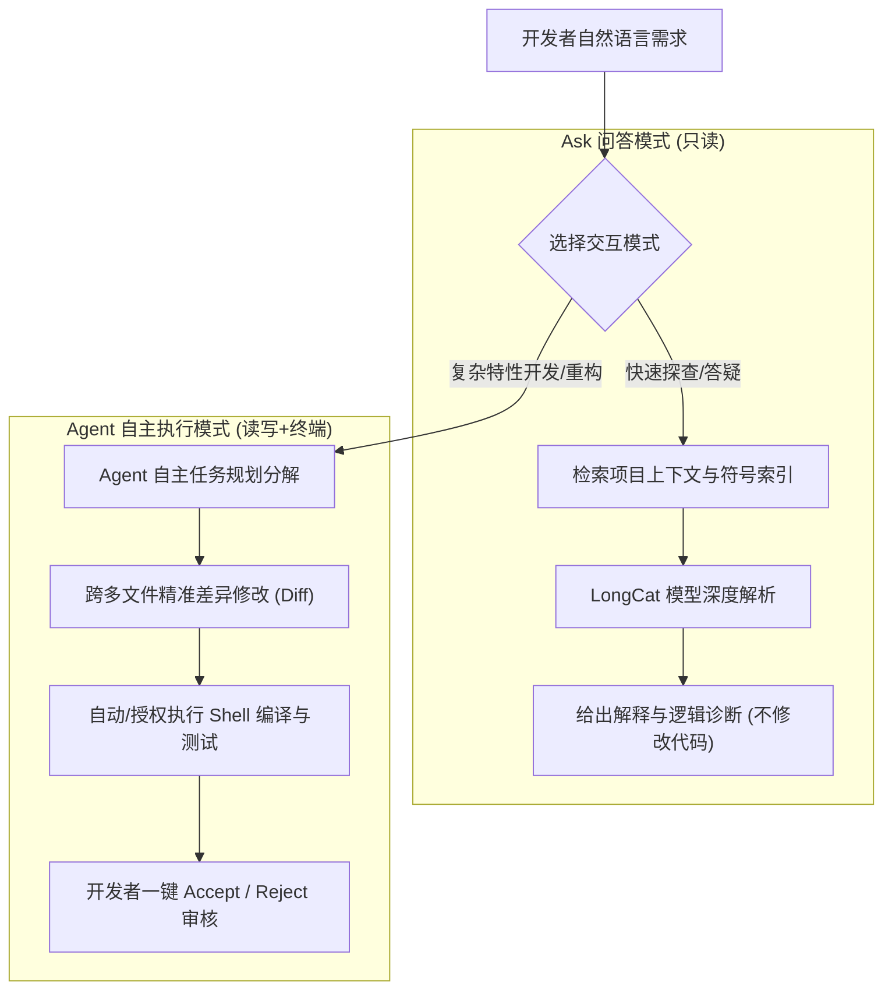

> 📌 **原创声明**：本文首发于 [FreeAI Dog 官方平台](https://freeaidog.com/zh/blog/meituan-catpaw-longcat-ai-ide-complete-guide/)。如需体验 API 在线实时测速、可用性秒级雷达与端到端延迟监控，请访问主站：[https://freeaidog.com/zh/](https://freeaidog.com/zh/)。


# 国产黑马登场！美团 CatPaw (猫爪) AI 编程 IDE 深度实测与白嫖指南：Agent双模式、实时预览与 LongCat 每日海量免费 Token 薅法

在当前的 AI 辅助编程领域，**Cursor、Claude Code 与 Windsurf** 凭借强大的 Agent 代码修改能力成为了全球开发者追捧的生产力利器。但对于国内大多数个人开发者、独立创作者和在校学生来说，每人每月 **\$20（折合人民币约 150 元）** 的高昂订阅费，再加上苛刻的境外网络节点与海外信用卡支付门槛，让许多人望而却步。

而国内大厂虽然也推出了不少代码补全插件，但绝大多数仍停留在传统的“行内单行补全”或“侧边栏单轮聊天”阶段，无法真正像 Cursor Agent 那样具备自主跨文件规划、自动执行终端命令、联动修改多处工程代码的能力。

直到最近，美团技术团队正式对外开放了在其内部打磨验证已久的王牌研发利器——**美团 CatPaw（猫爪）AI IDE**！

> [!NOTE]
> CatPaw 并非简单的 VS Code 套壳插件，而是一款**以 Agent 与人协作为核心的全新一代独立 AI 编程工作环境**。它底层深度融合了美团自研的 **LongCat（龙猫）** 长上下文编程大模型。据内部披露，CatPaw 在美团数万名工程师中经过了高强度的实战检验，内部 AI 代码采纳率与生成渗透率均处于行业领先水准。

更令人振奋的是：**目前 CatPaw 客户端完全处于免费公测阶段，无需排队邀请码即可直接下载体验；同时，美团开放的 LongCat 大模型平台还提供了按天刷新的海量免费 Token 额度，支持标准兼容 OpenAI API！**

今天，我们将带大家全面拆解美团 CatPaw 的核心王炸特性，并手把手教你如何榨干它的每一滴免费算力！

---

## 一、 为什么值得推荐？美团 CatPaw 的四大王炸特性

比起市面上泛滥的各种基础聊天插件，CatPaw 在工程交互和开发者体验上做了极具针对性的创新：

### 1. 真正的“人机协同”：Ask 问答模式 与 Agent 规划执行模式
CatPaw 彻底将提问与落地执行做了清晰的功能分层：
* **Ask 模式（只读问答）**：
  当你需要理解一段祖传屎山代码、梳理微服务依赖拓扑、或者排查某个晦涩的控制台报错时，使用 Ask 模式。它会快速检索全工程代码给出解释，**绝不会擅自改动你的任何源文件**，兼顾安全性与速度。
* **Agent 模式（全自主代码执行官）**：
  当你输入 *“帮我用 Tailwind CSS 和 Lucide 图标库重构这个响应式导航栏，并补充深色模式适配”* 时，Agent 会自动分解任务链、检索工程全局样式文件、定位关联组件、同时分批对多个文件下发精准 Patch，并在终端中执行代码检查，真正实现“从一句话到完整落地”。



### 2. NextEdit 意图预测与智能补全（超越传统的 Tab 补全）
传统的代码补全往往只能在你当前光标停留的位置进行“后向猜测”。但 CatPaw 引入了美团前沿的 **NextEdit（下一步编辑预测）** 机制：
* 当你在 `UserEntity.ts` 中新增了一个 `age` 字段后，一旦切换到 `UserDTO.ts`，CatPaw 就能直接预判出你需要在此处同步增加 DTO 映射属性并高亮提示；
* 支持**跨文件多点联动批量修改预测**，只需按一个 `Tab` 键即可连续跳跃采纳修改，大幅消灭重复机械劳动。

### 3. 前端/全栈福音：In-IDE 实时网页预览与可视画框改代码
以往用 Cursor 或 VS Code 开发前端时，我们需要在 IDE 和 Chrome 浏览器之间频繁切屏。CatPaw 创新性地在编辑器内集成了**项目实时预览与控制台联调沙盒**：
* 本地启动 Vite / Next.js / Vue 项目后，IDE 内部即可直接唤起预览窗口；
* **画框即修改（Visual Select & Edit）**：在预览界面直接鼠标框选某个错位的按钮或排版不适的卡片，呼出输入框输入：“把这个按钮改成吸顶浮动样式，圆角调大至 12px”，AI 就会自动逆向映射并修改对应的 JSX/CSS 文件；
* **Console 错误自动回流**：前端抛出的运行时 React Error 或未捕获 Promise，会直接在预览控制台一键点击“Send to Agent”，让 AI 带着调用栈秒级修复。

### 4. 原生支持 MCP（Model Context Protocol）协议与 Rules 规则注入
* **`.catpawrules` 定制规范**：支持在项目根目录下配置项目级规约或个人习惯（例如：“前端强制使用 TypeScript Strict 模式，所有接口请求封装必须使用统一 Axios 拦截器”），Agent 会把这些规则作为最高优先级护栏；
* **MCP 工具链生态无缝扩展**：CatPaw 原生拥抱 Anthropic 主推的 **MCP 协议**，你可以轻松给它挂载本地 SQLite 数据库查询、Git 提交历史检索、Figma 设计稿读取甚至外网实时搜索工具。

---

## 二、 底层引擎：LongCat (龙猫) 模型与每日海量免费 Token 薅法

很多朋友关心：“CatPaw 客户端免费，它的底层模型到底行不行？有没有独立的 API 可以挂载到我自己的外部开发工具？”

答案是：**不仅有，而且极其良心！**

美团自研的 **LongCat（龙猫）** 系列大模型是专门针对长代码上下文、复杂 Agent 逻辑推导特训的基座。在官方大模型开放平台（`https://longcat.chat/platform/`），美团面向全体开发者推出了**每日海量免费 Token 配额**：

| 模型代号 | 定位与能力 | 每日免费白嫖额度 | 核心适用场景 |
|---|---|---|---|
| **LongCat-Flash-Lite** | 超低延迟极速轻量模型 | **每天千万级 Token 免费** | 实时行内代码补全、快速语法纠错、小脚本生成 |
| **LongCat-Flash-Chat** | 通用对话与代码理解模型 | **每日百万级共享免费额度** | 日常技术咨询、代码注释生成、单元测试编写 |
| **LongCat-Flash-Thinking** | 深度思考与长链推理大模型 | **每日专属免费配额** | 复杂架构设计、复杂算法推导、Bug 根因深度剖析 |

> [!TIP]
> **免费额度刷新机制**：
> 1. LongCat 的免费 Token **在每天北京时间凌晨 00:00 自动刷新重置**；
> 2. 免费额度不支持跨日累计，当天用完即止，但次日立刻满血复活；
> 3. 目前只需要**国内手机号实名验证**即可开通，**无需绑定任何信用卡，0 扣费风险**！

---

## 三、 手把手实战：如何提取 LongCat API 并接入外部开发工具

如果你除了使用 CatPaw 独立客户端外，还想在 **Claude Code、Cursor、Cline、NextChat** 或者本地 Python 自动化脚本中调用美团的算力，只需以下简单 3 步：

### 第一步：获取你的专属 LongCat API Key
1. 访问美团大模型开放平台：[longcat.chat/platform](https://longcat.chat/platform/)；
2. 使用手机号登录，点击左侧菜单栏的 **【API 密钥 (API Keys)】**；
3. 点击 **【创建新密钥】**，为密钥命名（如 `My-Cline-Key`）并复制保存生成的 `sk-...` 字符串。

### 第二步：掌握接入核心参数（OpenAI 兼容规范）
美团官方接口完美兼容 OpenAI 标准格式，你可以直接在任何三方工具中使用以下连接信息：

* **API Base URL (接口基础地址)**：
  ```
  https://api.longcat.chat/openai
  ```
* **API Key**：填入你上一步生成的 `sk-...`
* **推荐调用模型名**：
  * `longcat-flash-lite`（适合高速补全）
  * `longcat-flash-chat`（适合日常对话）
  * `longcat-flash-thinking`（适合逻辑推理与 Agent 任务）

### 第三步：在 Python / 终端中使用标准 SDK 调用示例
```python
import os
from openai import OpenAI

# 配置美团 LongCat 兼容接口
client = OpenAI(
    api_key="sk-your-longcat-api-key-here",
    base_url="https://api.longcat.chat/openai/v1"
)

response = client.chat.completions.create(
    model="longcat-flash-chat",
    messages=[
        {"role": "system", "content": "你是一位精通分布式架构的美团资深高级架构师。"},
        {"role": "user", "content": "请用 Go 语言写一个基于 Redis 分布式锁的高并发抢单限流器，包含防死锁与自动续期逻辑。"}
    ],
    temperature=0.3
)

print(response.choices[0].message.content)
```

---

## 四、 CatPaw 客户端完整上手与 Agent 开发实战

现在，让我们回到美团 CatPaw 客户端本身，走一遍零门槛实战流程：

### 1. 下载与安装
1. 前往美团 CatPaw 官方站点：[catpaw.meituan.com](https://catpaw.meituan.com/)；
2. 选择对应你电脑系统的安装包（macOS 支持 Apple Silicon 与 Intel 架构，Windows 推荐 Windows 10/11 64 位）；
3. 下载后直接双击安装，运行后通过手机验证码一键登录即可完成账号绑定。

### 2. 界面布局与初始化工程
* **左侧工作区**：与 VS Code 保持一致的文件目录树，支持直接无痛导入你的现有项目；
* **中央编辑区**：代码高亮、智能补全与 NextEdit 差异指示区；
* **右侧智能助手栏**：
  * 顶部可在 `Ask` 和 `Agent` 之间自由切换；
  * 支持一键关联 `@Files`（特定文件）、`@Folders`（整个文件夹）或 `@Docs`（官方文档）；
* **底部/侧边预览区**：点击右上角的小浏览器图标，可随时唤起 In-IDE 实时网页预览面板。

### 3. Agent 实战演示：10 分钟重构一个完整看板组件
我们以一个实际的 React 待办看板为例：
1. 切换到 **Agent** 模式；
2. 输入提示词：
   > *"请分析当前项目的 src/components/Kanban 目录。帮我新增一个支持鼠标拖拽（Drag & Drop）卡片分组的功能，使用 HTML5 原生拖拽 API 实现，保持现有的 Tailwind 颜色规范，不要引入多余的第三方库。完成后直接对项目文件进行修改。"*
3. **观察 Agent 自主执行链**：
   * Agent 首先读取 `Kanban.tsx` 和 `types.ts`；
   * 自主规划：拆分为“修改数据类型”、“定义 dragStart/dragOver 事件处理函数”、“重构 Column 渲染布局”3个子任务；
   * 编辑区会直接弹出绿色（新增）与红色（删除）的代码 Diff 对比；
   * 你可以逐行查看修改细节，确认无误后点击顶部的 **【Accept All (全部采纳)】**；
4. **实时预览验证**：在内置预览窗口中直接用鼠标拖动卡片，查看控制台是否有异常报错，发现小瑕疵直接圈选后继续呼叫 Agent 微调。

---

## 五、 横向评测：CatPaw vs Cursor vs Trae vs 通义灵码

为了让大家更客观地了解 CatPaw 的定位，我们整理了目前主流 AI 编程工具的综合横向对比：

| 评估维度 | 美团 CatPaw | Cursor (Pro) | 字节跳动 Trae | 阿里通义灵码 (Lingma) |
|---|---|---|---|---|
| **订阅资费** | **完全免费公测中** | \$20/月 (约 ¥150) | 免费公测中 | 个人版免费 / 企业收费 |
| **网络直连状态** | ⚡ **国内极速直连** (0 代理) | 需特殊海外网络环境 | ⚡ 国内直连 | ⚡ 国内直连 |
| **底层核心模型** | 美团自研 LongCat 系列 | Claude 3.5 Sonnet / GPT-4o | Claude 3.5 Sonnet / GPT-4o | 通义千问 Qwen 系列 |
| **自主 Agent 能力** | 强 (多文件自主规划修改) | 顶尖 (全局 Agent 执行) | 强 (Agent 跨文件编写) | 中等 (侧重单点问答与重构) |
| **NextEdit 编辑预测** | ✅ 原生深度支持 | ✅ 具备 Copilot++ 预测 | 🟡 基础行内预测 | ❌ 仅支持基础补全 |
| **IDE 内嵌实时预览** | ✅ 原生支持并支持框选改代码 | ❌ 需配合第三方插件 | ❌ 需切外置浏览器 | ❌ 无内置预览 |
| **MCP 协议支持** | ✅ 原生支持 | ✅ 原生支持 | 🟡 部分支持 | ❌ 暂未开放 |
| **API 开放能力** | ✅ 提供独立兼容 API 接口 | ❌ 无官方对外 API 售卖 | ❌ 无模型 API 独立开放 | ✅ 阿里云百炼提供 API |

---

## 六、 常见问题排查与避坑指南 (FAQ)

### Q1: CatPaw 耗费本地硬件资源吗？
**A**: 完全不耗费显卡！CatPaw 所有的模型推理均在美团云端超算集群完成，本地只运行基于 Electron 的轻量 IDE 客户端，一般的轻薄办公本或老款电脑均能丝滑运行。

### Q2: 内部项目代码会上传泄露吗？企业内部能否使用？
**A**: 美团官方遵循企业级安全与隐私规范，公测版传输数据均采用端到端 TLS 加密，且明确承诺不会将开发者的私有项目代码用于大模型的公共预训练。但如果是涉及金融或军工等高密级的涉密代码，建议先咨询内部合规要求或在隔离测试环境中体验。

### Q3: 为什么有时候 NextEdit 没有弹出提示？
**A**: NextEdit 需要收集开发者的编辑上下文。如果你只是刚打开一个空项目或单纯滑动代码，模型没有足够的“行为意图线索”。在你进行过一两处实质性的代码编辑（如修改了函数参数或重构了某个变量）后，NextEdit 的预测准确率会呈指数级提升。

---

## 七、 总结

在 AI 编程工具日益内卷的今天，美团 CatPaw 的亮相绝不仅仅是“又多了一个大厂竞品”，而是**真正将高阶 Agent 自主执行、In-IDE 实时预览以及自研 LongCat 模型的强大上下文能力，以“零门槛、免翻墙、纯免费”的形式带给每一位开发者**。

无论你是想找一个无需折腾网络与外币信用卡的 **Cursor 免费平替**，还是想薅美团 LongCat 每日千万级的免费 Token 挂载到自己的工作流中，现在的 CatPaw 都绝对是一张不容错过的王牌！

趁着公测期不限号，赶快去体验吧！

* 🎯 **美团 CatPaw 客户端下载**：[catpaw.meituan.com](https://catpaw.meituan.com/)
* 🔑 **美团 LongCat 大模型开放平台**：[longcat.chat/platform](https://longcat.chat/platform/)

---

> 💡 **原文首发与实时探活**：
> - 本文首发于 [FreeAI Dog 官网博客](https://freeaidog.com/zh/blog/meituan-catpaw-longcat-ai-ide-complete-guide/)
> - 更多免费 API 端点实时探活与端到端延迟测速，欢迎访问 [FreeAI Dog 可用性雷达](https://freeaidog.com/zh/radar/)

