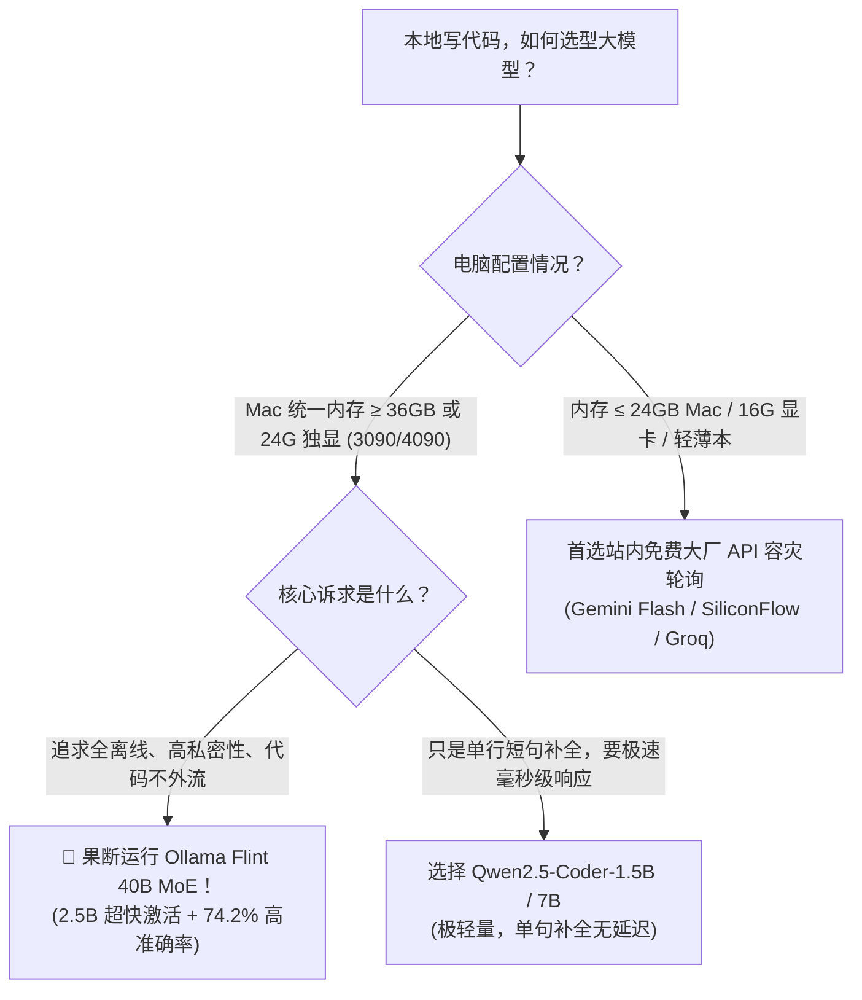

# Ollama v0.40.8 首发！40B 编码神模型 Flint 一键本地跑：激活仅 2.5B，SWE-bench 74.2% 越级实测

> **导读**：在本地跑代码大模型，开发者长期面临一个致命的“三难困境”：  
> - **7B/8B 小模型**：跑起来飞快，但稍微遇到多文件关联、复杂重构或深层类型推断就频繁幻觉、语法翻车；  
> - **32B/70B 大模型**：智力够用，但在普通消费级显卡或 MacBook 上生成速度慢如龟速（10~15 t/s），显存直接爆满；  
> - **商业云端 API**：好用但涉及私有代码泄露风险，且企业内网经常处于断网沙箱环境。
> 
> 今天，由 Recursive 团队正式开源并被 **Ollama v0.40.8** 闪电集成的 **Flint**，彻底打破了这一僵局！这是一颗总参数高达 **40B**、但每个 Token **仅激活 2.5B** 的混合专家（MoE）编码模型。更狠的是：它拥有 **262K 超长上下文**，采用完全商用友好的 **Apache 2.0 协议**，并在权威的 SWE-bench Verified 评测中狂砍 **74.2%**，全面越级超越 Qwen3.6-35B-A3B！
> 
> 现在，只需一条命令：`ollama run flint`，你的电脑就能瞬间化身为零成本、高智商的离线编程超级大脑。

---

## 一、什么是 MoE 架构？为什么 40B 总参 + 2.5B 激活是本地党的终极答案？

传统的大模型大多是**密集型（Dense）网络**：无论你只是让它写一个简单的 `for` 循环，还是设计一套复杂的微服务高并发架构，它都会毫无保留地将全部 32B 或 70B 的神经元同时计算一遍，计算开销与显存带宽压力极大。

而 **Flint 采用的 MoE（Mixture of Experts，混合专家）架构**，把庞大的模型拆分为了多个各怀绝技的垂直领域“专家”。


### 这一架构给本地开发者带来的核心红利：
1. **生成吞吐翻倍暴增**：每生成一个 Token，芯片只需要做 2.5B 规模的浮点运算，生成速度媲美超轻量小模型（在 Apple Silicon 或 RTX 40 系显卡上轻松突破 45~60 t/s）；
2. **知识广度与深度不缩水**：40B 的总参数量完整装载了整个开源世界的海量语法规则、算法模板和第三方 SDK，绝无小模型“忘词少逻辑”的常见硬伤；
3. **262K 超长代码库检索**：支持直接塞入整套完整工程项目文件，实现全局符号分析与跨模块联动调试。

---

## 二、基准硬核横评：Flint 与主流编码模型战力对比

在开源 AI 领域，衡量一个代码模型是否真正能打，行业公认最具含金量的两大黄金测试集是：
- **SWE-bench Verified**：直接拉取 GitHub 真实项目的开放 Bug Issue，让模型自主定位报错代码、修改文件并跑通自动化单元测试；
- **Terminal-Bench 2.1**：考察模型在真实 Linux/macOS 终端环境下的自动化工具调用、多步骤指令排障与运维能力。

以下为社区与实验室实测跑分对比表：

| 模型名称 | 模型架构 | 总参数量 / 激活参数 | SWE-bench Verified | Terminal-Bench 2.1 | 最大上下文 | 开源商用协议 |
| :--- | :---: | :---: | :---: | :---: | :---: | :---: |
| **👑 Recursive Flint** | **MoE** | **40B / 2.5B** | **74.2%** | **54.9%** | **262K** | **Apache 2.0 (完全自由商用)** |
| Qwen3.6-35B-A3B | MoE | 35B / 3.0B | 68.5% | 49.2% | 128K | Apache 2.0 |
| DeepSeek-Coder 33B | Dense | 33B / 33B | 62.1% | 46.8% | 128K | DeepSeek License |
| Llama-3.1-8B-Instruct | Dense | 8B / 8B | 41.3% | 34.7% | 128K | Llama 3.1 Community |
| Claude 3.5 Sonnet (参考标杆) | 闭源云端 | 商业机密 | 77.2% | 58.6% | 200K | 商业闭源付费 API |

从数据可以清晰看出：Flint 以极其克制的 **2.5B 激活算力**，在 SWE-bench 上跑出了 **74.2%** 的骇人成绩，已经极其逼近云端顶流商业模型 Claude 3.5 Sonnet 的水准，彻底终结了“本地代码模型只能写简单脚本”的历史。

---

## 三、三分钟极速上手：Ollama 一键运行 Flint

Ollama 在最新的 **v0.40.8** 正式版中，首发将 Flint 纳入了官方第一公民支持库，省去了此前本地编译 GGUF 与配置复杂权重字典的所有繁琐步骤。

### 1. 升级 Ollama 到最新版 (≥ v0.40.8)
在终端中执行更新检查，或者直接访问官网下载：
```bash
# macOS / Linux 升级命令
curl -fsSL https://ollama.com/install.sh | sh

# 验证版本
ollama --version
# 输出需大于等于: ollama version is 0.40.8
```

### 2. 一行命令启动 Flint 对话
```bash
ollama run flint
```
首次执行时，Ollama 会自动从官方高速 Hub 拉取量化权重。

> [!WARNING]
> ### ⚠️ 显存避坑真相：统一内存共享陷阱，为什么 24GB Mac mini 也撑不住？
> 很多开发者在看硬件推荐时容易忽略 **PC 独立显存** 与 **Mac 统一内存** 的本质物理差异：
> 1. **PC 独立显卡（RTX 3090 / 4090）**：拥有 **24GB 专属独立 VRAM**。Windows 操作系统和后台程序全部运行在主板内存（RAM）上，完全不挤占显存，因此 22GB~23GB 的模型可以几乎 100% 塞进显存纯 GPU 加速；
> 2. **Mac 统一内存（致命区别）**：Mac 的统一内存是 **CPU 系统内存与 GPU 显存完全共享** 的！
>    - macOS 系统、WindowServer 和后台软件开机就吃掉 4GB~6GB；
>    - macOS 底层 Metal 框架默认设置了显存分配上限（通常约为总物理内存的 70%~75%）；
>    - **结论：一台 24GB 内存的 Mac mini 或 MacBook，实际留给 GPU 跑大模型的物理内存仅有 16GB ~ 18GB 左右！**
>    - 一旦强行加载 22GB~24GB 的 Q4 模型，溢出的 5GB~7GB 权重会被强行推入 SSD 虚拟内存交换（Swap），生成速度会从飞快的 50 t/s 瞬间暴跌到 0.5 t/s，甚至卡死崩溃！
> 
> **🎯 真实真机选型准则**：
> - **PC 独立显卡党**：单卡 **RTX 3090 / 4090（24GB 专用显存）** 刚好完美装下 Q4_K_M；
> - **Mac 苹果生态党**：流畅跑满 Q4_K_M 必须具备 **32GB / 36GB / 48GB / 64GB** 统一内存（如 M3/M4 Pro 36G 或 Max 系列芯片）；
> - **16GB / 24GB Mac 用户**：切勿盲目下载 24GB 的 `flint:latest`，建议等后续推出的 **Q3_K_M（约 17GB）** 轻度量化版，或日常使用 `qwen2.5-coder:7b` 与 FreeAI Dog 站内免费大厂 API。

### 3. 量化规格选择建议
针对不同硬件配置的开发者，建议按需指定量化等级：
- **`ollama run flint:latest` (默认推荐 Q4_K_M)**：模型体积约 22GB~24GB，激活计算仅 2.5B，**32GB/36GB+ Mac 或 RTX 3090/4090 独显首选**；
- **`ollama run flint:q8_0` (满血精度版)**：显存/内存占用约 42GB，适合 M2/M3/M4 Max 64G 或双卡工作站；
- **24GB 及以下 Mac 或 16G 显卡笔记本**：请勿强行本地跑 40B Q4 版，避免频繁 Swap 伤硬盘与卡死。

---

## 四、打造生产力闭环：配进 VS Code 变身 0 元离线 Copilot

命令行打字只是玩票，真正让 Flint 产生生产力的方式，是把它接入日常 IDE！

### 步骤 1：在 VS Code 中安装 Continue 插件
在 VS Code 插件市场搜索并安装 `Continue` 插件（目前最火的开源本地 Copilot 替代方案）。

### 步骤 2：编辑 Continue 配置文件
按下 `Cmd + Shift + P`（Windows 为 `Ctrl + Shift + P`），输入 `Continue: Open config.json`，在 `models` 数组中添加以下配置：

```json
{
  "models": [
    {
      "title": "Local Flint 40B (Ollama)",
      "provider": "ollama",
      "model": "flint",
      "apiBase": "http://localhost:11434",
      "contextLength": 131072
    }
  ],
  "tabAutocompleteModel": {
    "title": "Local Flint Tab",
    "provider": "ollama",
    "model": "flint",
    "apiBase": "http://localhost:11434"
  }
}
```

保存后，你在编辑器中选定任何代码按下 `Cmd + I` 或 `Cmd + L`，就能直接调用本地 Flint 进行**实时函数补全、全工程多文件重构、单元测试自动化生成与 Bug 诊断**，断网也能飞速响应！

---

## 五、非 Mac 用户福音：Linux / Windows 如何通过 vLLM 抢先上车？

目前 Ollama v0.40.8 首发在 macOS 平台提供了最优的 Metal 优化驱动，Linux 与 Windows CUDA 平台将在随后的 minor release 中进一步全量开启。

如果你现在是 Linux 服务器或 Windows 独立显卡平台，想要立刻吃上这碗神仙饭，推荐使用 **vLLM** 部署一个高并发的 OpenAI 兼容服务：

```bash
# 1. 确保安装最新版 vLLM
pip install --upgrade vllm

# 2. 一键启动 Flint OpenAI 兼容服务器
python3 -m vllm.entrypoints.openai.api_server \
    --model RecursiveSI/flint \
    --tensor-parallel-size 1 \
    --trust-remote-code \
    --gpu-memory-utilization 0.92 \
    --max-model-len 32768 \
    --port 8000
```
启动后，直接将 Cherry Studio、NextChat、Cursor 或者 Dify 的 API 地址填为 `http://localhost:8000/v1`，API Key 随便填任意字符，即可同样享受到 40B MoE 的极速代码推理！

---

## 六、总结与选型决策指南



Flint 的出现向开源社区证明了一点：**盲目堆砌参数量的时代已经过去了，精准路由的稀疏 MoE 架构才是个人算力设备的未来**。用仅相当于 2.5B 小模型的算力开销，兑现 40B 大模型的顶流智力，无论你是独立开发者、开源作者还是企业研发，都不妨在终端敲下 `ollama run flint`，亲自感受一次技术范式迁移带来的震撼飞跃！

---

> 💡 **原文首发与实时探活**：
> - 本文首发于 [FreeAI Dog 官网博客](https://freeaidog.com/blog/ollama-flint-40b-moe-coding-guide/)
> - 更多免费 API 端点实时探活与端到端延迟测速，欢迎访问 [FreeAI Dog 可用性雷达](https://freeaidog.com/radar/)
