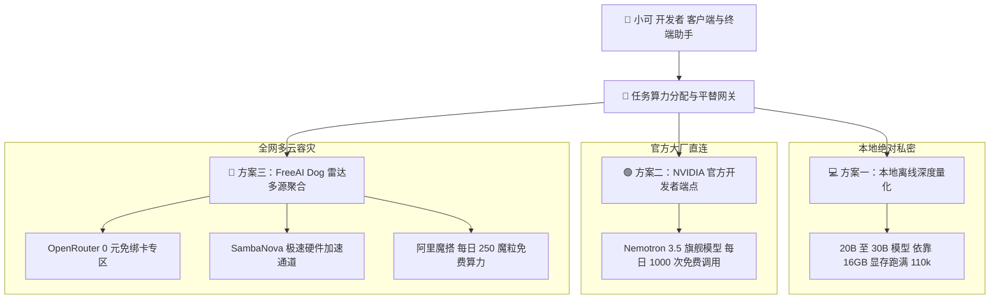

> 📌 **原创声明**：本文首发于 [FreeAI Dog 官方平台](https://freeaidog.com/zh/blog/ollama-free-cloud-models-end-migration-alternatives-guide/)。如需体验 API 在线实时测速、可用性秒级雷达与端到端延迟监控，请访问主站：[https://freeaidog.com/zh/](https://freeaidog.com/zh/)。


# Ollama 免费云模型即将停服：6 款模型关闸清单与三大 0 成本平替实战

对于习惯了在本地终端或编辑器里白嫖大模型算力的开发者来说，今天迎来了一个突发变动。

Ollama 官方团队在社区正式发出公告，自 2026 年 11 月 9 日起，Ollama 现行的 Free 计划将正式关闭云端模型的免费额度，全量切换为按量扣费的 Pay-as-you-go 模式。这意味着过去只需一条命令行即可调用的多款百亿乃至千亿参数的高阶云端模型，在 9 天后都将不再免费。

面对这次政策收紧，许多将日常编程助手或长文本总结挂载在 Ollama 云端的团队面临断供风险。

小可在第一时间核验了官方公告、深入追踪了社区核心开发者的应对策略，并结合 FreeAI Dog 雷达库的全网算力储备，为大家整理出这篇紧急避坑与无缝迁移指南。只要按照本文梳理的三大平替路线，你依然可以在不花一分钱的前提下，继续稳定调用顶尖旗舰模型。

---

## 一、 关闸时间线与受影响模型清单

### 1. 政策生效时间节点
- **停服关闸日期**：2026 年 11 月 9 日
- **计费模式转换**：原有的 Free 账户若要继续请求相关云端模型，必须预充值账户余额，系统将按照消耗的词元数量进行实时扣费。
- **历史订阅差异**：早期订购了包月专属计划的团队不受本次变动影响，但新用户已无法购买老套餐。

### 2. 即将停止免费调用的 6 款云模型名单

| 受影响云端模型名称 | 基础参数规模 | 典型应用场景 | 关闸影响评估 |
| :--- | :--- | :--- | :--- |
| **gpt-oss:120b** | 1200 亿超大参数 | 复杂多步逻辑推导与深度编程 | 极高，单机本地极难完全载入 |
| **nemotron-3-super** | 旗舰多模态思考模型 | 代码生成与工程级架构规划 | 极高，代码助手主流云端主力 |
| **nemotron-3-ultra** | 极大规模全能旗舰 | 论文长文深度总结与全能问答 | 极高，日常白嫖最高规格算力 |
| **gemma4:31b** | 310 亿中大参数 | 多语言算法推演与结构化提取 | 中等，中高配显卡可在本地替代 |
| **nemotron-3-nano:30b** | 300 亿轻量高速模型 | 毫秒级函数级代码补全与校验 | 中等，消费级 16GB 显卡可本地接管 |
| **gpt-oss:20b** | 200 亿紧凑推理模型 | 终端日常问答与命令行辅助 | 较低，完全可由本地离线模型平替 |

### 3. 一项至关重要的定心丸
在公告中，官方明确做出了核心承诺：**在开发者自己的电脑上离线运行本地模型，永远保持 100% 免费**。

这表明本次变动纯粹是云端服务器托管成本高昂带来的必然调整，Ollama 作为本地开源推理底座的纯粹性并未动摇。

---

## 二、 三大 0 成本无缝平替架构

为了在 11 月 9 日之后无缝接续工作流，小可设计了如下分层容灾与迁移拓扑：



通过这套组合拳，我们针对不同规模的任务制定了梯队式承接方案。

---

## 三、 保姆级实操迁移步骤

### 路线一：将 20B 至 30B 模型迁回本地完全离线
对于清单中的 gpt-oss:20b、nemotron-3-nano:30b 以及 gemma4:31b，只要你的电脑配备了 16GB 显存，或者拥有 32GB 以上的统一内存，完全不需要为云端付费。

配合小可此前验证的集成显卡画面分流与 KV 缓存压缩技术，本地运行 Qwen 27B 或 Gemma 31B 的轻量量化档位，即可获得丝滑体验：

```bash
# 一键拉取由开源社区深度对齐的高性能本地轻量模型
ollama run qwen3.8:27b

# 或者在终端中配置纯离线环境，切断一切云端调用依赖
export OLLAMA_HOST="127.0.0.1:11434"
```

这种方案的数据完全不出本机，杜绝了断网与云端变动的后顾之忧。

### 路线二：转战 NVIDIA NIM 官方端点继续免费使用 Nemotron
Ollama 关停云端 Nemotron 后，并不代表我们无法免费使用这款优秀的模型。NVIDIA 官方开发者平台一直开放着专属免费调用通道。

小可梳理的具体接入 SOP：
1. 直达 NVIDIA 开发者构建中心，注册普通账号，无须绑定任何海外信用卡。
2. 在个人控制台生成专属的个人 API Key，系统默认提供多达 1000 次免费推理点数，且支持后续重置。
3. 在你的客户端中将基础请求地址指向 NVIDIA 官方标准网关。

配置示例：

```bash
# 通过标准接口直接调用 NVIDIA 官方云端 Nemotron 3.5 旗舰模型
curl -X POST https://integrate.api.nvidia.com/v1/chat/completions \
  -H "Authorization: Bearer 你的_NVIDIA_API_KEY" \
  -H "Content-Type: application/json" \
  -d '{
    "model": "nvidia/nemotron-3.5-super",
    "messages": [
      {"role": "user", "content": "请分析当前微服务架构的限流策略"}
    ],
    "temperature": 0.6,
    "top_p": 0.95
  }'
```

技术注意要点：
NVIDIA 官方免费通道的一项客观代价是，其服务条款中注明部分匿名数据可能会被用于模型迭代训练，因此企业极其敏感的核心商业机密代码建议谨慎提交，日常通用算法开发与论文查阅则完全没有影响。

### 路线三：基于 FreeAI Dog 雷达无缝切换多大厂免费专区
针对 120B 这种极其庞大、普通本地显卡难以吞下的庞然大物，最稳妥的策略是通过标准网关平移到全网其他大厂的免费专区：

1. **OpenRouter 官方免绑卡 0 元专区**：
   - 包含多款标有免费后缀的顶尖开源大模型，每天自动补充免费限额，完全免除绑卡风险。
   - 基础端点直接设置为 `https://openrouter.ai/api/v1`。
2. **SambaNova Cloud 硬件加速专区**：
   - 官方开放 0 元专区，每日定时刷新充值，支持高达数百字每秒的惊人生成速度。
   - 基础端点直接设置为 `https://api.sambanova.ai/v1`。
3. **阿里魔搭 ModelScope 开源社区**：
   - 国内直连极低延迟，个人中心一键复制访问令牌，每天赠送 250 魔粒免费开源推理算力。
   - 基础端点直接设置为 `https://api-inference.modelscope.cn/v1`。

在你的代码助手或沉浸式翻译等客户端中，只需将过去指向 Ollama 云端的基础地址替换为上述任意一家提供商的 Base URL，填入对应的免费密钥，便可立刻恢复正常服务。

---

## 四、 迁移选型横向对比矩阵

| 应对方案 | 覆盖模型规模 | 延迟表现 | 成本支出 | 隐私与数据安全 |
| :--- | :--- | :--- | :--- | :--- |
| **方案一：迁回本地纯离线** | 20B 至 30B 级模型 | 毫秒级原生直出 | 零元 | 最高，数据不出本机 |
| **方案二：NVIDIA 官方端点** | Nemotron 旗舰思考模型 | 约 200ms 至 300ms | 零元，官方赠送点数 | 适合通用开发，数据用于训练 |
| **方案三：多大厂免费专区** | 覆盖 70B 至 120B 各类旗舰 | 约 150ms 至 400ms | 零元，每日定时重置 | 标准企业级 API 隔离通道 |

---

## 五、 总结与行动建议

大模型云端托管服务的商业化收费是行业发展的必然规律，面对平台政策的调整，成熟工程师的核心竞争力在于构建灵活、解耦且具备高容灾能力的工作流。

离 11 月 9 日还有 9 天倒计时，小可建议大家在接下来的一周内完成以下三件事：
1. **清理自动化脚本**：检查自己本地的代码仓库、智能体配置文件，排查是否存在直接依赖那 6 款免费云模型的硬编码调用。
2. **提前申领备用算力**：花五分钟时间前往 NVIDIA 开发者平台与 OpenRouter 备齐免费凭据，确保断供当天一键切换。
3. **关注 FreeAI Dog 每日雷达**：面对大厂政策的动态变化，我们会持续监控全网 240 多条 API 线路的高可用状态，一旦有全新免费大模型上线，雷达与模型大厅都会第一时间完成归一化收录。

---

> 💡 **原文首发与实时探活**：
> - 本文首发于 [FreeAI Dog 官网博客](https://freeaidog.com/zh/blog/ollama-free-cloud-models-end-migration-alternatives-guide/)
> - 更多免费 API 端点实时探活与端到端延迟测速，欢迎访问 [FreeAI Dog 可用性雷达](https://freeaidog.com/zh/radar/)

