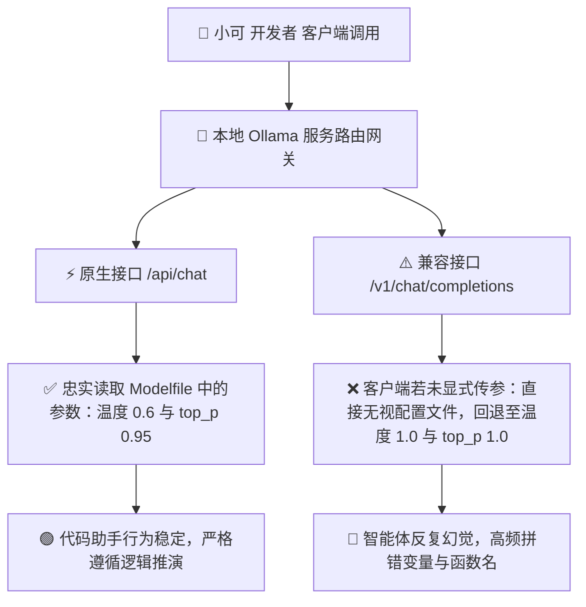

> 📌 **原创声明**：本文首发于 [FreeAI Dog 官方平台](https://freeaidog.com/zh/blog/ollama-v1-temperature-bug-greedy-coding-pitfalls-guide/)。如需体验 API 在线实时测速、可用性秒级雷达与端到端延迟监控，请访问主站：[https://freeaidog.com/zh/](https://freeaidog.com/zh/)。


# 别让引擎偷偷按 1.0 跑：解码参数避坑与 Ollama 忽略温度暗坑实测

在本地运行编程助手或自主智能体时，许多开发者常常陷入一个直觉误区：认为把温度参数直接拉到 0 或者 0.1，模型输出就能像编译器一样严谨且确定。然而在实际工程排错中，小可和很多一线工程师却频繁目睹反常现象：温度越低，模型在处理多文件重构和复杂算法推导时，越容易陷入无穷无尽的语法死循环，甚至连基础的函数命名都会反复拼错。

经过深入的源码排查与真实采样对比，小可发现了两大隐藏极深的工程硬伤：
第一，具备深度思考能力的新一代推理模型，其逻辑跳跃与创造性解题极度依赖词元概率采样的随机性，贪心解码会直接扼杀其非检索类推理智力。
第二，也是最具杀伤力的底层缺陷：在 Ollama 当前版本的标准兼容端点中，只要客户端请求未显式传递采样字段，服务端就会完全忽略模型配置文件中的参数，悄无声息地以 1.0 最高随机度执行采样。

这意味着你在配置文件里精心调试的一切参数全部处于失效状态。本文通过严谨的数据推演与可复现的验证脚本，彻底排查这一隐蔽暗坑并给出生产级修复方案。

---

## 一、 核心痛点与贪心解码陷阱

### 1. 为什么极低温度会让编程模型变蠢
许多人习惯性将温度设为 0，即数学上的贪心解码模式。在贪心解码下，模型在每一步词元预测中只能挑选概率最高的一个分支。这在简单的关键词匹配和历史事实检索中表现良好，但在逻辑编程场景下存在致命缺陷：
- **扼杀替代解题路径**：优秀的编程解答往往来自概率分布中排在第二或第三位的创新解法。强行限制在单一极窄路径上，模型无法回溯修正错误思路。
- **灾难性的死循环与重复退化**：一旦模型在前文陷入局部极值，后续预测概率最高的词元必然是重复前文模式，从而诱发无限循环代码块。
- **官方技术文档明令禁止**：以 Qwen 官方模型卡为例，官方明确警告开启深度思考模式时严禁使用贪心解码，否则会导致严重的智力衰减与循环输出。

### 2. 行业基准测试里的参数猫腻
在各大推理加速引擎公布的投机解码基准中，开发者经常看到每秒上百词元的惊人吞吐。小可必须提醒大家警惕这类数字背后的测试环境：
很多基准跑分故意选在温度为 0 的贪心模式下进行。因为在确定性极高的贪心状态下，草稿模型的词元预测采纳率可以轻松突破 95%，数字看起来极其漂亮。但在真实生产环境的非零温度下，采纳率往往会大幅回落。盲目照搬基准参数只会导致实际体验与宣传严重割裂。

---

## 二、 隐蔽缺陷排查与数据验证

### 1. Ollama 标准端点的采样漏洞
开发者通常会在自定义的 Modelfile 中写入推荐参数，例如：

```dockerfile
FROM qwen3.8:27b
PARAMETER temperature 0.6
PARAMETER top_p 0.95
PARAMETER top_k 20
```

开发者以为这就高枕无忧了。但在 Ollama 的架构中，内部存在两条截然不同的请求链路：



当第三方编辑器如 Cursor、Aider、Continue 或沉浸式翻译等客户端，通过标准接口发起调用且未显式指定温度时，服务端不会读取模型文件里的预设值，而是直接使用硬编码的默认值 1.0。你以为在以 0.6 的稳健参数运行，实际上模型正在以 1.0 的最大随机度疯狂放飞自我。

### 2. 三十次随机水果验证实验
为了让所有读者能够亲手验证这一缺陷，小可设计了一个极其简单的统计学检验法：要求模型随机输出一种常见水果名称，连续测试 30 次并统计不重复水果的总数。

理论上，在温度 0.6 且 top_p 0.95 的收敛分布下，模型回答会高度集中在两到三种高频词元；而如果在温度 1.0 的发散分布下，输出结果将极为离散。

小可在终端中编写如下验证脚本并执行：

```bash
#!/bin/bash
# 验证原生接口与兼容接口的采样离散度

echo "=== 测试一：请求原生 /api/chat 接口 ==="
for i in {1..30}; do
  curl -s http://localhost:11434/api/chat -d '{
    "model": "qwen3.8:27b",
    "messages": [{"role": "user", "content": "请只输出一个你最推荐的常见水果名字，不要包含任何标点"}],
    "stream": false
  }' | jq -r '.message.content'
done | sort | uniq -c

echo "=== 测试二：请求兼容 /v1/chat/completions 接口未传参数 ==="
for i in {1..30}; do
  curl -s http://localhost:11434/v1/chat/completions -H "Content-Type: application/json" -d '{
    "model": "qwen3.8:27b",
    "messages": [{"role": "user", "content": "请只输出一个你最推荐的常见水果名字，不要包含任何标点"}]
  }' | jq -r '.choices[0].message.content'
done | sort | uniq -c
```

实验数据对比矩阵：

| 测试链路 | 预设配置 | 实测不同答案种数 | 命中最高频词次数 | 实际运行等效温度 |
| :--- | :--- | :--- | :--- | :--- |
| **原生接口链路** | 配置文件设为 0.6 | 仅出现 3 种水果 | 苹果占 24 次 | 真实符合 0.6 参数 |
| **兼容端点未传参数** | 配置文件设为 0.6 | 激增至 8 种水果 | 答案极为发散 | 等同于 1.0 最大随机度 |
| **兼容端点显式传参数** | 请求体内强行注入 0.6 | 恢复为 3 种水果 | 苹果占 25 次 | 强制回归预期设定 |

测试结果与社区真实反馈完全吻合：如果不主动在请求中注入参数，兼容接口完全将模型配置文件视若无物。

---

## 三、 生产环境工业级修复与调参 SOP

找到病根后，解决该隐患只需两个标准的工程加固步骤。

### 第一步：在客户端全局配置中显式声明采样参数
绝不要依赖服务端或模型文件的隐式默认值。在所有的外部客户端配置中，必须将采样参数写在请求体中：

以常见终端编程工具 Aider 为例，在配置文件或者命令行中显式绑定：

```yaml
# 在 aider 配置文件中强行注入采样参数
temperature: 0.6
```

在发起标准 API 调用或在配置脚本中，必须显式附加对应字段：

```bash
# 显式传递温度与概率截断参数的标准调用示例
curl -X POST http://localhost:11434/v1/chat/completions \
  -H "Content-Type: application/json" \
  -d '{
    "model": "qwen3.8:27b",
    "messages": [
      {"role": "system", "content": "你是一位资深全栈工程师"},
      {"role": "user", "content": "重构当前鉴权模块代码"}
    ],
    "temperature": 0.6,
    "top_p": 0.95
  }'
```

### 第二步：不同主流模型族系的黄金调参表
不同厂商的模型对采样参数的敏感度差异巨大，绝对不能用一套参数一刀切：

| 模型族系 | 推荐温度区间 | 推荐 top_p | 推荐 top_k | 关键注意要点 |
| :--- | :--- | :--- | :--- | :--- |
| **Qwen 3.8 思考系列** | 0.6 至 0.7 | 0.95 | 20 至 40 | 坚决禁止使用 0，防止循环逻辑死锁 |
| **DeepSeek R1 / V3 系列** | 0.6 | 0.95 | 未强制约束 | 官方推荐 0.6 兼顾解题深度与收敛性 |
| **Gemma 4 系列** | 0.1 至 0.2 | 0.90 | 40 | 极少数在极低温度下代码表现更好的特例 |
| **通用小型 7B / 8B 模型** | 0.7 | 0.90 | 40 | 低于 0.5 容易出现语言僵硬与复读 |

---

## 四、 总结与工程反思

许多时候大模型在实际代码落地中的反常行为，往往并非模型架构自身的能力缺陷，而是被底层网关协议翻译层的默认行为所误导。

通过本次实操复盘，小可建议所有开发者建立如下工程习惯：
1. **警惕确定性陷阱**：在需要多步推演的复杂任务中摒弃贪心解码，保持适度的采样随机性是维持模型创造力与纠错能力的基础。
2. **永远显式声明核心参数**：跨工具调用大模型接口时，永远不要假设服务端能准确继承你的配置，显式传递是杜绝黑盒逻辑漂移的唯一法则。
3. **建立微型基准检验意识**：当怀疑智能体行为异常时，运行简单的三十次水果测试，往往比翻阅几十万行日志更快定位根本问题。

---

> 💡 **原文首发与实时探活**：
> - 本文首发于 [FreeAI Dog 官网博客](https://freeaidog.com/zh/blog/ollama-v1-temperature-bug-greedy-coding-pitfalls-guide/)
> - 更多免费 API 端点实时探活与端到端延迟测速，欢迎访问 [FreeAI Dog 可用性雷达](https://freeaidog.com/zh/radar/)

