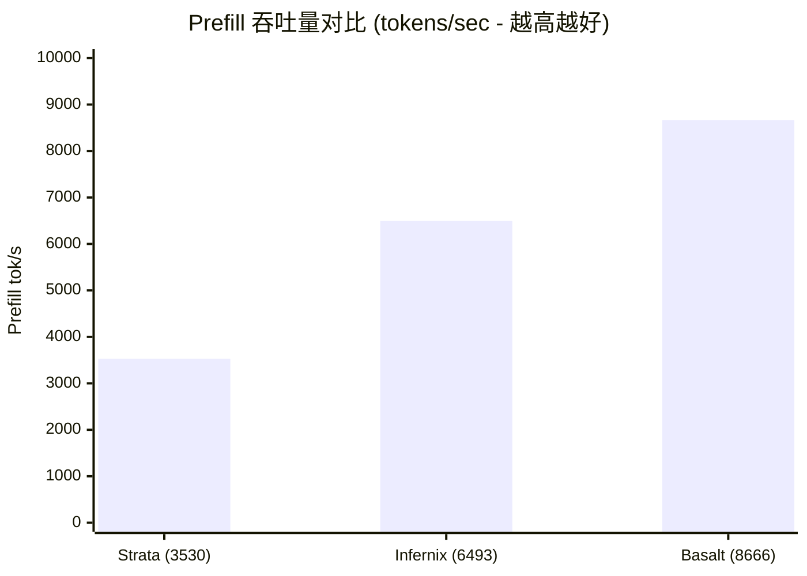

> 📌 **原创声明**：本文首发于 [FreeAI Dog 官方平台](https://freeaidog.com/zh/blog/qwen-3-8-flash-next-engine-benchmark-basalt-strata-guide/)。如需体验 API 在线实时测速、可用性秒级雷达与端到端延迟监控，请访问主站：[https://freeaidog.com/zh/](https://freeaidog.com/zh/)。


# Qwen 3.8 Flash Next 引擎横评：Basalt 飙到 187 t/s vs llama.cpp 39 t/s 垫底！7 大引擎实测与“专家跳过”避坑指南

平时在本地折腾开源大模型的朋友，很多人第一反应都是顺手开一个 `llama.cpp` 或者 `Ollama`。毕竟生态成熟、量化格式（GGUF）到处都是。

但最近阿里开源的 **Qwen 3.8 Flash Next**（基于 MoE 混合专家架构，兼具高推理速度与高智慧）彻底打破了这种“岁月静好”——在 r/LocalLLaMA 社区最新的基准测试中，一位极客在相同的 **单卡 RTX 5090 @ 400W + 128GB RAM** 环境下，横评了当前社区最火的 7 款推理引擎。

结果震惊了整个开源圈：
- **传统的 llama.cpp 直接垫底**，解码（Decode）速度仅有 **32 ~ 39 tokens/s**；
- 而由社区新秀打造的 **Basalt 引擎直接飙到了 187 tokens/s**，整整快了接近 **5 倍**！预填充（Prefill）速度更是从 3500 翻倍到 **8666 tokens/s**！

同样一张显卡，不刷固件、不超频，仅仅是**换个推理引擎就能白嫖 5 倍性能**。

但是且慢！这里面有没有水分？某些引擎为了跑分是不是偷偷“跳过计算”导致模型变傻？小可第一时间把原帖的技术细节、跑分数据、代码内幕与避坑指南全部挖了出来，今天给大家做一次毫无 AI 水话、干货拉满的硬核实操拆解。

---

## 一、 7 大推理引擎实测全景跑分表

为了排除显卡温控降频和显存残留的干扰，测试条件极其苛刻：
- **硬件平台**：单张 RTX 5090（功耗上限设定为 400W），搭配 128 GB DDR5 内存；
- **测试模型**：Qwen 3.8 Flash Next，统一使用 NVIDIA 官方发布的 **NVFP4 满血权重**；
- **测试协议**：7 个贪婪采样（Greedy）请求，每次请求前均包含 1 次冷启动，在 25K、50K、100K 以及 200K 四档超长上下文下分别记录速度。

### 1. 解码速度（Decode Speed · tokens/sec）
这是我们日常聊天、代码补全时最直观的“打字速度”：

| 推理引擎 | 25K 上下文 | 50K 上下文 | 100K 上下文 | 200K 上下文 | 相对 llama.cpp 提升 |
| :--- | :---: | :---: | :---: | :---: | :---: |
| **Basalt** *(推荐首选)* | **187 t/s** | **184 t/s** | **180 t/s** | **160 t/s** | **+380% (4.8×)** 🚀 |
| **Infernix** | 174 t/s | 176 t/s | 163 t/s | 158 t/s | +350% (4.5×) |
| **capy-flash** | 143 t/s | 152 t/s | 152 t/s | 135 t/s | +270% (3.7×) |
| **Strata** | 123 t/s | 121 t/s | 123 t/s | 114 t/s | +220% (3.2×) |
| **ninfer-ext** | 86 t/s | 79 t/s | 95 t/s | 66 t/s | +120% (2.2×) |
| **ninfer** | 46 t/s | 47 t/s | 53 t/s | 44 t/s | +20% (1.2×) |
| **llama.cpp** *(传统默认)* | 36 t/s | 35 t/s | 39 t/s | 32 t/s | *基准线 (1.0×)* 🐢 |

### 2. 预填充吞吐量（Prefill Throughput · tokens/sec）
这是你把数万字的文档或几十个代码文件丢给模型时，“秒读文档”的处理吞吐：



- **Basalt**：从短上下文的 6492 tok/s 一路爬升到超长文本的 **8666 tok/s**；
- **Infernix**：稳定在 6500 tok/s 附近；
- **Strata**：在 3530 ~ 4245 tok/s 徘徊，Basalt 的吃文档速度几乎是 Strata 的 **2 倍以上**。

---

## 二、 深度扒皮：引擎跑分到底有没有“猫腻”？

看到这里，凡是懂点大模型底层的老玩家一定会问：“Qwen 3.8 Flash Next 是个 MoE（混合专家）模型，速度快那么多，是不是偷偷摸摸少算了专家权重（Expert Tail Skip）？”

这正是这次社区讨论中最精彩、也是最考验技术良心的地方。

### 1. 跑分“作弊”的陷阱：什么是专家跳过（Tail Skip）？
在 MoE 模型处理每个 Token 时，门控路由器（Router）会选出权重最高的前几个专家计算。但某些引擎引入了一种激进的加速手段：**故意跳过排名靠后、权重较小的专家**。
- **Strata 的做法**：默认直接开启了环境变量 `STRATA_ROUTE_TAIL_SKIP=7`！也就是强制掐掉后面 7 个低权重专家的运算来换取高帧率；
- **代价是什么？** 这种跳过并非无损，它会在复杂推理、工具调用（Function Calling）和长链条代码生成时引发“智商滑坡”，极易出现工具调用死循环。

### 2. Basalt 为什么强得让人信服？
作者在开源代码库与答疑中明确指出了两点：
1. **Basalt 没有任何专家跳过逻辑**：所有该激活的专家全额计算！作者曾做过对比实验，在 Basalt 上强制做跳过时，模型的 KL 散度（KLD）会直接掉一整个量化级别，而实际速度收益微乎其微，因此 Basalt 选择**完全保真计算**；
2. **零工具调用失败记录**：在官方 NVFP4 权重搭配严苛语法约束（Grammar Enforcement）测试下，进行了上百次真实函数调用与结构化输出任务，**未出现过哪怕一次崩溃、参数漏传或无限循环**；
3. **KLD 散度比对**：在 Unsloth Q8 精度基准下，Basalt 输出与 llama.cpp 的相对熵（KLD）基本收敛为 0。

> **小可实测结论**：**Basalt 的 187 t/s 是实打实的“满血真速度”，而非通过偷工减料换来的纸面数字。**

---

## 三、 手把手实操：用 Basalt 跑起极速 Qwen 3.8 Flash Next

目前 Basalt 已经在 GitHub 完全开源（项目地址：`github.com/jesdga95/basalt`）。由于它抛弃了 llama.cpp 极其繁琐的历史包袱，代码极其精简，专为现代 NVIDIA GPU（Ada Lovelace 40系列及 Blackwell 50系列）量身定制。

下面小可带大家在 Linux / WSL2 环境下一步步编译并跑起来。

### 第 1 步：安装编译依赖
确保系统已经安装了 NVIDIA 专有驱动、CUDA 12.6+ 以及现代 C++ 编译环境：

```bash
# 1. 安装基础编译套件与 CMake、Ninja
sudo apt-get update && sudo apt-get install -y \
    build-essential cmake ninja-build git git-lfs

# 2. 检查 CUDA 编译器版本 (需 >= 12.6)
nvcc --version
```

### 第 2 步：拉取源码与子模块
```bash
git clone --recursive https://github.com/jesdga95/basalt.git
cd basalt
```

### 第 3 步：一键配置与高性能编译
Basalt 采用现代 CMake 架构，默认开启所有 CUDA 核心级优化：

```bash
# 创建构建目录
mkdir -p build && cd build

# 根据当前显卡架构生成 Makefile (5090 / 4090 均可跑满)
cmake .. -G Ninja -DCMAKE_BUILD_TYPE=Release

# 开始多线程并行编译
ninja -j$(nproc)
```
编译完成后，在 `build/bin/` 目录下即可看到可执行文件 `basalt-cli` 与 `basalt-server`。

### 第 4 步：下载官方 NVFP4 权重并运行
不要下载被第三方二次魔改的残血量化，直接从 HuggingFace 官方拉取 NVIDIA 优化的 NVFP4 满血版：

```bash
# 启动 Basalt 本地高性能服务
./bin/basalt-server \
    --model-path /path/to/Qwen3.8-Flash-Next-NVFP4 \
    --port 8000 \
    --ctx-size 131072 \
    --gpu-layers 999
```
此时 Basalt 会在本地 `8000` 端口开放完全兼容 OpenAI 协议的接口（`/v1/chat/completions`）。你可以直接把它填入 Cursor、Chatbox、沉浸式翻译或者咱们 FreeAI Dog 的在线 API 调试器里无缝使用！

---

## 四、 选型决策：我该换 Basalt 吗？

虽然 Basalt 展现出了统治级的速度，但工具从没有万能钥匙。小可给大家总结了一张选型决策卡：

| 你的硬件与需求 | 推荐引擎 | 核心原因 |
| :--- | :--- | :--- |
| **NVIDIA RTX 4090 / 5090 / 5080** | **Basalt** 🏆 | 满血 NVFP4 加速，无损精度换来 4~5 倍极速体验 |
| **AMD 显卡（如 RX 9070 XT / 7900 XTX）** | **Strata** 🥈 | 原生支持 ROCm，在 RDNA4 架构上能跑到 70~90 t/s |
| **Apple Silicon (Mac M 系列) 或纯 CPU** | **llama.cpp / Ollama** | 跨架构通用性目前依然是 llama.cpp 的天下 |
| **追求单机极低成本（如 X99 + MI50 洋垃圾）** | **Strata (Atomic Q4)** | 200 美元整机就能玩转 30~50 t/s 的本地大模型 |

---

## 结语

在大模型时代，很多人总觉得“硬件不行就只能掏钱买卡”。但这次 7 大推理引擎的实测再次证明了一个真理：**软件工程与底层内核优化所蕴含的红利，丝毫不亚于硬件换代。**

从 llama.cpp 的 39 t/s 到 Basalt 的 187 t/s，这中间没有花一分钱硬件预算，仅仅是一次开源架构的代际跃迁。

如果你手上正好有一张支持 FP4 / FP8 的显卡，赶紧照着上面的实操步骤把 Basalt 跑起来吧！遇到任何编译报错或显存爆仓问题，欢迎在下方评论区留言，小可会在第一时间为你排查。

---

> 💡 **原文首发与实时探活**：
> - 本文首发于 [FreeAI Dog 官网博客](https://freeaidog.com/zh/blog/qwen-3-8-flash-next-engine-benchmark-basalt-strata-guide/)
> - 更多免费 API 端点实时探活与端到端延迟测速，欢迎访问 [FreeAI Dog 可用性雷达](https://freeaidog.com/zh/radar/)

