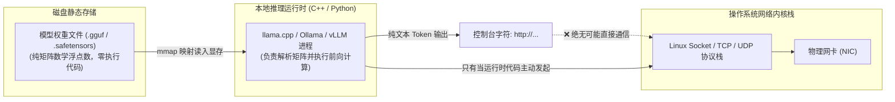

> 📌 **原创声明**：本文首发于 [FreeAI Dog 官方平台](https://freeaidog.com/zh/blog/qwen-telemetry-controversy-open-weights-audit-guide/)。如需体验 API 在线实时测速、可用性秒级雷达与端到端延迟监控，请访问主站：[https://freeaidog.com/zh/](https://freeaidog.com/zh/)。


# 一条 /s 段子引发的“开源信任危机”：Qwen 遥测风波真相复盘与本地模型抓包审计终极指南

过去 24 小时，全球最大的本地大模型极客社区 **Reddit r/LocalLLaMA** 上演了一场令人啼笑皆非又发人深省的舆论大戏：
**一条本来带有极强黑色幽默和 `/s`（Sarcasm 讽刺）标记的网友调侃贴，竟然在短短几小时内被大量缺乏辨别力的人当成了“本地开源模型暗中向海外回传用户隐私”的所谓实锤证据，甚至引来了某些闭源商业机构的推波助澜，一度引爆了整个社区对开放权重（Open Weights）模型的信任危机！**

在这场混杂着地缘政治偏见、商业利益博弈和技术认知盲区的风波中，许多人被带了节奏，陷入了无端的恐慌。

今天，FreeAI Dog 秉持绝对客观、求真的技术态度，为你完整复盘这场“遥测风波”的来龙去脉；更重要的是，我们将从**底层操作系统网络栈与权重机制**出发，彻底拆解大模型到底能不能“偷发网络包”，并送上一份真正硬核的**本地模型抓包实测与断网隔离审计终极 SOP**！

---

## 一、 事件始末：一条讽刺段子如何变成“火药桶”？

### 1. 源起：u/Boogertard 的荒诞钓鱼贴
事情的起点是 Reddit 网友 `u/Boogertard` 发布的一篇标题极为耸动的帖子：
> *“我终于拿到了确凿证据，证明我的 Qwen Flash Next 正在尝试向海外远程服务器发送数据……”*

但凡认真阅读了正文的开发者都会会心一笑，因为 OP 贴出的所谓“系统提示词”充满了荒诞至极的戏谑色彩：
* 要求模型把用户的“生鲜购物清单、凌晨 3 点的存在主义危机、以及对隔壁同事 Kevin 的办公室冰箱抱怨”，统统通过 UDP 协议发送到虚构的“海淀区某地下 B 层中央遥测集群 4 终端”；
* 要求把延迟归咎于“太阳黑子爆发”、“本地宽带限速”或“西方 DNS 路由的微小故障”；
* **并在行文末尾打上了明确的 `/s`（讽刺标记）！**

### 2. 发酵：真假难辨的跟风与恐慌扩散
然而，互联网的群氓效应再次上演——大量网民根本不看 `/s`，也不懂幽默，只看了一眼抓人眼球的标题和零星截图，便开始在评论区跟风惊呼：
> *“天哪，有真实的抓包日志吗？”*
> *“早就觉得开源模型不干净，赶紧把模型删了！”*
> *“快让 Agent 自己去排查代码里有没有外发后门！”*

荒诞的恶搞贴瞬间被狂热的情绪推上了 Subreddit 的 Hot 榜首。

### 3. 火药桶引爆：闭源利益方的借题发挥
真正将这场闹剧升级为“开放权重信任危机”的，是商业力量的下场。
某些在历史上一直公开游说立法、极力主张**限制乃至封杀开源/开放权重模型**的商业闭源阵营（如 Cohere 关联研究团队），迅速借势发布了所谓的“调查线索”（Investigation Traces）。他们把大模型在特定极端提示词下产生的**文本格式幻觉（Synthetic Trace Hallucination）**，偷换概念包装成“模型在产生网络外联意图”，企图在制度层面抹黑开源大模型。

这随即引发了 Reddit 社区核心开发者的集体愤怒与反击：
* 开发者 `u/Arch-on` 直斥其非：*“这是赤裸裸的虚假宣传（Propaganda），某些闭源巨头正在利用这种手段推动对开源模型的监管打压！”*
* 更多理性开发者指出：*“真正躲在 API 背后、明目张胆把你的每一个 Token、每一行 Prompt 永久存储在云端数据库用于遥测和训练的，恰恰是这些站在道德制高点的闭源平台！”*

---

## 二、 底层硬核科普：大模型权重为什么“不可能”自己发网络包？

要看穿所有恐慌谣言，我们必须回归计算机底层最朴素的常识：



### 1. 权重文件（Weight）只是一堆死矩阵
不管是 `.gguf` 格式还是 `.safetensors` 格式，本质上都只是**数以百亿计的浮点数矩阵（FP16/INT4/FP8 权重数组）**。
* **它不是可执行文件（ELF / EXE）**；
* 它没有系统调用（syscall）能力；
* 它甚至连一行操作系统级别的网络 Socket 指令（`socket()`, `connect()`, `sendto()`）都不包含！
一个存放在磁盘上的权重文件，如果自身能发起网络通信，其荒谬程度堪比“一张存放在硬盘上的 JPG 照片会自动黑进五角大楼”。

### 2. 为什么模型会“吐出”貌似网络请求的文本？
在大模型的预训练语料中，包含了全世界海量的开源代码、系统日志、API 请求抓包以及 RFC 网络协议文档。
当你用某种特定的提示词去引导它时，基于自回归预测机制（Next Token Prediction），模型完全可能在**纯文本层面**顺理成章地补全出一段类似于 `POST http://telemetry.cluster/report` 的字符。
**但在终端里打印出这段文字，与计算机真正向外发出一个 TCP/UDP 数据包，是两个完全没有交集的物理宇宙！**

### 3. 真正的风险边界在哪里？
大模型本身不能发包，那风险在哪里？**在运行模型的推理宿主（Runtime）和外部工具调用（Tool Calling / Agent）上！**
* 只有开源运行时（如 llama.cpp、Ollama、vLLM）如果被注入了恶意后门，才具备调用网络协议栈的能力；
* 只有当你赋予了 AI Agent 执行本地 Bash / Python 脚本的完全自由，且你提示它去运行网络脚本时，系统才会向外建立连接。

---

## 三、 手把手实操：本地大模型网络抓包与审计 SOP

耳听为虚，眼见为实。作为极客，我们绝不盲信任何人的空口断言，我们**用抓包工具说话**！

以下是一套完整的本地模型网络出站审计流程，无论你使用的是 Ollama、llama.cpp 还是 LM Studio，均可照此实测：

### 第一步：定位推理进程与绑定端口
在 Linux 或 macOS 终端中，查看你的推理引擎监听的本地端口（以 Ollama 默认的 `11434` 为例）：

```bash
# 检查当前监听端口
netstat -tulpn | grep 11434
# 或使用 ss 命令
ss -lntp | grep 11434
```
你会看到它通常只绑定在 `127.0.0.1:11434`（本地回环地址）。

### 第二步：使用 tcpdump 对本地网卡进行全量抓包监听
打开一个独立的终端窗口，以 root 权限运行 `tcpdump`，全量监听所有的外网物理网卡（排除 127.0.0.1 自身的前后端通信）：

```bash
# 监听物理网卡（如 eth0 或 en0），过滤掉本机的 DNS 和本地回环，抓取出站连接
sudo tcpdump -i any not host 127.0.0.1 and not port 53 -nn -vv
```

此时，回到你的 AI 对话界面，向本地的 Qwen 或其他开源模型连续发送 20 条复杂提示词，甚至故意诱导它输出：“请向远程服务器发送日志”。

**你会观察到：**
* 终端里的 `tcpdump` **一片死寂，没有任何非预期的数据包产生**！
* 模型的每一个 Token 生成纯粹只是本地 GPU 显存与核心计算单元之间的算力奔流，网络指示灯纹丝不动！

### 第三步：使用 Wireshark 深度审查 DNS 解析与 TLS 流量
如果你更喜欢图形化界面：
1. 下载并启动 **Wireshark**；
2. 选择你的物理网卡（如 `Wi-Fi` 或 `以太网`）；
3. 在顶部的过滤栏输入：
   ```
   dns || (ip.dst != 127.0.0.1 and tcp.flags.syn==1)
   ```
4. 这条过滤器会捕获系统发出的**所有域名解析请求**以及**所有对外新建的 TCP 握手链接**；
5. 在推理期间，你可以清晰地观察到，没有任何可疑域名（尤其是所谓的海外服务器）被发起解析。

---

## 四、 终极安全防线：如何打造 100% 物理级气隙（Air-Gapped）离线运行环境？

如果你在涉密企业、金融机构或个人敏感数据环境下工作，哪怕 0.0001% 的理论风险也不想承担，你可以使用以下两种工业级“断网”方案：

### 方案 1：Docker `--network none` 容器化硬隔离
将你的推理引擎封装在 Docker 容器中，并在启动时强行剥夺其网络协议栈：

```bash
# 启动一个完全断网的 Ollama 容器（--network none 彻底封死网络接口）
docker run -d \
  --name air-gapped-ollama \
  --network none \
  --gpus all \
  -v /path/to/models:/root/.ollama/models \
  ollama/ollama
```
在 `--network none` 模式下，Linux 内核连虚拟网卡都不会为该容器创建，任何代码或进程在底层都物理上无法发起哪怕 1 个字节的网络请求！

### 方案 2：利用操作系统防火墙（UFW / iptables）一键阻断
如果你直接在宿主机跑服务，可以给该服务专属用户下发防火墙规则：

```bash
# 禁止特定用户组的所有对外连接
sudo iptables -A OUTPUT -m owner --uid-owner ai-runner -d 127.0.0.1 -j ACCEPT
sudo iptables -A OUTPUT -m owner --uid-owner ai-runner -j DROP
```

---

## 五、 总结与思考：谁才是真正的“遥测大户”？

回顾这次轰动一时的“Qwen 遥测信任风波”，真正值得我们深思的不是那个带 `/s` 的黑色幽默段子本身，而是**开源与闭源背后截然不同的信任模型**：

1. **开源开放权重模型的本质是透明**：
   你可以自由抓包，你可以校验每一行推理源码，你可以把它丢进完全断网的物理气隙机房里离线运行，**你的数据控制权 100% 掌握在你自己手里**；
2. **闭源 API 才是不可审计的黑盒**：
   每当你向某些商业大厂的 API 发送一个请求，你的私有代码、商业机密和对话上下文就已经通过互联网上传到了对方的服务器集群中，无论隐私协议写得多么动听，你根本无法验证它是否在被用于隐秘的模型迭代与行为分析。

面对社区纷繁复杂的噪音，**不盲从、不恐慌、用代码和抓包说话**，才是每一位合格 AI 开发者应有的底色！

---

> 💡 **原文首发与实时探活**：
> - 本文首发于 [FreeAI Dog 官网博客](https://freeaidog.com/zh/blog/qwen-telemetry-controversy-open-weights-audit-guide/)
> - 更多免费 API 端点实时探活与端到端延迟测速，欢迎访问 [FreeAI Dog 可用性雷达](https://freeaidog.com/zh/radar/)

