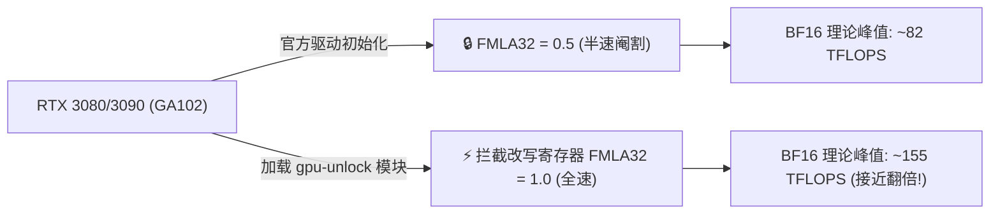

> 📌 **原创声明**：本文首发于 [FreeAI Dog 官方平台](https://freeaidog.com/zh/blog/rtx-3090-gpu-unlock-bf16-kernel-module-guide/)。如需体验 API 在线实时测速、可用性秒级雷达与端到端延迟监控，请访问主站：[https://freeaidog.com/zh/](https://freeaidog.com/zh/)。


# RTX 3090 白嫖 1.9× 算力？Zagitta GPU Unlock 内核模块实操与 LLM 真实收益测评

在本地部署大模型的世界里，**RTX 3090（24GB 显存）**一直被广大极客奉为“穷鬼尊严卡”。小可自己的工作台里也常年插着两张 3090，用来跑 Qwen、Llama 和各种蒸馏小模型。

不过老玩家都知道一个公开的秘密：**老黄（NVIDIA）在 GA102 这颗消费级芯片上故意动了刀**——将 FP32 累积的 Tensor 核心运算速度（驱动层的 `FMLA32` 指令）砍成了一半（Half Speed），逼着大企业去买价格昂贵数倍的企业级卡（比如 A6000）。

以往要想解开这个限制，得冒着显卡变砖的风险硬刷修改版 vBIOS。而今天在 r/LocalLLaMA 上，开发者 Zagitta 开源的 **`gpu-unlock` Linux 内核模块**直接引爆了社区：**不刷 BIOS、不改显存、不换驱动，仅靠一个精巧的内核模块，就能在驱动加载前把 Tensor 核心解禁到全速！**

小可第一时间跟进并做了一轮客观实测，今天把实操方法、理论跑分、以及大家最关心的——**真实跑大模型到底能快多少**，详细给大家拆解清楚。

---

## 一、老黄到底锁了什么？内核模块是怎么破除的？

### 1. 什么是 FMLA32 半速限制？
我们在跑 BF16 或 TF32 的大模型推理（尤其是矩阵乘法 GEMM）时，Tensor Core 在做乘加运算时，通常会用 **FP32 精度进行累加**，以保证数值计算的稳定性和精度（即 Fused Multiply-Add with FP32 Accumulation，简称 `FMLA32`）。

在专业卡（如 RTX A6000）上，这个累加单元跑在满血状态；但老黄为了做产品线切割，在消费级的 GA102 驱动初始化代码里，强行把 `FMLA32` 设为了 0.5（半速）。



### 2. Zagitta 的黑客解法：驱动加载前“抢跑”
以往刷 vBIOS 的思路是自下而上篡改固件，而 Zagitta 的 `gpu-unlock` 则采用了更加优雅的自上而下拦截：
- 它是一个轻量级的 **Linux 内核模块（DKMS）**；
- 在操作系统启动、NVIDIA 专有闭源驱动（`nvidia.ko`）接管显卡硬件**之前**，抢先一步向 GA102 的控制寄存器写入标志位，将 `FMLA32` 还原为 Full Speed；
- 随后 NVIDIA 驱动正常加载，显卡直接工作在全血状态。

**大家最关心的稳定性问题**：
- **输出是否会发生数值漂移？** 开发者进行了极其严苛的验证：在相同的 expert cache 大小下，对 1996 个 teacher-forced 位置的 log-prob 输出进行逐字节比对，**与官方原版驱动输出的二进制结果完全一致**！这意味着它只提升计算速率，不会影响模型回答的准确性；
- **重启或休眠会失效吗？** 实测重启后设置自动生效，休眠唤醒后同样保持。

---

## 二、理论跑分 vs LLM 真实收益：别被 1.9× 忽悠了！

看到社区标题里写的“1.9× 提速”，很多朋友可能会兴奋地以为本地跑大模型速度能直接翻倍。**小可在这里必须泼一盆客观冷静的水：理论微基准 ≠ 真实端到端推理！**

### 1. 纯数学算力微基准（Microbenchmark）
在针对 Tensor Core 纯算力的测试中（4× RTX 3090 平台），效果确实极其炸裂：

| 测试项目 | 官方驱动默认 | 加载 gpu-unlock 后 | 实际提升倍率 |
|---|---|---|---|
| **BF16 Tensor Pipe 理论峰值** | 82 TFLOPS | **155 TFLOPS** | **+89% (≈ 1.89×)** |
| **cuBLAS BF16 GEMM (8192)** | 64 TFLOPS | **99 TFLOPS** | **+54.7% (≈ 1.55×)** |
| **TF32 算力峰值** | 41 TFLOPS | **79 TFLOPS** | **+92.7% (≈ 1.92×)** |

在纯 GEMM 计算场景下，算力几乎直接翻倍。

### 2. 真实大模型实测：Qwen3.8 Flash-Next 双卡实测
当接入真实大模型推理栈（Strata 引擎 + Qwen3.8 Flash-Next 双卡部署）时，Prefill（首字提示词处理）速度的实测数据如下：

- **4K 上下文 Prefill**：提速约 **+12%**；
- **10K 上下文 Prefill**：提速约 **+12%**；
- **90K 超长上下文**：处理吞吐从 3205 t/s 提升到 **3536 t/s（+10.3%）**。

### 3. 为什么理论翻倍，大模型端到端只有 10%~12%？
小可给大家拆解一下大模型运行时的真实耗时结构：
1. **GEMM 并不代表全部**：在实际的大模型 Prefill 阶段，纯 GEMM 矩阵乘法运算大约只占总处理时间的 35%~40%；
2. **显存带宽才是老大**：模型权重的读取、KV Cache 的搬运严重受制于显卡显存物理带宽（Memory Bandwidth Bound）。解锁 Tensor 算力并不能拓宽 3090 的显存总线；
3. **非 GEMM Kernel 无法受益**：Attention 算子、激活函数、LayerNorm、量化反量化等 CUDA Core 计算不受此寄存器影响。

> **小可的实测结论**：
> 别抱有“3090 一秒变 4090”的不切实际幻想。但在**完全不花一分钱、不承担硬件变砖风险**的前提下，纯靠一个开源模块白嫖到 **10%~12% 的端到端免费加速**，这在硬件优化圈已经算是一块极香的“免费午餐”了！
> *(注：在极度依赖纯 GEMM 计算的高负载场景，如 8× 3090 Ti 跑蒸馏训练的 Logits 阶段，最高可压榨出 +70% 的 Prefill 提速，但功耗也会从 320W 飙升至 450W)*。

---

## 三、硬件支持与避坑范围

在动手之前，请先对号入座确认你的显卡是否支持：

### 1. 支持名单（Ampere GA102 芯片专属）
- ✅ **RTX 3090** (24GB)
- ✅ **RTX 3090 Ti** (24GB)
- ✅ **RTX 3080** (10GB / 12GB)
- ✅ **RTX 3080 Ti** (12GB)
- ✅ **RTX A6000 消费级马甲卡 / GA102 核心工控卡**

### 2. 不支持名单
- ❌ **RTX 40 系（Ada Lovelace 架构）**：如 4090 / 4080 / 4070 等。底层寄存器完全不同，加载无效（社区已有 fork 如 `unitypit71/rtx4070tisuper-tensor-unlock` 尝试探索，但目前尚不成熟）；
- ❌ **RTX 3070 及以下**：3070 采用的是 GA104 芯片，不在解禁范围内；
- ❌ **Windows 系统**：该项目本质是利用 Linux 内核模块在驱动前介入，Windows 下目前缺乏免签驱动介入工具，暂时仅支持 Linux。

---

## 四、手把手实操：编译与加载流程

整个过程非常轻量，建议在 Ubuntu 22.04 / Debian 12 或主流 Linux 发行版上操作。

### 1. 安装前置依赖
确保你的机器已安装好基础编译环境和内核头文件：
```bash
sudo apt update
sudo apt install -y build-essential dkms git linux-headers-$(uname -r)
```

### 2. 拉取源码并构建
```bash
git clone https://github.com/Zagitta/gpu-unlock.git
cd gpu-unlock
make
```

### 3. 安装为 DKMS 模块（保证内核升级后依然有效）
```bash
sudo make install-dkms
```
这会将模块注册到系统的 DKMS 服务中。这样以后即使系统升级了 Linux 内核，也会自动重新编译加载，省去重复配置的麻烦。

### 4. 调整加载时序（确保抢在 NVIDIA 驱动前）
打开或新建模块预加载配置：
```bash
echo "gpu_unlock" | sudo tee /etc/modules-load.d/gpu-unlock.conf
sudo update-initramfs -u
```

### 5. 重启并验证生效状态
重启系统后，通过 `dmesg` 查看内核模块是否成功接管显卡：
```bash
sudo dmesg | grep -i "gpu_unlock"
```
如果你看到如下类似日志，说明寄存器已经成功解禁：
```text
[    1.428512] gpu_unlock: Found GA102 device [10de:2204]
[    1.428519] gpu_unlock: Patching FMLA32 register to FULL speed... OK!
```

此时再运行 vLLM、Ollama 或 llama.cpp，就能自动享受全速 Tensor Core 的加速红利了。

---

## 五、小结与经验

折腾完这套配置，小可有三点体会跟大家分享：
1. **白嫖就要干脆**：对用 Linux 跑 3080/3090 的炼丹党和推理玩家，只要显卡在 GA102 名单里，强烈推荐顺手挂上这个模块。几分钟的配置，换来每天多轮推理 10%+ 的时间节省，何乐而不为；
2. **保持理性预期**：不要把跑分软件的 1.9× 当成真实推理性能。大模型是极其复杂的软硬件协作工程，算力、带宽、软件调度三者平衡才是王道；
3. **保持对黑客精神的敬畏**：无需盲目跟风去刷高风险 vBIOS，通过规范的开源内核模块拦截底层硬件状态，不仅优雅安全，而且代码透明可审计。

如果你在编译或加载过程中遇到了具体报错，欢迎随时交流，小可也会持续追踪 40 系的解锁进展！

---

> 💡 **原文首发与实时探活**：
> - 本文首发于 [FreeAI Dog 官网博客](https://freeaidog.com/zh/blog/rtx-3090-gpu-unlock-bf16-kernel-module-guide/)
> - 更多免费 API 端点实时探活与端到端延迟测速，欢迎访问 [FreeAI Dog 可用性雷达](https://freeaidog.com/zh/radar/)

