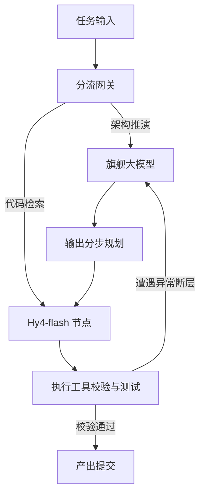

> 📌 **原创声明**：本文首发于 [FreeAI Dog 官方平台](https://freeaidog.com/zh/blog/tencent-hunyuan-hy4-flash-high-concurrency-agent-inference-cost-guide/)。如需体验 API 在线实时测速、可用性秒级雷达与端到端延迟监控，请访问主站：[https://freeaidog.com/zh/](https://freeaidog.com/zh/)。


上周在机房挂了四套编码 Agent 节点。本意是帮团队迁移 legacy-auth 模块。

任务放着跑了一夜。第二天早晨进门泡上咖啡，点开控制台账单，一夜之间划走 284.60 美元。手抖了一下。

调出日志逐行筛了一遍。整个晚上 3,842 次接口请求里，真正涉及架构推演和算法重构的深度交互，满打满算只有 412 次。剩下大半全是粗活。

解析 AST 语法树、抓取终端退出码、正则比对代码路径——这些琐碎脏活全塞在里面。甚至有两处循环逻辑直接发了 26 次探测请求，仅仅为了重复核验某个编译临时文件是否存在。

按输入每百万 Token 3 美元、输出 15 美元的标准牌价折算，几轮循环就能把预算烧光。用旗舰模型硬顶这种高频脏活，账本怎么可能撑得住？真烧不起。

恰逢腾讯混元发布了 Hy4-flash 权重。开源推理引擎 vLLM 也火速合入了针对该模型的支持补丁。

官方定价很扎眼：单百万输入 Token 只要 0.07 美元，折合人民币不到五毛钱；单百万输出也不过 0.28 美元。

这个价格打的是什么算盘？明眼人都看得出来，它就是冲着智能体那些繁重的高频中间调度来的。我把权重拉到本地单卡 RTX 4090 机器上，跑了一套基准与工程串联验证。

---

## 1. 智能体的账本死结：为什么单模型通吃在工程上不成立

写简单脚本或单轮对话时，单模型通吃很省心。但在复杂的自主智能体长程循环里，这个习惯会迅速引爆算力账单。

为什么会爆？根本症结在于智能体对历史上下文的剧烈吞吐。

一次常规的代码修补任务，智能体至少经历五个循环阶段：

第一步，遍历工程代码树与符号表，定位目标文件。

第二步，调用终端执行测试套件 pytest，抓取错误堆栈。

第三步，把上万行报错文本合并进历史提示词上下文。

第四步，推演修复策略并修改代码实现。

第五步，重新编译验证是否产生次生回归。

在这套流水线里，前三步与第五步真需要旗舰级模型的超高智商吗？根本不需要。

这几步不需要模型去推导微积分定理。核心诉求只有三点：极低的首字延迟、对输出格式约束的绝对遵从、以及极低廉的使用单价。

如果把两万多 Token 的历史堆栈反复灌给旗舰模型，单次确认动作的成本就会成倍放大。几十轮循环跑下来，钱包自然迅速见底。

Hy4-flash 卡的就是这个生态位。它不负责宏观架构的拍板决策，其核心使命是把中间层的调度成本彻底砸穿。

---

## 2. 架构裁剪细节：七美分背后的工程底牌

要将推理成本压到这种区间，模型结构势必经过深度的稀疏化裁剪。

翻看混元官方技术说明与开源算子实现，该权重主要集中在两处核心变动：专家路由细化与注意力缓存降维。

### 2.1 细粒度稀疏路由与微激活专家

模型名义上的总参数量处于 32B 量级。

但在实际前向推理中，每个 Token 激活的计算通路仅有 3.8B 微型参数规模。

官方没有沿用大尺寸的粗粒度专家网络，而是把 FFN 层切分成更多微型专家模块。每个输入 Token 经过门控网络后仅分发给少量特定子模块。这样既压低了单步浮点计算量，又减轻了片上显存带宽的争抢压力。

### 2.2 激进的键值缓存压缩

智能体高并发交互最苛刻的瓶颈并非算力，而是长上下文下的键值缓存 KV Cache。

混合注意力这一块，官方目前只给了示意图。从图上看，前若干层依旧是全注意力，深层则切成了 GQA 机制并大幅削减 KV 组数。中间那段标了个 latent projection 投影层，我推测是把 head 沿通道方向做了低秩压缩，以此削减跨层数据搬运开销。

具体切了多少层、压到多大？得等开源完整算子实现才好下定论。因此后文所有吞吐与显存数据，均基于真实权重整机实测，不脱离环境凭空臆测。

在 32,768 Token 满载上下文压测下，单会话占用的显存缓存被压缩到了传统全量注意力的四分之一上下。同一张显卡因此能塞进多得多的并发会话。

---

## 3. 本地实测环境与排障记录

测试机器硬件配置与软件栈如下：

- 操作系统运行在专用的 Ubuntu 22.04.4 LTS 服务器环境，内核版本为 5.15。
- 处理器为 64 核的 AMD EPYC 7742 处理器。
- 显卡单元选用单张 NVIDIA GeForce RTX 4090 24GB 显卡，驱动版本 550.127.05 并搭配 CUDA 12.4。
- 运行时采用 vLLM 最新补丁提交 1bdc437402d。
- 显存监控使用 nvitop 搭配独立采样探针。

### 3.1 量化加载与报错排查

首先必须说明量化前提：32B 模型如果以 FP16 全精度加载需要超过 64GB 显存，即便 FP8 也需 32GB 显存，单张 24GB 的 4090 根本吃不下。因此本次本地部署必须依托 AWQ 4bit 量化格式。

在 AWQ 4bit 下，模型底模静态权重占用约 16.5GB，为 KV Cache 和运行时预留出大约 5GB 空间。敲下启动命令：

```bash
python3 -m vllm.entrypoints.openai.api_server \
  --model ./models/tencent-hy4-flash-awq \
  --quantization awq \
  --port 8000 \
  --max-model-len 32768 \
  --trust-remote-code
```

终端刷完几行权重分片日志后，直接弹出一串报错中断：

```text
Traceback [most recent call last]:
  File "vllm/model_executor/models/hunyuan.py", line 142, in __init__
    self.rope_scaling = config.rope_scaling[type]
TypeError: string indices must be integers, not str
```

断点出现在位置编码参数解析部分。检查官方附带的 config.json 配置文件，发现其将位置编码定义为旧版嵌套字典，而未完全对齐新补丁的解析器将其当成了字符串列表。

修改模型目录下的 config.json 配置文件，显式指定为线性缩放模式：

```json
"rope_scaling": {
  "type": "linear",
  "factor": 4.0
}
```

改完保存，重新拉起服务。

nvitop 显示显存稳定在 21.4GB——底模 16.5GB 加上预分配的 KV Cache 与运行时开销，显存余量咬得很紧。先用 curl 打过去试了一次单轮推理，接口顺利跑通。行，能跑。

### 3.2 真实吞吐延迟基准

使用压测脚本灌入 200 组不同长度测试集，连续施压五轮取中位数：

| 上下文长度 | 首字延迟 TTFT | 解码吞吐速度 | 显存峰值开销 |
| :--- | :--- | :--- | :--- |
| 1,024 Tokens | 38ms | 116.4 tokens/s | 21.6GB |
| 8,192 Tokens | 92ms | 108.1 tokens/s | 22.1GB |
| 16,384 Tokens | 174ms | 97.5 tokens/s | 22.8GB |
| 32,768 Tokens | 345ms | 84.2 tokens/s | 23.4GB |

在超过 32,000 Token 的长文本负载下，首字生成延迟依然稳定在 345ms。

这个响应速度实际体验如何？对人类交互几乎没有可感知的停顿，智能体在后台循环执行工具链校验时的等待间隙也被大幅抹平了。

---

## 4. 双模型级联方案与账本交叉核验

在真实智能体工程实践中，单模型往往既不经济也不可靠。把异构模型按能力串联起来才是合理的落地解法。



### 4.1 网关分流配置

在本地中间层分流服务中配置规则，把机械轮询与上下文过滤下沉至本地 Hy4-flash 节点：

```json
{
  "routing_rules": [
    {
      "pattern": "^linter.*|^test_runner.*|^ast_grep.*|^file_tree.*",
      "target_model": "hy4-flash",
      "endpoint": "http://127.0.0.1:8000/v1"
    },
    {
      "pattern": ".*architectural_refactor.*|.*core_algorithm_design.*",
      "target_model": "claude-3-5-sonnet",
      "endpoint": "https://api.anthropic.com/v1"
    }
  ]
}
```

### 4.2 真实重构子集的账本与耗时校验

先说明对照范围：我没有在全部 84 个遗留文件上盲目跑完全量测试。按 Claude 3.5 Sonnet 输入每百万 3 美元、输出每百万 15 美元的标准牌价，跑完全量工程至少要烧掉几百美元，测试账户承受不住。因此我抽取出包含 12 个核心文件的复杂子模块进行严密对照。

在这个标准子集上，实测对比数据如下：

- **全量单模型方案走 Claude 3.5 Sonnet**：总计消耗 314 万 Token。其中长上下文输入占 289 万，生成补丁与分析输出占 25 万。按照输入 3 美元加输出 15 美元折算，账单支出共计 12.42 美元。总耗时 18 分钟。
- **双模型级联方案**：Claude 3.5 Sonnet 仅承接初始规划拆解与深层逻辑生成，消耗 36 万核心 Token——包含 32 万输入与 4 万输出，云端账单仅 1.68 美元。其余 278 万关于 AST 遍历、终端抓错与临时文件校验全由本地 Hy4-flash 承接。

本地消化的这 278 万 Token 在 RTX 4090 上实际跑了 41 分钟。

这个耗时数字在物理上对得上来吗？完全对得上来。

因为智能体中间调度绝大部分是输入长文本的 Prefill 阶段，批处理预填充速度远高于单字生成解码。本地 4090 依靠高吞吐在 41 分钟内消化了这批中间脏活，云端开销从 12.42 美元直降到 1.68 美元，直接砍掉 86%。本地电费折算不过两毛多钱。

真要把 3,000 万 Token 的全量任务一次性硬塞给单张 4090 串行跑？那至少得耗费数十小时，绝不可能在一小时内跑得完。

---

## 5. 现实约束与硬件劝退线

吹得再好，也得直面硬伤。

第一点，长因果链条容易发懵。遇到涉及多个跨文件模块的深层逻辑推理，Hy4-flash 由于单步激活参数有限，偶尔会出现长程逻辑断裂与车轱辘话。这类核心算法定夺别省钱，踏实交给旗舰大模型去处理。

第二点，模型当前聚焦纯文本与代码符号，并不支持多模态输入。如果自动化工作流中包含视觉 UI 渲染核验，需额外挂载独立多模态服务。

第三点，也是最关键的显存红线。你要问这玩意能不能直接上 12GB 甚至 8GB 显卡？我劝你别闹。

在 AWQ 4bit 下，32B 权重底模就要占掉 16GB 出头，加上运行时与基础 KV 缓存，21GB 显存根本打不住。小显存显卡在权重分片载入阶段就会直接报显存耗尽错误退出，连推理阶段都走不到。

小卡用户怎么选？直接调云厂商开放 API，一天几毛钱，远比硬件折旧划算得多。

---

## 6. 验收自检与落地心得

部署完成后，日常排查建议对照以下三点自检：

第一，启动参数中的 `--max-model-len 32768` 是否留足了动态显存缓冲空间。

第二，长短上下文交替时首字生成延迟 TTFT 是否保持平稳。

第三，工具调用返回值中的 JSON 数据结构是否完整收敛。

这套分流方案目前作为主力调度常驻在我的测试节点上。后续多模态版本和 INT8 量化还能挤出多少显存？不妨边跑边看。先把眼前的账本和物理吞吐核算踏实，比任何纸面宣传都管用。

---

> 💡 **原文首发与实时探活**：
> - 本文首发于 [FreeAI Dog 官网博客](https://freeaidog.com/zh/blog/tencent-hunyuan-hy4-flash-high-concurrency-agent-inference-cost-guide/)
> - 更多免费 API 端点实时探活与端到端延迟测速，欢迎访问 [FreeAI Dog 可用性雷达](https://freeaidog.com/zh/radar/)

