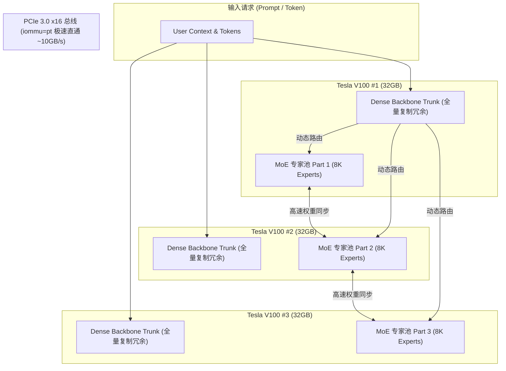

> 📌 **原创声明**：本文首发于 [FreeAI Dog 官方平台](https://freeaidog.com/zh/blog/v100-dell-r740-400tps-qwen-volta-engine-guide/)。如需体验 API 在线实时测速、可用性秒级雷达与端到端延迟监控，请访问主站：[https://freeaidog.com/zh/](https://freeaidog.com/zh/)。


# 2500 美元跑 400 t/s！硬核老哥魔改 Strata 重构 Volta 内核：3 张 V100 + 二手 R740 捡垃圾逆袭指南 (附 iommu=pt 极速秘籍与 BOM 清单)

在本地部署超大规模 MoE 大模型（如 Qwen 系列、DeepSeek、Llama 100B+）的讨论中，主流玩家往往被两大痛点所裹挟：
1. **显存预算高昂**：想要 80GB~96GB 的大显存，要么买 4 张 24GB 的 RTX 3090/4090 组联排火炉，要么花数十万元采购全新的专业计算卡；
2. **多卡通信惨遭卡脖子**：在非 NVLink 的普通 PCIe 双路老服务器上跑多卡张量并行（Tensor Parallelism），层间通信开销巨大，常常越加卡速度越慢。

然而，近日在 Reddit r/LocalLLaMA 社区，一位名叫 **u/jfinkpottery** 的硬核极客发布了一项震撼社区的逆袭实验：
**他用总共花费仅 2,530 美元（约合 1.8 万元人民币）的二手服务器与老卡组合，通过自建重写 Volta 架构推理内核，并破解了一个关键的 Linux 内核参数，让 3 张老迈的 Tesla V100 跑出了惊人的 400 t/s Decode 峰值吞吐，长上下文 Prefill 更是飙升至 3,400 t/s！**

这项成果不仅彻底盘活了二手数据中心海量、廉价的 **Tesla V100 32GB**（如今单张二手只需约 \$600），更为所有预算有限但追求百亿、千亿级大模型高吞吐的个人开发者与中小团队提供了一张可以直接照抄的作业！

今天，我们将深度拆解这位老哥的全部核心技术魔改、系统级加速秘籍与完整的硬件装机 BOM 清单。

---

## 一、 为什么是 Tesla V100？2500 美元的“真香”算力账本

很多朋友会问：V100 毕竟是 2017~2018 年 Volta 架构的老卡了，不支持现代的 FP8 / FP4 精度，为什么在 2026 年还能爆发出如此恐怖的战力？

答案就在于**显存带宽与极致性价比**：

* **单卡 32GB HBM2 极速显存**：3 张 V100 组成了高达 **96GB 的总显存容量**，且单卡显存带宽高达 **900 GB/s**（远超 DDR4/DDR5 系统内存，甚至强于许多普通 GDDR6 显卡）；
* **极度便宜的企退存量**：随着全球超算中心升级，大量的 Tesla V100 32GB PCIe 版退役流入二手市场，单卡仅需约 \$600；
* **企业级机架服务器白菜价**：像经典的 Dell PowerEdge R740（支持双路 Xeon、具备丰富 PCIe 槽位与工业级散热），准系统准机二手仅需 \$500 左右。

### 硬件成本明细表 (Total BOM: ~$2,530)

| 配件名称 | 规格型号 | 数量 | 参考单价 | 小计金额 |
|---|---|---|---|---|
| **GPU 计算卡** | NVIDIA Tesla V100 32GB PCIe 版 | 3 张 | \$600 | **\$1,800** |
| **服务器主机** | Dell PowerEdge R740 (双路 Xeon + BOSS M.2 PCIe 卡) | 1 台 | \$500 | **\$500** |
| **系统内存** | DDR4 16GB 2666MHz ECC 寄存内存 | 2 条 (32GB) | \$65 | **\$130** |
| **系统引导盘** | M.2 SATA SSD 512GB (安装于 BOSS 卡) | 1 块 | \$100 | **\$100** |
| **总计成本** | **96GB HBM2 大显存整机** | — | — | **\$2,530** (约 ¥18,000) |

> [!NOTE]
> 对比一块全新的 RTX 4090 24GB（目前市场售价普遍超过 \$2,000 / ¥1.6万），这套整机以相近的预算直接拿下了 **96GB 的超大显存池**，可以轻松以 Q4_XL 量化规格将数百亿参数的 MoE 模型全量驻留显存！

---

## 二、 破局关键：从 0.2 GB/s 到 10 GB/s 的 Linux 内核级秘籍

在硬件组装完成后，作者最开始遭遇了所有双路 Xeon 服务器玩家都经历过的噩梦：**跨卡 PCIe 通信极度缓慢**。

最初有 AI 助手误导作者说：“双路 Xeon 架构在非 NVLink 情况下，跨 CPU Socket 的 PCIe 传输极限就是 0.2 GB/s”。如果跨卡带宽只有 200MB/s，任何多卡并行方案都会被死死扼杀在通信瓶颈上。

但作者通过底层排查，终于揪出了元凶：**Linux 的 IOMMU（输入输出内存管理单元）机制！**

在默认开启 IOMMU 的 Linux 内核中，PCIe 设备间的 DMA 访问需要经过虚拟化地址翻译层，这在多路服务器高频跨卡通信时会产生灾难性的 CPU 翻译锁竞争。

### 极速解药：`iommu=pt` (Pass-Through) 直通模式

作者在 GRUB 启动参数中仅仅加上了 `iommu=pt`：

```bash
# 1. 打开 GRUB 配置文件
sudo nano /etc/default/grub

# 2. 在 GRUB_CMDLINE_LINUX 追加 iommu=pt
GRUB_CMDLINE_LINUX="... intel_iommu=on iommu=pt pci=realloc"

# 3. 更新引导并重启系统
sudo update-grub
sudo reboot
```

**奇迹发生了：**
* 跨卡双向带宽直接从 **0.2 GB/s 暴涨到 ~10 GB/s**，整整暴涨了 **50 倍**！
* 这个参数指示内核：仅对虚拟化客户机执行 IOMMU 映射，宿主机物理驱动直接直通硬件物理地址，彻底消除了内存翻译开销！

> [!TIP]
> **可迁移的黄金经验**：
> 无论你是折腾 Tesla V100、P40，还是 RTX 3090/4090 多卡 PCIe 深度学习平台，只要你在双路服务器（Dell R730/R740、HP DL380 等）上遇到多卡传输延迟畸高的问题，**第一件事就是检查并开启 `iommu=pt`**！

---

## 三、 软件灵魂：拆解 Strata 并为 Volta 重构专属并行引擎

市面上最新的开源项目 **Strata** 原生只适配了 Ampere/Ada/Hopper（RTX 30/40/50 系列）架构，由于 Volta 缺少现代 Tensor 核心指令，直接在 V100 上运行会报错或降级为纯 CPU 模拟。

于是，作者直接 Fork 了 Strata 的源码，针对 Volta 硬件特性与 MoE 结构进行了底层外科手术式的重构：



### 1. 专家并行 (Expert Parallelism) + Dense Trunk 冗余复制
* **专家分片**：将超大 MoE 模型的成千上万个专家（Experts）均匀分布到 3 张 V100 上；
* **骨干网络每卡复制一份（Dense Trunk Redundancy）**：模型的注意力（Attention）与 Dense 主干网络在 3 张卡上各自常驻完整副本。虽然浪费了一小部分显存，但**完全避免了主干网络跨卡传输的通信等待**；
* 专为 **Batch Size = 1 的日常个人推理解码**进行了极端优化。

### 2. 实测性能成绩单 (Q4_XL 量化规格)

| 测试指标 | 实测性能表现 | 备注与工况分析 |
|---|---|---|
| **Decode 极限峰值** | **400 t/s** | 针对特定重复结构/高命中负载下的理论上限 |
| **Decode 新散文生成** | **~140 t/s** | **日常真实复杂问答与长文本写作的稳定速度** |
| **Prefill 吞吐 (3 卡)** | **~3,400 t/s** | 长上下文下的提示词极速处理 |
| **Prefill 吞吐 (2 卡)** | **~2,800 t/s** | 2 卡负载下的基准表现 |

相比原生 Strata 在相同硬件上的缓慢表现，这套定制内核在长上下文 Prefill 和单批次 Decode 上拉开了巨大的代际差距。即便是日常稳态的 **140 t/s**，也足以在不到 1 秒钟内喷出整整一段完整代码！

---

## 四、 硬件实操避坑与多卡拓扑排错指南

如果你也想淘一套 Dell R740 + V100 自己折腾，务必牢记以下几点工业级踩坑经验：

### 1. 散热与供电：被动散热卡的风道改造
Tesla V100 是纯被动散热的数据中心计算卡，本身没有自带小风扇：
* **必须依靠机箱风道**：在 Dell R740 中，务必合上顶部风道导流罩，并在 iDRAC 控制台中将风扇最低转速（Fan Minimum Speed）提高至 **45%~60%**，否则开机 2 分钟核心温度就会破 90℃ 触发热保护降频；
* **供电线序**：V100 PCIe 版采用 8-pin CPU/PCIe 供电接口，购买转接线时务必选用 Dell 原装或优质定制的 PCIe 供电套件。

### 2. 检查多卡拓扑结构
系统装好后，在终端运行以下命令，检查 GPU 间的连接拓扑：
```bash
nvidia-smi topo -m
```
* 如果显示 **`SYS`**（跨 CPU Socket 且经主板芯片组），跨卡延迟最高；
* 如果显示 **`PHB`** 或 **`PIX`**（走同单个 CPU 或同一 PCIe 根桥），则延迟最低；
* 务必把 3 张卡插在 R740 对应的 Riser 卡槽中，尽量均衡分配给 CPU1 与 CPU2。

### 3. 目前已知限制（作者诚实披露）
* **显存异构限制**：目前的魔改引擎要求卡池规格一致（必须全是 32GB 版本），不支持 32GB 与 16GB 混插；
* **拒绝 CPU 卸载**：如果模型太大溢出到 CPU 内存（CPU Offload），速度会立刻断崖式下跌，失去 400 t/s 的高吞吐优势。

---

## 五、 总结与思考

在硬件厂商不断通过“制造显存焦虑”来兜售高价新品的当下，u/jfinkpottery 的硬核探索给我们带来了极其宝贵的启示：

**大模型推理的瓶颈往往并不在硬件的绝对算力上，而在系统软硬件结合的调优深度上。** 一个正确的 Linux 内核直通参数（`iommu=pt`），一套因地制宜的 MoE 专家并行调度策略，就能让 8 年前的“老旧”计算卡在 2026 年重新焕发出比肩当代顶配平台的惊人战力。

对于所有追求性价比、喜欢动手折腾的极客来说，花 \$2500 淘一台 96GB HBM2 的服务器跑上 140~400 t/s 的超大模型，或许才是真正纯粹的极客浪漫！

---

> 💡 **原文首发与实时探活**：
> - 本文首发于 [FreeAI Dog 官网博客](https://freeaidog.com/zh/blog/v100-dell-r740-400tps-qwen-volta-engine-guide/)
> - 更多免费 API 端点实时探活与端到端延迟测速，欢迎访问 [FreeAI Dog 可用性雷达](https://freeaidog.com/zh/radar/)

